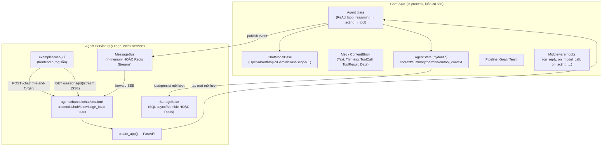

# High-Level Design — `agentscope`

> Nguồn: `/home/lamhung/code/agentscope`
> Khác biệt căn bản với 3 dự án đã khảo sát trước (`ai_agent`, `full-stack-ai-agent-template`, `fastapi-langgraph-agent-production-ready-template`): đây **không phải** một app FastAPI+LangGraph cụ thể, mà là **AgentScope 2.0** — một **SDK/thư viện Python** (`pip install agentscope`) để xây dựng LLM agent, do SysML team (Alibaba Tongyi Lab) phát triển, Apache-2.0, yêu cầu Python ≥3.11.

## 1. Tổng quan

AgentScope 2.0 có 2 lớp đóng gói trong cùng 1 package:

1. **Core SDK** (`src/agentscope/agent`, `model`, `message`, `event`, `state`, `pipeline`, `tool`, `middleware`, `rag`, `workspace`, ...) — runtime agent chạy in-process (class `Agent` + vòng lặp reasoning/acting), dùng độc lập được (vd chạy qua terminal bằng `launch_console`).
2. **Agent Service** (`src/agentscope/app/*`, cài qua extra `service`: fastapi, uvicorn, apscheduler, ag-ui-protocol, aiortc) — một **backend FastAPI đóng gói sẵn** ("agent service") kèm frontend web dựng sẵn (`examples/web_ui`), biến SDK thành ứng dụng web multi-tenant, multi-session, có persistence. **Đây chính là lớp trả lời cho các câu hỏi về chat/streaming.**

### Lineage quan trọng
Đây là **bước nhảy (breaking change) từ AgentScope 1.0/0.x** (arXiv 2402.14034). `docs/changelog.md` ghi rõ: "❌ Deprecate distribution functionality momentarily, a new distribution module is coming soon." Lớp distributed/actor-model RPC cũ (`RpcAgent`, `to_dist`) và **AgentScope Studio** cũ (web monitor của bản 0.x) **đã bị xoá hoàn toàn** trong codebase này (grep rỗng). Thay thế bằng "Agent Service" + `examples/web_ui` mới.

## 2. Tech stack

| Nhóm | Thành phần |
|---|---|
| LLM SDK | `anthropic`, `openai`, `dashscope` (Alibaba) + extras: Gemini, Ollama, xAI, DeepSeek/Moonshot/Volcengine/MiniMax built-in |
| Giao thức tool/context | `mcp>=2.0.0` (Model Context Protocol) |
| Core runtime | hoàn toàn **async** (`Agent.reply`/`reply_stream` là `async def`, model call async) |
| Tracing | `opentelemetry-*` tích hợp sẵn |
| Agent Service (`service` extra) | FastAPI, uvicorn, apscheduler, `ag-ui-protocol`, `aiortc` (voice/WebRTC) |
| Storage (`storage-sql`) | SQLAlchemy 2.0 async + Alembic (driver do người dùng chọn) |
| Storage (`storage-redis`) | redis |
| Storage (`storage-s3`) | aioboto3 |
| Channel | lark-oapi, discord.py, dingtalk-stream |
| Workspace sandbox | Docker, E2B, Daytona, K8s, Apple Container, Bubblewrap, OpenSandbox |
| Realtime voice | `websockets` |
| TUI | `textual` |
| Agent-to-agent | `a2a-sdk` (Agent2Agent protocol) |
| RAG / Vector DB | Qdrant, Milvus, MongoDB, Elasticsearch |

## 3. Kiến trúc tổng quan (2 lớp)

- **Core SDK không phụ thuộc web framework nào** — dùng trực tiếp class `Agent`, nhận `async for event in agent.reply_stream(inputs)`, tự quyết định cách đẩy ra ngoài (terminal, hoặc tự viết WebSocket/SSE riêng).
- **Agent Service** là lớp serving hoàn chỉnh, đóng vai trò tương tự "LangGraph Platform" đối với LangGraph — nhưng là **self-hosted**, không phải managed SaaS.

## 4. Streaming — kiến trúc sự kiện thống nhất

Ở tầng model: `ChatModelBase.__call__(...) -> ChatResponse | AsyncGenerator[ChatResponse, None]` (constructor có `stream: bool = True`) — mọi provider wrapper đều theo đúng hợp đồng này.

Ở tầng agent: các chunk stream được chuyển thành **1 bộ event đã chuẩn hoá** (`src/agentscope/event/_event.py`): `ReplyStartEvent`, `ModelCallStartEvent`/`ModelCallEndEvent`, bộ ba Start/Delta/End cho `TextBlock`, `ThinkingBlock`, `ToolCall`, `ToolResult`, `DataBlock` (đa phương thức), cộng `HintBlockEvent`, `RequireUserConfirmEvent`/`UserConfirmResultEvent` (HITL), `UserInterruptEvent`, `ExceedMaxItersEvent`, `ReplyEndEvent`, `CustomEvent`.

→ Consumer chỉ cần `async for event in agent.reply_stream(inputs): ...` để nhận stream sự kiện **có kiểu rõ ràng**, không phải raw text delta — đây là điểm khác biệt lớn so với 3 dự án FastAPI+LangGraph đã khảo sát (vốn tự định nghĩa vocabulary sự kiện riêng theo từng dự án).

## 5. Agent Service — Topology & giao thức

- `POST /chat/` — **fire-and-forget**: spawn chat run dưới dạng background task qua `ChatRunRegistry` (trả 409 nếu session đó đang chạy), **trả về ngay lập tức, không trả event trong body**.
- `GET /sessions/{session_id}/stream` — endpoint **SSE** dài hạn (`media_type="text/event-stream"`) mà client thực sự dùng để nhận event: subscribe kênh theo session trên `MessageBus`, replay lại log sự kiện đã lưu của session, sau đó forward sự kiện live, có heartbeat 30s (`:\n\n`) để sống sót qua idle timeout của reverse proxy.
- `MessageBus` (`src/agentscope/app/message_bus/`) — abstraction pub/sub + durable log, 2 implementation: `_in_memory_message_bus.py` (1 process) và `_redis_message_bus.py` (Redis Streams — multi-process/multi-node). Cung cấp `publish`/`subscribe` (live), `log_append`/`log_read`/`log_trim` (log sự kiện replay được theo session), `acquire_lock`/`try_lock` (distributed lock), `registry_*` (KV bền vững nhỏ cho HITL projection/checkpoint cursor), và nguyên thuỷ run-lock/cancel theo session.

## 6. Persistence (tóm tắt, chi tiết ở LLD)

- **Core SDK không sở hữu persistence nào** — `AgentState` chỉ là pydantic `BaseModel` serializable, nhưng class `Agent` không có `.save()`/`.load_state()`.
- **Agent Service mới là nơi AgentScope thật sự cung cấp persistence**: `StorageBase` (SQL async/Alembic hoặc Redis) lưu nguyên khối `AgentState` theo từng session, đọc/ghi quanh mỗi lượt chat.

## 7. Distributed / Scale (tóm tắt, chi tiết ở LLD)

**Không còn runtime distributed/actor-model nào cho bản thân agent** (tính năng RPC/actor của bản 0.x/1.x đã bị deprecate và chưa có module thay thế). Khả năng chạy đa process/đa node chỉ tồn tại ở **tầng Agent Service**: `MessageBus` (bản Redis) cung cấp distributed lock + event log dùng chung + SQL/Redis storage dùng chung — đây là **lớp điều phối cho các worker app stateless chạy song song**, không phải hệ thống actor/object phân tán.

## 8. Tài liệu liên quan

- `agentscope-LLD.md` — chi tiết class `Agent`, `AgentState`, Pipeline, Agent Service routers, MessageBus, Storage.
- So sánh trực tiếp 5 tiêu chí (giao thức, server, resume khi reload, state, scale) với `ai_agent`/`full-stack-ai-agent-template`/`fastapi-langgraph-agent-production-ready-template` — xem phần trả lời trong hội thoại hoặc file so sánh riêng nếu được tạo.
