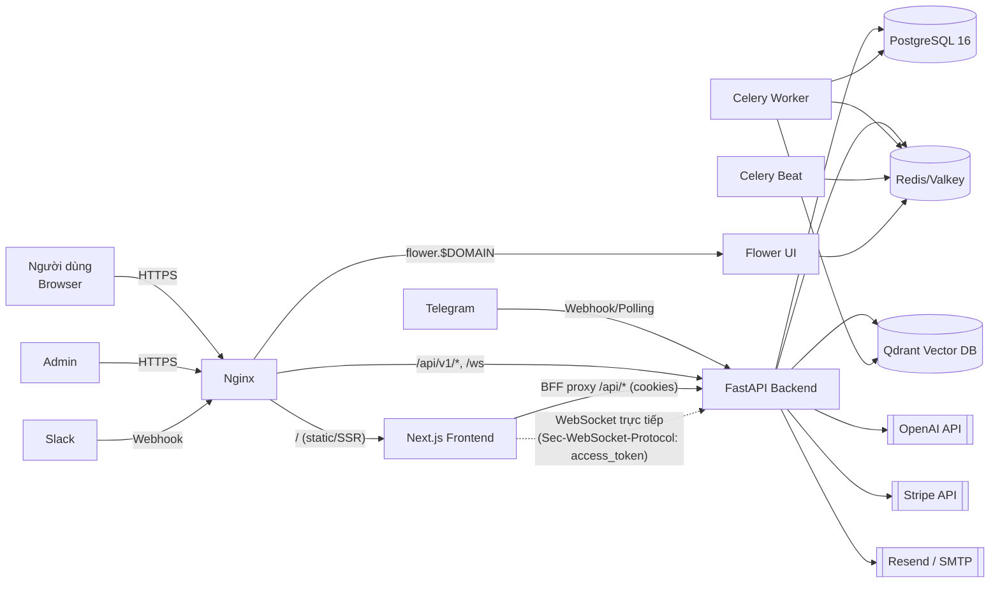

# High-Level Design — `ai_agent`

> Nguồn: `/home/lamhung/code/ai_agent`
> Tài liệu này mô tả kiến trúc ở mức cao (system context, topology, luồng dữ liệu chính). Xem `ai_agent-LLD.md` cho chi tiết module/API/DB.

## 1. Tổng quan hệ thống

`ai_agent` là một **SaaS đa tổ chức (multi-tenant) cho chat với AI agent**, được sinh ra (generate) từ template `full-stack-ai-agent-template` (xem tài liệu riêng), sau đó được mở rộng đáng kể.

Chức năng chính:
- Người dùng chat với AI agent qua **WebSocket** thời gian thực (streaming token-by-token).
- Agent có thể gọi **tools**: web search, fetch URL, RAG (tìm kiếm tài liệu nội bộ), tạo biểu đồ.
- Hội thoại được lưu trữ bền vững trong PostgreSQL.
- Tài liệu có thể được ingest vào **knowledge base** (RAG) dựa trên Qdrant (vector DB).
- **Billing** theo credit, tích hợp Stripe (subscription + usage-based).
- **Kênh bên ngoài**: Slack, Telegram bot relay vào cùng agent.
- Admin panel, audit log, usage analytics, rate limiting.

## 2. Tech stack

| Lớp | Công nghệ |
|---|---|
| Backend framework | FastAPI (Python 3.12), Pydantic v2, `pydantic-settings` |
| ORM / Migration | SQLAlchemy 2.0 (async, `Mapped[]`), Alembic |
| Database | PostgreSQL 16 (asyncpg runtime, psycopg2 cho Alembic) |
| Cache / Queue broker | Redis (image `valkey`) |
| AI framework | LangGraph + LangChain (`langchain_openai.ChatOpenAI`) |
| Vector DB / RAG | Qdrant, OpenAI embeddings (`text-embedding-3-large`), reranker tuỳ chọn (Cohere), PDF parsing (LlamaParse/LiteParse/PyMuPDF) |
| Background jobs | Celery + Celery Beat + Flower |
| Billing | Stripe (checkout, portal, webhook, credit ledger) |
| Auth | JWT (HS256), bcrypt, API key header, Google OAuth2 |
| Observability | Sentry, Prometheus (`prometheus-fastapi-instrumentator`), structured logging |
| Admin UI | SQLAdmin (chỉ bật ở dev/staging) |
| Frontend | Next.js 15 (App Router), React 19, TypeScript strict |
| Frontend state | Zustand 5 (client state), TanStack React Query 5 (server-state cache) |
| Frontend UI | Tailwind CSS v4, Radix UI, `lucide-react`, `recharts` (dashboard), `react-leaflet` (map tool) |
| i18n | `next-intl` (en/pl) |
| Testing | pytest (backend); Vitest + Testing Library + Playwright (frontend) |
| Hạ tầng | Docker Compose (dev/stage/prod), Nginx (reverse proxy + TLS + WS upgrade), GitLab CI |

> Lưu ý: mặc dù tên template gợi ý "AI Elements" (Vercel AI SDK), dự án thực tế **không dùng `ai-sdk`** — UI chat và streaming được viết tay (custom WebSocket hook + Zustand store + markdown renderer).

## 3. System Context Diagram



## 4. Docker Compose Topology

### Dev (`docker-compose.yml` / `docker-compose.dev.yml`)
Một network bridge `backend` chung, chứa:
- `app` — FastAPI, port 8000, `--reload`, mount `./backend/app` read-only.
- `db` — `postgres:16-alpine`, port 5432.
- `redis` — `valkey/valkey:9-alpine`, port 6379.
- `qdrant` — `qdrant/qdrant:v1.19.2`, port 6333/6334.
- `celery_worker`, `celery_beat` — nền tảng background task.
- `flower` — dashboard giám sát Celery, port 5555.

### Prod (`docker-compose.prod.yml`)
- Network nội bộ `backend-internal` (db/redis/qdrant **không** publish port ra ngoài).
- `app` chạy `uvicorn --workers 4`.
- `celery_worker` có `replicas: 2`.
- Redis yêu cầu password; Flower có basic auth.
- Thêm service `frontend` (Next.js, biến `NEXT_PUBLIC_*` được bake vào lúc build image, port 3000).
- Giới hạn CPU/memory (`deploy.resources`) cho từng service.

### Nginx (`nginx/nginx.conf`)
3 server block HTTPS:
1. `api.$DOMAIN` → proxy `/api/v1/ws` (WebSocket, header Upgrade) + các route còn lại tới `backend:8000`.
2. `$DOMAIN` → proxy tới `frontend:3000` (có passthrough `/_next/webpack-hmr` cho dev).
3. `flower.$DOMAIN` → proxy tới `flower:5555`.

Kèm HTTP→HTTPS redirect, Let's Encrypt ACME path, security headers chuẩn.

## 5. Luồng dữ liệu chính

### 5.1 Chat real-time (WebSocket)
```
Browser --(WS, Sec-WebSocket-Protocol: access_token.<jwt>)--> Backend /ws/agent
  → xác thực user (get_current_user_ws)
  → AgentSession (services/agent_session.py)
      → resolve knowledge-base collections được phép truy cập
      → LangGraphAssistant.stream() → graph.astream(stream_mode=["messages","updates"])
      → forward sự kiện: model_request_start, text_delta, thinking_delta,
        tool_call, tool_result, final_result, message_saved, complete/error
  → persist Message/ToolCall vào Postgres
  → (nếu bật billing) ghi nhận usage/credit
Browser cập nhật UI theo từng sự kiện (Zustand chat-store)
```

### 5.2 Request REST thông thường
```
HTTP request → api/routes/v1/*.py (validate Pydantic + Depends auth/org-scoping)
  → *Service (business rule, raise domain exception)
  → *Repository (flush, KHÔNG commit)
  → SQLAlchemy model → Postgres
  → commit/rollback tự động tại boundary của get_db_session
```

### 5.3 RAG ingestion (background)
```
Admin upload tài liệu / cấu hình sync source (Google Drive, S3, ...)
  → Celery task (worker/tasks/rag_tasks.py)
      → DocumentProcessor (parse PDF/văn bản)
      → EmbeddingService (OpenAI embeddings)
      → QdrantVectorStore (upsert vector theo collection = knowledge base)
  → SyncLog ghi nhận kết quả
Agent runtime: tool `search_documents` truy vấn Qdrant theo collection được
resolve server-side (ContextVar `_active_kb_collections`), không tin client.
```

### 5.4 Billing
```
Checkout (Stripe Checkout Session) → Stripe webhook → StripeEvent (idempotency)
  → cập nhật Subscription / CreditTransaction
Celery Beat: usage matview refresh (5 phút), low-credit alert (4h),
  trial reminder (hàng ngày), anomaly detection (15 phút)
```

### 5.5 Channel relay (Slack/Telegram)
```
Slack/Telegram message → webhook route hoặc bot polling (khởi động trong lifespan)
  → AgentInvocationService (non-streaming, graph.ainvoke)
  → trả kết quả qua channel adapter (services/channels/)
```

## 6. Bảo mật & Multi-tenancy (tóm tắt mức cao)

- **2 trục phân quyền độc lập**: `UserRole` toàn hệ thống (admin/user) và `OrgRole` theo tổ chức (owner/admin/member/viewer), resolve qua header `X-Organization-Id`.
- **Auth**: JWT access (30p) + refresh (7 ngày) + DB-backed login session (revocable), Google OAuth2, magic-link, API key (so sánh constant-time).
- **IDOR protection**: mọi query luôn scope theo `user_id`/`organization_id` ở tầng service, không tin ID client gửi lên.
- **RAG là tài nguyên dùng chung trong tổ chức** (không phải per-user riêng lẻ); chỉ admin mới được quản lý ingestion/sync.
- Chi tiết đầy đủ: xem `SECURITY.md` của dự án gốc và `ai_agent-LLD.md`.

## 7. CI/CD (tóm tắt)

GitLab CI (`.gitlab-ci.yml`): **lint** (ruff check/format, `ty check`) → **test** (pytest + Postgres/Valkey service) → **security** (`pip-audit`, allow_failure) → **build** (docker build backend image trên default branch). Hiện **chưa** có stage lint/test cho frontend trong CI (frontend test chạy local/Playwright).

## 8. Tài liệu liên quan

- `ai_agent-LLD.md` — chi tiết module, API, DB schema, LangGraph graph.
- `full-stack-ai-agent-template-HLD.md` / `-LLD.md` — kiến trúc của generator đã sinh ra dự án này.
