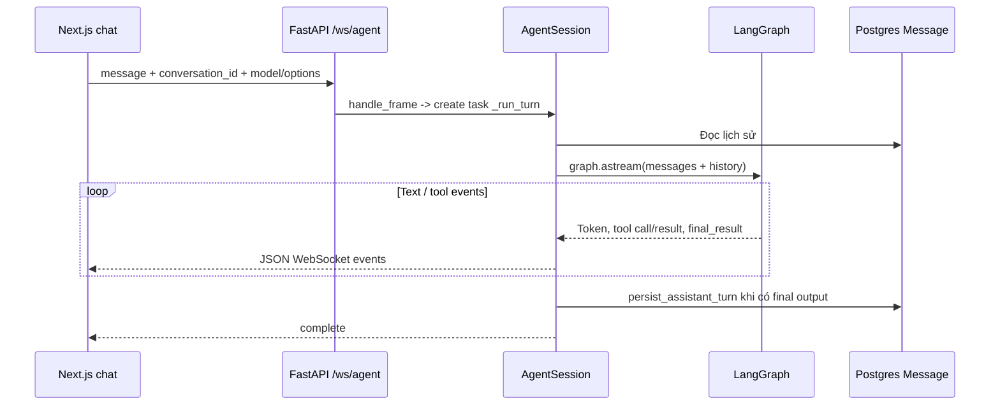
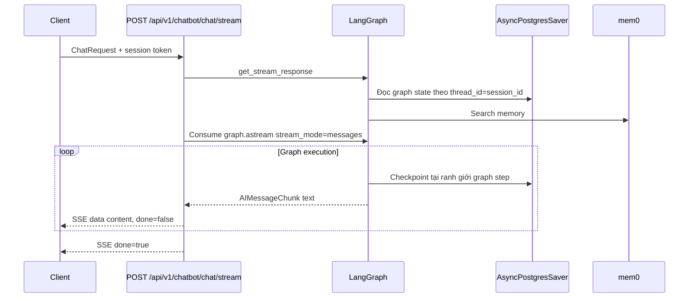
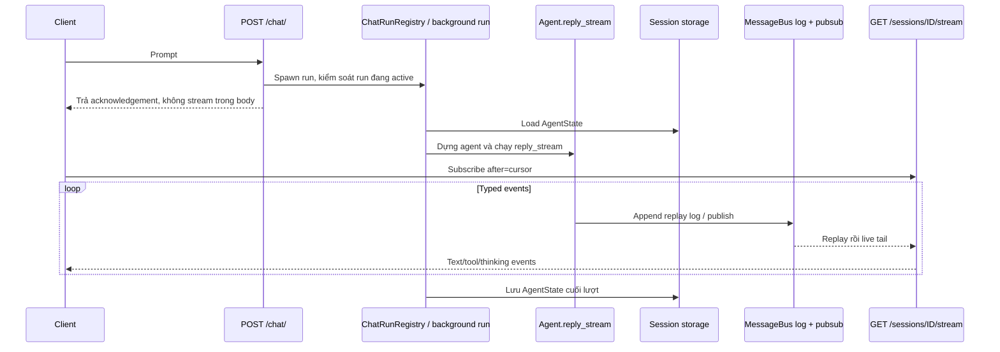
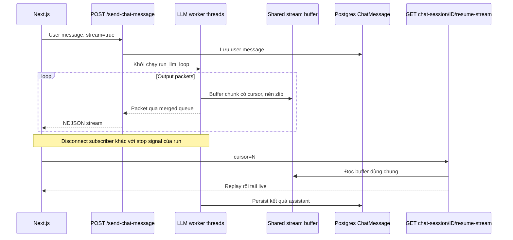
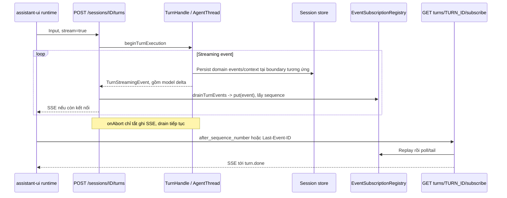
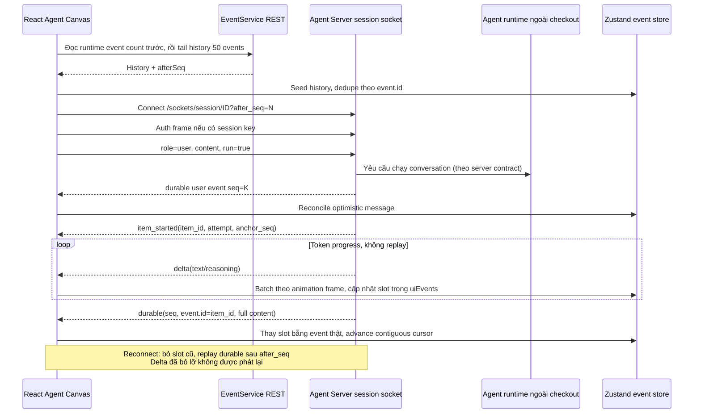

# Luồng dữ liệu khi chat — So sánh các dự án/framework

> Đối chiếu `ai_agent` / `full-stack-ai-agent-template`, `fastapi-langgraph-agent-production-ready-template`, `agentscope` (Agent Service), `onyx`, `trueforge` và **OpenHands Agent Canvas**.
> Cập nhật OpenHands ngày 22/10/2026 từ checkout `/home/lamhung/code/OpenHands`, commit `70b8f9069dec3d1c39a04d755521ebe6bd252aab`.
> Đọc kèm HLD/LLD từng dự án trong thư mục này. Đây là phân tích code local, không phải kết quả chạy load test hay kiểm chứng crash recovery.

## 1. Các khái niệm cần phân biệt

| Khả năng | Câu hỏi thực sự cần trả lời |
|---|---|
| Token streaming | Khi đang online, client nhận từng phần response bằng cách nào? |
| Execution continuity | Đóng kết nối có huỷ model/tool task không? Task do request, session hay worker độc lập sở hữu? |
| History recovery | Reload có đọc lại được message/event đã lưu không? |
| Stream replay | Delta/packet đã lỡ khi offline có được gửi lại theo cursor không? |
| Execution recovery | Server thực thi chết thì có worker khác khôi phục được turn đang chạy không? |

Năm khả năng này khác nhau. Checkpoint graph không tự tạo token replay buffer. Redis replay buffer cũng không tự khởi động lại worker bị chết. Dùng cùng một socket để gửi và nhận vẫn có thể resume tốt nếu session execution và durable log được quản lý độc lập.

## 2. `ai_agent` / `full-stack-ai-agent-template` — WebSocket cùng kênh, turn gắn với session socket

Trigger và phản hồi chung WebSocket. `AgentSession.shutdown()` gọi `_cancel_turn()`, task đang chạy bị cancel; nếu chưa tới `persist_assistant_turn`, nội dung assistant dở không được lưu qua đường persist cuối turn này. Không có log delta/cursor replay trên đường chat đã khảo sát.

LangGraph dùng `MemorySaver` theo cấu hình của dự án, nhưng history sản phẩm chủ yếu đến từ bảng `Message` đọc lại mỗi lượt; không tương đương một durable checkpointer dùng chung xuyên process.

Nguồn chính: [AgentSession](/home/lamhung/code/ai_agent/backend/app/services/agent_session.py:1), [graph](/home/lamhung/code/ai_agent/backend/app/agents/langgraph_assistant.py:1). Xem [HLD ai_agent](ai_agent-HLD.md), [LLD ai_agent](ai_agent-LLD.md), [LLD template](full-stack-ai-agent-template-LLD.md). Hai checkout được nhóm theo mẫu kiến trúc đã khảo sát, không hàm ý mọi file của chúng luôn giống nhau.

## 3. `fastapi-langgraph-agent-production-ready-template` — SSE cùng request, checkpoint không phải replay

`StreamingResponse(event_generator())` trực tiếp consume `agent.get_stream_response`, bên trong trực tiếp consume `graph.astream`. Code không tách việc thực thi thành worker/queue riêng cho turn và không cung cấp endpoint replay token theo cursor.

**Không thể kết luận generation chắc chắn chạy tiếp chỉ vì không thấy `request.is_disconnected()`.** Vòng đời generator còn phụ thuộc xử lý disconnect/cancellation của ASGI server, framework và model client. Khi reload, client đọc được state đã checkpoint qua `GET /messages`; không có bằng chứng bảo đảm mọi token đang sinh dở sẽ được hoàn tất và lưu sau disconnect.

`AsyncPostgresSaver` là persistence hội thoại thật do LangGraph quản lý. Checkpoint giữ graph state ở các ranh giới thực thi, không phải journal từng token gửi cho browser. `mem0` là memory dài hạn, không phải transport replay.

Nguồn: [stream route](/home/lamhung/code/fastapi-langgraph-agent-production-ready-template/app/api/v1/chatbot.py:79), [graph stream implementation](/home/lamhung/code/fastapi-langgraph-agent-production-ready-template/app/core/langgraph/graph.py:338). Xem [HLD](fastapi-langgraph-agent-production-ready-template-HLD.md), [LLD](fastapi-langgraph-agent-production-ready-template-LLD.md).

## 4. `agentscope` Agent Service — POST trigger, SSE replay theo session

Agent Service tách task thực thi khỏi subscriber SSE. Client reconnect với `after` để replay log rồi theo dõi live; có dedupe ở ranh giới replay/live. Phải phân biệt lớp Service này với core SDK: core chỉ cung cấp agent/event/state, không áp đặt HTTP hoặc tự host replay API.

Replay log có giới hạn **1000 entry theo session** trong cấu hình đã khảo sát. Khả năng phục hồi delta phụ thuộc cursor còn nằm trong log được giữ lại; không nên viết “không mất token trong mọi trường hợp”. Redis MessageBus hỗ trợ dùng chung xuyên process; session state store là lớp khác với log transport.

Nguồn: [SSE session route](/home/lamhung/code/agentscope/src/agentscope/app/_router/_session.py:810), [MessageBus](/home/lamhung/code/agentscope/src/agentscope/app/message_bus/_base.py:1). Xem [HLD](agentscope-HLD.md), [LLD](agentscope-LLD.md).

## 5. `onyx` — POST có thể stream ngay, GET riêng để resume packet buffer

POST ban đầu **vẫn có thể vừa trigger vừa trả stream**; điểm khác biệt là có endpoint GET riêng để subscribe lại. Response mang media type `text/event-stream`, nhưng packet được serialize theo dòng NDJSON; frontend dùng `fetch` và parser riêng. Không nên đồng nhất media type với wire framing SSE chuẩn hoặc `EventSource`.

`check_is_connected` trong phần setup thực tế đọc **stop signal trong cache**, không đo kết nối browser. Worker threads thực thi LLM độc lập với việc client đọc response. Stop tường minh đi qua `POST /stop-chat-session/{id}`.

`StreamBufferWriter` lưu chunk có cursor vào cache dùng chung Redis hoặc Postgres backend; endpoint resume ghi rõ bất kỳ pod API nào cũng có thể đọc và tail. Buffer có TTL/truncation; thiếu resumable run trả 404 và client refetch session. Log replay tạm này khác bảng `ChatSession`/`ChatMessage` lưu lịch sử bền vững. Không dùng LangGraph checkpointer cho chat loop đã khảo sát.

Nguồn: [worker/setup](/home/lamhung/code/onyx/backend/onyx/chat/process_message.py:1045), [buffer](/home/lamhung/code/onyx/backend/onyx/chat/stream_buffer.py:1), [resume route](/home/lamhung/code/onyx/backend/onyx/server/query_and_chat/chat_backend.py:1296). Xem [HLD](onyx-HLD.md), [LLD](onyx-LLD.md).

## 6. `trueforge` — SSE với sequence registry, disconnect không dừng drain

POST hỗ trợ stream trực tiếp hoặc `stream:false` trả sớm rồi chạy nền. GET subscribe riêng phục vụ resume. `stream.onAbort()` tắt cờ ghi socket, không abort execution; `drainTurnEvents` tiếp tục đưa event vào registry trước khi thử gửi client. Cancel là API tường minh, còn shutdown/time limit cũng có thể dừng execution.

Cần phân biệt **hai tầng lưu**:

- Registry Redis Streams ở hosted mode, hoặc in-memory ở standalone: giữ streaming union có sequence, gồm delta, cho subscribe/replay. Có TTL; in-memory mất khi process chết.
- Session store Postgres/SQLite: domain state, context và persisted events. **Không phải mọi token delta đều ghi vào `session_event`**: `TurnHandle.persistExecutionEvent` cho `MODEL_MESSAGE`/`MODEL_MESSAGE_DELTA` đi qua stream-only; model content bền vững được lưu qua `AGENT_CONTEXT_APPEND.output`.

Vì vậy “ghi registry trước client” không phải transaction nguyên tử ghi từng token vào cả Redis lẫn SQL. Registry cho replay delta trong thời gian retention; SQL giữ state/history theo các boundary của engine.

Hosted mode hỗ trợ subscriber đọc xuyên replica qua Redis và forward cancel tới executor sở hữu turn. Điều này không tự chứng minh turn đang chạy được migrate sau khi executor chết.

Nguồn: [drain và onAbort](/home/lamhung/code/trueforge/packages/trueforge/src/apis/turns.ts:381), [stream-only vs persisted events](/home/lamhung/code/trueforge/packages/trueforge-core/src/agent-session/TurnHandle.ts:408), [registry](/home/lamhung/code/trueforge/packages/trueforge/src/runtime/event-subscription/index.ts:1). Xem [HLD](trueforge-HLD.md), [LLD](trueforge-LLD.md); phân biệt delta/SQL ở trên làm rõ phát biểu rộng hơn trong tài liệu khảo sát cũ.

## 7. `OpenHands` — WebSocket hai chiều, durable replay và token progress tách biệt

### 7.1 Đường gửi và đường nhận

Prompt thông thường và response dùng **cùng session WebSocket**. Socket chưa mở nhưng có runtime URL thì Canvas gửi bằng `ConversationClient.sendEvent(...,{run:true})` qua REST, rồi nhận event qua socket/replay. Cloud chưa có URL thì giữ prompt trong queue RAM theo conversation, flush khi kết nối được.

Vì vậy OpenHands là ví dụ cho thấy “chung WebSocket” không tự đồng nghĩa “task sẽ bị cancel khi socket đóng”. Frontend không gửi interrupt lúc disconnect; provider và test có chủ đích hỗ trợ runtime vẫn chạy qua reconnect. Implementation server Python không nằm trong checkout, nên không khẳng định crash recovery hoặc continuation vô điều kiện.

### 7.2 Đơn vị replay

| Dữ liệu OpenHands | Được replay? | UI xử lý |
|---|---|---|
| `durable {seq,event}` | Có, theo `after_seq` | Dedupe ID, thêm event hoàn chỉnh, advance cursor |
| `item_started/delta/item_aborted` | Không | Slot tạm, mất khi disconnect/reload |
| `transient {event}` | Không có durable seq | Normal event handler, không advance durable cursor |

Cursor chỉ tăng qua seq liên tục để không bỏ event đến lệch thứ tự. Slot dùng `item_id` trùng ID event hoàn chỉnh: event thật tới sẽ thay slot. Nếu reconnect giữa response, delta mới có thể mở lại bubble chỉ có phần suffix; event hoàn chỉnh sau đó phục hồi full content. **Đó là durable-event recovery, không phải replay toàn bộ token stream như registry delta của AgentScope/TrueForge.**

### 7.3 Lịch sử, stop và scale

Local history đọc từ runtime; Cloud history đọc từ App API, còn count/live socket vẫn từ runtime host. Cloud first-connect lùi cursor 50 event để bù độ trễ bản sao history, không bảo đảm nếu lag vượt khoảng chồng.

Stop local gọi `interruptConversation`; Cloud pause sandbox. Reconnect chỉ mở socket, khác resume execution. Main và planning agent có socket/cursor/batcher độc lập.

Helm trong checkout là **all-in-one StatefulSet mặc định một replica với PVC**. UI chọn nhiều Agent Server không chứng minh load balance một conversation xuyên replica. Không có implementation shared Redis stream/cross-replica executor bus trong Canvas để xác nhận scale tương đương Onyx hoặc hosted TrueForge.

Nguồn: [provider](/home/lamhung/code/OpenHands/src/contexts/conversation-websocket-context.tsx:166), [send/fallback](/home/lamhung/code/OpenHands/src/contexts/conversation-websocket-context.tsx:1409), [wire contract](/home/lamhung/code/OpenHands/src/types/agent-server/session-frames.ts:1), [history/cursor](/home/lamhung/code/OpenHands/src/hooks/query/use-conversation-history.ts:1), [reconnect test](/home/lamhung/code/OpenHands/__tests__/contexts/conversation-websocket-context.test.tsx:1413), [Helm](/home/lamhung/code/OpenHands/helm/agent-canvas/values.yaml:1). Xem [HLD](openhands-HLD.md), [LLD](openhands-LLD.md).

## 8. Ma trận so sánh luồng stream LLM response

| Dự án | Trigger và stream bình thường | Replay sau reload/reconnect | Đơn vị lưu/replay | Giới hạn chính |
|---|---|---|---|---|
| `ai_agent` / full-stack template | WebSocket cùng kênh | Không có token cursor replay | Postgres Message khi assistant kết thúc; delta chỉ live | Session shutdown cancel turn chưa xong |
| FastAPI/LangGraph template | POST SSE cùng request | Đọc lại checkpoint/history; không replay token | Graph state qua AsyncPostgresSaver | Không có worker turn độc lập; không bảo đảm generation tiếp tục sau disconnect |
| AgentScope **Service** | POST trigger + GET SSE | Replay delta/event log theo `after`, rồi live | MessageBus log; AgentState lưu riêng | Log giới hạn 1000 entry; core SDK không tự host cơ chế này |
| Onyx | POST trigger có stream + GET resume riêng | Replay/tail packet chunks theo cursor | Shared Redis/Postgres cache; ChatMessage riêng | TTL/truncation; media type event-stream nhưng payload NDJSON |
| TrueForge | POST turn có stream hoặc JSON + GET subscribe riêng | Replay/tail streaming events gồm delta | Redis/in-memory registry; SQL domain state riêng | TTL, standalone buffer không bền qua restart; delta không mặc định ghi SQL |
| **OpenHands Canvas** | **WebSocket cùng kênh**, REST send fallback | **Replay durable event** theo `after_seq`; không replay progress delta | Runtime log theo contract; UI slot chỉ RAM | Backend ngoài repo; Cloud history overlap 50; chart all-in-one một replica |

| Khía cạnh trực tiếp | OpenHands | AgentScope Service / Onyx / TrueForge |
|---|---|---|
| Trải nghiệm online | Progress text/reasoning theo slot, batching và reveal animation | Event/packet delta stream theo protocol riêng |
| Offline giữa response | Mất delta progress; chờ durable event để có nội dung đầy đủ | Có thể replay phần delta/packet đã buffer, trong retention |
| Quan hệ token và history | Progress không phải event persisted | Transport replay log tách history/state; không mặc định đồng nhất từng delta với SQL history |
| Thứ tự và dedupe | Contiguous durable seq + ID dedupe; delta nối theo arrival | Cursor và seam handling ở replay transport của từng dự án |
| Tiếp tục sau client disconnect | Canvas không gửi stop; có test cho live reconnect, server cần khảo sát thêm | Run/task hoặc drain được tách khỏi subscriber theo code đã khảo sát |
| Đọc stream xuyên replica | Chưa chứng minh từ checkout Canvas; cần runtime đúng log | Có lớp shared bus/cache/registry ở mode triển khai phù hợp |
| Thực thi sau server crash | Chưa chứng minh | Không được suy ra chỉ từ replay buffer hoặc shared storage |

## 9. Kết luận thiết kế áp dụng cho `agent_project`

1. **Chọn đơn vị khôi phục trước khi chọn SSE hay WebSocket.** Nếu chỉ cần nội dung hoàn chỉnh sau reconnect, durable-event replay kiểu OpenHands có thể đáp ứng. Nếu cần toàn bộ phần delta đã lỡ, cần log delta/packet có cursor như các Service/buffer phía trên.
2. **Tách lifecycle execution khỏi subscriber**, dù dùng một socket hay nhiều HTTP endpoint. Stop/cancel nên là lệnh tường minh; phải xử lý thêm timeout, shutdown và owner failure.
3. **Kết hợp history snapshot với live cursor phải xử lý race.** OpenHands đọc count trước page, replay overlap và dedupe ID; Cloud replica lag còn cần giới hạn hoặc watermark rõ ràng.
4. **Persisted message, checkpoint và transport buffer là ba lớp khác nhau.** Xác định owner, retention, cursor và fallback của từng lớp. Không gọi registry “SQL durable log từng token” khi code chỉ lưu delta tạm.
5. **UI phải có identity ổn định giữa provisional và final.** OpenHands dùng `item_id`, `attempt`, anchor và event ID để thay bubble đúng chỗ, tránh duplicate và bỏ retry cũ.
6. **Kiểm chứng ba failure độc lập:** rớt client connection; buffer hết retention; process thực thi chết. Chứng minh một tình huống không đủ để hứa khả năng phục hồi cho hai tình huống còn lại.
