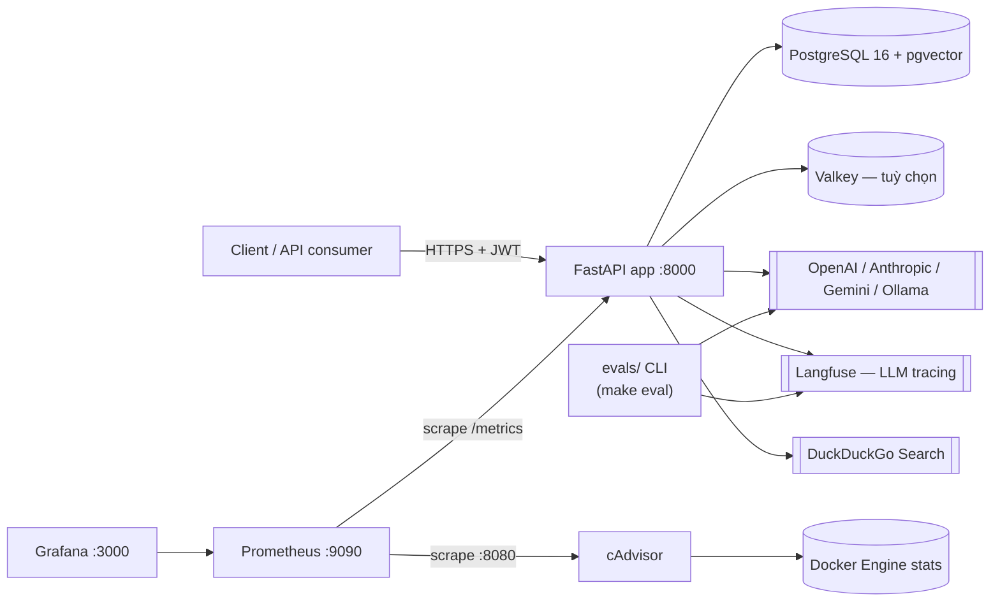

# High-Level Design — `fastapi-langgraph-agent-production-ready-template`

> Nguồn: `/home/lamhung/code/fastapi-langgraph-agent-production-ready-template`
> Package name: `langgraph-fastapi-template`. Đây là backend **độc lập**, không liên quan tới `ai_agent` hay `full-stack-ai-agent-template` (không có frontend Next.js, không SaaS billing, không multi-tenant). Trọng tâm là một **reference backend "production-ready"** cho 1 single-agent LangGraph: observability đầy đủ, resilient LLM calls, long-term memory, eval harness tích hợp sẵn.

## 1. Tổng quan hệ thống

Đây là template backend FastAPI + LangGraph để làm nền tảng xây agent chat, nhấn mạnh các thực hành "production" mà một LangGraph quickstart thông thường không có:

- **Conversation state bền vững**: checkpointer `AsyncPostgresSaver` (không phải memory/sqlite) — mọi lần gọi graph đều persist vào Postgres, hỗ trợ resume nhiều lượt và human-in-the-loop interrupt.
- **Long-term semantic memory**: mem0 + pgvector, có cache, cô lập theo user.
- **LLM call có khả năng chịu lỗi**: retry exponential backoff (tenacity) + fallback xoay vòng nhiều model + timeout tổng — không chỉ gọi `ChatOpenAI` đơn lẻ.
- **Auth + session đầy đủ**: JWT 2 scope (user token, session token), rate limiting (slowapi), chính sách mật khẩu, bcrypt.
- **Observability tích hợp sẵn chứ không phải gắn thêm sau**: Langfuse (LLM tracing), Prometheus + Grafana + cAdvisor (metrics/dashboard), structlog (structured logging theo request context), pyinstrument (profiling).
- **Eval harness LLM-judge tích hợp sẵn** (`evals/`): kéo trace từ Langfuse, chấm điểm bằng LLM judge, ghi điểm ngược lại Langfuse + báo cáo JSON local.
- **Schema do Alembic quản lý** (không `create_all()` lúc runtime), có `include_object` filter để Alembic không đụng vào bảng do bên ngoài quản lý (bảng checkpoint của LangGraph, bảng mem0/pgvector).
- Tối ưu hiệu năng: `asyncio.gather` song song (kiểm tra state + tìm memory), thực thi tool đồng thời, system prompt cache lúc module-load, claim nguyên tử qua Postgres cho việc sinh tiêu đề session nền, `uvloop`.

> README có nhắc "Atlas Cloud" (OpenAI-compatible multi-model proxy) như tích hợp tiện lợi/tài trợ — không bắt buộc về kiến trúc, chỉ là 1 `OPENAI_BASE_URL` thay thế.

## 2. Tech stack

| Lớp | Công nghệ |
|---|---|
| Web framework | FastAPI ≥0.121.0, Uvicorn (uvloop), Python 3.13 |
| Agent framework | LangGraph ≥1.0.2 + `langgraph-checkpoint-postgres` ≥3.0.1, LangChain ≥1.0.5, `langchain-core` ≥1.0.4, `langchain-openai` ≥1.0.2 (extras: Anthropic, Ollama, Google Gemini) |
| Database | PostgreSQL 16 + pgvector (`pgvector/pgvector:pg16`) |
| ORM | SQLModel ≥0.0.25 (SQLAlchemy + Pydantic), `psycopg[binary]`/`psycopg2-binary`; pool async (`psycopg_pool.AsyncConnectionPool`) cho checkpointer, pool sync (`QueuePool`) cho CRUD app |
| Migration | Alembic ≥1.18.4 |
| Cache / rate-limit backend | Valkey (Redis-compatible) ≥8.1.6, tuỳ chọn — fallback in-memory TTL cache/slowapi storage nếu không cấu hình |
| Long-term memory | mem0ai ≥1.0.0 (AsyncMemory), vector store pgvector, OpenAI cho trích xuất fact + embedding (`text-embedding-3-small`) |
| Observability | Langfuse 3.9.1 (LLM tracing), `prometheus-client` + `starlette-prometheus` (metrics), Grafana, cAdvisor (container metrics), structlog ≥25.2.0, `asgi-correlation-id`, pyinstrument (dev) |
| Auth | `python-jose[cryptography]` (JWT), `passlib[bcrypt]`/`bcrypt` |
| Rate limiting | slowapi ≥0.1.9 |
| Retry | tenacity ≥9.1.2 |
| Tool | `duckduckgo-search`/`ddgs`, `langchain-community` |
| Tokenizer | `tiktoken` |
| Eval harness | OpenAI SDK (`.beta.chat.completions.parse`), Langfuse API client, tqdm, colorama, rich |
| Lint/type | ruff, pyright (standard mode), pre-commit + detect-secrets |
| Package manager | `uv` + `uv.lock` |

## 3. System Context / Topology



`docker-compose.yml` — 1 network bridge `monitoring`, 6 service:

| Service | Image | Port | Ghi chú |
|---|---|---|---|
| `db` | `pgvector/pgvector:pg16` | 5432 | healthcheck `pg_isready` |
| `valkey` | `valkey/valkey:8.1.6-alpine` | 6379 | luôn start, chỉ thực sự dùng nếu `VALKEY_HOST=valkey` |
| `app` | build từ `Dockerfile` (arg `APP_ENV`) | 8000 | `depends_on: db (healthy)`, healthcheck `curl /health` |
| `prometheus` | `prom/prometheus:latest` | 9090 | scrape `app:8000/metrics` + `cadvisor:8080` |
| `grafana` | `grafana/latest` | 3000 | admin/admin, auto-provision dashboard từ `./grafana/dashboards` |
| `cadvisor` | `gcr.io/cadvisor/cadvisor` | 8080 | container metrics, mount `/rootfs`, `/var/run`, `/sys`, docker dir |

Volumes: `postgres-data`, `valkey-data`, `grafana-storage`.

2 chế độ deploy qua Makefile:
- `make docker-up` → chỉ `db` + `app` (vòng dev nhanh).
- `make stack-up` → toàn bộ stack kèm Prometheus/Grafana/cAdvisor.

## 4. Luồng dữ liệu chính

### 4.1 Chat đồng bộ
```
POST /api/v1/chatbot/chat
  → get_current_session (verify JWT session token + lookup DB)
  → maybe_name_session() (fire-and-forget nếu session chưa có tên)
  → agent.get_response()
      → asyncio.gather(graph.aget_state(), memory_service.search())
      → graph.ainvoke(..., thread_id=session_id, checkpointer=Postgres)
          → node "chat": llm_service.call() (retry + fallback)
          → nếu có tool_calls → node "tool_call" (chạy song song) → quay lại "chat"
          → END
      → background task: memory_service.add()
  → trả ChatResponse
```

### 4.2 Chat streaming (SSE)
```
POST /api/v1/chatbot/chat/stream
  → graph.astream(..., stream_mode="messages")
  → lọc AIMessage/AIMessageChunk, trích text (hỗ trợ cả format block reasoning/text kiểu GPT-5 Responses API)
  → yield từng token dạng SSE "data: {...}\n\n"
```

### 4.3 Human-in-the-loop (interrupt/resume)
```
graph.aget_state(config) → nếu state.next không rỗng (đang pause giữa interrupt)
  → lần gọi tiếp theo dùng graph.ainvoke(Command(resume=last_message.content), config)
    thay vì input messages mới
Tool "ask_human" gọi langgraph.types.interrupt(question) để tạm dừng graph thật sự.
```

### 4.4 Evaluation (ngoài luồng request, chạy thủ công/định kỳ)
```
make eval → evals CLI
  → kéo Langfuse trace 24h gần nhất chưa có score
  → với mỗi trace × mỗi metric (markdown prompt trong evals/metrics/prompts/*.md)
      → gọi OpenAI structured output → ScoreSchema{score, reasoning}
  → push score ngược lại Langfuse + ghi JSON report local
```

## 5. Bảo mật & vận hành (tóm tắt)

- JWT 2 scope độc lập: user token (tạo/liệt kê session) và session token (bắt buộc cho mọi endpoint chat); cả hai đều lookup lại DB nên có thể vô hiệu hoá bằng cách xoá record dù JWT chưa hết hạn.
- `Settings.validate_jwt_secret_key()` chặn khởi động app (ngoài môi trường TEST) nếu `JWT_SECRET_KEY` < 32 ký tự hoặc trùng giá trị placeholder đã biết.
- Rate limit theo từng route (slowapi), input sanitize ở biên router auth, `detect-secrets` pre-commit, CORS giới hạn qua `ALLOWED_ORIGINS`.
- Nguyên tắc "fail-loud" cho hạ tầng quan trọng: nếu tạo pool kết nối cho checkpointer thất bại thì raise lỗi ngay, không âm thầm chạy mà không có checkpointer.

## 6. CI/CD (tóm tắt)

GitHub Actions `.github/workflows/ci.yaml`: 1 job `checks` (PR + push `master`) — `uv sync --all-extras --all-groups` → `ruff check` → `ruff format --check` → `pyright`. **Không có bước chạy test** (dù có dependency group `test` với pytest/httpx — thực tế không có thư mục `tests/` nào trong repo). `.github/workflows/deploy.yaml`: build image production (`make docker-build ENV=production`) rồi push Docker Hub khi push `master` (có điều kiện secret `DOCKER_USERNAME`).

> Lưu ý: CI/deploy trigger trên branch `master`, nhưng `git status` cho thấy branch hiện tại của repo là `main` — khả năng lệch tên branch cần kiểm tra lại.

## 7. Tài liệu liên quan

- `fastapi-langgraph-agent-production-ready-template-LLD.md` — chi tiết module, graph, DB schema, metrics, eval harness.
- `ai_agent-HLD.md` / `ai_agent-LLD.md`, `full-stack-ai-agent-template-HLD.md` / `-LLD.md` — hai dự án khác, không liên quan trực tiếp tới template này.
