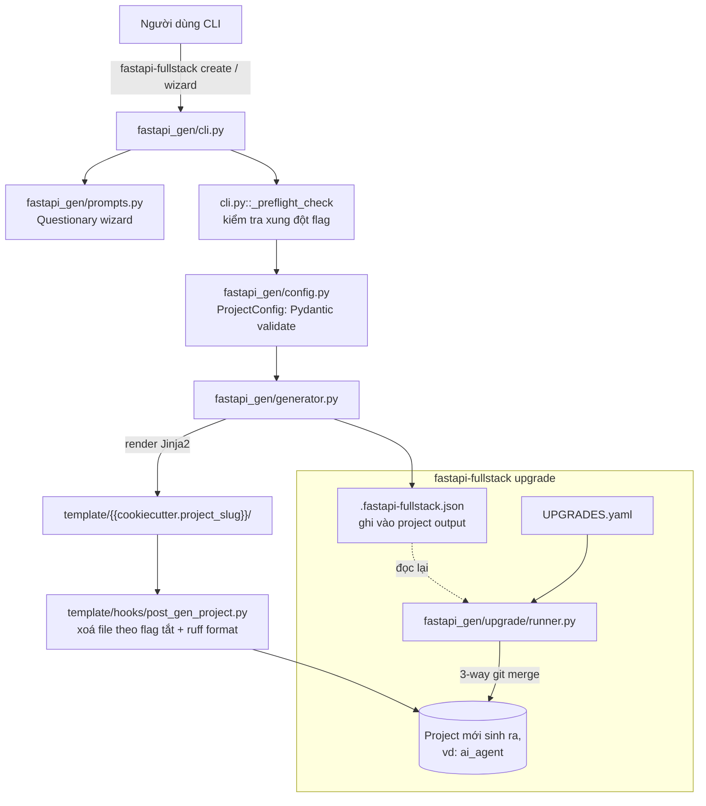

# High-Level Design — `full-stack-ai-agent-template`

> Nguồn: `/home/lamhung/code/full-stack-ai-agent-template`
> Đây **không phải** một ứng dụng chạy được, mà là một **code generator / project scaffolding tool**. Dự án `ai_agent` (xem `ai_agent-HLD.md`/`ai_agent-LLD.md`) nhiều khả năng được sinh ra bằng cách chạy generator này.

## 1. Mục đích

`full-stack-ai-agent-template` là một package Python PyPI tên `fastapi-fullstack`, cung cấp CLI `fastapi-fullstack` để **scaffold** (sinh ra) các dự án full-stack FastAPI + Next.js với AI agent tích hợp sẵn, dựa trên **Cookiecutter** (engine templating Jinja2) với rất nhiều điều kiện (conditional) theo lựa chọn cấu hình.

Bằng chứng liên hệ với `ai_agent`:
- `ai_agent/.fastapi-fullstack.json` chính là **manifest nâng cấp** mà generator ghi vào mỗi project được sinh ra (`fastapi_gen/generator.py::write_manifest`), phục vụ lệnh `fastapi-fullstack upgrade` — thực hiện 3-way git merge để kéo cải tiến từ template mới vào project đã được tuỳ biến.
- Do đó: **LLD chính xác của `ai_agent` phải đọc trực tiếp từ code của chính nó**; `template/{{cookiecutter.project_slug}}/` trong repo này chỉ nên dùng làm tài liệu tham chiếu "tính năng X mặc định trông như thế nào", còn `UPGRADES.yaml` / `.fastapi-fullstack.json` cho biết phiên bản/tuỳ chọn mà `ai_agent` đã dùng lúc sinh.

## 2. Hai "sản phẩm" trong cùng một repo

| | Generator (chính repo này) | Dự án được sinh ra (nằm trong `template/`) |
|---|---|---|
| Ngôn ngữ/stack | Python 3.11+, Click, Cookiecutter, Pydantic v2, Questionary, Rich, Ruff, hatchling | FastAPI/Next.js full-stack (tuỳ chọn theo cấu hình) |
| Vai trò | CLI tool sinh code, nâng cấp code đã sinh | Ứng dụng AI agent thực tế người dùng cuối triển khai |
| Entry point | `fastapi_gen/cli.py:main` → lệnh `fastapi-fullstack` | `backend/app/main.py:create_app()` (FastAPI), `frontend/src/app/` (Next.js) |

## 3. Tech stack

### Generator
Python 3.11+, Click (CLI), Cookiecutter (templating), Pydantic v2 (`ProjectConfig` validate), Questionary (wizard tương tác), Rich (console output), Ruff (format code sau khi sinh), hatchling (build backend package).

### Dự án được sinh ra (tuỳ chọn cấu hình — xem §5)
- Backend: FastAPI + Pydantic v2, SQLAlchemy 2.0 (async) hoặc SQLModel, Alembic, PostgreSQL (hỗ trợ pgvector).
- AI framework (chọn 1 trong 5): **Pydantic AI** (mặc định), **Pydantic Deep Agents**, **LangChain**, **LangGraph**, **DeepAgents**.
- LLM provider: OpenAI, Anthropic, Google Gemini, OpenRouter, OpenAI-compatible, hoặc "all".
- RAG: vector store (Milvus/Qdrant/ChromaDB/pgvector), embedding (OpenAI/Voyage/Gemini/SentenceTransformers), reranker (Cohere/CrossEncoder), PDF parser (PyMuPDF/LiteParse/LlamaParse).
- Background task: Celery / Taskiq / ARQ / Prefect (Redis-backed, trừ Prefect).
- Frontend: Next.js 15 (App Router), React 19, TypeScript, Tailwind v4, Zustand, TanStack Query, Bun, next-intl (PL/EN), shadcn-style UI.
- Observability: Logfire (path Pydantic AI), LangSmith (path LangChain/LangGraph/DeepAgents), Sentry, Prometheus.
- Hạ tầng: Docker/Docker Compose (dev/stage/prod), Kubernetes manifest, GitHub Actions hoặc GitLab CI, Nginx hoặc Traefik.
- Billing: Stripe (+ Paddle/Lemonsqueezy/Polar tuỳ chọn), credit/usage metering.
- Messaging: Telegram + Slack multi-bot adapter.

## 4. Kiến trúc generator (mức cao)

## 5. Bề mặt cấu hình (configuration surface)

Nguồn sự thật: `template/cookiecutter.json` (~209 key / ~120 biến khái niệm) + tài liệu đầy đủ ở `template/VARIABLES.md`. Các lựa chọn dạng enum chính:

| Biến | Giá trị |
|---|---|
| `database` | `postgresql` \| `none` |
| `orm_type` | `sqlalchemy` \| `sqlmodel` |
| `auth_mode` | `local` \| `delegated` (IdP ngoài qua JWKS hoặc shared-secret HMAC) |
| `ai_framework` | `none` \| `pydantic_ai` \| `langchain` \| `langgraph` \| `deepagents` \| `pydantic_deep` |
| `llm_provider` | `openai` \| `anthropic` \| `google` \| `openrouter` \| `openai_compatible` \| `all` |
| `background_tasks` | `none` \| `celery` \| `taskiq` \| `arq` \| `prefect` |
| `vector_store` | `milvus` \| `qdrant` \| `chromadb` \| `pgvector` |
| `embedding_provider` | `openai` \| `voyage` \| `gemini` \| `sentence_transformers` |
| `reranker_type` | `none` \| `cohere` \| `cross_encoder` |
| `pdf_parser` | `pymupdf` \| `liteparse` \| `llamaparse` \| `all` |
| `frontend` | `none` \| `nextjs` |
| `reverse_proxy` | `none` \| `nginx_external` \| `traefik_external` |
| `ci_type` | `github` \| `gitlab` \| `none` |
| `tenancy` | `single` \| `multi_org` \| `platform` |
| `payment_provider` | `stripe` \| `paddle` \| `lemonsqueezy` \| `polar` |
| `billing_model` | `subscription` \| `usage` \| `hybrid` \| `one_time` |

Ngoài ra rất nhiều feature flag độc lập: `enable_rag`, `enable_websockets`, `enable_admin_panel`, `enable_billing`, `enable_credits_system`, `enable_teams`, `enable_marketing_site`, `enable_mcp_client`, `enable_memory`, `enable_deep_research`, `enable_subagents`, `enable_charts`, `enable_code_execution`, `enable_skills`, `use_telegram`, `use_slack`, `enable_webhooks`, `enable_i18n`, `enable_storybook`, v.v.

**Ràng buộc chéo** được kiểm tra ở `fastapi_gen/cli.py::_preflight_check()` TRƯỚC khi Pydantic validate, ví dụ: `--billing` yêu cầu `--teams`; `--credits` yêu cầu `--billing`; `--rag` với `vector_store=pgvector` yêu cầu `database=postgresql`; `--marketing-site`/`--oauth-google` yêu cầu `--frontend nextjs`; `--task-queue celery/taskiq/arq` yêu cầu `--redis`.

**9 preset dựng sẵn** (`cli.py:853-1112`): `production`, `ai-agent`, `production-saas`, `b2b-multi-tenant`, `internal-tool`, `embedded-chatbot`, `blog-saas`, `consumer-app`, `dev-playground`.

## 6. Topology của dự án được sinh ra (khi bật đủ tính năng)

Giống hệt `ai_agent-HLD.md` §3–§4 (docker-compose dev/stage/prod, Nginx 3 server block, Kubernetes manifest thay thế khi deploy K8s) — vì `ai_agent` chính là một thực thể cụ thể của template này với bộ flag đã chọn.

## 7. CI/CD của chính generator (khác với CI của project sinh ra)

`.github/workflows/`:
- **ci.yml** — pipeline matrix lớn: `lint` → `type-check` → `test` (pytest) → `security` → ~24 job **generate-\*** thực sự chạy generator end-to-end với các tổ hợp option khác nhau rồi lint/type-check/build kết quả sinh ra (regression test thật sự, không chỉ unit test config logic). Ví dụ: `generate-minimal`, `generate-pg-langgraph`, `generate-pg-billing-credits`, `generate-pg-rag-pgvector`, `generate-marketing`, `generate-frontend-billing`...
- **docs.yml** — deploy mkdocs site lên GitHub Pages khi push `main`.
- **release.yml** — khi GitHub release published: `uv build` + publish PyPI.
- **rename-guard.yml** — chặn PR di chuyển/đổi tên file trong `template/` mà không có entry tương ứng trong `UPGRADES.yaml` (giữ tooling upgrade chính xác).

## 8. Quan hệ với tài liệu khác

- `full-stack-ai-agent-template-LLD.md` — chi tiết cấu trúc `fastapi_gen/`, `template/`, cookiecutter variables, LangGraph agent trong template, DB models, frontend.
- `ai_agent-HLD.md` / `ai_agent-LLD.md` — dự án cụ thể được sinh ra từ template này.

## 9. Lưu ý quan trọng khi đối chiếu tài liệu

Tài liệu mkdocs gốc của repo này (`docs/architecture.md`, `docs/ai-agent.md`) mô tả kiến trúc theo hướng **minh hoạ/đơn giản hoá** (ví dụ dùng `MessagesState` chung chung, luồng WS đơn giản) — **không khớp hoàn toàn** với code Jinja thực tế (vốn phức tạp hơn nhiều: state riêng theo từng AI framework, dual-stream-mode, `AgentSession` 2951 dòng rẽ nhánh theo 5 framework, hỗ trợ reasoning/thinking, ghi nhận credit/usage). Khi cần độ chính xác cao, luôn đối chiếu trực tiếp file Jinja trong `template/`.
