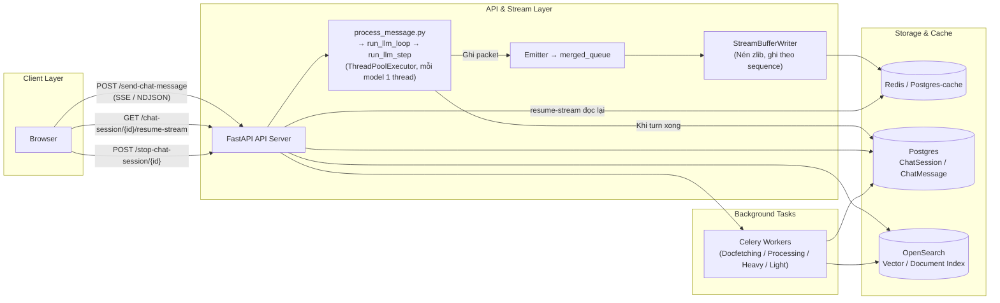

# High-Level Design — `onyx`

> Nguồn: `/home/lamhung/code/onyx`
> Onyx (tiền thân là Danswer) là nền tảng mã nguồn mở **đã trưởng thành ở quy mô lớn hơn hẳn** so với `ai_agent`/`full-stack-ai-agent-template`: một "context layer" doanh nghiệp — tìm kiếm/chat/RAG gắn với 50+ nguồn dữ liệu (Slack, Confluence, Google Drive, ...) qua framework connector, index có nhận biết quyền truy cập, expose qua chat web/Slack-Discord bot/MCP server/Chrome extension/widget nhúng/desktop/mobile, với vòng lặp agentic RAG tự viết, deep-research nhiều bước, persona/agent tuỳ biến, tool-calling (web search, sandbox code exec, MCP, sinh file/artifact), triển khai multi-tenant qua Docker Compose hoặc Kubernetes/Helm.

## 1. Tech stack

| Lớp | Công nghệ |
|---|---|
| Backend | FastAPI (`0.133.1`) |
| ORM/Migration | SQLAlchemy 2.0 + Alembic (DB chính), `alembic_tenants` cho schema-per-tenant |
| Auth | `fastapi-users` + `fastapi-users-db-sqlalchemy` |
| Background job | Celery 5.5.1 — **nhiều pool worker chuyên biệt**: docfetching, docprocessing, heavy, light, primary, monitoring, scheduled-tasks, user-file-processing + celery-beat |
| Rate limit | `fastapi-limiter` |
| **AI/agent framework** | **KHÔNG dùng LangGraph** (grep toàn backend = 0 hit, không có trong `pyproject.toml`). `langchain-core` có mặt nhưng chỉ dùng ở **đúng 1 file** để import type `BaseMessage` — không phải orchestration framework. **Vòng lặp agent/chat là tự viết tay hoàn toàn** |
| Vector store / document index | **OpenSearch** (trước đây Danswer dùng Vespa — codebase này đã chuyển hẳn sang OpenSearch) |
| Cache / coordination | Abstraction `CacheBackend` pluggable — **Redis** (triển khai thường) hoặc **Postgres-backed cache** (cho flavor "onyx-lite" không cần Redis) |
| Multi-tenancy | Schema-per-tenant Postgres qua SQLAlchemy `schema_translate_map`, có shard registry (`shard_routing.py`, `shard_registry.py`) map `tenant_id → shard` để scale DB ngang |
| Frontend | Next.js (`web/`) |

## 2. Kiến trúc tổng quan

## 3. Điểm khác biệt cốt lõi so với 3 dự án FastAPI+LangGraph đã khảo sát

- **Không có LangGraph, không có checkpointer nào cả** — không phải vì thiếu sót mà vì Onyx **không cần đến khái niệm checkpointer**: toàn bộ state bền vững được tự ghi thẳng vào Postgres bằng code của chính Onyx (`ChatSession`/`ChatMessage`), và state tạm thời giữa các bước trong 1 lượt chat sống trong 1 object Python in-process (`ChatStateContainer`).
- **Có hẳn 1 cơ chế resume-stream cấp sản phẩm (không phải optional add-on)**: `StreamBufferWriter` nén và ghi từng đoạn NDJSON đã stream vào cache dùng chung (Redis/Postgres), kèm "processing fence" đánh dấu session nào đang chạy với `stream_id` nào. Client reload gọi `GET /chat-session/{id}/resume-stream?cursor=N` để **phát lại đúng phần đã lỡ rồi tiếp tục xem live** — bất kỳ pod API nào cũng phục vụ được vì state nằm ở cache dùng chung, không phải bộ nhớ process.
- **Disconnect của browser KHÔNG huỷ generation** — hoàn toàn khác `ai_agent` (huỷ ngay khi mất kết nối). Onyx chỉ dừng generation khi người dùng bấm nút Stop rõ ràng (`POST /stop-chat-session/{id}`), kiểm tra qua cờ trong cache mỗi 50ms — không có `await request.is_disconnected()` ở đâu cả trong code.

## 4. Scaling

- API server: Helm chart, `Service` kiểu `ClusterIP` thường, **không có session affinity**; `HorizontalPodAutoscaler` (mặc định `minReplicas: 1, maxReplicas: 100`) hoặc KEDA `ScaledObject` thay thế. Stateless an toàn **chính nhờ** state in-flight (stream buffer + processing fence) nằm ở cache dùng chung, không ở bộ nhớ pod.
- Nginx: upstream round-robin thường, không `ip_hash`/sticky directive nào.
- Celery: nhiều pool worker độc lập, mỗi pool có Deployment + HPA + KEDA riêng.
- Postgres: Helm dùng operator kiểu CloudNativePG, số instance cấu hình được (mặc định 1); multi-tenant còn shard qua nhiều Postgres instance.
- Redis: Docker Compose mặc định 1 container, không HA; module Terraform AWS ElastiCache mặc định `num_cache_clusters = 1` (không auto-failover trừ khi cấu hình thêm).
- OpenSearch: module Terraform AWS hỗ trợ `instance_count` + multi-AZ zone awareness — **có thể HA thật sự**, không giới hạn single-node như Redis mặc định.

## 5. Tài liệu liên quan

- `onyx-LLD.md` — chi tiết endpoint, code path resume-stream, mô hình luồng chạy agent, DB schema.
- Bảng so sánh 5 tiêu chí với `ai_agent`, `full-stack-ai-agent-template`, `fastapi-langgraph-agent-production-ready-template`, `agentscope` — xem trong hội thoại hoặc file so sánh tổng nếu được tạo.
