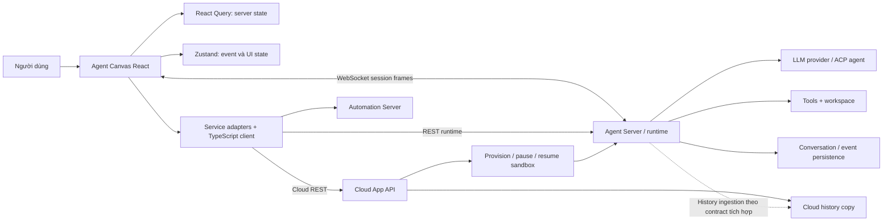

# High-Level Design — OpenHands Agent Canvas

> Khảo sát ngày 22/10/2026 từ `/home/lamhung/code/OpenHands`, commit `70b8f9069dec3d1c39a04d755521ebe6bd252aab`.
> Package `@openhands/agent-canvas` **1.30.0**, TypeScript client **1.56.0**; cấu hình pin Agent Server **1.56.0**, yêu cầu tối thiểu **1.55.0**.
> Đây là mô tả code tại checkout, không phải kiến trúc của mọi phiên bản OpenHands trước đây.

## 1. Phạm vi và ranh giới hệ thống

Checkout này là **Agent Canvas frontend**, kèm launcher và đóng gói local stack. Nó không chứa implementation Python của agent loop, LLM provider, conversation persistence hoặc canonical Agent Server API. Không nên mô tả nó như một monolith Python tự chạy LLM.

| Thành phần | Trách nhiệm | Có implementation trong checkout? |
|---|---|---|
| Agent Canvas | UI chat, terminal, browser, files, profiles/settings, backend selection, state và service adapters | Có: `src/` |
| Stack launcher/ingress | Chạy dịch vụ Python ngoài repo, frontend, route HTTP/WebSocket, cấu hình persistence | Có: `bin/`, `scripts/`, `docker/`, `electron/` |
| Software Agent SDK / Agent Server | Agent/tools/workspace/conversations, gọi LLM, lưu event, REST/WebSocket server | Không; dependency ngoài repo |
| Automation Server | Schedule/webhook, run history, dispatch conversation | Không; launcher gọi package ngoài repo |
| Cloud App API | Organization/auth, provisioning sandbox, app-conversation metadata và bản sao event history | Chỉ có client tích hợp |
| ACP agents | Agent bên ngoài được truy cập qua Agent Server và adapter/profile | Chỉ có cấu hình và UI tích hợp |

Nguồn: [repository ownership](/home/lamhung/code/OpenHands/AGENTS.md:22), [kiến trúc gốc](/home/lamhung/code/OpenHands/docs/architecture.md:1), [dependencies](/home/lamhung/code/OpenHands/package.json:1).

## 2. Kiến trúc tổng thể

`R`, `L`, `P`, `C`, `T` là dịch vụ/implementation ngoài checkout. Mũi tên history thể hiện contract mà Canvas tiêu thụ, không xác nhận cơ chế ingestion nội bộ của Cloud.

Có hai đường truy cập quan trọng:

- **Local/remote Agent Server**: Canvas gọi trực tiếp server đã chọn; `local` là loại backend, không bắt buộc server nằm trên laptop.
- **Cloud**: metadata/history đi tới App API; WebSocket, event count và thao tác runtime đi tới host trong `conversation_url`, dùng `session_api_key`. Host App API và host runtime có thể khác nhau.

Nguồn: [backend types](/home/lamhung/code/OpenHands/src/api/backend-registry/types.ts:1), [event routing](/home/lamhung/code/OpenHands/src/api/event-service/event-service.api.ts:15), [client options](/home/lamhung/code/OpenHands/src/api/agent-server-client-options.ts:1).

## 3. Công nghệ và phân lớp

| Lớp | Công nghệ / module | Vai trò |
|---|---|---|
| View/routing | React 19.3, React Router 7.18, TypeScript | Route conversation/settings/automation, UI độc lập và embedded |
| Build/style | Vite 8, Tailwind, HeroUI | Build standalone và thư viện component |
| Server state | TanStack React Query 5 | Fetch/cache metadata, history, files; invalidate sau mutation |
| Client state | Zustand 5 | Event log trong RAM, projection UI, optimistic messages, execution status, metrics |
| API | `@openhands/typescript-client`, adapters trong `src/api/` | Runtime calls có kiểu, chuyển đổi local/cloud |
| Realtime | Native browser WebSocket + hook tự viết | Session frames, reconnect, durable cursor |
| Workspace UI | Monaco, xterm, browser/files components | Hiển thị và điều khiển công cụ qua API |
| Phân phối | npm CLI, Docker, Electron, Helm | Launcher host/local stack, desktop và cluster |

Phiên bản lấy từ `package.json`; đây không phải lời khuyên nâng cấp dependency.

## 4. Luồng conversation và LLM response

### 4.1 Tạo conversation

Home/launch mutation xác định backend, workspace/worktree, agent hoặc ACP profile và settings. Local path xây request bằng adapter rồi gọi `ConversationClient.createConversation`; Cloud path dùng App API để tạo start task và chờ runtime coordinates. Khi đã có conversation, provider quản lý socket của conversation đó.

Settings/secret lookup được chuẩn bị qua backend; Canvas không thực thi model inference. Initial prompt lúc tạo conversation có thể chạy trước khi socket của trang chat mở, nên lịch sử và replay là phần bắt buộc của thiết kế frontend.

Nguồn: [create service](/home/lamhung/code/OpenHands/src/api/conversation-service/agent-server-conversation-service.api.ts:517), [create mutation](/home/lamhung/code/OpenHands/src/hooks/mutation/use-create-conversation.ts:1), [Cloud create](/home/lamhung/code/OpenHands/src/api/cloud/conversation-service.api.ts:148).

### 4.2 Mở chat, gửi và nhận

1. Đọc metadata, `conversation_url`, `session_api_key`.
2. Main conversation nạp trang lịch sử REST gần nhất: đọc event count trước, rồi fetch tối đa 50 event mới nhất.
3. Mở `ws(s)://host[/prefix]/sockets/session/{id}?after_seq=N`; gửi frame auth nếu có session key.
4. Khi socket mở, prompt được gửi dưới dạng `{role: "user", content: [...], run: true}` trên **chính socket đó**. Nếu socket chưa mở nhưng biết runtime, fallback qua `ConversationClient.sendEvent(..., {run:true})`.
5. Server phát frame progress để UI hiện dần text/reasoning. Sau đó event hoàn chỉnh đi trong frame `durable`, thay thế bubble tạm cùng ID.
6. Conversation state/stats/action/observation được route sang các store, cache và panel liên quan.

**Kết luận:** đường gửi thông thường là WebSocket hai chiều, khác các dự án dùng POST + SSE. Tuy nhiên runtime conversation và durable replay không phụ thuộc vào việc prompt phải luôn đi trên socket: có REST fallback và history riêng.

Nguồn: [conversation provider](/home/lamhung/code/OpenHands/src/contexts/conversation-websocket-context.tsx:1409), [session protocol mirror](/home/lamhung/code/OpenHands/src/types/agent-server/session-frames.ts:1).

## 5. Hai lớp dữ liệu realtime

| Lớp | Dữ liệu | Khôi phục sau reconnect |
|---|---|---|
| Durable | `{type:"durable", seq, event}`: event đã persist theo contract | Replay sau `after_seq`; dedupe theo event ID |
| Progress | `item_started`, `delta`, `item_aborted` | Không replay; mất phần delta trong khoảng offline |
| Transient | `{type:"transient", event}`: event không persist | Không có durable cursor |

Progress dùng `item_id`, `attempt`, `anchor_seq` và delta text/reasoning. Slot chỉ tồn tại trong `uiEvents`, không ghi vào mảng `events` để tránh chiếm ID của event thật. Khi `event.id === item_id`, event hoàn chỉnh thay thế slot tại vị trí cũ.

Do đó **khôi phục được nội dung event hoàn chỉnh không đồng nghĩa replay được từng token**. Nếu reconnect giữa một response, UI có thể chỉ hiện phần delta mới nhận tiếp; event durable tới sau sẽ sửa thành nội dung đầy đủ. Nếu runtime chết trước khi tạo event hoàn chỉnh, frontend này không chứng minh phần text tạm đã được lưu bền vững.

Nguồn: [frame contract](/home/lamhung/code/OpenHands/src/types/agent-server/session-frames.ts:1), [UI projection](/home/lamhung/code/OpenHands/src/utils/handle-event-for-ui.ts:93), [reconnect tests](/home/lamhung/code/OpenHands/__tests__/contexts/conversation-websocket-context.test.tsx:1413).

## 6. State và persistence

| State | Owner / nơi lưu | Mức bảo đảm đọc được từ repo |
|---|---|---|
| Event hoàn chỉnh và runtime conversation | Agent Server | Canvas đọc REST + durable replay; backend lưu thế nào nằm ngoài repo |
| Local deployment files | Thư mục qua `OH_CONVERSATIONS_PATH`, `OH_PERSISTENCE_DIR`, `OH_BASH_EVENTS_DIR` | Launcher/container cấu hình đường dẫn; không có schema DB conversation trong Canvas |
| Cloud event history | App API | Tách runtime sandbox, có thể trễ so với log runtime |
| Event/UI projection, delta buffer | Zustand và refs trong browser | RAM, không phải DB hoặc checkpoint bền vững |
| History/metadata cache | React Query | Cache phía client; reload phải fetch lại |
| Backend selection và metadata phụ | Browser localStorage / store tương ứng | Preferences/cache; không thay thế log hội thoại server |
| Automation state trong local stack | Automation service; mặc định `automation/automations.db` | DB của dịch vụ khác, không phải bảng chat Canvas |

Nguồn: [history preload](/home/lamhung/code/OpenHands/src/hooks/query/use-conversation-history.ts:1), [event store](/home/lamhung/code/OpenHands/src/stores/use-event-store.ts:1), [Docker persistence](/home/lamhung/code/OpenHands/docker/entrypoint.sh:179), [shared defaults](/home/lamhung/code/OpenHands/config/defaults.json:1).

## 7. Reconnect, stop và các failure boundary

- Reconnect dùng cursor **liên tục không có khoảng trống**, không lấy `max(seq)` đơn giản; durable frame có thể tới lệch thứ tự. Dedupe bằng event ID ngăn history và replay tạo bản sao.
- `onClose`/`onOpen` xoá progress slots và delta buffer, không gọi API interrupt. Đóng tab chỉ đóng kết nối ở phía Canvas; execution tiếp tục hay chịu giới hạn gì phải xét server. Test/contract trong repo thể hiện trường hợp runtime vẫn chạy qua reconnect, không chứng minh crash recovery.
- Stop là thao tác tường minh: local gọi `interruptConversation`; Cloud pause sandbox. Resume execution là `runConversation` hoặc wake sandbox, khác reconnect transport.
- History Cloud có độ trễ: first-connect lùi cursor 50 event so với tail runtime để bù, không phải bảo đảm cho độ trễ không giới hạn.

Nguồn: [cursor](/home/lamhung/code/OpenHands/src/utils/session-seq-cursor.ts:1), [socket lifecycle](/home/lamhung/code/OpenHands/src/contexts/conversation-websocket-context.tsx:1140), [stop/resume](/home/lamhung/code/OpenHands/src/hooks/mutation/conversation-mutation-utils.ts:53).

## 8. Deployment và scale

- Frontend có standalone build và exports để nhúng conversation/browser/files/settings/sidebar/terminal; Electron đóng gói desktop cùng launcher.
- Local stack gồm frontend/ingress, Agent Server và Automation Server. `config/defaults.json` tập trung version/port/path; dev ports và đường persistence có thể khác Docker.
- Helm triển khai image **all-in-one bằng StatefulSet**, mặc định **1 replica**, lưu state trên PVC. `values.yaml` yêu cầu giữ một replica trừ khi đã externalize automation DB và làm Agent Server thật sự chia sẻ state an toàn.
- Kết nối nhiều backend trong UI là **chọn nhiều host thực thi**, không phải load balancing một conversation qua nhiều worker. WebSocket resume phải tới runtime có đúng conversation log.
- Repo không đủ bằng chứng để kết luận Agent Server có failover xuyên pod, Redis replay bus hoặc horizontal scale không sticky như TrueForge/Onyx.
- `helm/agent-canvas/values.yaml:196` có field `podAffinity` pass-through kiểu Kubernetes thông thường — đây chỉ là knob Helm chuẩn để người dùng tự cấu hình nếu muốn, **không phải** cơ chế session-affinity riêng của OpenHands; đừng nhầm nó là bằng chứng có sticky-session tích hợp sẵn.

Nguồn: [Helm defaults](/home/lamhung/code/OpenHands/helm/agent-canvas/values.yaml:1), [StatefulSet](/home/lamhung/code/OpenHands/helm/agent-canvas/templates/statefulset.yaml:1), [package exports](/home/lamhung/code/OpenHands/package.json:1).

## 9. Authentication và contract evolution

Runtime REST dùng client options với session API key ưu tiên hơn backend key. Browser WebSocket gửi `{type:"auth", session_api_key:...}` lúc `onopen`, trước callback ứng dụng. Cloud App API dùng cơ chế auth của Cloud client, tách key của sandbox.

Protocol version nằm ở đường `/sockets/session`; endpoint events cũ không phải đường stream hiện tại. Frame chưa nhận diện được bị bỏ qua. `asSessionFrame` chỉ narrow theo tên frame, không phải schema validator đầy đủ. Minimum Agent Server version là contract compatibility do Canvas kiểm soát.

Nguồn: [WS auth](/home/lamhung/code/OpenHands/src/utils/websocket-auth.ts:1), [WS URL](/home/lamhung/code/OpenHands/src/utils/websocket-url.ts:103), [compatibility](/home/lamhung/code/OpenHands/src/api/agent-server-compatibility.ts:1).

## 10. Tài liệu liên quan và giới hạn khảo sát

- [LLD](openhands-LLD.md): wire frames, cursor, projection, batching và các failure case.
- [So sánh chat data flow](chat-data-flow-comparison.md): đối chiếu với những checkout khác đã khảo sát.
- Chưa đọc implementation ngoài repo của `software-agent-sdk`, Cloud backend hoặc Automation Server; không suy diễn DB schema, thuật toán agent loop hay semantics shutdown nội bộ của chúng từ tên SDK method.
- Khảo sát tĩnh, có đọc test và fixture đã commit; không chạy LLM live hoặc kiểm chứng deployment thực tế.
