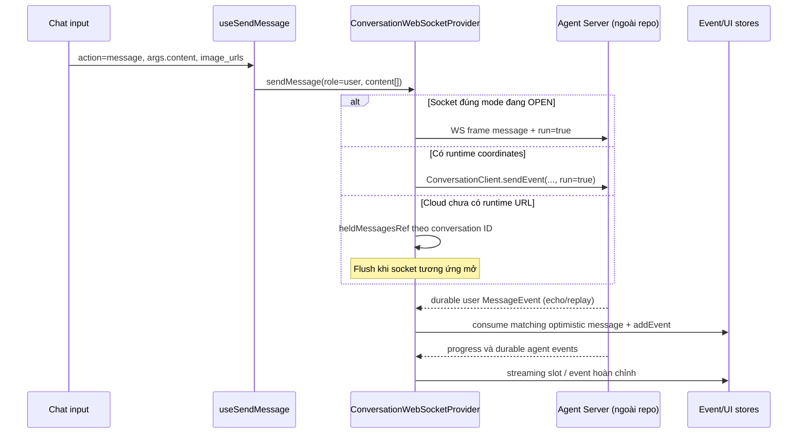
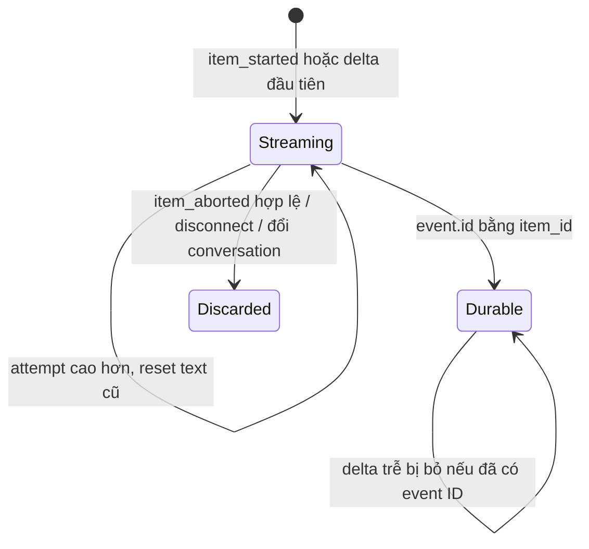

# Low-Level Design — OpenHands Agent Canvas

> Nguồn: `/home/lamhung/code/OpenHands`, commit `70b8f9069dec3d1c39a04d755521ebe6bd252aab`, khảo sát 22/10/2026.
> Đọc kèm [HLD](openhands-HLD.md). Phạm vi là implementation Canvas và contract phía client; server Python nằm ngoài checkout.

## 1. Bản đồ module và ownership

| Module | Trách nhiệm |
|---|---|
| `src/routes/conversation.tsx`, `src/contexts/websocket-provider-wrapper.tsx` | Ghép route, metadata, planning sub-conversation và provider |
| `src/hooks/use-send-message.ts` | Chuyển input UI thành `role/content` chuẩn, thêm image content |
| `src/contexts/conversation-websocket-context.tsx` | Điều phối history, hai socket main/planning, send fallback, route frame/event, optimistic echo và side effect |
| `src/hooks/use-websocket.ts` | Native socket lifecycle, auth, watchdog, reconnect/backoff |
| `src/types/agent-server/session-frames.ts` | Mirror protocol envelope của SDK server |
| `src/utils/session-seq-cursor.ts` | Cursor durable liên tục qua frame tới lệch thứ tự |
| `src/utils/streaming-delta-batcher.ts` | Gom delta theo animation frame |
| `src/stores/use-event-store.ts` | `events`, ID set và `uiEvents`, dedupe/merge/sort |
| `src/utils/handle-event-for-ui.ts` | Streaming slots, thay slot bằng event thật, action/observation projection |
| `src/hooks/query/use-conversation-history.ts`, `src/hooks/use-load-older-events.ts` | REST preload và pagination lịch sử |
| `src/api/event-service/event-service.api.ts` | Local/Cloud history routing, runtime count và confirmation |
| `src/components/conversation-events/chat/{messages,event-message}.tsx` | Group/render event, handoff từ provisional sang durable |
| `src/hooks/use-streamed-text.ts` | Reveal text theo đồng hồ để làm mượt hiển thị |

Các đường dẫn ở bảng tính từ repo OpenHands. Danh sách nguồn có link trực tiếp ở §12.

## 2. Bootstrap conversation và transport

### 2.1 Create

`AgentServerConversationService.createConversation` chọn Cloud hoặc local path. Local path xây request qua `buildStartConversationRequestWithEncryptedSettings`, thêm tags/workspace metadata rồi gọi `ConversationClient.createConversation`. Cloud path tạo app-conversation start task, lấy runtime coordinates thông qua các hook query/poll.

`AppConversation` là model thích nghi cho UI; `toAppConversation` đổi runtime info sang model này. Các trường trọng yếu của đường chat gồm `id`, `conversation_url`, `session_api_key`, `execution_status`, `sandbox_id`. Không nên coi chúng là schema bảng DB được định nghĩa trong repo này.

### 2.2 URL và auth

`buildWebSocketUrl` tạo:

```text
ws(s)://runtime-host[/proxy-prefix]/sockets/session/{conversation_id}?after_seq=N
```

Prefix trước `/api/conversations` trong `conversation_url` được giữ lại, ví dụ `/runtime/55313`. Dùng WSS nếu trang hoặc runtime URL dùng HTTPS. Khi `onopen`, hook gửi frame dưới đây nếu có key, rồi mới gọi callback provider:

```json
{"type":"auth","session_api_key":"<session-key>"}
```

Đây là frame auth, không phải key trong URL. `OPEN` phía hook phản ánh native socket mở và đã gửi auth, không phải một application-level ACK riêng đã được Canvas xác nhận.

Trong image all-in-one, `docker/entrypoint.sh:440` đăng ký route ingress `--route "/sockets=http://127.0.0.1:${AGENT_SERVER_PORT}"` — xác nhận trực tiếp đường `/sockets` được forward thẳng tới process Agent Server, không qua lớp trung gian nào khác trong Canvas.

### 2.3 Bảng endpoint REST đã xác nhận

| Phạm vi | Endpoint | Nguồn |
|---|---|---|
| Local runtime | `GET /api/conversations/{id}` | `src/api/agent-server-adapter.ts:393` |
| Local runtime | `GET/PUT /api/settings/secrets/{name}` | `src/api/agent-server-adapter.ts:1059` |
| Local runtime | `GET /api/file/home`, `POST /api/file/upload` | `src/api/agent-server-home.ts:10,91,95` |
| Local runtime | `/api/automation/*` | `src/api/automation-service/automation-service.api.ts:60` |
| Local runtime | `GET /api/canvas-extensions` | `src/api/canvas-extensions-service.ts:19` |
| Local runtime | `GET /api/agent-profiles` | `src/api/agent-profiles-service/agent-profiles-service.api.ts:8` |
| Cloud | `/api/v1/app-conversations[...]` (CRUD/search/download/pause/resume) | `src/api/cloud/conversation-service.api.ts:102,127,158,179,187,198,205,216,255,267-293` |
| Cloud | `POST /api/v1/conversation/{id}/events/search` | `src/api/event-service/event-service.api.ts:21-23,113` |
| Cloud | `POST /api/v1/sandboxes/{id}/pause`, `/resume` | `src/api/cloud/conversation-service.api.ts:267-293` |
| Cloud | `/api/v1/secrets*`, `/api/v1/settings*`, `/api/v1/mcp/*`, `/api/v1/git/*` | tương ứng các service file cùng tên |

## 3. Luồng gửi prompt



- Mode `plan` chọn socket và ID của planner; mode code chọn main. Không có planner ID thì báo lỗi, không tự gửi sang code agent.
- Socket path trả `{queued:false}` khi đã gọi `socket.send`; đây không phải cam kết backend đã persist hoặc hoàn tất turn.
- REST fallback trả `{queued:true}` dù request đã được gửi tới runtime. Giá trị này không đồng nghĩa có durable job queue phía browser.
- Cloud không có runtime URL: giữ message trong `heldMessagesRef`, dedupe payload giống hệt trong queue; return `queued:true`. Queue nằm trong RAM, không chứng minh sống qua full reload.
- REST fallback lỗi thì set error và throw. Echo event được dùng để reconcile optimistic bubble; history preload cũng consume echo để tránh bubble trùng.

Nguồn chính: [send hook](/home/lamhung/code/OpenHands/src/hooks/use-send-message.ts:1), [send implementation](/home/lamhung/code/OpenHands/src/contexts/conversation-websocket-context.tsx:1409).

## 4. Session frame contract

| `type` | Trường trọng yếu | Xử lý Canvas |
|---|---|---|
| `sync` | `from_seq?`, `through_seq?` | Không đổi cursor; cursor tăng khi nhận durable |
| `durable` | `seq`, `event` | `observe(seq)`, unwrap và gắn `seq` lên event, chạy event handler |
| `transient` | `event` | Unwrap, không tăng durable cursor |
| `item_started` | `item_id`, `attempt?`, `anchor_seq?` | Mở/reset provisional slot |
| `delta` | `item_id`, `attempt?`, `order`, `kind?`, `content`, metadata chunk | Enqueue vào batcher; không thêm event vào raw log |
| `item_aborted` | `item_id`, `attempt?`, `reason` | Bỏ slot nếu đúng attempt hoặc mới hơn |
| `error` | `code`, `detail` | Hiện conversation error, không buộc reconnect |

`kind` của delta là `text` hoặc `reasoning`. `seq` là index log, khác `event.id` và khác `delta.order`. Theo mirror contract, durable được phát sau persist; progress/transient không thuộc log replay.

Union kiểu event bọc trong frame `durable`/`transient` (`src/types/agent-server/core/openhands-event.ts:1-45`): `ActionEvent | ObservationEvent | MessageEvent | UserRejectObservation | AgentErrorEvent | SystemPromptEvent | ACPToolCallEvent | HookExecutionEvent | CondensationEvent/CondensationRequestEvent/CondensationSummaryEvent | ConversationStateUpdateEvent | ConversationErrorEvent | PauseEvent | ServerErrorEvent | StreamingDeltaEvent`. Đây là type mirror phía client, không phải enum xác nhận từ server source.

`routeSessionFrame` enqueue delta và trả `null`. Với mọi frame khác, nó **flush delta trước khi xử lý frame đó**, để text tạm không vượt qua message hoàn chỉnh hoặc abort. Frame lạ bị bỏ qua. `asSessionFrame` chỉ kiểm tra object và `type` thuộc tập tên đã biết; không validate đầy đủ field runtime.

## 5. REST history + cursor replay

### 5.1 First load

`useConversationHistory` lấy metadata rồi chạy query với key gồm conversation ID, URL và session key:

1. Gọi runtime `getEventCount` trước khi đọc history; log index cuối tại thời điểm này là `count - 1`.
2. `searchEvents(limit=50, sortOrder="TIMESTAMP_DESC")`, reverse thành cũ → mới.
3. Seed vào event store, reconcile optimistic messages và dựng lại model-switch messages.
4. Main socket chỉ mở sau first-load query hết pending. Background refetch không teardown socket. Query lỗi thì fallback mở socket với `after_seq=-1` nếu không có cursor.

Local cursor = `count - 1`. Cloud cursor = `max(-1, count - 1 - 50)`: history App API là bản sao có thể trễ hơn runtime, nên replay chồng 50 event rồi dedupe. **Nếu lag lớn hơn khoảng chồng này vẫn có thể có lỗ hổng.** Event count thất bại thì cursor null, replay từ `-1`.

`hasMore` dựa `next_page_id` hoặc số item đạt page size; scroll lên fetch older pages, bulk add và dedupe. History query cache giữ 30 phút, refetch khi mount, không refetch window-focus/reconnect, retry một lần.

### 5.2 Reconnect cursor

Mỗi socket có `SeqCursor` riêng trong ref:

```text
start(base): value=base, ahead={}
observe(seq):
  nếu seq <= value: bỏ qua
  đưa seq vào ahead
  khi ahead có value+1: tăng value và bỏ seq đó khỏi ahead
  nếu ahead.size > 1024: bước qua hole cũ nhất rồi drain tiếp
```

Ví dụ `base=10`, nhận `12` trước `11`: cursor vẫn `10`; nhận `11` rồi mới lên `12`. Dùng `max(seq)=12` ngay có thể bỏ mất `11` khi rớt mạng.

`queryParams` là hàm được gọi lúc connect/reconnect, đọc cursor mới nhất thay vì snapshot của lần render trước. `start` khi reconnect xoá `ahead`, vì phần đã nhận vượt hole sẽ replay và được dedupe. Ngưỡng 1024 là đánh đổi để không mắc vĩnh viễn ở event mà server không đọc được; không phải cam kết exactly-once vô điều kiện.

Main first-connect chọn `cursor.value ?? historyAfterSeq ?? -1`; planner không preload REST, chọn `cursor.value ?? -1`. ID planner đổi thì clear cursor riêng. Một số comment trong provider còn nhắc `resend_mode/after_timestamp`; code chạy hiện tại sử dụng **`after_seq`**.

## 6. Streaming slot và event projection

### 6.1 State model

```text
EventState
  events: OHEvent[]              // event đã đưa qua normal handler
  eventIds: Set<string|number>   // dedupe theo event.id
  uiEvents: OHEvent[]            // projection đã merge + provisional slots
  loadedConversationId          // owner của global store
```

`events` không phải bảng durable ở browser; nó có thể nhận transient event qua normal handler. Provisional slots chỉ ở `uiEvents`, không vào `eventIds`, để durable event cùng ID không bị dedupe nhầm.

### 6.2 Slot lifecycle



- `attempt` mặc định 1. Attempt thấp bị bỏ qua; attempt cao thay nội dung tạm của lần thử cũ. Abort attempt thấp không xoá slot retry mới.
- `anchor_seq` đặt slot trước durable event đầu tiên có seq lớn hơn anchor **trong cùng socket**. Main/planner có log độc lập nên không so seq xuyên conversation.
- Timestamp slot mượn từ anchor để sort timestamp không đẩy bubble nhảy vị trí.
- Delta không có slot sẽ mở slot mới: hỗ trợ client join giữa stream. Nó chỉ chứa phần delta client nhận được từ lúc đó.
- Contract có `order` tăng dần, nhưng `appendStreamingDeltas` hiện nối theo thứ tự nhận; không dùng `order` để reorder/dedupe token. Dedupe durable event không đồng nghĩa dedupe delta.
- Durable event thay slot cùng ID tại chỗ. React renderer dùng key dựa event ID để hỗ trợ handoff ổn định.
- Observation thường thay action theo `action_id`; Think/Finish observation không hiện trùng action. ACP tool event được merge theo `tool_call_id`.

## 7. Batching và rendering

`createStreamingDeltaBatcher` gom delta tới `requestAnimationFrame` tiếp theo, fallback timer 16ms. Main và planner có batcher riêng. `flush()` chạy trước non-delta frame; `reset()` bỏ pending delta khi socket/owner đổi. Việc gom theo frame giảm store writes; ranh giới non-delta có thể buộc flush sớm.

`useWebSocket` gọi `onMessage` trực tiếp, không ghi `lastMessage` vào React state mỗi token. `useFilteredEvents` lấy projection UI và lọc event có thể render; `Messages` group tool activity, `EventMessage` render text/reasoning/tool/error.

`useStreamedText` làm mượt text theo tốc độ cơ sở **0,06 ký tự/ms**; khi backlog lớn nó tăng tốc theo `backlog/500ms`. Đây là animation hiển thị, không phải token rate của LLM hoặc replay buffer. Text không phải phần nối dài của text đang hiển thị sẽ snap ngay.

## 8. Socket lifecycle, replay và side effects

- Reconnect tự động: backoff 1s, 2s, 4s… cap base 30s, thêm jitter tới 30%; mặc định không giới hạn số lần thử nếu caller không đặt `maxAttempts`.
- Watchdog đóng socket mắc ở CONNECTING. WeakSet đánh dấu socket nào được reconnect; socket bị thay/chủ động đóng không được mở lại do callback muộn.
- `onClose` và `onOpen` reset batcher, clear slots cho đúng main/planning stream. Không gửi interrupt trong các callback này.
- Khi tab bị background, hook visibility có thể disconnect rồi reconnect khi foreground; frontend coi transport và execution là hai lifecycle riêng.
- Main/planning handler kiểm tra event trùng trước các side effect không idempotent để replay không lặp client-tool actions. Durable cursor được advance trong frame routing trước bước normal event handler; cursor này không phải transaction/ACK sau khi mọi side effect thành công.
- State/stats update đi tới conversation-state/metrics store; bash observation tới terminal store; browser/file/planning events cập nhật panel hoặc invalidate query. Một số Canvas UI, child launch và secret request action được xử lý bởi service phía client.

Nguồn: [WS hook](/home/lamhung/code/OpenHands/src/hooks/use-websocket.ts:1), [visibility hook](/home/lamhung/code/OpenHands/src/hooks/use-page-visibility-reconnect.ts:1), [replay side-effect tests](/home/lamhung/code/OpenHands/__tests__/contexts/conversation-websocket-context.test.tsx:520).

## 9. Stop, resume execution và confirmation

| Hành động | Đường code |
|---|---|
| Stop local | `pauseConversation` → `ConversationClient.interruptConversation` để cancel in-flight theo contract của client |
| Stop Cloud | `pauseConversation` → `pauseCloudSandbox(sandbox_id)` trên App API |
| Resume runtime có URL | `ConversationClient.runConversation` |
| Resume Cloud chưa có URL | `resumeCloudSandbox`, chờ metadata có runtime URL |
| Trả lời approval | `EventService.respondToConfirmation` tới runtime, dùng session key |
| Reconnect stream | Chỉ mở lại socket với `after_seq`; không phải resume execution |
| Stop `/goal` loop | `stopGoal` tách biệt interrupt turn; caller cần thêm interrupt nếu muốn dừng cả turn đang chạy |

Semantics chi tiết như local interrupt huỷ model request đến đâu hay Cloud pause chờ LLM xong là contract/comment phía client; implementation nằm ở server ngoài repo.

`AppConversation.sandbox_status` (chỉ Cloud) nhận một trong `PAUSED | RUNNING | STARTING | MISSING | ERROR`; conversation local/self-hosted không mang field này (`null`) — `src/api/conversation-service/agent-server-conversation-service.types.ts:12-17`. Đây là bằng chứng rõ nhất rằng chỉ OpenHands Cloud mới cấp phát sandbox ephemeral theo từng conversation kèm pause/resume; ở local/self-hosted/image all-in-one, một Agent Server sống lâu dài phục vụ chung mọi conversation trên host đó — cách ly giữa các conversation trong chế độ này chỉ là **thư mục làm việc riêng**, công thức `${workingDirBase}/${conversationId không dấu gạch ngang}`, mặc định `workingDirBase = "workspace/project"` (`src/api/agent-server-config.ts:203-211`), **không phải** filesystem hay process riêng.

## 10. Persistence, routing và giới hạn bảo đảm

| Tình huống | Hành vi chứng minh từ Canvas |
|---|---|
| Rớt socket sau durable event | Reconnect với cursor; replay overlap được dedupe theo ID |
| Rớt socket giữa token stream | Bỏ slot/buffer; không replay delta đã lỡ; event hoàn chỉnh phục hồi full content khi tới |
| Reload toàn trang | Refs và RAM queue mất; dựng lại từ REST history và cursor mới |
| Server chết trước durable event | Canvas không có kho token hoặc execution checkpoint để phục hồi |
| Cloud history trễ hơn 50 event | Overlap cố định có thể không đủ; không có bảo đảm gap-free tuyệt đối |
| Browser đổi conversation | Clear event/UI/metrics theo owner, seed history conversation mới |
| Runtime chưa khởi động | Chưa có socket; Cloud held queue chỉ trong RAM |
| Nhiều API replicas | Repo không chứng minh replay tới replica bất kỳ; cần đúng runtime/log |

Docker truyền đường lưu conversation/state/bash qua environment; Helm mặc định StatefulSet 1 replica + PVC. Không thấy schema Postgres chat, LangGraph checkpointer hoặc Redis token bus được triển khai bởi Canvas. Không thể suy ra backend SDK cũng không có các cơ chế tương tự chỉ từ sự vắng mặt trong repo frontend.

## 11. Bằng chứng kiểm thử đã đọc

| File test có sẵn | Hành vi thể hiện |
|---|---|
| `__tests__/contexts/conversation-websocket-context.test.tsx` | Frame routing, slot/durable handoff, reconnect giữa stream, retry/abort, cursor và chống lặp side effect |
| `__tests__/contexts/conversation-websocket-provider.behavior.test.tsx` | History gate, REST fallback, plan/code routing, lifecycle và store side effects |
| `__tests__/utils/session-seq-cursor.test.ts` | Không vượt hole, replay/restart/clear cursor |
| `__tests__/utils/streaming-delta-batcher.test.ts` | Gom delta, flush/reset theo scheduler |
| `__tests__/hooks/query/use-conversation-history.test.tsx` | Preload, paging/cursor và cache behavior |
| `__tests__/components/conversation-events/chat/streamed-reply-handoff.test.tsx` | Chuyển từ stream slot sang finished message |

Có fixture session socket được ghi với Agent Server 1.47.0 trong `__tests__/fixtures/session-socket/`; đó là bằng chứng protocol của fixture, không phải phiên bản backend pin hiện tại. Đây là **đọc test**, không phải kết quả chạy test hoặc xác minh server live.

## 12. Source index

- [Provider / frame router / send / reconnect](/home/lamhung/code/OpenHands/src/contexts/conversation-websocket-context.tsx:1)
- [Session frames](/home/lamhung/code/OpenHands/src/types/agent-server/session-frames.ts:1)
- [Contiguous cursor](/home/lamhung/code/OpenHands/src/utils/session-seq-cursor.ts:1)
- [History query](/home/lamhung/code/OpenHands/src/hooks/query/use-conversation-history.ts:1)
- [Event service và Cloud/runtime split](/home/lamhung/code/OpenHands/src/api/event-service/event-service.api.ts:1)
- [Event store](/home/lamhung/code/OpenHands/src/stores/use-event-store.ts:1)
- [Slot/projection helpers](/home/lamhung/code/OpenHands/src/utils/handle-event-for-ui.ts:1)
- [Delta batcher](/home/lamhung/code/OpenHands/src/utils/streaming-delta-batcher.ts:1)
- [Text reveal](/home/lamhung/code/OpenHands/src/hooks/use-streamed-text.ts:1)
- [Mutation helpers](/home/lamhung/code/OpenHands/src/hooks/mutation/conversation-mutation-utils.ts:1)
- [Local/Cloud create adapter](/home/lamhung/code/OpenHands/src/api/conversation-service/agent-server-conversation-service.api.ts:479)
- [Deployment defaults](/home/lamhung/code/OpenHands/config/defaults.json:1)
- [Helm state and replicas](/home/lamhung/code/OpenHands/helm/agent-canvas/values.yaml:1)
