ss# Kiến trúc hệ thống agent chat — bản nền ngày 23/10/2026

> **Bản nền lịch sử:** các đoạn về user feed tổng hợp, JSON ACK tạo run và public `/realtime/*` đã được thay thế ngày 26/10/2026. Quyết định hiện hành: FastAPI + LangGraph OSS + ag_ui_langgraph.LangGraphAgent emit AG-UI, EventEncoder encode SSE; chỉ học input/output API từ CopilotKit, không dùng package/runtime/SDK; POST run/connect trả SSE, snapshot+tail nằm trong connect. Xem [API hiện hành](./chat-agent-api-contract.md) và [kiến trúc nền tảng đã cập nhật](./langgraph-oss-agent-platform-design.md).
> Lưu ý khi đọc sơ đồ lịch sử bên dưới: mọi bước emit/convert live graph events hiện được thực hiện bằng LangGraphAgent.run(), không xây mapper native riêng. Queue/replay/snapshot là trách nhiệm backend ngoài wrapper.
> Ngày ghi nhận: 23/10/2026. Phạm vi: conversation, agent runtime, streaming, khôi phục khi reload và triển khai nhiều pod.
> Đây là **kiến trúc đích**, chưa phải mô tả các tính năng đã triển khai trong `agent_project`. Các endpoint, payload và tên component dưới đây là contract đề xuất để hiện thực hoá quyết định, chưa phải API hiện hữu.

## 1. Mục tiêu và trải nghiệm cần đạt

Người dùng gửi câu hỏi đầu tiên, nhìn thấy câu trả lời đang viết và tên conversation tự cập nhật. Nếu đóng browser, backend vẫn làm việc. Khi mở lại chat, UI hiển thị ngay phần response đã sinh tới trạng thái snapshot hiện tại rồi nối delta mới, không phát lại animation của từng token đã bỏ lỡ.

Ví dụ:

```text
Trước khi đóng:   "Xin chào các bạn"
Trong lúc đóng:  backend tiếp tục sinh response
Khi mở lại:      "Xin chào các bạn, tôi là AI trợ lý Handy và tôi có"
Stream tiếp:    " thể giúp..."
```

“Ngay” ở đây nghĩa là ngay sau khi nhận snapshot hợp lệ, không phải không có độ trễ mạng hoặc xử lý. Snapshot luôn phản ánh một watermark xác định, không hứa nội dung trùng thời điểm đồng hồ browser render.

Các yêu cầu chính:

- REST gửi lệnh, SSE nhận dữ liệu và cập nhật trạng thái.
- Execution không phụ thuộc vòng đời HTTP/SSE của browser.
- Postgres là nơi lưu state/history bền vững, Redis giữ streaming buffer và projection đang hoạt động.
- Dựng runtime mới mỗi lượt, khôi phục state/context đã lưu.
- Nhiều API/realtime pod có thể phục vụ cùng người dùng qua shared storage.
- Mỗi run chỉ có một executor sở hữu, có lease và cơ chế ngăn executor cũ ghi sau khi mất quyền sở hữu.
- Title chạy bất đồng bộ, có fallback và không ghi đè tên do người dùng đặt.

## 2. Hiện trạng và phần cần thay đổi

| Khía cạnh | Code hiện tại | Kiến trúc đích |
|---|---|---|
| Trigger | `POST /agent` nhận `RunAgentInput` | REST tạo run, trả acknowledgement |
| Execution | Generator HTTP trực tiếp consume `request_agent.run()` | Executor độc lập với HTTP subscriber |
| Streaming | SSE trong response POST đó | Kênh SSE tổng hợp, có reconnect cursor |
| Runtime | Cached AG-UI wrapper, `.clone()` mỗi request | Run-scoped runtime, hydrate từ state đã lưu |
| Reload | Chưa có contract snapshot + tail trong route đã đọc | Bootstrap/snapshot có watermark rồi subscribe |
| Shared streaming store | Chưa được triển khai trong route này | Redis Streams và snapshot projection |
| Durable storage | Chưa có lifecycle storage mới theo thiết kế này | Postgres cho conversation/messages/run/context |

Nguồn hiện trạng: [backend endpoint](/home/lamhung/code/agent_project/backend/src/agent_backend/main.py:1), [AG-UI wrapper](/home/lamhung/code/agent_project/backend/src/agent_backend/agui.py:1), [frontend hook](/home/lamhung/code/agent_project/frontend/src/hooks/use-agent-chat.ts:1).

Không kết luận generation chắc chắn sống qua disconnect chỉ vì route hiện tại không gọi `is_disconnected()`. Kiến trúc đích phải tách ownership execution một cách tường minh.

## 3. Sơ đồ tổng quan hệ thống

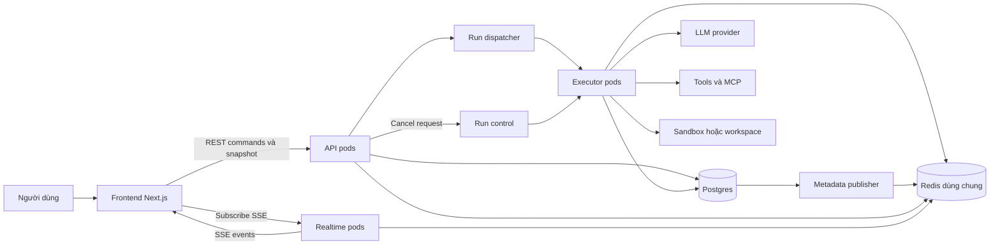

`API pods` và `Realtime pods` là vai trò logic, có thể cùng một service/process ở giai đoạn đầu. Chỉ tách deployment khi có nhu cầu scale độc lập. Dispatcher, metadata publisher và run control là trách nhiệm cần có, chưa chốt thư viện queue hoặc sản phẩm triển khai.

## 4. Trách nhiệm và vòng đời component

| Thành phần | Trách nhiệm | Vòng đời |
|---|---|---|
| Frontend | Render snapshot, apply events, optimistic state, reconnect, sidebar title | Theo tab ứng dụng |
| Command API | Auth/authz, validate input, tạo conversation/message/run, trả acknowledgement | Theo request |
| Snapshot API | Trả view nhất quán cùng watermark và thông tin stream epoch | Theo request |
| Realtime subscriber | Đọc shared feed sau cursor, gửi SSE, heartbeat, xử lý client chậm | Theo SSE connection |
| Dispatcher | Đưa run đã được chấp nhận tới executor, xử lý dispatch thất bại | Service-level |
| Executor | Sở hữu run, hydrate state, chạy loop, lưu kết quả, giải phóng runtime | Theo run |
| Title task | Tạo title độc lập, cập nhật có điều kiện, phát metadata update | Tác vụ nền |
| Runtime factory | Dựng agent/orchestrator từ definition và state | Theo run |
| Resource pools | Pool DB/HTTP và tài nguyên có thể tái sử dụng đúng scope | Theo process |
| Shared stores | Durable state, streaming buffer, projection và ownership records | Ngoài process |

“Agent mới” nghĩa là runtime/orchestrator mới, không phải tải lại model weights khi dùng LLM API. Dữ liệu conversation tồn tại độc lập với object runtime.

## 5. Mô hình domain và quan hệ dữ liệu

Đây là mô hình logic, chưa phải DDL PostgreSQL hoặc quyết định index/migration.

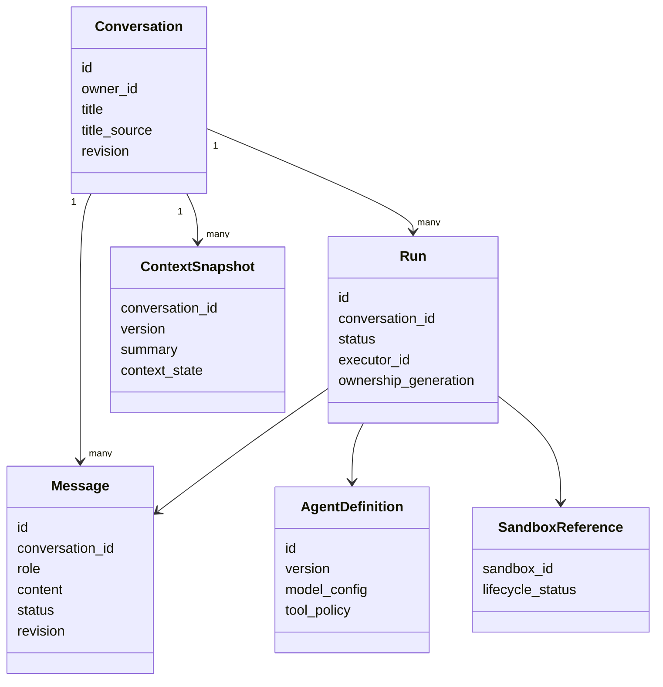

Một run có thể sinh nhiều assistant/tool messages. `Conversation` không đồng nhất với `Run`; cùng một conversation có nhiều lượt nối tiếp. Agent definition có version để biết runtime được dựng từ cấu hình nào. Chính sách khi người dùng gửi lượt mới lúc lượt cũ còn chạy cần chốt riêng, không mặc định chạy song song trên cùng mutable context.

## 6. Storage: dữ liệu nào nằm ở đâu

| Dữ liệu | Owner lưu trữ | Retention / ghi chú |
|---|---|---|
| Conversation, title và quyền sở hữu | Postgres | Bền vững theo chính sách sản phẩm |
| User/assistant/tool messages hoàn chỉnh | Postgres | Bền vững |
| Run status, execution metadata và kết quả | Postgres | Bền vững |
| Context snapshot, summary, capability state | Postgres, qua state store/checkpointer của engine | Không chỉ nằm trong RAM |
| Agent definition và version | Postgres/config registry | Có thể cache theo version |
| Text/reasoning/tool progress đang sinh | Redis Streams | Buffer có TTL và giới hạn dung lượng |
| Response tích luỹ và metadata projection cho bootstrap | Redis | View có version/watermark, có thể dựng lại |
| Lease và ownership generation | Shared coordination store | Cần ghi/kiểm tra nguyên tử |
| Delta batching, UI render state | RAM browser | Mất khi reload, không là nguồn sự thật |
| In-flight runtime và tool accumulator | RAM executor | Chỉ tồn tại khi run hoạt động |
| Sandbox filesystem | Storage của sandbox/workspace | Vòng đời tách agent runtime |

Redis snapshot là view phục vụ realtime, không thay Postgres làm nguồn lịch sử bền vững. Không coi Redis buffer là vĩnh viễn. Cần chọn persistence/HA/eviction policy khi triển khai, chưa có cam kết không mất dữ liệu khi Redis hỏng.

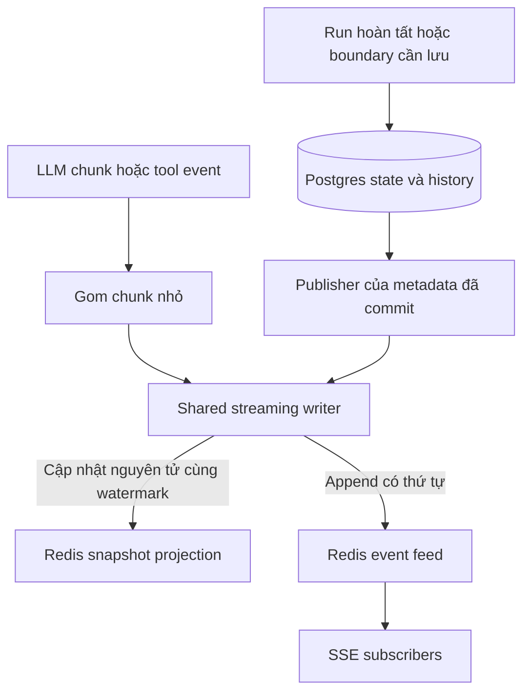

Ranh giới nguyên tử ở đây là **Redis snapshot + event append**, không phải một transaction chung Redis và Postgres. Durable metadata cần cơ chế publish đáng tin cậy sau DB commit. Transactional outbox là một lựa chọn triển khai cần đánh giá, không phải công nghệ đã được chốt.

## 7. REST command API và SSE contract

Các đường dẫn dưới đây là đề xuất, có thể đổi trước khi triển khai đồng bộ client/server.

| Method / endpoint | Mục đích |
|---|---|
| `POST /conversations` | Tạo conversation |
| `GET /conversations` | Danh sách metadata và title |
| `PATCH /conversations/{id}` | Đổi title do người dùng |
| `POST /conversations/{id}/runs` | Nhận prompt, tạo message/run, trả IDs và trạng thái accepted |
| `GET /conversations/{id}/snapshot` | View conversation, phần đang dở và watermark phù hợp với feed |
| `GET /realtime/bootstrap` | Snapshot sidebar và conversation đang xem, kèm cursor của feed tổng hợp |
| `GET /events?after={cursor}&epoch={epoch}` | Một SSE feed cho user/tab đã xác thực |
| `POST /runs/{id}/cancel` | Yêu cầu cancel tường minh |
| `POST /runs/{id}/tool-responses` | Tool approval hoặc câu trả lời cần người dùng |

Một kênh SSE mỗi tab không có nghĩa mọi conversation đều phải đẩy mọi token xuống tab đó. Có thể lọc progress cho các conversation được theo dõi, còn metadata/title vẫn cập nhật sidebar. Khi đổi phạm vi subscription phải có snapshot/cursor hợp lệ cho phạm vi mới.

### 7.1 Event envelope

```json
{
  "event_id": "1840000000123-0",
  "feed_epoch": "epoch-7",
  "type": "message.content.delta",
  "conversation_id": "conv-123",
  "run_id": "run-456",
  "message_id": "msg-789",
  "entity_revision": 18,
  "data": { "text": " thể giúp..." }
}
```

SSE framing:

```text
id: 1840000000123-0
event: message.content.delta
data: {"conversation_id":"conv-123","run_id":"run-456","message_id":"msg-789","entity_revision":18,"data":{"text":" thể giúp..."}}

```

Dòng trống kết thúc event là bắt buộc. `id` là cursor transport, không phải message ID. Native EventSource hỗ trợ reconnect bằng `Last-Event-ID`; nếu dùng fetch-based SSE thì client tự quản lý reconnect/cursor. Sau full reload không giả định browser còn state cũ.

| Event | UI xử lý |
|---|---|
| `conversation.updated` | Cập nhật title/metadata/sidebar |
| `message.created` | Tạo hoặc reconcile message theo ID |
| `message.content.delta` | Nối text theo message và revision |
| `message.reasoning.delta` | Cập nhật reasoning được phép hiển thị |
| `message.completed` | Thay bằng nội dung hoàn chỉnh, đánh dấu đã settle |
| `run.updated` | Cập nhật running/waiting/terminal status |
| `tool.updated` | Cập nhật một tool call/result/approval |
| `resync.required` | Bỏ giả định cursor liên tục và bootstrap lại |

Danh sách event là vocabulary đề xuất. Cần adapter mapping với AG-UI hiện có, không tự mở một agent execution mới khi client chỉ subscribe lại.

### 7.2 Phân biệt các loại số thứ tự

| Giá trị | Phạm vi | Công dụng |
|---|---|---|
| Feed cursor / SSE event ID | Một feed user/subscription | Reconnect và nối snapshot với tail |
| Conversation event seq | Một conversation, nếu engine có | Audit hoặc replay domain events |
| Message/entity revision | Một entity | Bỏ delta/update cũ, kiểm tra duplicate hoặc gap |
| Ownership generation | Một run | Chặn executor cũ ghi sau khi lease đổi chủ |
| Feed epoch | Một thế hệ feed | Phát hiện feed bị reset/recreate |

Không lấy `seq=120` của conversation A làm cursor của feed user chứa cả A, B và C. Nếu snapshot có `through_event_id`, nó phải là watermark của **chính feed/subscription** được mở sau đó. Các ID có thể là opaque string, không mặc định là integer liên tiếp.

## 8. Luồng tạo conversation và chạy câu hỏi đầu tiên

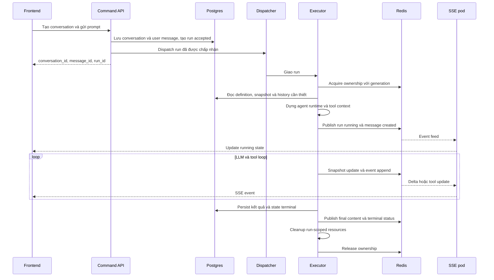

Việc tạo run trong DB và dispatch không được để một run “accepted” bị bỏ quên khi process chết giữa hai bước. Cần delivery/reconciliation policy, chọn cụ thể cùng cơ chế queue. REST acknowledgement không đồng nghĩa run đã hoàn tất hoặc đã bắt đầu model call.

SSE client có thể mở trước khi run bắt đầu hoặc nối sau acknowledgement bằng cursor từ bootstrap. Client không cần nhận tất cả frame ngay lần đầu vì feed có replay trong retention.

## 9. Luồng tạo title song song

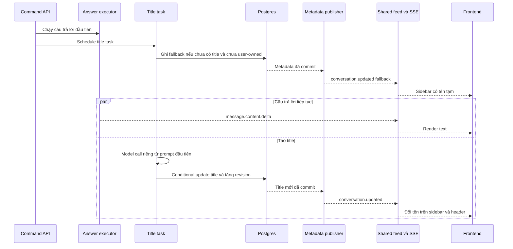

- Fallback có thể là “Cuộc trò chuyện mới” hoặc tên rút gọn từ prompt, chính sách copy cần chốt khi làm UI.
- Title task không chặn token đầu tiên và không stream từng token title xuống UI.
- `title_source=user` ghim tên. Điều kiện chấp nhận title tự động phải kiểm tra tại lúc ghi DB, không chỉ kiểm tra trước model call.
- Title task lỗi hoặc timeout thì giữ fallback. Nó không làm run trả lời thất bại.
- Người dùng đóng browser thì backend vẫn có thể hoàn tất title task.
- Snapshot metadata và update có revision để response GET cũ không ghi đè title mới đã nhận qua SSE.

## 10. Snapshot nhất quán và reconnect

### 10.1 Contract cho snapshot + tail

```json
{
  "feed_epoch": "epoch-7",
  "through_event_id": "1840000000123-0",
  "conversation": { "id": "conv-123", "title": "Giới thiệu Handy", "revision": 3 },
  "active_run": { "id": "run-456", "status": "running" },
  "messages": [
    {
      "id": "msg-789",
      "role": "assistant",
      "content": "Xin chào các bạn, tôi là AI trợ lý Handy và tôi có",
      "status": "streaming",
      "revision": 18
    }
  ]
}
```

Bất biến: snapshot thể hiện view của phạm vi đã yêu cầu tại watermark F. Tất cả thay đổi cần thấy sau F phải tồn tại trong feed để client tail. Feed dùng chung nhiều conversation nên F là cursor của feed đó, không phải revision 18 của message.

Một cách hiện thực đề xuất là runtime view trong Redis: streaming writer cập nhật snapshot và append event trong cùng thao tác nguyên tử, bootstrap đọc view và feed tail nhất quán. Metadata đã commit Postgres được mirror sang view bằng publisher có revision. Nếu dùng Redis Cluster phải bố trí các key tham gia thao tác nguyên tử cùng hash slot hoặc chọn cơ chế đồng bộ khác.

View có thể trễ so với Postgres, nhưng thay đổi chưa mirror phải tới sau bằng event. Không đọc tuỳ ý metadata cũ từ DB, rồi lấy cursor mới nhất của Redis và coi hai thứ là snapshot nhất quán: cách đó có thể bỏ qua update nằm giữa hai lần đọc.

### 10.2 Luồng reload khi run còn chạy

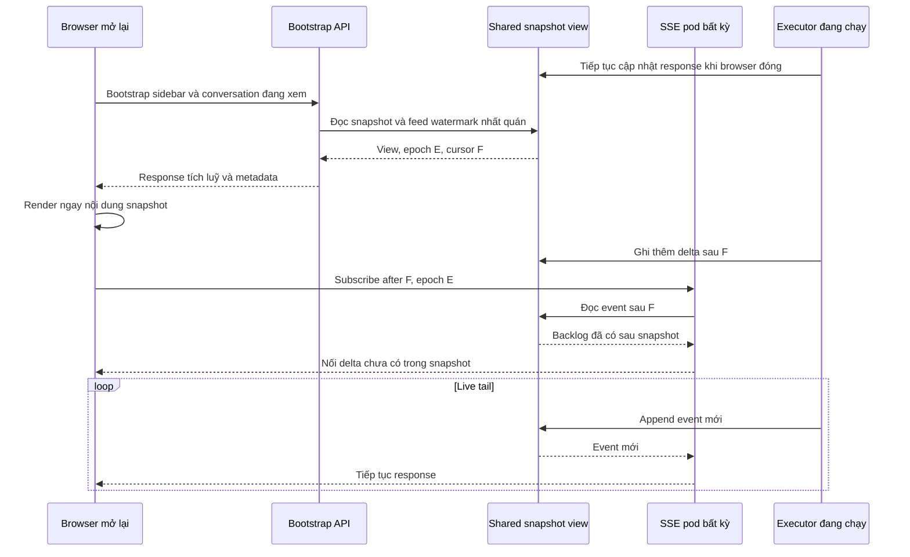

Backlog sau F là phần sinh giữa thời điểm snapshot và thời điểm subscriber bắt kịp, không phải toàn bộ response từ đầu. Khi mạng đứt ngắn và client còn projection trong RAM, có thể reconnect từ cursor đã apply. Full reload thì bootstrap lại để có baseline.

### 10.3 Feed hết retention hoặc bị reset

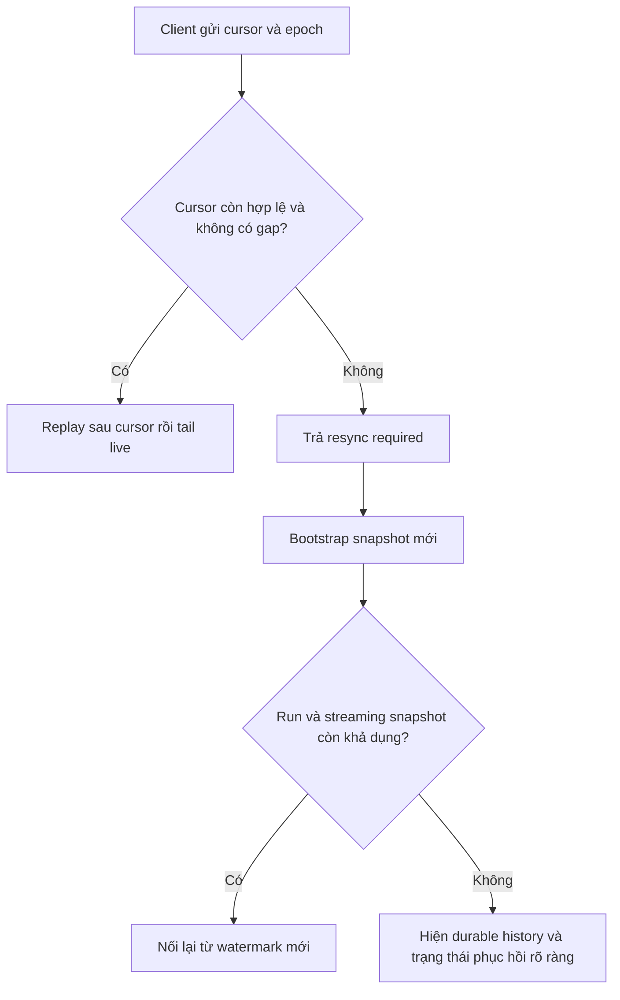

Không im lặng nối suffix nếu prefix đã mất. Redis trim/TTL phải phối hợp feed epoch, retention và snapshot lifetime. Nếu không còn partial snapshot và run chưa có message hoàn chỉnh trong DB, phải hiển thị trạng thái chưa thể phục hồi phần đang dở, không giả dữ liệu đầy đủ.

## 11. Agent runtime và tài nguyên theo lượt

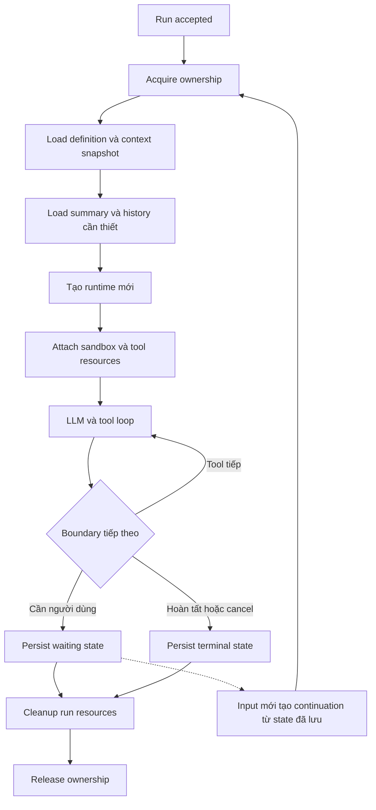

Waiting/continuation là contract đề xuất, phải xác định engine có serialize được state tại boundary hay không. Không mặc định có thể dừng tại bất kỳ dòng Python/TypeScript nào rồi resume ở pod khác.

| Loại tài nguyên | Policy |
|---|---|
| Mutable runtime state | Tách theo run, không dùng chung giữa user |
| Definition đã parse | Có thể cache theo version |
| DB/HTTP clients | Pool theo process |
| MCP connection | Chỉ reuse khi đúng tenant, identity và credential scope |
| Sandbox/worktree | Có thể sống qua nhiều lượt, attach lại qua reference |
| Context dài | Summary và snapshot, không tải toàn bộ log mặc định |
| Runtime idle | Mặc định không giữ lâu, chỉ thêm TTL cache khi có số đo |

## 12. Vòng đời run, cancel và approval

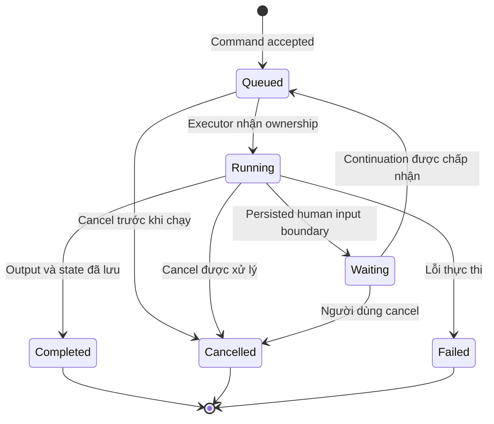

Các tên trạng thái và việc continuation dùng cùng run ID hay run ID mới chưa chốt. Sơ đồ thể hiện lifecycle logic, không khẳng định schema cuối cùng.

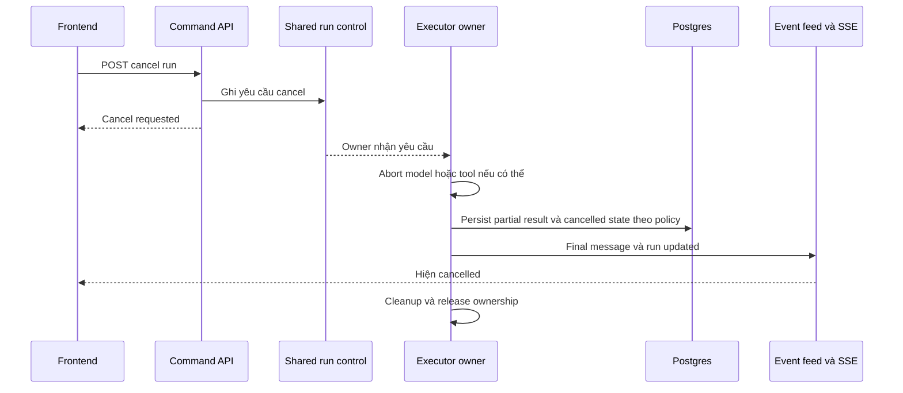

Cancel acknowledgement khác confirmed cancellation. Tool đã tạo side effect bên ngoài không tự rollback. Cần định nghĩa boundary dừng an toàn cho từng tool. Disconnect SSE chỉ đóng subscriber, không đi qua đường cancel này.

## 13. Multi-pod, ownership và scale

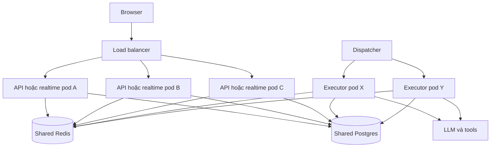

- Một SSE connection đang mở vẫn gắn với một pod. Thêm pod không tự chuyển connection đang có.
- Reconnect có thể tới pod khác vì baseline và feed dùng chung, không cần sticky session cho đường đọc nếu implementation đúng contract này.
- Executor ownership của run độc lập với pod phục vụ SSE.
- Theo dõi concurrent connections, RAM, event throughput, replay lag và độ trễ thay vì chỉ CPU.
- SSE pod không nên mở một kết nối DB dài hạn cho mỗi browser. Nếu dùng Redis blocking read phải tính cả connection budget cho Redis.
- Buffer phía subscriber phải có giới hạn. Client chậm có thể bị detach và yêu cầu resync, không được kéo chậm hoặc làm đầy RAM executor.
- Reconnect cần backoff và jitter để tránh tất cả browser reconnect cùng lúc khi deploy.
- Tách logical feeds theo tenant/user/subscription, tránh một global stream nóng duy nhất cho toàn hệ thống.

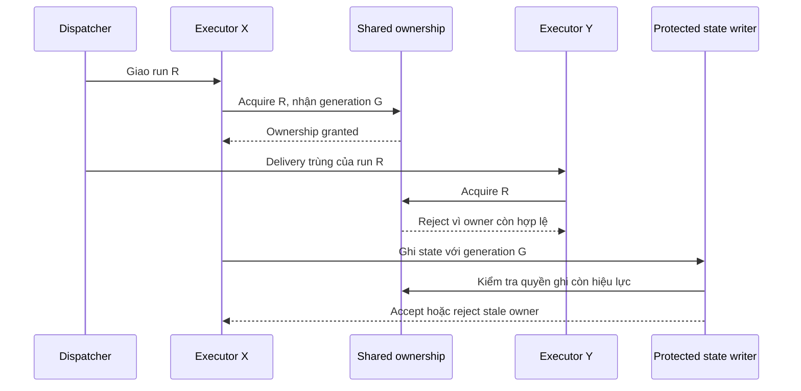

Lease hết hạn không đủ ngăn executor cũ vẫn chạy do network partition. State writer/tool dispatcher cần fencing phù hợp. Quyền gọi tool có side effect cần policy riêng, không hứa exactly-once chỉ nhờ lock.

### 13.1 Ranh giới chưa chốt: executor crash

Buffer Redis giúp giữ phần output đã ghi và cho reader reconnect, nhưng không tự tiếp tục model request hoặc khôi phục call stack đã chết. Chưa chốt automatic takeover giữa lượt, retry policy, idempotency cho tool side effects hoặc engine checkpoint cụ thể.

Thiết kế triển khai phải có ít nhất chính sách phát hiện orphaned run và thông báo trạng thái rõ ràng. Không mặc định mở lại browser sẽ tiếp tục execution sau pod crash giống trường hợp browser disconnect.

## 14. Frontend state và thứ tự áp dụng dữ liệu

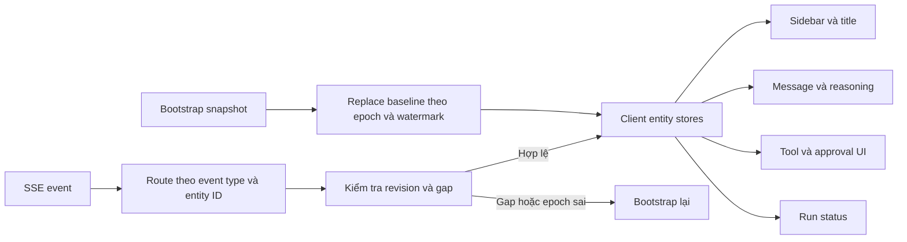

Quy tắc frontend:

1. Hydrate snapshot trước khi apply tail của baseline đó.
2. Dedupe entity bằng ID, không dựa nội dung text.
3. Bỏ update cũ theo revision, kiểm tra gap cho delta không có tính idempotent.
4. Không nối delta lần nữa nếu message đã settle bằng final content có revision mới hơn.
5. Gom delta UI theo animation frame để giảm render mỗi token.
6. Khi đổi conversation hoặc subscription scope, huỷ apply của request cũ vào view mới.
7. Cursor reconnect chỉ xác nhận phần client đã apply, không vượt qua event chưa được xử lý.
8. Fetch metadata cũ không được ghi đè projection mới từ SSE.

## 15. Batching, latency và quan sát vận hành

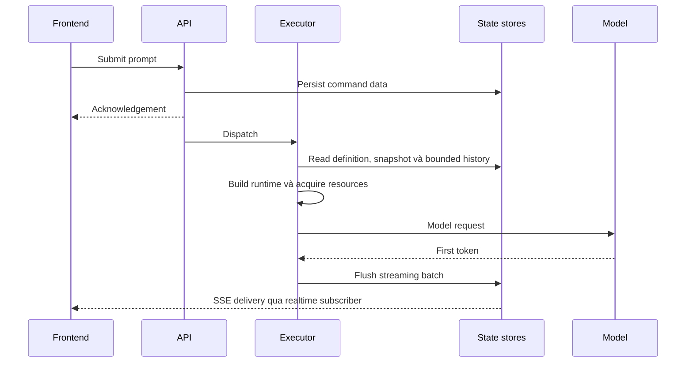

Các khoảng cần đo riêng:

| Metric | Ý nghĩa |
|---|---|
| Command acknowledgement latency | Thời gian nhận prompt tới khi API chấp nhận |
| Queue wait | Thời gian accepted tới khi executor bắt đầu |
| State hydration latency | Đọc context và history |
| Runtime/resource setup latency | Dựng agent, MCP, sandbox attach |
| Model first-token latency | Gọi model tới chunk đầu |
| Publish-to-render latency | Chunk có ở executor tới khi UI nhận/render |
| Snapshot load và catch-up latency | Mở lại chat tới khi có baseline và bắt kịp live |
| Active runs/connections, memory và replay lag | Chỉ số capacity và scale |

Đo p50/p95 và tải đồng thời. Chưa chốt con số mục tiêu, chunk batch size, flush interval hoặc TTL. Phân biệt batching ghi Redis và batching render frontend, vì chúng tác động độ trễ ở hai vị trí khác nhau.

## 16. Failure matrix và kiểm chứng cần có

| Tình huống | Hành vi cần đạt |
|---|---|
| Browser đóng giữa response | Executor tiếp tục, ghi shared buffer |
| Mở lại khi run đang chạy | Snapshot full prefix, nối delta sau watermark |
| Delta sinh giữa snapshot và subscribe | Replay từ shared feed, không mất chữ |
| Reconnect tới API pod khác | Khôi phục cùng view và stream |
| Title hoàn tất khi browser đóng | Lưu DB, mở lại đọc được hoặc nhận update sau baseline |
| User rename trong lúc title task chạy | Title tự động không ghi đè |
| Metadata fetch cũ tới muộn | Không ghi đè entity revision mới |
| Delivery dispatch trùng | Không có hai owner thực thi cùng run |
| Redis feed trim/reset | Phát hiện gap/epoch, yêu cầu bootstrap |
| Client rất chậm | Giới hạn buffer, detach/resync, không kéo chậm executor |
| Cancel được gửi qua pod khác | Owner nhận yêu cầu, UI nhận terminal update |
| Executor chết giữa turn | Phân biệt output replay với execution recovery, không tự hứa resume |
| DB commit xong nhưng publish lỗi | Publisher/reconciliation khôi phục event notification |

Đây là tiêu chí kiểm chứng cho implementation tương lai. Tài liệu này chưa xác nhận chúng đã có trong code hiện tại.

## 17. Đối chiếu các dự án đã khảo sát

| Dự án | Bài học đưa vào kiến trúc đích |
|---|---|
| OpenHands Canvas | Tách provisional UI và durable event, identity ổn định, batching, không nhầm event recovery với token replay |
| OpenHands Agent Server 1.56.0 | Ví dụ runtime cache + idle eviction + hydrate lại, là phương án khác với mặc định run-scoped đã chọn |
| Onyx | Shared replay buffer, worker tiếp tục khi subscriber biến mất, đọc stream xuyên pod |
| TrueForge | Runtime dựng từ snapshot mỗi turn, stream registry riêng với durable store, sandbox có thể attach lại |
| DeepSeek Harness | Fallback title và LLM title bất đồng bộ, generic projection, baseline và revision chống ghi đè cũ |

Tài liệu tham khảo nội bộ:

- [So sánh chat data flow](../architecture/chat-data-flow-comparison.md).
- [OpenHands HLD](../architecture/openhands-HLD.md) và [LLD](../architecture/openhands-LLD.md).
- [Onyx HLD](../architecture/onyx-HLD.md) và [LLD](../architecture/onyx-LLD.md).
- [TrueForge HLD](../architecture/trueforge-HLD.md) và [LLD](../architecture/trueforge-LLD.md).
- [Nối tay AG-UI hiện tại](ag-ui-manual-wiring.md), [batch render reasoning](raf-batched-reasoning-updates.md).

Nguồn code cho các kết luận bổ sung đã kiểm tra trong cuộc trao đổi:

- [TrueForge tạo runtime mỗi turn](/home/lamhung/code/trueforge/packages/trueforge-core/src/agent-session/SessionHandle.ts:179).
- [TrueForge sandbox lifecycle](/home/lamhung/code/trueforge/packages/trueforge-core/src/agent-session/TurnResourceResolver.ts:117).
- [Onyx dựng state và worker mỗi lượt](/home/lamhung/code/onyx/backend/onyx/chat/process_message.py:1144).
- [DeepSeek Harness title service](/home/lamhung/code/deepseek-harness/packages/session/session-title/src/index.ts:503).
- [DeepSeek Harness projection control stream](/home/lamhung/code/deepseek-harness/packages/api/session-controller/src/control.ts:25).
- [OpenHands Agent Server 1.56.0 lifecycle](https://github.com/OpenHands/software-agent-sdk/blob/v1.56.0/openhands-agent-server/openhands/agent_server/conversation_service.py).
- [OpenHands idle TTL configuration](https://github.com/OpenHands/software-agent-sdk/blob/v1.56.0/openhands-agent-server/openhands/agent_server/config.py).

Các tài liệu khảo sát dự án khác là bằng chứng tham khảo, không phải yêu cầu copy nguyên framework hoặc hạ tầng của dự án đó.

## 18. Quyết định đã chốt và phần cần chốt tiếp

| Đã thống nhất | Chưa chốt implementation |
|---|---|
| REST + SSE | Native EventSource hay fetch-based SSE, auth và proxy details |
| Một kênh event tổng hợp mỗi tab | Feed partition, lọc subscription và Redis Cluster key layout |
| Snapshot + live tail | Payload cuối cùng và cách hiện thực atomic snapshot boundary |
| Postgres + Redis | DDL/index, Redis HA/persistence/eviction, retention |
| Runtime mới mỗi lượt | Framework/engine cụ thể, checkpointer và paused-state contract |
| Executor độc lập HTTP | Queue/dispatcher, dispatch reliability và cancel transport |
| Một executor owner mỗi run | Lease store, fencing implementation và tool idempotency |
| Title task độc lập, user rename được bảo vệ | Model title, timeout, retry và fallback copy |
| Reuse resources, đo latency | Pool policy, budget, TTL cache runtime nếu cần |
| Phục hồi khi browser reconnect | Automatic execution recovery sau executor crash |

Các chi tiết được ghi “đề xuất” trong tài liệu là cách làm cho quyết định có thể triển khai và review, không đồng nghĩa đã được chọn thư viện hoặc có production guarantee.
