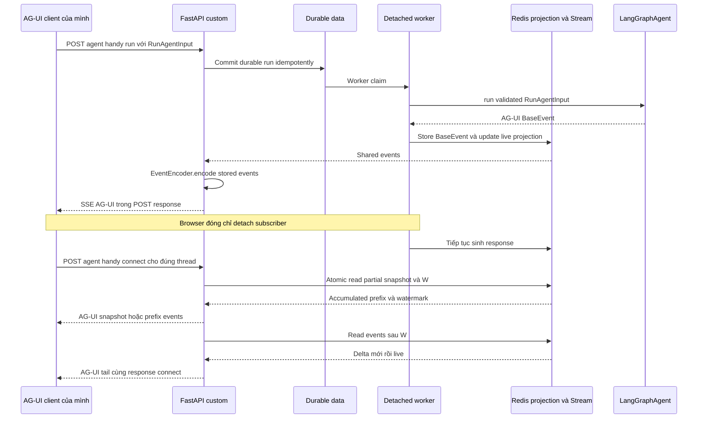

# API cần có cho chat AG-UI — backend custom tham khảo CopilotKit

> Chốt ngày 26/10/2026: backend FastAPI custom + LangGraph OSS + `ag_ui_langgraph.LangGraphAgent` + AG-UI client hiện có. **Không dùng CopilotKit Runtime, React SDK, core hoặc Intelligence.** Source CopilotKit chỉ là tài liệu tham khảo. Chưa triển khai API mới.
> **Lưu trữ production, đề xuất 27/10/2026:** [thiết kế mới](./production-data-storage-design.md) bổ sung journal commit trước SSE và conversation/branch/native-thread mapping. Transport run/connect/stop bên dưới giữ nguyên; field nhánh và ý nghĩa public thread ID phải được chốt cùng implementation, chưa được coi là đã hỗ trợ đầy đủ branching.
>
> **Phạm vi phân quyền:** [tình huống sản phẩm và quyền tổ chức](./chat-use-cases-and-organization-access.md) bổ sung yêu cầu membership, chat/result visibility, source ACL và quyền từng tool action. Các kiểm tra này áp dụng cả history/connect/replay/export và worker thực thi, không chỉ POST run. Đây là yêu cầu thiết kế, chưa xác nhận implementation hỗ trợ.
> Đây là contract thay thế bản Assistant/Thread/Run tham khảo Agent Server trước đó. Kiến trúc worker, Postgres native checkpoint/Store và Redis vẫn theo [thiết kế nền tảng](./langgraph-oss-agent-platform-design.md).
> Quyết định transport: POST run trả AG-UI SSE; POST connect tự gửi snapshot + watermark rồi tail trong cùng response. Không có user feed toàn ứng dụng hoặc hai public endpoint `/realtime/*` trong phạm vi hiện tại.
> Tham chiếu source: `/home/lamhung/code/CopilotKit`, commit `89629de0a26cb0965399c033894a2eed9bee52a2`, package runtime `1.80.0`. Phạm vi là backend chat tự triển khai; không cài CopilotKit Runtime hoặc SDK.

## 1. Chọn API theo ba trách nhiệm

1. **Execution:** AG-UI run, connect, stop; truyền messages/tools/state và lifecycle.
2. **Conversation:** tạo chat, sidebar, tên, archive, xoá và transcript.
3. **Recovery:** snapshot + watermark + tail khi reload, dựa trên shared storage.

Nguồn event live bắt buộc là `from ag_ui_langgraph import LangGraphAgent`: worker consume `.run(validated_input)`, lưu các event AG-UI đã phát, gateway dùng `ag_ui.encoder.EventEncoder` để trả SSE. Không tự viết lại graph-event-to-AG-UI mapper. Tham khảo [phân chia trách nhiệm](./copilotkit-agui-integration.md).

CopilotKit là tham chiếu method/path và cách gọi AG-UI, không phải toàn bộ API của nó đều cần cho chat này. Chỉ tham khảo contract; không cài hay chạy package CopilotKit. Không triển khai Agent Server REST chỉ để frontend dùng AG-UI. Không xây hai endpoint tạo run độc lập cùng thực thi một prompt.

Các đường dẫn dưới đây tương đối với API base, ví dụ `/api`. FastAPI có thể phục vụ trực tiếp hoặc qua Next.js proxy. Không bắt buộc đặt tên base `/api/copilotkit` khi implementation là custom.

## 2. Source CopilotKit xác nhận điều gì?

| Quan sát | Bằng chứng local | Tác động tới dự án |
|---|---|---|
| Có run/connect/stop theo agent key | [fetch-router.ts](/home/lamhung/code/CopilotKit/packages/runtime/src/v2/runtime/core/fetch-router.ts:98) | Dùng làm cấu trúc execution API |
| Thread list là GET, không phải POST search | [router threads](/home/lamhung/code/CopilotKit/packages/runtime/src/v2/runtime/core/fetch-router.ts:229) | Thay `POST /threads/search` bằng `GET /threads` |
| Thread messages/events/state là ba tài nguyên khác nhau | [router inspect](/home/lamhung/code/CopilotKit/packages/runtime/src/v2/runtime/core/fetch-router.ts:163) | Không lấy events hoặc state làm transcript một cách mặc định |
| Rename nhận `name`, có thể cập nhật `archived` | [handleUpdateThread](/home/lamhung/code/CopilotKit/packages/runtime/src/v2/runtime/handlers/intelligence/threads.ts:144) | Public title dùng field `name`, không bọc vào metadata tuỳ ý |
| Thread subscribe trả join token | [handleSubscribeToThreads](/home/lamhung/code/CopilotKit/packages/runtime/src/v2/runtime/handlers/intelligence/threads.ts:183) | Không dùng route đó như SSE metadata của mình |
| Stop có scope runId để tránh dừng nhầm run sau | [handle-stop.ts](/home/lamhung/code/CopilotKit/packages/runtime/src/v2/runtime/handlers/handle-stop.ts:15) | UI Stop luôn gửi runId đang xem |
| Runtime discovery có agents và capability flags | [get-runtime-info.ts](/home/lamhung/code/CopilotKit/packages/runtime/src/v2/runtime/handlers/get-runtime-info.ts:163) | Dùng `/info` thay API authoring Assistants trong MVP |
| Runner có run/connect/isRunning/stop | [agent-runner.ts](/home/lamhung/code/CopilotKit/packages/runtime/src/v2/runtime/runner/agent-runner.ts:79) | Backend cần shared execution service, không chỉ HTTP router |

[Trang endpoint chính thức](https://docs.copilotkit.ai/backend/runtime-endpoints) là tham chiếu bổ sung. Source local được pin ở commit trên là bằng chứng cho các nhận xét cụ thể trong tài liệu này. Các route, payload extension, auth và retention dưới đây là thiết kế của dự án.

Không copy mặc định local-store authorization hoặc nhánh Intelligence. Bản docs online và checkout có thể khác hành vi: ví dụ source stop hiện đã resolve identity/thread ở nhánh Intelligence; không dùng một mô tả security cũ để kết luận toàn bộ mọi version.

## 3. Danh sách API đề xuất

### 3.1. Execution và discovery

| Method/path | Cần khi nào? | Contract |
|---|---|---|
| `GET /info` | Cần cho discovery/capabilities | JSON agent registry và tính năng thực sự hỗ trợ |
| `POST /agent/{agentId}/run` | Cần để submit AG-UI input | Nhận RunAgentInput, enqueue durable run rồi trả SSE BaseEvent |
| `POST /agent/{agentId}/connect` | Cần cho reload/reconnect bằng AG-UI adapter của mình | Attach thread, gửi accumulated snapshot + tail, không chạy prompt mới |
| `POST /agent/{agentId}/stop/{threadId}` | Cần cho nút Stop | Durable stop intent, ưu tiên body `{runId}` |

Đây là cấu trúc route của CopilotKit, không phải bốn endpoint bắt buộc của mọi implementation AG-UI. `/agent/{agentId}/run` có thể thay đường `/agent` hiện có khi refactor; giai đoạn migration chỉ proxy/alias về cùng service, không execute hai lần.

### 3.2. Conversation và history

| Method/path | Mức cần thiết | Nguồn/hành vi |
|---|---|---|
| `POST /threads` | Cần cho lifecycle chat rõ ràng | **Custom extension**, tạo owner mapping trước run |
| `GET /threads?agentId=handy&limit=30&cursor=...` | Cần | Theo CopilotKit list route, pagination do backend quản lý |
| `GET /threads/{threadId}` | Cần cho deep link/detail | **Custom extension**, thread summary và active-run summary |
| `PATCH /threads/{threadId}` | Cần | Rename/archive, dùng `name`, `archived`, revision precondition |
| `DELETE /threads/{threadId}` | Cần | Tombstone, cancel nếu cần, cleanup nền |
| `GET /threads/{threadId}/messages?limit=30&before=...` | Cần | Transcript AG-UI messages; pagination/revision là extension |

`POST /threads` và `GET /threads/{threadId}` **không phải** route create/get detail có sẵn trong fetch-router CopilotKit đã đọc. Chúng là bổ sung chủ động để quản lý ownership và chat chưa gửi prompt. Không giả rằng stock CopilotKit thread UI tự gọi hai extension này.

Chỉ cần một cách archive: `PATCH {archived: true/false}`. Chưa cần thêm `POST /threads/{threadId}/archive` song song.

### 3.3. Vận hành

| Method/path | Hành vi |
|---|---|
| `GET /health/live` | Process liveness |
| `GET /health/ready` | Readiness theo service role |

Snapshot/recovery nằm trong POST connect. Không triển khai `/realtime/bootstrap`, `/realtime/events` hoặc user-feed transport adapter ở giai đoạn này. API upload/voice/feedback chỉ bổ sung khi có feature sản phẩm.

## 4. Contract execution đã chốt

```text
POST /agent/{agentId}/run
  body: RunAgentInput
  Accept: text/event-stream
  response: SSE BaseEvent stream

POST /agent/{agentId}/connect
  body: input attach của AG-UI adapter phiên bản đã pin
  Accept: text/event-stream
  response: snapshot của thread được chọn rồi tail

POST /agent/{agentId}/stop/{threadId}
  body: {runId}
  response: JSON acknowledgement của stop intent
```

`run` không trả `202 JSON` rồi yêu cầu browser tìm stream khác. Run handler nhận input, auth/idempotency, commit durable job và subscribe shared event feed để trả SSE trong chính response. Worker thực thi độc lập bằng LangGraphAgent.run(), disconnect chỉ đóng subscriber; HTTP route không tự consume native graph stream để emit một bộ event khác.

`connect` là endpoint custom FastAPI, không phải CopilotKit Runtime handler. Client nối lại đúng thread/nhánh, nhận accumulated response đã sinh tới watermark W rồi chỉ nhận delta sau W. Không enqueue lại prompt, không gọi LangGraphAgent.run() hoặc LLM chỉ để đọc history.

Frontend giữ `@ag-ui/client` hiện có. Plain HttpAgent một URL `/agent` không tự phát hiện route connect/stop: cần agent adapter nhỏ cho attach/detach/explicit stop, theo API của version được pin. Adapter này không phải CopilotKit và không cần xây user-feed multiplexing.

### 4.1. Một stream cho chat đang chọn

Run và connect là hai operation, không phải hai subscription text song song. Khi đổi thread hoặc bắt đầu run mới, detach consumer cũ đúng lifecycle rồi mở operation tương ứng. Chỉ một stream text hoạt động cho chat được chọn trong mỗi tab; nhiều tab có thể là nhiều subscriber độc lập.

Title, tool và trạng thái của chat đang chọn dùng cùng AG-UI stream, title qua CUSTOM `thread.updated`. Không cam kết push realtime cho tất cả chat nền trong sidebar; sidebar lấy lại từ GET threads khi mở/chuyển chat hoặc refresh.

### 4.2. Snapshot nhất quán trong connect

1. Auth owner, agent binding và thread/nhánh.
2. Đọc nhất quán public messages/state, partial prefix và watermark W từ shared live projection; hydrate durable history khi cần.
3. Dùng models của ag_ui.core dựng restore events đúng schema/lifecycle, EventEncoder encode thành SSE; không chạy lại wrapper.
4. Đọc shared Stream sau W và gửi các delta tiếp theo trong cùng HTTP response.
5. Retention gap/epoch đổi thì dựng lại snapshot trong reconnect; không gửi suffix bị thiếu prefix.

Active message phải giữ messageId. Không phát TEXT_MESSAGE_END chỉ vì vừa gửi prefix. Snapshot có thể dùng MESSAGES_SNAPSHOT/STATE_SNAPSHOT hoặc tái tạo active prefix bằng START + một CONTENT lớn; reducer/open-message bookkeeping phải được integration test, không mặc định mọi client version nhận snapshot là đủ.

Snapshot và tail là bảo đảm do backend/adapter mình hiện thực. Không coi replay của InMemory runner hoặc checkpoint native tự đáp ứng atomic snapshot đang sinh.

### 4.3. Title hoàn thành sau answer

Khi còn stream, gửi CUSTOM update đã committed. Nếu title hoàn thành sau khi stream đã đóng, GET thread/GET threads trả title mới; UI có thể refresh metadata có giới hạn khi title còn pending. Không mở một global SSE chỉ vì title, không hứa mọi chat nền cập nhật tức thời.

## 5. Wire DTO và quy tắc input

### 5.1. Run

```json
{
  "threadId": "thread-uuid",
  "runId": "run-uuid",
  "state": {},
  "messages": [{"id": "user-message-uuid", "role": "user", "content": "Xin chào"}],
  "tools": [],
  "context": [],
  "forwardedProps": {}
}
```

`agentId` là key cấu hình, hiện chỉ có `handy`; giữ để định tuyến nội bộ/mở rộng về sau, UI chưa cần bộ chọn agent. Nó không phải danh tính nhánh hoặc object runtime. Thread phải thuộc principal và agent binding hợp lệ. Native saver/Store hydrate server state; client state/messages không được ghi đè mọi dữ liệu đã lưu.

- Reconcile message IDs với durable transcript, chỉ nhận input mới và tool result/resume đã xác minh.
- Không append toàn bộ history của payload vào checkpoint mỗi request.
- Không cho arbitrary system message hoặc browser-supplied context nâng quyền tools.
- Frontend tool result là input hợp lệ nếu khớp tool call đang chờ; không reject mọi role ngoài user một cách máy móc.
- Ownership/tenant/credential namespace lấy từ authenticated server context.
- Cùng `(tenant, owner, threadId, runId)` và payload chuẩn hoá tương đương là retry cùng operation; khác input phải conflict. Idempotency-Key nếu dùng thêm phải bind nhất quán với runId đó.
- Hash input dùng schema-normalized fields và stable message/tool IDs, không đưa volatile transport cursor vào danh tính prompt.
- Chỉ một invocation được mutate graph state của cùng thread. Duplicate retry attach lại run cũ, không tạo executor mới.

Các event trả cho AG-UI gồm `RUN_STARTED`, text/tool/state events và terminal lifecycle. Title dùng `CUSTOM` tên `thread.updated`, không tạo một event type chuẩn giả. Live events do LangGraphAgent emit; lưu BaseEvent trong envelope Redis có fence/revision/cursor. Gateway restore BaseEvent rồi EventEncoder.encode, không convert native LangGraph events lần nữa. Metadata title dùng CustomEvent của ag_ui.core vì đây là event nghiệp vụ ngoài graph.

### 5.2. Connect

Source [parseConnectRequest](/home/lamhung/code/CopilotKit/packages/runtime/src/v2/runtime/handlers/shared/agent-utils.ts:477) parse body qua RunAgentInput schema và đọc `lastSeenEventId`. Việc parse field này không chứng minh mọi runner đều dùng cursor; [runner interface](/home/lamhung/code/CopilotKit/packages/runtime/src/v2/runtime/runner/agent-runner.ts) không tự bảo đảm replay offset.

Backend custom nên phân biệt `runId` của connect request với active execution ID từ server; connect **không enqueue một run mới**. Version/adapter quyết định chính xác shape connect input; không dùng một `{threadId}` tối giản rồi tuyên bố drop-in compatibility.

Snapshot + tail của mình cần watermark nhất quán và partial prefix. Plain native checkpoint state hoặc backlog compaction không đủ chứng minh yêu cầu này. Active message phải giữ messageId và lifecycle bookkeeping để delta sau snapshot không bị tạo bubble mới hoặc append hai lần.

### 5.3. Stop

```http
POST /agent/handy/stop/thread-uuid
Content-Type: application/json
```

```json
{"runId": "run-uuid"}
```

Server kiểm tra owner, agent/thread membership và exact active run. Stop scope r1 không được dừng r2 vừa bắt đầu sau đó. Body sai key/JSON phải reject, không fallback thành stop thread-wide.

Contract custom đề xuất: `202 {accepted: true, runId, status: "cancel_requested"}` khi đang xử lý; `200 {accepted: false, runId, status: "already_terminal"}` nếu đã xong hoặc không còn là active run trong scope được phép. Không trả `stopped: true` chỉ vì đã ghi cancel intent. Status cuối đến qua AG-UI lifecycle hoặc feed metadata.

Đây là response của backend custom; AG-UI adapter hiện có sẽ gọi explicit stop và đọc acknowledgement này, không dùng CopilotKit proxy. Detach/reload không gọi stop. Không lấy plain HttpAgent HTTP abort làm bằng chứng server đã cancel durable run.

## 6. Thread DTO theo kiểu CopilotKit

Dùng camelCase cho public DTO và `name` làm tên conversation; cột DB vẫn có thể là title. Ví dụ:

```json
{
  "id": "thread-uuid",
  "name": "Thiết kế agent",
  "agentId": "handy",
  "archived": false,
  "createdAt": "2026-10-26T07:00:00Z",
  "updatedAt": "2026-10-26T07:01:00Z",
  "revision": 5,
  "activeRun": {"runId": "run-uuid", "status": "running"}
}
```

Revision và activeRun là extension. GET thread trả metadata/summary, không dump internal graph state. GET list trả `{threads, nextCursor}`; sort ổn định `(updated_at, id)`, dedup khi sidebar nhận update realtime.

`POST /threads` nhận `{agentId}` cùng optional `name`; trả `201` với DTO trên. Owner từ auth, server cấp ID. Retry create dùng Idempotency-Key scope owner+operation. Nếu custom UI muốn cấp ID trước khi POST, phải có cơ chế reservation/idempotency được xác định, không dựa client-generated ID làm quyền truy cập.

```http
PATCH /threads/thread-uuid
If-Match: "5"
Content-Type: application/json
```

```json
{"agentId": "handy", "name": "Tên do người dùng đặt", "archived": false}
```

`agentId` trong mutation, nếu nhận, chỉ để kiểm tra binding; không chuyển graph của thread qua agent khác. Allowlist `name/archived`; user rename đặt title source=user ở DB. Thiếu If-Match trả `428`, sai revision trả `412`. Auto-title task dùng conditional update để không ghi đè tên user.

DELETE trả `202` cho tombstone/cleanup nền. Xoá chat phải chặn run mới, xử lý run đang chạy và native persistence qua workflow idempotent, không xoá checkpoint dưới active writer.

GET messages trả `{messages, nextCursor}`; `messages` là AG-UI Message shape để hydrate client, còn cursor/revision là extension. Không trả DTO toolCalls rút gọn cho inspector rồi dùng nó như AG-UI Message chưa convert; hai schema phải có mapper nếu khác nhau.

## 7. Flow khi mở chat và gửi tin



Không có CopilotKit trong luồng runtime trên. Native checkpoint/Store vẫn do LangGraph quản lý. Redis là shared streaming view để API pod khác có thể attach; không cần sticky routing khi reconnect.

Title task tự chạy từ prompt đầu; conditional update chống ghi đè tên user. History API phục vụ phân trang, không bắt buộc gọi thêm một public snapshot API trước connect.

## 8. API không cần trong MVP

| Endpoint/nhóm | Lý do bỏ hoặc để sau |
|---|---|
| `POST /threads/search` | Đã thay bằng GET threads query |
| Public `POST /threads/{id}/runs` kiểu Agent Server | Không tạo thêm public submit path cạnh AG-UI run; queue service có thể là internal function |
| `/assistants/*` authoring | MVP agent registry từ config, discovery qua info |
| `GET /threads/{id}/events` | Endpoint CopilotKit này trả JSON event history, không phải SSE live; chỉ thêm cho inspect khi cần |
| `GET /threads/{id}/state` | Chỉ thêm debug/shared-state use case rõ ràng; không thay live snapshot trong connect |
| `/realtime/bootstrap`, `/realtime/events` | Đã bỏ khỏi phạm vi, connect chứa snapshot + tail |
| `POST /threads/clear` | Không sao chép thao tác wipe local store vào production |
| `POST /threads/subscribe` | CopilotKit dùng join token, không phải user SSE của mình |
| `POST /threads/{id}/archive` | PATCH archived đã đủ, tránh duplicate API |
| Inspector metadata/debug routes | Không cần cho người dùng chat thông thường |
| Suggest/transcribe/upload/feedback | Chỉ thêm theo feature sản phẩm |
| Store/memories HTTP, cron, A2A, MCP serving | Không cần để native LangGraph memory hoạt động |

Run list/get không bắt buộc cho UI cơ bản nếu thread summary, connect và stream đã có status. Có thể thêm admin/observability route sau; không cần copy mọi API run management của Agent Server.

## 9. Resume và ID mapping

`threadId` là conversation/checkpointer identity. `runId` trên wire AG-UI là một protocol invocation có lifecycle riêng; continuation sau terminal interrupt dùng semantics của version đã pin. `attemptId` là retry nội bộ, logical turn ID nếu có là danh tính nghiệp vụ riêng.

Không giữ custom REST `/resume` làm API browser mặc định rồi kỳ vọng CopilotKit tự gọi. Resume/HITL đi qua AG-UI input được version hỗ trợ và adapter chuyển sang native LangGraph Command. Nếu chỉ chat text ban đầu, defer approval endpoint tới khi có feature.

Không dùng runId đã terminal để tạo thêm một lifecycle không có mapping. Với schema DB run-as-logical-turn ở thiết kế cũ, phải có invocation mapping trước khi triển khai frontend-tool continuation hoặc HITL.

## 10. Info và phạm vi tương thích

Dùng AppInfo của backend custom: agent registry, app/API version và capability run/connect/stop đã triển khai. Không giả CopilotKit RuntimeInfo và không cần phục vụ discovery của CopilotKit proxy vì không dùng proxy đó.

Mục tiêu là backend custom lấy cảm hứng route, giữ AG-UI input/events; không triển khai CopilotKit UI/Runtime/Inspector/Intelligence. Chỉ advertise list/mutations/realtime capability khi endpoint, auth và response thực sự đáp ứng client tương ứng.

Authz bắt buộc trên list/messages/run/connect/stop/patch/delete; opaque UUID không thay auth. Transcript, live view và Store đều phải đúng tenant/user scope.

## 11. Tiêu chí nghiệm thu

- POST run retry cùng identity không nhân run hoặc user input.
- Live graph events chỉ do LangGraphAgent.run() emit; EventEncoder chỉ encode transport, không có mapper native thứ hai.
- Connect/replay không gọi lại LangGraphAgent.run() và không execute LLM/tool.
- POST run và POST connect đều trả AG-UI SSE, không dùng JSON ACK làm response tạo run của browser.
- Reload không gửi prompt mới; snapshot prefix + tail không trùng text hoặc mất delta.
- Chuyển thread/nhánh detach stream cũ, không phát terminal event của run A vào consumer run B.
- Disconnect/detach không stop worker, nút Stop dừng đúng runId.
- Sidebar/title rename thắng background title job.
- Native context trim không xoá transcript UI.
- Không tin client state/history/tool results để nâng quyền hoặc mutate checkpoint tuỳ ý.
- User/tenant khác không list hoặc attach thread bằng ID.
- Deployment nhiều pod sử dụng shared storage; in-memory runner không được coi là durable backend.

Quyết định transport trên đã được người dùng chốt. Implementation và acceptance tests vẫn chưa được thực hiện; không có package CopilotKit nào được thêm vào dự án.
