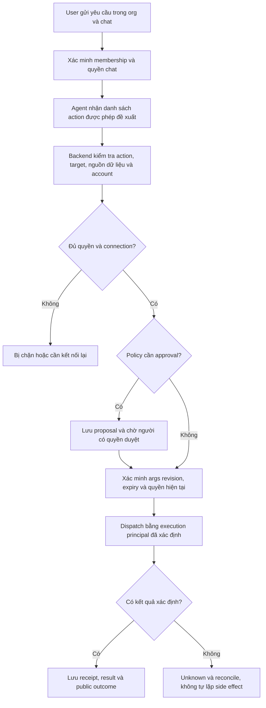
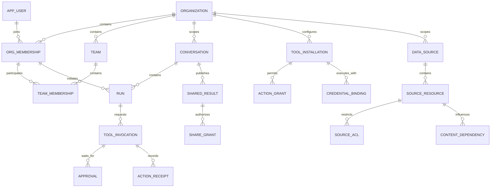

# Tình huống sử dụng chat, phân quyền tổ chức và yêu cầu dữ liệu

Ngày: **27/10/2026**. Trạng thái: **đề xuất yêu cầu sản phẩm để thiết kế database**, chưa phải chức năng đã triển khai hoặc toàn bộ policy đã được người dùng chốt.

Tài liệu đi từ **người dùng muốn làm gì → nhìn thấy gì → cần quyền nào → phải lưu dữ liệu gì**. Đây là đầu vào bổ sung cho [thiết kế lưu trữ production](./production-data-storage-design.md). Không thay LangGraph native Saver/Store, `LangGraphAgent` và SSE đã chọn.

> **Bước cụ thể hóa database:** [Review schema](./database-schema-review.md) chuyển entity model ở đây thành catalogue bảng, quan hệ, access paths và constraints. Tên entity sơ bộ không có nghĩa bắt buộc một entity là một bảng.

## 1. Phạm vi và các giả định đề xuất

- Một người có thể thuộc nhiều tổ chức; mỗi lần chat nằm trong đúng một tổ chức/workspace. Giai đoạn đầu quy ước một organization là một tenant; có thể có nhiều team/project bên trong.
- Một agent mặc định `handy` phục vụ nhiều người. Những tool/data nó được dùng thay đổi theo người đang yêu cầu và phạm vi công việc, không phải mọi người dùng chung quyền của agent.
- Chat mới là riêng tư với người tạo trong tổ chức. Chia sẻ là thao tác rõ ràng, không tự cho toàn bộ admin/team đọc.
- Vai trò tổ chức gồm owner/admin/member. Reviewer, data steward và tool manager là quyền được giao trong phạm vi cụ thể, không bắt buộc thêm role toàn cục cho mỗi chức danh.
- Chia sẻ nội bộ giai đoạn đầu là **bản kết quả chỉ đọc có phiên bản**. Chưa bật cùng sửa/chạy một branch, public link hoặc chia sẻ xuyên tổ chức. Khi bật tính năng nào phải thực hiện đầy đủ quyền của tính năng đó.
- Nội dung có nguồn hạn chế giữ quan hệ với nguồn. Được đọc tài liệu không tự có quyền phát tán câu trả lời dẫn xuất cho người không được đọc nguồn.
- Đây là các mặc định khuyến nghị để có mô hình dữ liệu rõ. Các lựa chọn khác được nêu ở mục 13 để chốt trước DDL.

## 2. Những màn hình người dùng cần có

| Màn hình/vùng | Người dùng thấy | Dữ liệu hoặc quyền quyết định |
|---|---|---|
| Chọn tổ chức | Các tổ chức mình còn là thành viên; tổ chức đang hoạt động | Membership active; preference chọn workspace không thay tenant của run cũ |
| Sidebar | Chat của tôi, kết quả được chia sẻ, tìm kiếm, ghim/archive | Conversation ownership/grants; quyền riêng cho shared snapshot; không list mọi chat của org |
| Header chat | Tiêu đề, dấu riêng tư/chia sẻ, nhánh đang xem | Title/source/revision; branch/view state; quyền rename/share |
| Khung nhập | Text, attachment, phạm vi nguồn, tool khả dụng; nút gửi/stop | Agent policy, quyền người dùng, trạng thái file, connection và quota |
| Câu trả lời | Text streaming, bảng/code, citation, attachment/artifact, phiên bản câu trả lời | Public transcript, source dependency, item type và branch |
| Thẻ hoạt động | “Đang tra cứu tài liệu”, “Đang kiểm tra đơn hàng” | Activity/tool event đã được phép hiển thị; không đưa raw graph state lên UI |
| Thẻ hành động | Hệ thống đích, thao tác, nội dung quan trọng, account thực thi, nút xác nhận | Capability, invocation draft, approval policy, current permission |
| Trạng thái lỗi/chờ | Đang chờ duyệt, cần kết nối lại, chưa xác định kết quả, đã dừng | Run/approval/invocation/connection state; không quy mọi tình huống thành lỗi chung |
| Nguồn và kết nối | Nguồn được phép dùng, trạng thái cập nhật, account đã kết nối | Source ACL, connector installation, credential binding |
| Memory | Những thông tin đã nhớ về tôi trong tổ chức này; sửa/xóa | Native Store namespace + provenance + quyền owner |
| Quản trị | Membership/team, tool installation, policy, usage và audit theo quyền | Control-plane permission riêng; không mặc định có quyền đọc chat riêng |

UI chỉ nên hiện tên và mô tả dễ hiểu như “Tra cứu đơn hàng”, không bắt người dùng hiểu function name, checkpoint ID, seq hoặc Redis. Các ID kỹ thuật nằm trong API/log để hỗ trợ vận hành.

## 3. Danh mục tình huống sử dụng

### 3.1. Hội thoại thường, lịch sử và nhánh

| ID | Yêu cầu/ngữ cảnh mẫu | Hiển thị và hành vi mong đợi | Quyền | Dữ liệu cần lưu |
|---|---|---|---|---|
| C01 | “Viết giúp tôi email xin nghỉ phép” | Chat mới, title tạm → câu trả lời xuất hiện dần → title tự sinh; chưa gửi email ra ngoài | Org active, `chat.create`, agent/model được phép | Conversation, input, run/attempt, transcript, title job |
| C02 | “Viết ngắn hơn và lịch sự hơn” | Trả lời theo nhánh đang chọn, giữ câu cũ | Quyền tiếp tục chat và context đang dùng | Branch/native thread, parent item, run input/checkpoint boundary |
| C03 | Đóng browser giữa câu rồi mở lại | Hiện ngay prefix đã commit, trạng thái đang trả lời, nhận suffix | Re-authorize chat/branch và dependency trước connect | Stream snapshot/journal, run status, stable item ID, cursor |
| C04 | Bấm Stop | “Đang dừng…” rồi “Đã dừng”; giữ output đã tạo | Quyền stop run cụ thể, đúng actor/scope | Durable cancel intent, actor/time, final status, partial output |
| C05 | Request gửi trùng do mạng; hoặc chọn “Tạo lại câu trả lời” | Retry mạng không tạo hai run; regenerate tạo phương án mới rõ ràng | Same request identity hoặc quyền tạo run mới | Idempotency key/hash, run kind, generation, sibling/branch |
| C06 | Sửa câu hỏi cũ, chọn đáp án khác, fork chat | Giữ câu/nhánh cũ; chỉ hiện descendants của lựa chọn; fork có nguồn xuất phát | Quyền đọc prefix và fork; checkpoint boundary hợp lệ | Parent tree, branch head, lineage, checkpoint pin/version |
| C07 | Đổi tên trước khi title tự sinh xong | Tên do người dùng nhập được giữ | Rename conversation | Title source/revision, job input revision, conditional update |
| C08 | Hai tab xem hai nhánh; gửi khi chat đang chạy | Mỗi tab giữ lựa chọn; lượt đang chạy không đổi context; báo bận hoặc hiển thị queued nếu đã hỗ trợ | Run limit và conversation policy | Per-user view hint, tab local state, immutable run branch/actor |
| C09 | Tìm chat, ghim, archive, đọc lại từ điện thoại | Chỉ thấy chat được quyền; archive không xóa; danh sách theo hoạt động | List/read đúng org, owner hoặc grant | Sidebar indexes, view/read state, title/search fields |

**Phân biệt UI:** “Thử gửi lại” vì chưa biết server nhận request hay chưa phải giữ idempotency identity. “Tạo lại” là một lần thực thi mới, có thể phát sinh chi phí/tool side effect; không dùng cùng nút/semantics cho hai trường hợp.

### 3.2. Hỏi trên file, tài liệu và dữ liệu doanh nghiệp

| ID | Câu hỏi/ngữ cảnh mẫu | Hiển thị và hành vi mong đợi | Quyền | Dữ liệu cần lưu |
|---|---|---|---|---|
| D01 | Upload PDF: “Tóm tắt hợp đồng này” | Upload → đang xử lý → sẵn sàng hoặc lỗi có retry; không nói đã đọc file khi chưa sẵn sàng | Upload, use-in-context và read file đúng org/chat | Object reference, content version/hash, processing job/status, item-file link |
| D02 | “Chính sách nghỉ phép năm nay là gì?” | Cho biết đang tra nguồn nội bộ; answer có citation và ngày/phiên bản nguồn | Source query + document read của người hỏi | Source/connection, document/version, ACL, retrieval/citation provenance |
| D03 | “Liệt kê lương của phòng kinh doanh” khi không có quyền HR | Không đưa dữ liệu vào model; báo thiếu quyền ở mức không tiết lộ nguồn bí mật; có lối yêu cầu quyền nếu org cho phép | Document/row/field scope, không suy từ câu prompt hoặc chức danh | Principal/team, resource scope, policy decision, request-access nếu có |
| D04 | “So sánh doanh thu dự án A và B” nhưng chỉ được đọc A | Hỏi lại hoặc trả kết quả trong phạm vi được phép, nói rõ chưa đủ dữ liệu; không suy đoán số của B | Quyền từng dataset/entity/field | Source/resource constraints, authorized retrieval refs, output completeness status |
| D05 | Nguồn bị sửa/xóa hoặc quyền bị thu hồi sau khi có answer | Answer cũ có version đã dùng; nội dung bị hạn chế không tiếp tục được phục vụ theo policy mục 8 | Quyền nguồn hiện tại và quyền xem derived content | Document version, ACL revision/freshness, dependencies, restriction status |
| D06 | “Xuất báo cáo này thành Excel/PDF” | Artifact card có tên, trạng thái tạo, tải xuống; mở lại vẫn cấp được link | Export/create artifact và read nội dung đầu vào; download được kiểm tra riêng | Artifact, object key/version, originating run, content dependencies, export job |
| D07 | “Tìm trên web rồi đối chiếu tài liệu nội bộ” | Nguồn web và nội bộ phân biệt; không tự gửi văn bản nội bộ vào công cụ bên ngoài | Tool/domain được phép và policy đưa dữ liệu ra ngoài | Destination/tool policy, classification/provenance, request summary |

Citation phải trỏ tới **source identity và version**, không chỉ URL. Các kết quả từ API doanh nghiệp cũng cần provenance/resource scope dù không có “document” trong vector index. File tải về có thể chứa dữ liệu dẫn xuất nên kế thừa giới hạn chia sẻ của nội dung đó.

### 3.3. Tool và hành động trên hệ thống khác

| ID | Yêu cầu/ngữ cảnh mẫu | Hiển thị và hành vi mong đợi | Quyền | Dữ liệu cần lưu |
|---|---|---|---|---|
| T01 | “Đơn A123 đang ở đâu?” | Thẻ đang tra hệ thống đơn hàng → kết quả và thời điểm đọc | `order.read`, account/đơn/field thuộc phạm vi | Installation/capability, execution principal, invocation, authorized targets, result/provenance |
| T02 | “Tạo ticket lỗi đăng nhập ở dự án A” | Preview project/title/description; xác nhận nếu policy yêu cầu → ticket ID/link sau khi thành công | `ticket.create` trên project A; connection còn hiệu lực | Request args/hash, approval nếu cần, idempotency, external receipt |
| T03 | “Gửi báo cáo này cho khách hàng” | Hiện đúng người nhận, subject, body, file, account gửi; chọn sửa/xác nhận/hủy | `email.send`, người nhận/miền và nội dung được phép gửi | Immutable action proposal/version, recipient scope, approval và receipt |
| T04 | “Hoàn tiền đơn hàng này” cần người khác duyệt | “Đang chờ người có thẩm quyền duyệt”; approver thấy đúng action và bằng chứng cần thiết | Quyền đề xuất, quyền duyệt và quyền thực thi được định nghĩa riêng | Approval policy/version, approver scope, args hash, decision, execution principal |
| T05 | Tool timeout sau khi có thể đã tạo ticket/chuyển trạng thái | “Chưa xác định kết quả”; cho kiểm tra trạng thái; không tự tạo thêm thao tác | Reconcile/read operation và quyền action nếu retry thật sự cần | Invocation `unknown`, operation/idempotency key, reconciliation job, receipt |
| T06 | Tool được cấp nhưng account chưa kết nối/hết token | “Cần kết nối” hoặc “Kết nối lại”; sau khi xong kiểm tra lại quyền trước chạy | Grant use tool không thay OAuth/service credential | Connection status/scopes/owner, secret reference, expiry/revocation |
| T07 | Admin tắt tool khi run đang chờ duyệt | Không thực hiện action dù nút cũ vẫn còn ở browser; hiển thị policy đã thay đổi | Quyền hiện hành tại resume và trước dispatch | Grant/policy revision, approval invalidation, audit, run reason |

Các tool chỉ đọc không cần tự thêm bước xác nhận nếu policy cho phép. Tool ghi cần xác nhận theo mức tác động được cấu hình; “LLM muốn gọi tool” không phải quyết định cấp quyền. Giao diện cần phân biệt **bị chặn quyền**, **thiếu kết nối**, **chờ duyệt**, **đang thực hiện**, **thất bại**, **chưa xác định**, **thành công**.

### 3.4. Tổ chức, chia sẻ, memory và vòng đời dữ liệu

| ID | Ngữ cảnh mẫu | Hiển thị và hành vi mong đợi | Quyền | Dữ liệu cần lưu |
|---|---|---|---|---|
| O01 | Một user ở org A và B; chuyển org khi run A đang chạy | Sidebar/tool/memory đổi theo B; run A vẫn thuộc A, không đổi account thực thi | Membership và tenant context mỗi request | User, membership, organization, immutable run org/actor |
| O02 | Admin mời thành viên, thêm vào team Sales | Mời → pending → active; quyền team có hiệu lực theo membership | Manage membership/team trong org | Invitation, membership lifecycle, team membership, audit |
| O03 | Chia sẻ kết quả cho đồng nghiệp/team | Chọn bản/nhánh và người nhận; preview phần được share; người nhận xem read-only | Share permission + quyền phân phối nội dung/dependencies | Shared snapshot/version, recipient grants, expiry/revocation, dependency set |
| O04 | Người nhận muốn hỏi tiếp từ kết quả được chia sẻ | Tạo chat/branch thuộc phạm vi người nhận nếu context hợp lệ; không dùng account của người chia sẻ | Fork/continue riêng; quyền nguồn/tool của actor mới | Lineage, sanitized/authorized context provenance, new run principal |
| O05 | “Nhớ tôi thích báo cáo bằng tiếng Việt” | Xác nhận nhớ; có màn xem/sửa/xóa trong org hiện tại | Memory write/read đúng user+org | Native Store namespace/key, revision, provenance, memory job |
| O06 | “Đừng nhớ thông tin này nữa” hoặc sửa memory sai | Hiện đã sửa/xóa; lượt sau dùng state phù hợp, cache/index được invalidated | Owner memory hoặc delegated policy rõ | Store update/delete, provenance, revision, cleanup task |
| O07 | Thành viên bị khóa/rời org khi có SSE/run/approval | Mất truy cập org; stream đóng và action chờ bị chặn; UI không chuyển run sang org khác | Current membership; explicit reassignment nếu cần | Revocation version, cancel/invalidation events, org custodian policy |
| O08 | Xóa chat, xóa tài khoản hoặc export lịch sử | Chat biến khỏi danh sách sau tombstone; export đúng scope; memory/files có phạm vi cleanup rõ | Delete/export theo resource; admin không mặc định được export mọi private chat | Tombstone, purge/export job, references/provenance, audit |
| O09 | Người vận hành hỏi “Ai đã gửi email này, ai duyệt?” | Audit hiển thị actor, thời gian, action, outcome; transcript chỉ mở nếu có quyền riêng | Audit read theo phạm vi, content read riêng | Audit events, policy/args versions, invocation/approval/receipt references |

## 4. Ví dụ hỏi–đáp cụ thể làm tiêu chí sản phẩm

### 4.1. Hỏi tài liệu nội bộ có quyền

**User:** “Năm nay tôi có bao nhiêu ngày phép?”

Hệ thống xác định câu hỏi cần chính sách chung hay số dư cá nhân. Nếu chỉ có tài liệu chính sách, trả quy định kèm citation và nói chưa có số dư của người hỏi. Nếu có tool HR được cấp, tra số dư bằng external identity của người đó. Không dùng tên người trong prompt thay authenticated identity.

**UI:** “Đang đọc chính sách nghỉ phép” → “Đang tra số dư của bạn” → câu trả lời phân biệt quy định và số dư thực tế, kèm thời điểm dữ liệu.

**Database bị ảnh hưởng:** ngoài messages cần membership → external account mapping, source/version, invocation và output dependencies. Một cột `can_use_hr=true` không đủ để giới hạn “chỉ xem chính tôi”.

### 4.2. Hỏi ngoài phạm vi dữ liệu

**User thuộc Sales:** “Cho tôi bảng lương của Engineering.”

Nếu không có grant phù hợp, không retrieve dữ liệu rồi mới yêu cầu model giấu đi. Trả thông báo như “Tôi chưa có dữ liệu được cấp quyền để trả lời yêu cầu này.” Chỉ hiện yêu cầu cấp quyền nếu workflow có hỗ trợ; không tiết lộ tên file/bảng nhạy cảm mà user chưa được discover.

**Database bị ảnh hưởng:** source/resource grants, scope constraints, current policy revision và audit decision; không thể chỉ kiểm tra conversation.owner_id.

### 4.3. Gửi email khác với viết email

**User:** “Viết email gửi khách hàng về tiến độ dự án.” → sinh bản nháp trong chat, chưa có side effect.

**User:** “Gửi bản này cho an@example.com.” → tạo action proposal với recipients/subject/body/attachment đã xác định; UI cho xem lại và xác nhận theo policy.

Sửa người nhận hoặc attachment sau khi duyệt tạo proposal revision mới và yêu cầu duyệt lại. Record approval gắn args hash/version và đúng invocation. Nếu external API timeout, UI “Chưa xác định kết quả” cho tới khi có receipt/reconcile; không báo “Đã gửi” chỉ vì graph kết thúc.

**Database bị ảnh hưởng:** proposal/invocation, approval, credential binding, external operation ID, receipt và state unknown; một message role=tool không đủ diễn tả vòng đời này.

### 4.4. Người quản lý duyệt nhưng không cho mượn quyền

**Nhân viên:** “Xin hoàn tiền đơn A123.”

Workflow phải có quyền đề xuất và policy cho phép service account thực hiện sau approval. Reviewer duyệt đúng amount/order/revision, sau đó backend kiểm tra lại điều kiện thực thi. Nếu hệ thống chưa có workflow delegated execution, việc reviewer bấm approve không tự cấp quyền hoàn tiền cho nhân viên.

Nếu muốn reviewer trực tiếp làm thay, tạo execution mang principal của reviewer hoặc service principal được policy cho phép; UI/audit ghi rõ ai yêu cầu, ai duyệt, ai thực hiện. Không thay actor bằng sửa `user_id` trên run cũ.

### 4.5. Chia sẻ câu trả lời có nguồn hạn chế

**Lan thuộc Finance** hỏi số liệu dự báo rồi chia sẻ kết quả cho **Minh thuộc Sales**.

Quyền Lan đọc nguồn không tự cho Lan phát tán ra mọi team. Chính sách khởi đầu: share chỉ thành công nếu audience được phép nhận phần nội dung đó. Với nguồn chỉ một số người được đọc, dùng direct-recipient grant đã kiểm tra; team grant cần policy source/team rõ, không suy từ việc tất cả thành viên hiện tại tình cờ có quyền.

Nếu Minh thiếu quyền, không chỉ giấu citation mà vẫn hiện số dự báo trong câu trả lời. Chặn chia sẻ bản đầy đủ; tùy sản phẩm có thể tạo bản đã biên tập/phê duyệt cho audience khác trong workflow riêng. Không coi LLM tự “xóa dữ liệu nhạy cảm” là bằng chứng đủ quyền chia sẻ.

**Database bị ảnh hưởng:** shared snapshot, audience grants, content/source dependencies, redistribution policy và version. Cho phép viewer đọc chat không cấp quyền tải file gốc hoặc gọi tool Finance.

### 4.6. Hỏi tiếp từ kết quả chia sẻ

**Minh:** “Tính thêm tỷ lệ tăng trưởng từ câu trả lời Lan chia sẻ.”

Minh chỉ có thể dùng context được authorize cho Minh. Checkpoint của Lan có thể chứa private tool result, memory cá nhân hoặc nguồn không xuất hiện trong bản share. Giai đoạn đầu chỉ cho read-only share; tính năng hỏi tiếp, khi triển khai, tạo execution context mới từ nội dung được phép và graph contract đã kiểm thử. Không attach trực tiếp native thread của Lan.

Lựa chọn checkpoint mới này khác fork cùng owner trên một branch có đầy đủ quyền. Schema phải lưu cả **lineage nội dung** và **execution actor**, không dùng chung một `owner_id` để diễn tả cả hai.

## 5. Mô hình phân quyền đề xuất

### 5.1. Bốn phạm vi cần kiểm tra

| Phạm vi | Câu hỏi kiểm tra | Ví dụ permission |
|---|---|---|
| Tổ chức | User còn thuộc org? Được quản trị phần nào? | membership.manage, team.manage, integration.manage |
| Chat/kết quả | User được xem/đổi/chia sẻ/chạy tiếp resource này? | conversation.read/rename/delete/fork, share.create/revoke |
| Dữ liệu | User được tìm/đọc/tải/trích xuất những tài liệu, row, field nào? | source.search, document.read, attachment.download, data.export |
| Tool action | User được thực hiện thao tác nào, trên đích nào, bằng account nào? | order.read, ticket.create, email.send |

Có thêm policy runtime như model/provider được phép, quota và đưa dữ liệu ra ngoài. Chúng là điều kiện bổ sung, không thay quyền nội dung.

Nguyên tắc nền là quyền tối thiểu, mặc định từ chối khi chưa có grant và kiểm tra authorization ở mỗi đường truy cập. Role đơn thuần không mô tả đủ quan hệ owner/team/resource. [OWASP Authorization](https://cheatsheetseries.owasp.org/cheatsheets/Authorization_Cheat_Sheet.html).

### 5.2. Vai trò tổ chức và quyền tài nguyên

| Actor | Được làm theo mặc định đề xuất | Không tự được cấp |
|---|---|---|
| Org owner | Quản trị tổ chức, membership, giao quyền quản trị | Đọc mọi chat riêng, mọi nguồn dữ liệu, dùng mọi external account |
| Org admin | Quản lý phần cấu hình/membership/integration được giao | Đọc private transcript hoặc raw credential |
| Member | Tạo chat riêng, dùng tool/data đã được cấp | Quản trị org hoặc mở dữ liệu đồng nghiệp |
| Team member | Nhận resource grants gắn team trong org | Quyền vượt resource scope của grant |
| Conversation creator/custodian | Quản lý chat theo policy, đọc nội dung còn được phép | Quyền vĩnh viễn với source đã bị revoke |
| Shared-result viewer | Đọc snapshot được chia sẻ nếu grants/dependencies còn hợp lệ | Native checkpoint, tool execution, chỉnh source chat |
| Approver theo scope | Đọc action preview đủ để ra quyết định và duyệt trong scope | Mọi private history của người yêu cầu hoặc tự nâng quyền action |
| Auditor theo scope | Đọc audit metadata được cấp | Nội dung chat/file/token nếu không có grant riêng |

“Admin không mặc định đọc nội dung” chỉ đúng nếu quyền cấp grant/policy cũng được giới hạn. Admin có thể thay mọi data policy để tự cấp quyền thì thực tế vẫn có đường nâng quyền. Thiết kế cần tách grant authority cho dữ liệu hạn chế, ghi audit và nếu cần có quy trình truy cập đặc biệt được bật rõ; không hứa riêng tư chỉ dựa vào việc UI giấu nút đọc chat.

### 5.3. Capability và resource scope

Một tool CRM có thể có `customer.search`, `customer.read`, `customer.update`, `customer.export`. Không cấp một boolean “được dùng CRM” rồi cho phép mọi action.

Grant nên chỉ rõ principal, action, installation/resource scope, các điều kiện đã được backend hỗ trợ, expiry và người cấp. Scope ví dụ: project A, các account được phân công, đơn hàng của customer thuộc team, field được phép. Scope là dữ liệu có schema/validator; không nhận SQL hay biểu thức thực thi tùy ý từ browser.

Khởi đầu dùng role nhỏ cho quyền quản trị và typed resource grants cho các quyền nghiệp vụ. Không cần policy DSL tổng quát hoặc hàng trăm role theo tên phòng ban. Nhiều grant hợp lệ có thể cộng quyền; policy cấm của tổ chức và membership revoked là giới hạn trên không được grant nhỏ vượt qua.

## 6. Quy trình kiểm tra một tool call

Điều kiện thực thi gồm: membership active; quyền action trên target; policy organization/agent; account thực thi phù hợp; nguồn được dùng hợp lệ; approval đúng revision nếu cần. Snapshot quyền lúc tạo run dùng để audit và hạn chế capabilities đã chấp nhận, **không phải giấy phép vĩnh viễn**. Thu hẹp quyền phải áp dụng; việc vừa cấp thêm quyền giữa run không tự mở rộng hành động đã được người dùng chấp nhận.

### Credential có hai trường hợp

| Chế độ | Ví dụ | Quy tắc |
|---|---|---|
| Delegated user | Đọc mailbox/lịch bằng account người hỏi | Binding phải đúng actor+org và external account; người xem chat không kế thừa account |
| Org service account | Tạo ticket bằng bot của tổ chức | Backend giới hạn action/target theo grant; quyền token bên ngoài rộng không đồng nghĩa user có quyền rộng |

Run/invocation lưu `initiated_by`, `execution_principal`, `credential_binding_id` và effective scope/reference. Database lưu secret reference hoặc encrypted credential theo cơ chế triển khai; transcript, checkpoint, AG-UI event và audit payload không chứa token. Chỉ giữ credential handle trong runtime state khi cần, rồi resolve lại có kiểm tra quyền lúc dispatch.

Approval lưu proposal version/hash, invocation ID, reviewer scope, expiry và decision actor/time. Thay args phải duyệt lại; approval đã dùng không được replay để chạy action thứ hai. LangGraph interrupt hỗ trợ pause/resume state, còn ứng dụng phải kiểm tra ai được quyết định và quyết định cho hành động nào. [LangGraph interrupts](https://docs.langchain.com/oss/python/langgraph/interrupts).

## 7. Quyền nguồn dữ liệu phải theo tới kết quả

### 7.1. RAG và API doanh nghiệp

Quyền sử dụng connector và quyền từng tài liệu/row là hai điều kiện. Tool chỉ nhận các kết quả đã authorize **trước khi** đưa vào model. Với connector có native ACL, mapping external principal/group và freshness của ACL là một phần dữ liệu cần lưu; local team role không thay remote ACL.

Phạm vi hiệu lực là giao giữa quyền ứng dụng, quyền external source và policy dữ liệu. Service account connector có thể index nhiều dữ liệu hơn người dùng được tìm. Backend phải áp dụng document/row/field scope, không chỉ ẩn citations sau khi model đã nhìn toàn bộ dữ liệu.

Nguồn không có khả năng filter quyền đủ tin cậy thì hạn chế deployment đó cho tập audience đồng nhất, hoặc không bật integration với dữ liệu hạn chế. Chưa đồng bộ ACL/không xác minh được quyền hiện tại thì trả unavailable trong phạm vi đó theo freshness policy; không đoán allow từ lần đọc cũ vô thời hạn.

### 7.2. Provenance cần giữ những gì

- Source/connection và resource external ID, version/hash, thời điểm đọc.
- ACL/policy revision hoặc bằng chứng kiểm tra quyền phù hợp với connector.
- Item/artifact/memory/share snapshot nào phụ thuộc nguồn đó.
- Các dependency kế thừa từ context trước, summary và tool output, **không chỉ những citation model chọn in ra**.
- Redis/search/cache namespace hoặc revision đủ để invalidation theo audience/policy; không cache một answer riêng tư rồi trả cho toàn org.

Không khẳng định có thể truy vết chính xác từng chữ do nguồn nào tạo ra. Policy an toàn ban đầu giữ dependency ở mức item/run/branch; nếu context có nguồn hạn chế, coi output phụ thuộc nguồn đó cho tới khi có workflow xuất bản bản độc lập được định nghĩa rõ.

### 7.3. Share snapshot khác live conversation

Share snapshot chụp phần nội dung và branch boundary cụ thể, có version và audience. Message mới sinh sau đó không tự xuất hiện trong bản đã chia sẻ. Thao tác “Cập nhật bản chia sẻ” tạo version mới sau khi kiểm tra nội dung và audience.

Ưu tiên tách `shared_result`/`shared_result_grant` khỏi `conversation_grant`: người nhận bản share không vô tình được gọi endpoint lịch sử để đọc nhánh khác. Nếu sau này có live shared conversation, đó là loại grant riêng, với kiểm tra context/tool mỗi lượt theo actor; không mở rộng silent từ read-only share.

## 8. Thu hồi quyền, đổi tổ chức và lịch sử cũ

| Thời điểm | Hành vi cần thiết |
|---|---|
| Nhận prompt | Kiểm tra membership/chat/scope, ghi org+actor bất biến lên run |
| Worker nhận queue | Kiểm tra lại quyền hiện tại, không dùng request đã chờ lâu như giấy phép |
| Trước retrieval/tool dispatch | Kiểm tra action/targets/credential và quyền nguồn |
| Khi approve/resume | Kiểm tra cả requester, reviewer, payload revision và nguồn/context còn hợp lệ |
| Khi GET history/connect/replay/download/export | Kiểm tra quyền người đang đọc và content dependencies; việc event đã commit không đồng nghĩa mọi user được nhận |
| SSE đang mở | Nhận invalidation và kiểm tra định kỳ trong khoảng giới hạn; ngừng phát nội dung sau khi biết quyền bị thu hồi |

Cần công bố/đo giới hạn trễ thu hồi quyền; không hứa revoke và mọi socket trên mọi pod đồng thời dừng ngay trong cùng một thời điểm. Pub/sub là hint, authoritative revision ở database; cache quyền có TTL và đường refresh. Action đã tới hệ thống ngoài có thể không thu hồi được, nên lưu receipt và phản ánh outcome thật.

Theo policy mặc định đề xuất, khi mất quyền source, không tiếp tục phục vụ response/checkpoint context dẫn xuất chứa source đó. Có thể hiện placeholder “Một phần nội dung không còn khả dụng” mà không tiết lộ source title. Nếu chưa có redaction/reducer có kiểm chứng, chặn replay/continue của phạm vi branch liên quan thay vì phát payload cũ từ Redis. Hệ thống không thể thu lại text/file người dùng đã đọc hoặc tải trước đó.

Kiểm tra này cũng áp dụng khi nạp lại native checkpoint, summary và memory: không được đưa context đã mất quyền trở lại model thông qua đường resume. Nếu chưa thể xác định và loại bỏ an toàn phần phụ thuộc đó, chặn tiếp tục branch và yêu cầu một context mới được phép.

Chuyển workspace chỉ đổi UI preference; org/actor/credential của run đã nhận không đổi. Không chuyển chat xuyên org bằng UPDATE `org_id`. Nếu sản phẩm cho phép mang nội dung sang org khác thì phải là export/import/copy được authorize như một hành động đưa dữ liệu ra ngoài.

Thành viên rời org: membership revoked, run mới bị chặn, action chờ revalidated. Chat trong org vẫn thuộc phạm vi quản trị dữ liệu của org theo policy; không tự biến thành tài sản workspace cá nhân hoặc tự chuyển credential cho admin. `created_by` là lịch sử actor, `custodian` là trách nhiệm quản lý hiện tại; không gộp hai ý nghĩa này trong một owner field duy nhất.

Chuyển custodian nếu làm thay đổi quyền đọc là một thao tác cấp quyền: cần đúng grant authority, kiểm tra quyền nguồn và audit. Quyền quản lý membership không mặc nhiên cho phép admin tự nhận custodian để đọc chat riêng.

## 9. Trạng thái hiển thị cần phản ánh dữ liệu thật

| Entity | Các trạng thái nghiệp vụ chính | Điều cần tránh |
|---|---|---|
| Run | queued, running, waiting_input, stopping, succeeded, failed, cancelled, recovering | Một spinner không phân biệt đang chờ user với đang chạy model |
| Message/output | draft/streaming, completed, interrupted, replaced, restricted | Append output attempt mới vào prefix cũ mà không báo thay thế |
| Tool invocation | proposed, waiting_approval, executing, succeeded, failed, unknown, denied | Timeout bị coi là failed chắc chắn và tự thực thi lại |
| Approval | pending, approved, rejected, expired, invalidated, consumed | Approve cũ dùng cho args mới hoặc action mới |
| Connection | unconnected, connected, expired, revoked, error | “Có tool” đồng nghĩa luôn có account/scope dùng được |
| Source/document | pending, indexing, ready, failed, stale, deleted/restricted | Bản trả lời cũ bị gắn nhãn như đã dùng version mới |
| File/artifact | uploading, processing, ready, failed, deleting, deleted | Signed URL được dùng làm identity bền vững |
| Shared result | draft, published, revoked, expired, restricted | Grant xem bản share vô tình mở toàn bộ source conversation |

Tên status vật lý có thể khác và cần thống nhất state machine trước DDL. Các trạng thái derive theo người xem như restricted không nhất thiết ghi đè canonical item status toàn hệ thống. Không tạo cột `status` chung cho mọi entity rồi dùng lẫn ý nghĩa.

## 10. Ánh xạ tình huống sang mô hình dữ liệu

### 10.1. Nhóm entity cần có

| Nhóm | Entity đề xuất | Các trường/quan hệ cần vì use case | Use case |
|---|---|---|---|
| Identity/org | `user`, `organization`, `organization_membership`, `invitation` | Membership unique user+org; role, status, validity/revocation revision; actor history | O01/O02/O07 |
| Nhóm làm việc | `team`, `team_membership`; project khi có scope sản phẩm | Team thuộc một org; membership reference cùng org | D03/D04/O02 |
| Chat core | `conversation`, `branch`, `transcript_item`, `conversation_view` | Org, creator/custodian, title revision, parent/head/native mapping, per-user view | C01–C09 |
| Chat sharing | `shared_result`, `shared_result_version`, `shared_result_grant`; `conversation_grant` khi bật live share | Snapshot boundary/payload, audience, source deps, expiry/revoke; quyền view khác fork | O03/O04 |
| Execution | `run`, `run_attempt`, `stream_head/event/snapshot` | Initiating membership, org/branch bất biến, generation, versions, authorized public view | C03/C05/C08/O01 |
| Tool registry | `tool_definition`, `tool_action`, `tool_installation` | Definition/version có thể dùng chung; installation thuộc org; read/write capability riêng | T01–T07 |
| Tool access | `tool_action_grant`, `credential_binding`, `service_principal` nếu cần | Principal, action, resource scope, binding owner, external identity, secret ref, status | T01/T02/T06 |
| Action lifecycle | `tool_invocation`, `approval_request/decision`, `action_receipt` | Request hash/version, execution principal, approver policy, operation ID, unknown/reconcile | T02–T05 |
| Data sources | `data_source`, `source_document`, `source_version`, `source_acl/grant`, `external_identity_mapping` | Org/installation, external refs, versions, sync/freshness, source principals | D02–D05 |
| Dữ liệu dẫn xuất | `content_dependency`, `citation` | Output item/artifact/share/memory → nguồn đã dùng; citation là phần render của dependency | D02–D07/O03/O04 |
| File/artifact | `attachment`, `artifact`, `item_attachment`, object lifecycle job | Object key/version, creator run/org, scope quyền, source dependencies | D01/D06/O08 |
| Memory | Native Store + `memory_provenance` | Namespace org+user; source item/version; revision và selective cleanup | O05/O06/O08 |
| Vận hành | `metadata_job`, `outbox_event`, `audit_event`, export/purge job | Retry/claim identity, request/actor/policy versions, outcome, lifecycle | C07/T05/O07–O09 |

Đây là entity model, chưa quyết định mỗi entity phải là một bảng riêng. Ví dụ external connection có thể dùng chung installation/binding abstraction cho retrieval và tool; không cần tạo hai kho token độc lập cho cùng integration. File upload và artifact cũng có thể dùng chung object metadata với kind và origin khác nhau.

Không tạo bảng `memory` thứ hai để sao chép native Store; app lưu reference/provenance và policy. Không tạo `checkpoint` của ứng dụng để thay native Saver; app giữ mapping/pins/version của graph. Public transcript vẫn riêng vì phục vụ UI, sharing và retention khác graph context.

### 10.2. Khóa và invariant cần chốt trước SQL

1. Mỗi tenant-bound resource có org scope rõ. Child references cùng org bằng composite FK/unique khi khả thi; UUID không phải bằng chứng quyền.
2. Membership active khác user account tồn tại. Run lưu actor membership; xóa account hoặc rời org không làm actor history thành một người khác.
3. Typed grant tables có foreign key thật tới resource. Principal dùng registry có constraint hoặc các cột member/team/service với CHECK đúng một loại; không dùng cặp type/id tự do rồi giả rằng DB có FK.
4. Grant lưu action/scope/issuer/validity/revocation. Quyền cấp grant bị giới hạn bởi authority của người cấp; thao tác share không trở thành đường tự nâng quyền.
5. Branch, parent transcript, native thread mapping thuộc đúng conversation/org. Chọn nhánh là view state, run branch bất biến sau accept.
6. Invocation có unique logical operation key, args hash, proposal revision và external operation ID nếu có. Approval decision consume atomically cho đúng operation.
7. Content dependency gắn mọi nguồn context cần thiết. Citation chỉ là metadata render, không đủ làm danh sách quyền của output.
8. Shared snapshot version immutable; thay nội dung tạo version và revalidate audience. Revoke grant không xóa audit lịch sử đã cấp.
9. Audit append theo event có actor/action/resource/policy revision/outcome; hạn chế payload nhạy cảm theo quyền, không dump raw token/tool result.
10. Permission/ACL revision phục vụ invalidation và audit, không thay enforcement source hiện tại. Request authorization snapshot không được dùng làm allow vô hạn.

### 10.3. ER logic về quyền tổ chức

Sơ đồ chỉ là quan hệ nghiệp vụ, không mô tả đủ FK/nullability và không tạo cross-org relation mặc định. Principal/resource scope cụ thể phải được đặc tả trong migration.

## 11. Ba luồng cần kiểm thử từ đầu

### A. Xem kết quả được chia sẻ nhưng thiếu quyền nguồn

Lan có quyền Finance, Minh chỉ có Sales. Lan tạo answer từ Finance và chọn share cho Minh. Hệ thống phải chặn publish hoặc tạo workflow bản khác được authorize, không chỉ giấu citation. Gọi trực tiếp API snapshot/download/export với ID cũng bị kiểm tra; cache không trả bản riêng tư đã có sẵn. Database cần source dependencies và audience grants để thực hiện được tình huống này.

### B. Quyền thay đổi trong thời gian chờ approval

User đề xuất gửi email, approval pending, org tắt action hoặc membership bị revoke, browser cũ bấm approve. Backend phải từ chối dispatch, ghi invalidated reason, giữ lịch sử đề xuất/quyết định. Checkpoint còn tồn tại không cấp quyền tiếp tục action. Native resume chỉ thực hiện sau khi policy hiện tại cho phép.

### C. External tool đã làm xong nhưng response bị mất

User xác nhận tạo ticket, external system có thể đã tạo nhưng request timeout. UI hiển thị unknown, backend reconcile bằng operation/idempotency key. Retry mạng không tạo ticket thứ hai. Nếu provider không có cách kiểm chứng, giữ unknown và đưa người dùng hướng xử lý; không đổi thành succeeded/failed theo suy đoán của model.

Các case acceptance bổ sung: cùng user đổi org; admin không có data grant đọc private chat; shared viewer đoán native thread ID; source revoke khi SSE đang mở; fork từ context có nguồn đã hết quyền; sửa proposal sau approval; xóa chat còn memory có nhiều provenance; tải artifact sau khi revoke; title job muộn; delete/revoke xảy ra giữa snapshot và tail.

## 12. Ưu tiên sản phẩm để tránh schema phình không cần thiết

| Mức | Chức năng |
|---|---|
| Nền tảng phải có khi phát hành org chat | Membership/org scope, private chat, owner/current authorization, transcript/run/reload, audit hành động quyền và tool, file lifecycle nếu có upload |
| Khi bật dữ liệu doanh nghiệp | Source ACL/identity mapping, scope filter trước model, content dependency, citation/version, revoke handling |
| Khi bật action tool | Capability/action scope, credential binding, preview/approval theo policy, idempotency/receipt/unknown-result handling |
| Khi bật chia sẻ | Shared snapshot/version/grants, kiểm tra audience và dependencies, quyền file/export riêng; không chờ tới sau mới thêm |
| Khi bật memory | Native Store namespace org+user, xem/sửa/xóa, provenance, policy extraction |
| Sau khi nền tảng ổn định | Live shared conversation, tiếp tục từ share có context mới, guest/public link, cross-org copy, approval nhiều tầng, autonomous schedule/service users |

Branch cùng owner đã nằm trong nhu cầu trước đó, nên schema phải chuẩn bị ngay; activation vẫn phụ thuộc fork/checkpoint contract được kiểm thử. Không cần triển khai hết các tích hợp CRM/HR/email để tạo được schema, nhưng phải có ít nhất một read tool và một action tool đại diện để kiểm chứng quyền và vòng đời.

## 13. Những lựa chọn sản phẩm quyết định schema

| Cần chốt | Mặc định khuyến nghị | Nếu chọn khác, dữ liệu thay đổi |
|---|---|---|
| Ai sở hữu chat trong tổ chức? | Resource nằm trong org, creator/custodian riêng; private visibility mặc định | Personal workspace cần scope riêng; transfer ownership phải có workflow |
| Chia sẻ cái gì? | Snapshot read-only có version | Live share cần conversation grants, collaborator actor và state/context isolation |
| Người đọc mất quyền nguồn có xem answer cũ? | Không phục vụ lại phần dẫn xuất bị hạn chế | Muốn giữ được cần policy phát hành bản dẫn xuất độc lập và quyền redistribution rõ |
| Tool chạy dưới account nào? | Delegated user khi phù hợp; service account phải có action/resource grant | Chạy thay người khác cần delegation/execution principal và audit riêng |
| Admin có đọc mọi nội dung? | Không có grant mặc định; tách audit/config với content | Administrative content access cần policy/grant/workflow cụ thể, không ẩn trong role admin |
| Memory dùng ở đâu? | User + org | Team/org shared memory cần resource grants, edit provenance và conflict policy |
| Thành viên rời org thì chat xử lý sao? | Thu hồi quyền, giữ/xóa theo org retention và custodian policy | Auto-purge hoặc chuyển người quản lý cần job và nội dung được phép chuyển |
| Quy mô phân quyền tới mức nào? | Org/team + resource/action scope, connector ACL được tôn trọng | Field/row quyền động cần adapter enforcement và metadata riêng theo nguồn |

Các quyết định này cần được chốt cùng sản phẩm; tên bảng có thể đổi, nhưng nếu thiếu semantics thì schema `conversation + messages + role` sẽ không giải quyết được quyền truy cập thực tế.

## 14. Liên kết với thiết kế hiện có và giới hạn

- [Production storage](./production-data-storage-design.md): nguồn chính, journal trước SSE, branch/native state, run/attempt, backup/retention. Tài liệu hiện tại bổ sung organization, grants, credential/source dependencies và actor semantics.
- [API contract](./chat-agent-api-contract.md): run/connect/stop và lịch sử; cần bổ sung org context, share/source/tool authorization theo use case trước khi triển khai. Không biến `agentId` thành tenant hoặc quyền thực thi.
- [Nghiên cứu database](../database_research/README.md): các pattern được khảo sát từ code; không khẳng định sản phẩm nào đã bao phủ mọi policy đề xuất ở đây.

Lần này viết use-case/model tài liệu và kiểm tra cấu trúc, không tạo migration, API, RBAC/ACL engine hoặc chạy kiểm thử bảo mật. Code backend hiện tại vẫn có graph demo; các actor/permission trong tài liệu là yêu cầu đích để thiết kế production.
