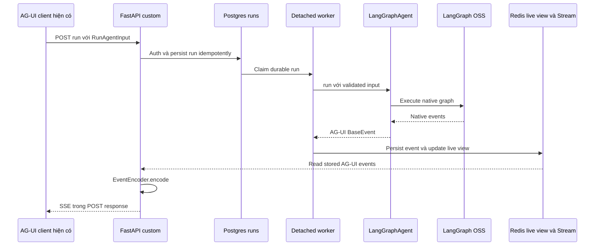

# Học thiết kế API CopilotKit, triển khai bằng LangGraphAgent + AG-UI

> Chốt ngày 26/10/2026. **Không dùng CopilotKit Runtime, React SDK, core, provider, runner hoặc Intelligence.** Chỉ học cách thiết kế input/output và chia operation run/connect/stop từ source CopilotKit.
> Backend dùng `from ag_ui_langgraph import LangGraphAgent` để chuyển LangGraph execution thành event AG-UI chuẩn. Frontend giữ `@ag-ui/client` và UI hiện có. Đây là tài liệu thiết kế, chưa triển khai các endpoint mới.
> Giữ tên file cũ để các liên kết nghiên cứu vẫn hoạt động; nội dung dưới đây thay các ví dụ tích hợp CopilotKit trước đó.

## 1. Ranh giới đã thống nhất

| Thành phần | Dùng trong hệ thống? | Trách nhiệm |
|---|---|---|
| CopilotKit source/docs | Chỉ tham khảo | Cách chia API và input/output |
| CopilotKit packages/services | Không | Không có trong application path |
| FastAPI custom | Có | Auth, API, subscribe và stop intent |
| LangGraph OSS | Có | Graph, state, checkpoint, Store, interrupt |
| `ag_ui_langgraph.LangGraphAgent` | Có | Chuyển native graph events thành AG-UI events |
| `ag_ui.encoder.EventEncoder` | Có | Encode BaseEvent thành SSE wire format |
| `@ag-ui/client` | Có | Nhận event, cập nhật messages/state, attach/detach adapter |
| Postgres + Redis | Có | Durable data và shared live snapshot/event replay |

`ag_ui_langgraph` là package tích hợp AG-UI được chọn. Ràng buộc không dùng CopilotKit không có nghĩa bỏ thư viện này và tự viết lại bộ chuyển đổi event.

## 2. Những gì học từ CopilotKit

Source tham khảo: `/home/lamhung/code/CopilotKit`, commit `89629de0a26cb0965399c033894a2eed9bee52a2`.

- [Router](/home/lamhung/code/CopilotKit/packages/runtime/src/v2/runtime/core/fetch-router.ts): run/connect/stop, GET threads và các history resources.
- [Thread handlers](/home/lamhung/code/CopilotKit/packages/runtime/src/v2/runtime/handlers/intelligence/threads.ts): list envelope, `name`/`archived`, phân biệt messages/events/state.
- [Stop handler](/home/lamhung/code/CopilotKit/packages/runtime/src/v2/runtime/handlers/handle-stop.ts): exact runId scope chống dừng nhầm run sau.
- [Runner interface](/home/lamhung/code/CopilotKit/packages/runtime/src/v2/runtime/runner/agent-runner.ts): phân biệt run, connect và stop. Đây là ví dụ phân chia trách nhiệm, không phải class cần import/extend trong dự án.
- [Runtime endpoint docs](https://docs.copilotkit.ai/backend/runtime-endpoints): tham khảo input/output; không yêu cầu copy toàn bộ schema hoặc hỗ trợ RuntimeInfo/Intelligence.

Không đưa proxy hai chặng, single-route envelope, GraphQL/provider, React hooks hay join-token/WebSocket của CopilotKit vào thiết kế triển khai.

## 3. Luồng run đã chọn



Worker chạy `LangGraphAgent.run()`; HTTP route chỉ subscribe shared output của worker. Khi browser đóng, worker tiếp tục consume generator. Không để HTTP subscriber sở hữu coroutine thực thi graph.

Không gọi thêm `graph.astream()`/`astream_events()` song song rồi tự sinh một bộ text/tool/lifecycle events khác. Một execution chỉ có một nguồn chuyển đổi chuẩn: LangGraphAgent.

## 4. Tạo wrapper và consume events

Hiện trạng [agui.py](/home/lamhung/code/agent_project/backend/src/agent_backend/agui.py) đã dùng:

```python
from ag_ui_langgraph import LangGraphAgent

agent = LangGraphAgent(
    name="agent",
    graph=compiled_graph,
    emit_raw_events=False,
)
```

Với production, compiled graph được bind native checkpointer/Store và ownership connection đúng execution scope. Wrapper cần độc lập theo run/attempt; nếu có template an toàn thì clone như code hiện tại, không dùng chung mutable wrapper giữa các run đồng thời. Clone không thay thế distributed ownership lock.

Pseudocode worker, các hàm ownership/repository/publisher là application code:

```python
from ag_ui.core import RunAgentInput
from ag_ui_langgraph import LangGraphAgent

async def execute_claimed_run(record, compiled_graph, trusted_config, publisher):
    input_data = RunAgentInput.model_validate(record.validated_agui_input)
    agent = LangGraphAgent(
        name="agent",
        graph=compiled_graph,
        config=trusted_config,
        emit_raw_events=False,
    )
    async for event in agent.run(input_data):
        await publisher.append_agui_event(record, event)
```

Đoạn này minh hoạ việc consume wrapper trong worker; không phải implementation đầy đủ cho lease, finalization hoặc cancellation. `input.thread_id/run_id` phải reconcile với identity đã được backend chấp nhận.

Wrapper có thể emit RUN_ERROR trong event stream; worker phải xét terminal events và lỗi execution khi finalize, không coi generator kết thúc bình thường luôn là success. Không tự emit thêm RUN_STARTED/RUN_FINISHED cho cùng live invocation nếu wrapper đã phát.

## 5. EventEncoder không thay LangGraphAgent

```python
from ag_ui.encoder import EventEncoder

encoder = EventEncoder(accept="text/event-stream")
# event là BaseEvent từ wrapper hoặc đã restore từ shared store.
wire_chunk = encoder.encode(event)
```

LangGraphAgent chuyển semantics native graph sang AG-UI; EventEncoder chỉ encode wire transport. Worker lưu event schema trước khi encode SSE, preserve type/messageId/toolCallId/runId và order. Gateway restore bằng model/schema chính thức đã pin rồi encode; không tự đổi TEXT_MESSAGE_CONTENT thành một event type khác.

Fence, revision, cursor, event dedup nằm trong storage envelope tách khỏi BaseEvent. Projection reducer apply BaseEvent để tích luỹ partial text/tools/state, không trở thành bộ chuyển graph events sang AG-UI thứ hai.

## 6. Connect/reload vẫn do backend custom thực hiện

POST connect đọc live snapshot và watermark W nhất quán, phát public snapshot/prefix rồi nối các event đã lưu sau W trong cùng SSE response. **Không gọi LangGraphAgent.run() trong connect**: `.run()` là execution, không phải read-only history API.

Các snapshot/prefix/control events phục vụ restore được tạo bằng model event chính thức của `ag_ui.core`, encode bằng EventEncoder. Chúng không thay thế nguồn event live của wrapper. Khôi phục active message phải giữ messageId và bookkeeping, không append prefix hai lần hoặc END message trước tail.

Checkpoint native không mặc nhiên chứa token đang sinh dở; shared Redis projection/Stream vẫn cần. LangGraphAgent tự emit đúng AG-UI không đồng nghĩa tự có detached execution, public connect API, ownership, atomic snapshot hoặc multi-pod replay.

Frontend có thể cần extension nhỏ quanh AG-UI client để gọi connect/stop custom và xử lý attach/detach. Không cài CopilotKit để làm việc đó. Một stream cho thread/nhánh đang chọn, không có public `/realtime/*` hoặc global user feed.

## 7. Metadata, title, errors và stop

- Title/metadata do application service quản lý. Dùng `ag_ui.core.CustomEvent` tên `thread.updated` để gửi update khi đang có subscriber; không tạo một type protocol giả.
- Live graph events lấy từ wrapper. Backend errors trước execution trả HTTP error; errors khi streaming phải tuân thủ terminal policy, tránh duplicate RUN_ERROR/FINISHED.
- Stop ghi intent bền vững rồi supervisor dừng worker task/provider theo policy. Đóng SSE subscriber không cancel run.
- Replay không chạy lại tool hoặc LLM. Recovery sau worker chết là luồng khác, cần checkpoint và side-effect safety.

## 8. Những phần cần kiểm chứng khi triển khai

- Pin/test phiên bản `ag-ui-langgraph`, Python `ag-ui-protocol` và JS AG-UI client theo lockfiles thực tế.
- Checkpoint durability mode, input/resume và cancellation phải cấu hình qua API wrapper/graph thực sự hỗ trợ; không giả `.run(input, durability=...)` tồn tại.
- Wrapper config và thread identity được tạo từ trusted backend context; browser không tự chọn checkpoint namespace hoặc credentials.
- State/message reconcile của wrapper phải được kiểm thử với server-owned history, tools, branch và approval; không tự append lại toàn bộ history trước wrapper.
- RUN_ERROR/interrupt/finalization, raw/reasoning events và snapshot restore cần integration tests trên phiên bản pin.

Các tests trên chưa chạy; tài liệu này không tuyên bố việc dùng wrapper tự hoàn tất mọi yêu cầu production.

## 9. Tài liệu hiện hành

- [API contract](./chat-agent-api-contract.md): endpoint và input/output của backend custom.
- [Thiết kế nền tảng](./langgraph-oss-agent-platform-design.md): queue, worker, native persistence và replay.
- [Manual wiring](./ag-ui-manual-wiring.md): code FastAPI hiện tại dùng LangGraphAgent và EventEncoder.
