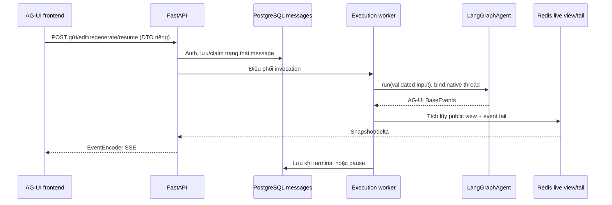

# Tham khảo API CopilotKit, triển khai bằng LangGraphAgent và AG-UI

Cập nhật: **29/10/2026**. Không dùng CopilotKit Runtime, React SDK, provider, runner hoặc Intelligence. Chỉ tham khảo cách tách thực thi/connect/stop từ source CopilotKit. API hiện hành dùng DTO nghiệp vụ riêng và routes conversations; chưa cần discovery /info.

Nguồn chuẩn cho dữ liệu: [database đã chốt](database-decisions.md), [quy ước ID](conversation-message-run-id-decisions.md), [API](chat-agent-api-contract.md), [kiến trúc](agent-chat-architecture.md). Không có bảng Postgres runs/attempts hoặc yêu cầu native Store trong baseline.

## 1. Thành phần được dùng

| Thành phần | Vai trò |
|---|---|
| FastAPI custom | Auth/authorization, điều phối start/resume/read/stop |
| LangGraph OSS | Graph và interrupt/state |
| ag_ui_langgraph.LangGraphAgent | Chuyển native events sang AG-UI |
| ag_ui.encoder.EventEncoder | Encode BaseEvent thành SSE |
| Frontend ChatAgent kế thừa HttpAgent | Input nghiệp vụ riêng, tái sử dụng HTTP/SSE và subscriber của @ag-ui/client |
| PostgreSQL + Redis | Lịch sử/checkpoint bền vững và shared live buffer theo phạm vi đã chốt |

## 2. Luồng chạy

Cơ chế queue/claim/writer ownership chưa được chọn đầy đủ; mũi tên điều phối không ngầm yêu cầu bảng run. Worker cần vòng đời độc lập subscriber nếu muốn đóng browser mà agent vẫn chạy.

## 3. Wrapper và ID

Clone wrapper mutable theo invocation; không dùng chung state của một LangGraphAgent cho nhiều request đồng thời. Một graph execution chỉ có một nguồn emit AG-UI, không stream native song song rồi tự map thêm bộ events khác.

Public threadId là conversation; native checkpoint thread là assistant message; runId chỉ phục vụ protocol AG-UI, không lưu current_run_id hoặc dùng làm khóa nghiệp vụ. Adapter cần xử lý mapping này. Proof trước đã thử AG-UI async nhưng chưa nối public/native mapping vào app frontend.

Giữ message/tool IDs ổn định. Context/historical activity không được coi là quyền thực thi tool. Server dựng input từ DTO nghiệp vụ và lịch sử đúng nhánh. Xem [quyết định ChatAgent](chat-agent-client-decisions.md).

## 4. Persistence và replay

- Khi chạy: Redis giữ partial public response/tail, không chỉ Pub/Sub nếu cần replay.
- Khi terminal/pause: PostgreSQL lưu transcript; checkpoint chỉ export lúc interrupt theo adapter đã kiểm chứng.
- Connect read-only: dùng AG-UI models và EventEncoder để dựng restore events, không gọi agent để đọc history.
- Không giả checkpoint giữ token của node đang sinh, hoặc Redis tự bảo đảm durability vô hạn.
- Không giữ app transaction trong khi chờ model. Intentional pause checkpoint và message trạng thái chờ commit chung transaction.
- Tắt/lọc raw events và internal graph state trước khi đưa ra public stream; chỉ reasoning được phép công bố mới thuộc transcript.

## 5. Kiểm chứng và giới hạn

[Proof sync/async](../experiments/langgraph-action-checkpoints/README.md) đã thử pause/resume, question content, SDK validation/SSE codec, revoke role permission, cancel và concurrent answers với model mô phỏng/PostgreSQL thật.

Chưa có HTTP/Redis connect end-to-end, frontend activity renderer, mapping C1/A1 trong adapter, provider LLM/MCP/S3 thật hoặc multi-pod load test. Dùng wrapper không tự tạo detached execution, authorization, Redis continuity hay crash recovery.

Tham khảo API nguồn: `/home/lamhung/code/CopilotKit`, commit `89629de0a26cb0965399c033894a2eed9bee52a2`; xem route families trong [API contract](chat-agent-api-contract.md). Không thêm dependency CopilotKit vào ứng dụng.
