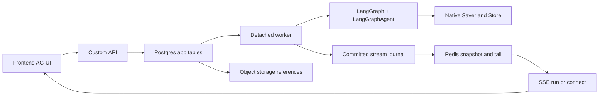

# Review mô hình database cho chat agent production

Ngày: **27/10/2026**. Trạng thái: **đề xuất sau review, chưa phải DDL đã triển khai hoặc benchmark**. Phạm vi là [32 tình huống sản phẩm](./chat-use-cases-and-organization-access.md), không cam kết bao quát mọi tính năng tương lai. Tài liệu này cụ thể hóa và ưu tiên hơn danh sách entity sơ bộ khi có khác biệt về tên bảng, cardinality và cách truy vấn.

## 1. Kết luận review

Giữ PostgreSQL cho dữ liệu ứng dụng và native LangGraph Saver/Store, Redis cho projection/tail có thể dựng lại, object storage cho bytes. Không dùng CopilotKit hoặc LangGraph Agent Server. Backend custom tiếp tục dùng `LangGraphAgent` emit AG-UI qua SSE.

Mô hình cũ đúng về nhóm trách nhiệm nhưng **chưa đủ để viết migration**. Cần sửa:

| Vấn đề | Quyết định đề xuất | Lý do |
|---|---|---|
| Parent message chưa xác định đường đọc nhánh | Thêm `branch_item` với ordinal, giữ item chung immutable sau khi hoàn tất | Phân trang nhánh bằng index; không đệ quy toàn cây mỗi lần mở chat |
| `owner` gộp actor, quyền và người quản lý | Tách creator, custodian, membership, typed grants và view preference | Không vô tình cấp quyền đọc cho admin hoặc người nhận chuyển giao |
| `approval` chưa gắn rõ execution | Request revision + decision rows + atomic consumption cho một invocation | Chặn duyệt nhầm arguments và gửi tool trùng |
| Dependency dùng type/id tự do | Typed dependency edges có FK; citation tham chiếu dependency | Có thể truy ngược nguồn bị revoke mà không mất toàn vẹn tham chiếu |
| File và artifact dễ trùng storage metadata | Dùng chung `stored_object`, attachment/link; artifact thêm version khi cần | Một lifecycle upload/scan/delete và một object key |
| Installation/tool/data connector dễ lưu token hai lần | Chung `integration_connection` và `credential_binding`; tool installation/data source tham chiếu | Tách cấu hình integration khỏi danh tính thực thi |
| Run bị đồng nhất attempt/protocol invocation | Một logical run, nhiều attempts; `run_invocation` cho wire lifecycle khi resume | Retry/interrupt không làm sai status, cursor hoặc idempotency |
| Queue vừa ở run vừa ở job | Run là durable queue cho inference; `background_job` cho công việc khác | Một nơi claim cho mỗi loại công việc |
| Xem journal như transcript dài hạn | Journal phục vụ recovery có retention; transcript phục vụ history | Không giữ vô hạn từng delta, không phải replay toàn stream để đọc chat |

Hiện code dự án vẫn dùng [InMemorySaver](../../backend/src/agent_backend/agent_graph.py), và [dependencies](../../backend/pyproject.toml) chưa khai báo package Postgres saver. Vì vậy các bảng trong tài liệu trước là **thiết kế**, không phải schema đang tồn tại cần ALTER.

## 2. Các dự án khác tổ chức thế nào và nên học gì

Đối chiếu bộ [nghiên cứu sáu dự án](../database_research/README.md), đọc lại một số schema/index tại checkout. Snapshot và giới hạn khảo sát ở từng tài liệu nguồn.

| Dự án | Cấu trúc quan sát | Áp dụng cho mình | Không áp dụng nguyên trạng |
|---|---|---|---|
| Onyx | ChatSession, ChatMessage parent/latest-child/preferred-response; ToolCall riêng, quan hệ tài liệu riêng | Tách metadata/message/tool; branch cần lựa chọn rõ; source references có cấu trúc | Cây message không tự giải quyết native checkpoint mapping hoặc paging nhánh |
| LibreChat | Mongo conversation/message riêng, parentMessageId; nhiều index user/tenant/archive/time; generation/reconnect riêng | Tách history khỏi metadata, stable identity, keyset và generation | Không copy toàn bộ index hay Mongo document layout sang Postgres |
| TrueForge | Session/turn/context log, context order riêng, sidebar summary, migration thêm FK | Tách payload lớn khỏi trạng thái nóng; order có nghĩa nghiệp vụ; summary nhỏ | Không copy mảng context tăng mãi hoặc fillfactor khi chưa đo |
| Open WebUI | Metadata chat và message rows; JSON history còn dual-write; indexes sidebar | Index theo truy vấn UI và lịch sử migration cho thấy cần lộ trình chuyển đổi | Không tạo hai canonical transcript: JSON toàn chat và message rows |
| Codex | Rollout lịch sử, SQLite metadata/jobs; fork theo boundary/lineage | Phân biệt execution/history projection, fork boundary, conditional job completion | Không dùng filesystem rollout như shared durable backend nhiều pod |
| NextChat | Browser store chứa sessions/messages, persist/sync snapshot | Client cache có version và hydrate | Không dùng browser snapshot làm canonical org chat database |

Bằng chứng đọc lại: [Onyx session](../../../onyx/backend/onyx/db/models.py:3298), [message](../../../onyx/backend/onyx/db/models.py:3401), [tool](../../../onyx/backend/onyx/db/models.py:3543); [LibreChat conversation indexes](../../../LibreChat/packages/data-schemas/src/schema/convo.ts:438), [message uniqueness](../../../LibreChat/packages/data-schemas/src/schema/message.ts:336); [Open WebUI indexes](../../../open-webui/backend/open_webui/models/chats.py:157). Chi tiết TrueForge/Codex/NextChat tiếp tục theo bằng chứng trong nghiên cứu đã có, không coi đây là khảo sát mới toàn bộ source của sáu repo.

## 3. Ranh giới sở hữu và tích hợp LangGraph



- **App schema**: identity, rights, conversation, branch, public transcript, runs, tool lifecycle, stream journal và operations.
- **Native storage**: checkpoint/state và long-term memory; dùng API Saver/Store, migration thuộc package. Không tạo FK SQL từ app sang bảng nội bộ thư viện; giữ opaque reference và reconciliation/pins.
- **Redis**: read projection, signal, tail có TTL. Mất Redis không mất transcript hoặc prefix đã commit journal. Không dùng Redis để quyết định quyền độc lập.
- **Object storage**: file bytes, artifact versions; app quyết định quyền và lifecycle.

Checkpointer quản lý state theo thread, Store quản lý dữ liệu xuyên thread theo [tài liệu LangGraph](https://docs.langchain.com/oss/python/langgraph/persistence). Điều này không thay membership, source ACL, sidebar hay action audit của app.

Một branch có một `native_thread_id` opaque, unique trong storage deployment. `conversation_id`, `branch_id`, logical `run_id`, wire invocation và `attempt_id` không dùng thay nhau. `agent_id=handy` là definition identity, không là owner. Endpoint resolve branch và quyền trước khi đưa native ID vào config; không tin `thread_id` tùy ý từ client.

`checkpoint_ref` gồm deployment, native thread, namespace, checkpoint ID và graph version. Không đoán cấu trúc internal table hoặc hỗ trợ fork của version thư viện. Khóa phiên bản package và kiểm chứng clone/fork/resume bằng API trước khi bật branch continuation. Nếu chỉ có replay approved messages thì ghi rõ đây là khởi tạo context mới, không phải exact checkpoint fork.

App transaction và native save **không mặc nhiên atomic** dù cùng PostgreSQL. Dùng trạng thái run, stable invocation marker trong graph, finalizer/reconciler; không tự viết vào bảng native để ép transaction. Checkpoint-only hoàn tất nhưng app chưa finalize phải được nhận diện và repair idempotently. Native Store mutation cũng cần operation/version và reconcile provenance; chưa reconcile thì memory mới chưa được dùng nếu thiếu kiểm chứng quyền.

Tách pool/role/migration ownership app và native. Schema/search_path hay database riêng phải qua integration test với package đã pin; không giả định constructor có tham số schema. Tổng pool tính theo số API pod + worker + saver connections. Không giữ transaction app trong lúc chờ LLM. Ownership lock dài của worker nếu dùng phải tính riêng trong connection budget như [thiết kế lưu trữ](./production-data-storage-design.md).

## 4. Quy ước vật lý

- Mục tiêu baseline PostgreSQL 16+; chưa cần tính năng chỉ có PG18. Public resources dùng UUID opaque; internal ordered positions/seq dùng BIGINT. UUID không thay authorization và không dùng làm commit-order cursor.
- `timestamptz`, `text`, `jsonb`, `boolean`; status phát triển theo sản phẩm dùng text + CHECK. Tiền dùng numeric kèm currency; token counts dùng bigint với CHECK không âm.
- Cột dùng filter/join/sort/constraint là cột typed. JSONB cho versioned content blocks, arguments, provider metadata; không nhét members/grants/message IDs vào JSONB làm quan hệ canonical.
- Tenant-bound rows có `org_id NOT NULL`. Parent có unique `(org_id,id)` để child composite FK ngăn cross-org. Các quan hệ trong cùng conversation dùng `(org_id,conversation_id,id)`. Chỉ thêm unique tổ hợp cần cho FK, không thêm mọi hoán vị.
- Index FK phía child theo access path; PostgreSQL không tự tạo index ở phía tham chiếu. CHECK không thay cross-row transaction/trigger. [PostgreSQL constraints](https://www.postgresql.org/docs/current/ddl-constraints.html).
- Không cập nhật `conversation.updated_at` cho mỗi token. Activity cập nhật tại accept/terminal hoặc checkpoint metadata có cadence rõ. Title có revision/source để job cũ không ghi đè tên người dùng đặt.

## 5. Catalogue bảng đề xuất

Các cột dưới là cột quan trọng, không phải full DDL. Mọi bảng tenant-bound áp dụng quy ước org và FK ở trên. Feature-specific tables chỉ tạo khi bật feature; số bảng không phải mục tiêu tối ưu.

### 5.1. Identity và quyền

| Bảng | Khóa/cột chính | Ràng buộc và cách dùng |
|---|---|---|
| `app_user` | id, identity issuer/subject, status | Unique issuer+subject; email không dùng làm durable external identity |
| `organization` | id, name, status, policy_revision | Tenant boundary; policy revision monotonic |
| `organization_membership` | id, org_id, user_id, role, status, revision | Unique org+user; giữ membership identity khi revoke/reactivate; audit lịch sử |
| `invitation` | org, token_hash, invited identity, expires_at, accepted_at | Không lưu raw token; consume transactionally |
| `team`, `team_membership` | team/org; team/member | Unique team+member, composite same-org FKs |
| `service_principal` | id, org, name, status | Không giả user cho máy; credential thuộc principal có thể revoke |
| Typed grant tables | resource FK, member_id/team_id/service_principal_id, action, issuer, validity | CHECK đúng một principal; FK thật. Chưa cần generic resource registry/policy DSL |

Grant tables cụ thể: `conversation_grant` chỉ khi live sharing được bật, `shared_result_grant`, `tool_action_grant`, `source_grant`. Source external ACL là lớp riêng, không cho app grant vượt quyền upstream. Mỗi loại principal dùng partial unique phù hợp trên resource+principal+action cho grant hiện hành; lịch sử nằm trong audit. Tránh unique nullable khiến duplicate lọt qua.

Role tổ chức không tự có quyền đọc chat riêng. Chuyển custodian mà thay quyền đọc là grant operation; không phải UPDATE tùy ý của admin. Khởi đầu authorization service + composite FKs, kiểm thử deny theo org. RLS là defense-in-depth có thể bổ sung, không tuyên bố đã có chỉ vì mọi row chứa org_id. Nếu bật RLS: role app không BYPASSRLS, transaction-local tenant context, reset pool và test owner/worker bypass.

### 5.2. Conversation, transcript và nhánh

| Bảng | Khóa/cột chính | Ràng buộc và cách dùng |
|---|---|---|
| `conversation` | id, org, created_by_member, custodian_member, title/revision/source, activity_at, lifecycle/deleted_at | Metadata nhỏ; creator là lịch sử, custodian không thay grants |
| `conversation_view` | org, member, conversation, selected_branch, last_seen_item, pinned_at, archived_at | Unique member+conversation; pin/archive của cá nhân không tác động mọi viewer; row này **không cấp quyền** |
| `branch` | id, conversation, parent_branch, fork_item, native_thread_id, graph_version, status, next_ordinal | Native ID unique; state preparing/ready/failed; fork/head same conversation |
| `transcript_item` | id, conversation, originating_branch/run, parent_item, role/kind, content JSONB, content_version, status | Một item có thể nhiều content blocks; item terminal immutable; sửa tạo item mới |
| `branch_item` | org, conversation, branch, ordinal, item | PK branch+ordinal; unique branch+item; same-conversation FK tới branch và item |
| `item_feedback` | org, member, item, rating, comment, revision | Optional; unique member+item cho feedback hiện hành |

**Lựa chọn ban đầu cho nhánh:** lúc fork, copy *references* prefix vào `branch_item`, không copy text/object bytes. O(prefix length) writes khi fork, đổi lại history paging O(page size) index scan; một triệu reference và nhiều deep fork phải benchmark trước khi cam kết. Parent item phục vụ lineage, `branch_item` là ordering authority cho UI; không sort bằng thời gian hoặc run ID. Không cần closure table mọi ancestor ngay.

Fork transaction chốt prefix immutable và branch preparing. Native preparation thành công mới chuyển ready. Nếu native fork thất bại, branch không được chạy và được retry/cleanup. Fork chỉ tại boundary đã hoàn tất/đã materialize, không copy item còn đang thay đổi. Khi tree rất lớn, cân nhắc immutable segment references thay prefix copy sau khi đo; abstraction repository phải che layout này khỏi API.

Input user item và run accepted cùng app transaction. Assistant đang sinh lấy từ journal projection; transcript có placeholder ổn định và materialize bounded snapshots/final content, không UPDATE text tăng dần từng token. Regenerate tạo branch/path mới từ boundary thích hợp, không tự động chạy lại side effect của tool cũ.

### 5.3. Execution và streaming

| Bảng | Khóa/cột chính | Ràng buộc và cách dùng |
|---|---|---|
| `run` | org/conversation/branch, actor, agent/config version, input_item, request_key/hash, state, available_at, cancel_requested_at | Unique org+actor+conversation+request_key; duplicate key khác hash trả conflict |
| `run_invocation` | run, ordinal, wire_run_id, kind start/resume, resume_key/hash, status | Một logical run có nhiều wire lifecycles khi protocol/version yêu cầu; unique wire ID và resume key scoped run |
| `run_attempt` | run/invocation, attempt_no, generation, worker, state, lease_expires_at, start/end checkpoint refs, error_code | Retry nội bộ không đổi logical run; unique invocation+attempt_no; fencing |
| `stream_head` | branch, epoch, committed_seq, compacted_through_seq | Serialize short append transactions; rotation epoch explicit |
| `stream_event` | branch/epoch/seq, stable event_id, run/invocation/attempt, event_type, payload_version, payload | PK branch+epoch+seq; unique branch+epoch+event_id; append before SSE |
| `stream_snapshot` | branch/epoch, through_seq, reducer_version, payload, payload_hash | Snapshot được publish khi có durable prefix và monotonic CAS |
| `checkpoint_pin` | branch/run/reason, opaque checkpoint_ref, expires_at nullable | Pins cho resume/fork/approval; không FK vào native tables |
| `run_usage` | run/attempt/provider_request key, model, input/output tokens, cost/currency, recorded_at | Optional feature; unique provider request/accounting key chống double charge nội bộ |

Một active logical run/conversation ban đầu, partial unique index trên org+conversation với trạng thái queued/running/waiting_input/cancelling/recovering. Waiting-input vẫn giữ slot; muốn hỏi tiếp phải resume/cancel hoặc policy khác rõ ràng. Reconciler phải giải phóng stuck run bằng transition có audit, không TTL-delete run để né constraint.

Claim queued run dùng transaction ngắn `FOR UPDATE SKIP LOCKED`, tạo attempt/generation và chuyển state atomically. SKIP LOCKED không bảo đảm fairness; đo queue age và giới hạn per-org. Lease hết không đủ chứng minh writer native cũ đã dừng; giữ ownership protocol đã mô tả trong production design.

**Journal retention và dedup:** unique event_id chỉ bảo vệ khi row còn tồn tại. Không compact tail của active/recovering run trước khi producer retry window hết; hoặc giữ dedup receipt đủ lâu. Sau terminal expiry, reject late producer theo attempt/state trước append. Request idempotency keys cũng có hợp đồng retention; không purge rồi hứa retry vĩnh viễn không tạo run mới.

### 5.4. Integration, tool và approval

| Bảng | Khóa/cột chính | Ràng buộc và cách dùng |
|---|---|---|
| `integration_connection` | org, provider, config/version, status | Shared connection abstraction, không giữ raw secrets |
| `credential_binding` | connection, member hoặc service principal, secret_ref, external_subject, scopes, status/revision | CHECK đúng một owner, cùng org; token trong secret manager |
| `tool_installation` | connection/org, definition_id/version, enabled policy | Definition/action schemas có thể registry immutable trong code; chưa cần bảng authoring |
| `tool_action_grant` | installation, action_key, principal, resource_scope/version | Action registry được validate; nếu cần FK action thì tạo versioned `tool_action` registry |
| `tool_invocation` | run, logical_operation_key, tool/action version, args/hash/revision, execution_principal, credential_binding, state | Unique run+logical operation; provider tool_call_id giữ riêng; nested parent invocation optional |
| `approval_request` | invocation, proposal_revision/hash, policy_version, expires_at, status, consumed_at | Unique invocation+proposal revision; state change atomic; args sửa phải xin mới |
| `approval_decision` | request, approver_member, decision, decided_at | Append audit; unique request+approver cho một quyết định cuối/người; policy quorum/version rõ |
| `action_receipt` | invocation, dispatch_attempt, external_operation_id, outcome, observed_at, safe_result_ref | Nhiều observations/attempts cho một invocation; không giả 1:1 |

Trước dispatch: lock invocation/request, kiểm tra rights hiện tại, hash và quorum; consume approval cùng dispatch-intent transaction. Gọi dịch vụ ngoài sau commit. Crash sau intent trước receipt tạo state unknown/reconciling, không auto-resend thao tác không idempotent. Exactly-once bên ngoài cần provider idempotency/reconciliation, unique DB một mình không đủ. Credential revoke không xóa lịch sử; quyền mới không tự broaden input run đã nhận.

### 5.5. Sources, provenance, file, share và memory

| Bảng | Khóa/cột chính | Ràng buộc và cách dùng |
|---|---|---|
| `data_source` | org, connection, collection/config, ACL sync status/revision | Connector health và quyền nguồn riêng |
| `source_resource` | source, external_resource_id, kind, current_version, deletion status | Thay tên source_document để chứa document, CRM row, API object; unique source+external ID |
| `source_version` | resource, external_version/hash, retrieved_at, object_ref | Immutable metadata; không bắt buộc copy toàn bộ nội dung upstream |
| `external_identity_mapping` | connection, org member/team, external_subject | Explicit mapping, freshness/revocation; không map bằng tên prompt |
| `source_acl_entry` | resource, external principal/action, effect, revision | Mô hình quyền upstream; deny/permission freshness fail closed theo policy |
| `item_source_dependency` | item, source_version/resource, usage_kind | Typed FK, unique edge; index reverse nguồn→item |
| `item_dependency` | derived_item, input_item | Lineage của summary/context; graph acyclic do service kiểm soát; không chỉ citation |
| `citation` | item, citation_no/block_id, dependency_ref, locator | Render metadata, không làm ACL source of truth |
| `stored_object` | org, bucket/key/version, checksum, size, MIME, status, created_by | Upload và artifact bytes chung lifecycle; signed URL sinh lúc đọc |
| `item_object` | item, object, purpose | Unique link; object không bị xóa khi còn reference/pin |
| `artifact`, `artifact_version` | org, creator/run, version, object, metadata | Chỉ khi sản phẩm cần artifact có identity/version độc lập; không cần cho file đơn giản |
| `shared_result`, `shared_result_version` | org, source conversation, boundary, immutable payload/object ref, expiry/status | Share một version cụ thể; không mở quyền toàn bộ conversation |
| `shared_result_grant` | version hoặc resource theo policy explicit, principal, expires/revoked | Default grant version cụ thể; version mới revalidate audience |
| `share_source_dependency`, `artifact_source_dependency` | version, source_version/resource | Typed reverse lookup như item dependencies |
| `memory_provenance` | org, native namespace/key, value_revision/hash, source item/version, status | Native Store giữ value; app giữ policy/provenance; sửa value invalidate provenance cũ |

Các dependency quan hệ nhiều-nhiều cần join tables typed; không triển khai cột `entity_type,entity_id` rồi gọi đó là FK. Chỉ tạo bảng cho entity thực sự bật. Nếu chain dependency dài, cache security-label projection có version để đọc nhanh, nhưng canonical edges giữ để rebuild. Revocation phải chặn serve/resume ngay khi phát hiện bằng policy/revision, không chờ batch đánh dấu hết descendants. Với nguồn external chưa đồng bộ, freshness budget phải rõ và có fail-closed; không thể hứa revoke tức thì nếu upstream không cung cấp tín hiệu.

Search chunks/vector index là derived retrieval subsystem. Khi bật RAG tự ingest, thêm chunk/version/chunk-object mappings theo provider đã chọn; không trộn embedding chat transcript và memory mặc định. Native Store semantic search không tự là enterprise document ACL engine. Mọi retrieval giới hạn org/actor trước context construction và recheck quyền trước khi serve/export.

### 5.6. Operations

`background_job` thay tên metadata_job: kind, dedupe_key, available_at, priority, state, lease/generation, attempts, payload_version; title/ingest/export/purge cùng cơ chế scheduler nhưng handler riêng. Không dùng nó làm bản sao queue của run.

`outbox_event`: transactional publication intents, event key/entity revision, payload an toàn, retry/claim. `audit_event`: actor, org, action/resource identity, outcome/policy revision, timestamp, safe details. Audit không phải bản sao transcript; có thể dùng resource type/id như immutable historical label vì resource được phép bị purge, không nhầm với business FK.

`purge_request`/`export_request` chỉ tách bảng nếu cần trạng thái UX/retention riêng; nếu chưa cần, job + audit + structured result đủ. Không tạo bảng chỉ để ánh xạ mọi danh từ trong use case.

## 6. Truy vấn nhanh: access path trước, index sau

| Truy vấn | Access path/index ứng viên | Ghi chú |
|---|---|---|
| Sidebar private | conversation `(org_id,created_by_member,activity_at DESC,id DESC)` WHERE deleted_at IS NULL | Authorize custodian/grants qua query riêng hoặc union, không coi creator filter đủ mọi trường hợp |
| Pin/archive cá nhân | view `(org_id,member_id,pinned_at DESC,conversation_id)` partial pinned | Sidebar thường keyset theo activity; view joined theo unique member+conversation |
| Shared results | grant theo org+principal+valid status → version PK | Tách tab shared lúc đầu; tránh fanout activity tới toàn bộ team mỗi token |
| History nhánh | branch_item `(branch_id,ordinal DESC)` → item PK, LIMIT | Fetch content chỉ cho page; batch object/citation lookup, tránh N+1 |
| Children/regenerate options | item `(org_id,conversation_id,parent_item_id,id)` | Không tải toàn tree để hiện một sibling group |
| Tail | event PK `(branch_id,epoch,seq)` với seq > watermark | Gửi theo seq; authorize trước cache/journal reads |
| Queue | run `(available_at,id)` WHERE state='queued' | Có org admission/quota; partial predicate khớp query |
| Recovery | attempt `(lease_expires_at,id)` WHERE state='running' nếu có attempt state | Chỉ index cột thực có trong DDL; lease không cấp lại native ownership tự động |
| Pending approval | request `(org_id,status,expires_at,id)` + reviewer scope lookup | Không quét args JSON để tìm reviewer |
| Revoke source | dependency `(source_resource/version_id,item_id)` và reverse derived-item edges | Cache policy revision; recursive impact calculation ngoài request lớn |
| Cleanup | terminal runs/events by retained stream + boundary; object status/time | Delete batches, tránh transaction cascade khổng lồ |
| Search lịch sử | dedicated item_search `(item_id, content_revision, tsvector)` + GIN khi bật | Org/access filter trước trả result/snippet/count; index async cần recheck |

Index bảng tenant-bound dùng prefix org ở các global tenant query; branch_id global unique có thể là prefix đủ cho exact branch lookup sau authorization. Không bắt mọi index bắt đầu org nếu query không cần hoặc index đã redundant. Không index toàn JSONB/payload theo thói quen. Không INCLUDE text/JSON lớn vào B-tree.

Ví dụ paging nhánh, sau authorization và resolve branch tại server:

```sql
SELECT bi.ordinal, i.id, i.role, i.content, i.status
FROM app.branch_item AS bi
JOIN app.transcript_item AS i
  ON i.org_id = bi.org_id
 AND i.conversation_id = bi.conversation_id
 AND i.id = bi.item_id
WHERE bi.org_id = :org_id AND bi.branch_id = :branch_id
  AND bi.ordinal < :before_ordinal
ORDER BY bi.ordinal DESC
LIMIT :page_size;
```

Client đảo thứ tự page để render tăng dần. Cursor gồm branch và boundary, kiểm tra scope mỗi request; không OFFSET hàng chục nghìn dòng. Branch append không làm các ordinal cũ đổi. Sidebar activity thay đổi có thể làm item chuyển trang: client dedup ID và refresh đầu list, không hứa snapshot tuyệt đối giữa các request. Full-text tiếng Việt cần đánh giá tokenizer/diacritics thực tế; cấu hình simple/trigram không đồng nghĩa có chất lượng semantic search.

## 7. Tính nhất quán và transaction boundaries

1. **Accept**: authorize → insert user item/path + run + outbox trong một transaction, unique idempotency; unique active-run xử lý race tabs/pods.
2. **Claim**: lock run → attempt/generation → commit; worker ownership native riêng theo protocol đã chọn.
3. **Stream**: validate attempt/current run → lock stream head → dedup stable event IDs → allocate seq → insert batch + advance head → commit → publish Redis/SSE. Theo lock order nhất quán của production design.
4. **Finalize**: native completion verified for current run → transcript finalized + terminal event + head + run state + outbox cùng app transaction. Reconciler retry conditional. Không hứa atomic với native writes.
5. **Fork**: freeze visible prefix → branch preparing + reference rows → native preparation → ready; no execution until ready.
6. **Revoke**: membership/grant revision + outbox invalidation trong transaction; request/worker/SSE recheck. Read replicas lag không dùng cho authorization vừa revoke.
7. **Delete**: tombstone chặn new work → cancel/quiesce → purge native/journal/cache/object theo jobs và dependency pins → audit. Không cascade membership deletion vào tất cả lịch sử tổ chức.

## 8. Mở rộng và bảo trì

- Bắt đầu một PostgreSQL cluster với app/native ownership riêng; chưa tách database mỗi tenant hay microservice mỗi bảng. Native checkpoint workload có metrics/pool riêng để phát hiện contention.
- Content row immutable sau terminal giảm churn. Live journal append batched; durable snapshots không rewrite toàn bộ lịch sử mỗi token. Không có batch interval “tối ưu” cố định trước benchmark.
- Stream epoch có lifecycle rõ. Giữ journal active/recovering, compact terminal prefix sau durable snapshot và pin checks. Transcript/objects/native checkpoint có retention riêng, không dùng một TTL chung.
- Chưa partition mọi bảng. Hash branch_id có lợi pruning/PK locality nhưng không DROP theo ngày; range time có lợi retention nhưng PK/unique phải gồm partition key. PostgreSQL yêu cầu unique/PK của partitioned table chứa partition keys: [partitioning](https://www.postgresql.org/docs/current/ddl-partitioning.html). Phải giữ dedup uniqueness bằng stream bucket cố định hoặc registry nếu chọn time partition; không thêm created_at vào unique rồi làm mất bảo đảm event ID toàn stream.
- Shard theo org chỉ khi dữ liệu/throughput chứng minh cần; org_id trên resource và native routing mapping giúp chuyển. Không dùng cross-shard join trong API contract. Large-tenant isolation cần routing deployment/native ref trước khi di chuyển.
- Replica cho terminal history nếu chấp nhận lag, read-your-write dùng primary hoặc consistency token. Current rights, approval, run ownership luôn authoritative; không cho stale replica mở lại dữ liệu đã revoke.
- Repository theo domain: Identity/Authorization, Conversation, Execution, Integration, Knowledge, Lifecycle. DTO/API không trả ORM model/native checkpoint schema. Schema migrations và native package upgrades độc lập nhưng có compatibility matrix.
- Expand → backfill bounded batches → verify → switch reads → contract. Derived projections có reducer/schema version và rebuild path. Không chạy native `setup()` trên mọi request hoặc tự đổi native indexes không kiểm chứng version.
- Giám sát query p95/p99, rows scanned/returned, lock wait, queue age, WAL/IOPS, replication lag, table/index bloat, autovacuum, connection count, snapshot lag, native checkpoint size. Không tăng pool vô hạn khi DB chậm.

## 9. Coverage và điều kiện nghiệm thu

| Use cases | Thành phần đáp ứng |
|---|---|
| C01–C09 | conversation/view, branch/item/path, run/invocation/attempt, journal/snapshot, title job/version |
| D01–D07 | stored_object, source/resource/version/ACL, typed dependencies, citation, artifact, egress policy |
| T01–T07 | integration/credential/action grants, invocation, approval decisions, receipts/reconciliation |
| O01–O09 | org/membership/team, shares/grants, native memory provenance, audit/export/purge |

Trước khi chốt DDL production cần kiểm chứng:

- Fixtures: org lớn/nhỏ, conversation 100/10.000/100.000 items, deep fork và nhiều siblings, 1KB/100KB/1MB content, nhiều ACL/dependencies. Đây là workload thử nghiệm, không là giới hạn sản phẩm.
- `EXPLAIN (ANALYZE, BUFFERS)` sidebar/history/tail/queue/source revoke trên dữ liệu đại diện; đo cold/warm cache và concurrent writes. Thống nhất SLO trước đo, chưa có con số latency được bảo đảm.
- Race: double submit, concurrent fork/stop/finalize, manual rename vs title job, stale worker, approver revoke, permission invalidation nhiều pod.
- Fault injection: crash sau native save trước app finalize, journal commit trước Redis, dispatch trước receipt, mất connection ownership, Redis loss, Postgres failover.
- Native conformance: checkpoint references/pins, interrupts và nhiều invocations, subgraphs namespace, Store update/delete + provenance, version upgrade và backup restore. Không assume replay token đồng nghĩa tiếp tục model socket.
- Retention: branch/shared version còn giữ không bị xóa source item/object cần thiết; native deletion theo API/version, không xóa checkpoint blobs bằng tuổi đơn thuần.
- Restore drill cùng app/native/object/secret references; prove rebuild Redis và deny quyền đã revoke. Backup riêng mỗi kho chưa đủ chứng minh khôi phục nhất quán.

Review này đã đọc tài liệu/source và kiểm tra cấu trúc tài liệu. **Chưa chạy DDL, benchmark, load test hay fault injection.** Bước triển khai nên viết migration theo core chat trước, nhưng các feature enterprise chỉ được bật khi schema và enforcement tương ứng cùng có; không trì hoãn ACL sau khi đã cho truy cập nguồn nội bộ.
