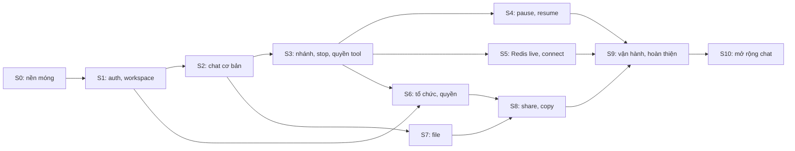

# Kế hoạch sprint phát triển chat

Lộ trình đưa chat từ scaffold hiện tại (`POST /agent`, `HttpAgent`, `InMemorySaver`) lên thiết kế đích đã chốt, dựa trên:
- [database-decisions.md](./database-decisions.md), [conversation-message-run-id-decisions.md](./conversation-message-run-id-decisions.md);
- [chat-agent-api-contract.md](./chat-agent-api-contract.md), [chat-agent-client-decisions.md](./chat-agent-client-decisions.md);
- [agent-chat-architecture.md](./agent-chat-architecture.md), [production-data-storage-design.md §13](./production-data-storage-design.md#13-lộ-trình-áp-dụng-không-đổi-database-baseline) (lộ trình 6 bước);
- Phần auth và file S3 tham khảo `hr-ai` (xem [§2](#2-tham-khảo-hr-ai)).

**Trạng thái**: lộ trình đã rà lại ngày 29/10/2026 (TD-003); các câu hỏi chặn S0 và S1 đã chốt (QD-08 → QD-13). Còn mở: Q-06 (đề xuất runner trong process, chặn S2) và Q-08 (chặn S5). File từng sprint tạo trong [sprints/](./sprints/) từ [mẫu](./sprints/_mau-sprint.md) vào ngày đầu sprint đó.

**Quy ước**
- Ngày là **dự kiến**, tính cho một người làm tuần tự, chưa trừ nghỉ lễ (Tết 2027). Mọi lần dời lịch ghi vào [nhat-ky/thay-doi.md](./nhat-ky/thay-doi.md).
- Ước lượng tính bằng **ngày công**, viết tắt **nc**.
- Mã task có dạng `CH-S<sprint>-<lớp>-<số>`. Lớp gồm `DB`, `BE`, `FE`, `QA`, `OPS`, `DOC`.
- Use case trỏ theo mã `C0x`, `D0x`, `T0x`, `O0x` ở [chat-use-cases-and-organization-access.md](./chat-use-cases-and-organization-access.md).

## 1. Lộ trình

| Sprint | Thời gian (dự kiến) | Chủ đề | Kết quả thấy được | Use case | Ước lượng |
| --- | --- | --- | --- | --- | --- |
| S0 | 02/11 – 13/11/2026 | Nền móng | Backend theo cấu trúc `src/app/` (QD-09); settings, DB session, exception handler; PostgreSQL 18 dev (compose); migration baseline + setup saver chạy up/down/up sạch; `generated_tables.py` sinh được; pytest với DB tạm. Frontend có TanStack Query, Zustand, Zod, Vitest, API client chung, `features/chat`. SDK được pin. `POST /agent` vẫn chạy | — | 6 nc |
| S1 | 16/11 – 27/11 | Auth và workspace | Đăng ký, đăng nhập, refresh rotation có phát hiện dùng lại, đăng xuất; `GET /users/me`, danh sách workspace; dependency user và workspace kiểm membership mỗi request. Frontend có trang đăng nhập, token trong bộ nhớ, tự refresh, ô chọn workspace | O01 | 7 nc |
| S2 | 30/11 – 11/12 | Chat cơ bản end-to-end | Tạo, liệt kê, mở, đổi tên, xoá mềm conversation; gửi câu hỏi qua `POST /conversations/{id}/messages`; runner chạy tách khỏi HTTP; finalize content AG-UI ở terminal, giữ partial khi lỗi; `GET messages` nhánh hiện hành. Frontend `ChatAgent.sendMessage`, UUIDv7, sidebar, mở lại chat cũ. **Gỡ `POST /agent`** | C01, C02, C09 (một phần) | 9 nc |
| S3 | 14/12 – 25/12 | Nhánh, stop và quyền tool | Edit, regenerate tạo nhánh; history trả dữ liệu nhánh; chuyển nhánh per-tab; stop theo assistant; pin, archive, folder; registry tool/skill, lọc quyền trước model và kiểm lại trước khi chạy tool. Frontend hiển thị trạng thái pending/running/terminal | C04, C05, C06, C08, C09 | 8 nc |
| S4 | 28/12/2026 – 08/01/2027 | Pause và resume | Adapter saver chỉ export khi interrupt; mapping C1 public / A1 native; resume bằng `ResumeEntry`; activity `user_interaction`; stop hủy lượt `requires_action`. Frontend render hỏi người dùng và duyệt tool | T03, T07 | 8 nc |
| S5 | 11/01 – 22/01 | Redis live và connect | Redis view + tail + watermark; connect không cursor; tín hiệu stop qua Redis; đóng tab mở lại thấy tiếp. Frontend `attach()`, chính sách nhiều SSE (Q-08) | C03 | 7 nc |
| S6 | 25/01 – 05/02 | Tổ chức và quyền | Tạo tổ chức, mời và nhận lời mời, thành viên, vai trò, gán quyền tool/skill; rời tổ chức thì chặn đọc và resume; email xác minh và đặt lại mật khẩu. Frontend màn quản trị tổ chức | O02, O07, T07 | 8 nc |
| S7 | 08/02 – 19/02 | File | RustFS dev; adapter storage theo hr-ai (§2.2); upload presigned + `complete`, `stored_files`, gắn file khi gửi (`fileIds`), tải qua URL ký sau khi kiểm quyền. Frontend đính kèm file | D01, D06 | 5 nc |
| S8 | 22/02 – 05/03 | Share và copy | Snapshot toàn cây, link public (cá nhân) hoặc nội bộ tổ chức, copy chat và byte object mới qua copy job. Frontend màn xem share, nút "Hỏi tiếp" | O03, O04 | 8 nc |
| S9 | 08/03 – 19/03 | Vận hành và hoàn thiện | Langfuse token/chi phí; log JSON; giới hạn concurrency và backpressure; load test API/stream/runner/PG/Redis; rà soát toàn bộ, chấm lại use case | — | 6 nc |
| S10 | 22/03 – 02/04/2027 | Mở rộng chat | Model đặt tên chat (giữ tên đổi tay); tìm chat theo tên và nội dung không phân biệt dấu; tool tạo tệp CSV/MD/TXT/XLSX gắn vào câu trả lời, đi theo share và copy; export chat của mình thành zip. Frontend ô tìm kiếm, thẻ tệp, nút export | C01, C09, D06, O08 (export) | 11 nc |
| | | | | **Tổng** | **≈ 83 nc** |

**Ràng buộc cứng**
1. **S0 trước mọi sprint**: cần schema và cấu trúc code thống nhất trước khi thêm module.
2. **S1 trước S2**: mọi route conversation cần user và workspace authoritative.
3. **S2 trước S3**: edit/regenerate/stop dựa trên runner, claim và finalize của S2.
4. **S3 trước S4, S5**: pause và live view dùng điểm claim, trạng thái và stop của S3.
5. **S3 trước phần gán quyền tool của S6**: cần registry tool/skill.
6. **S6, S7 trước S8**: share tổ chức cần membership; snapshot và copy cần file.

**Làm song song được** (khi có hơn một người)
- **S4 và S5**: khác phần (checkpoint và Redis).
- **S6 với S4, S5**: khác module (organizations/members/authorization và chat).
- **S7 với S3–S5**: file chỉ cần conversation/message của S2.
- **Phần frontend** của mỗi sprint bắt đầu khi DTO/OpenAPI của sprint đó đã chốt.

## 2. Tham khảo hr-ai

### 2.1. Auth (S1, S6)

Lấy từ `hr-ai/backend/src/app`, sửa cho khớp schema chat (QD-12):

| Lấy | File nguồn hr-ai | Sửa khi đưa sang |
| --- | --- | --- |
| Hash mật khẩu argon2 (chạy trong threadpool, có `DUMMY_HASH` chống dò email), băm token SHA-256, JWT HS256 có `iss`/`aud`/`type` | `config/security.py` | Bỏ claim `org`: `refresh_tokens` không gắn tổ chức ([phase 1 §7](../database_decisions/phase-1-decisions.md)) |
| Access token Bearer ngắn hạn; refresh token cookie HttpOnly, `SameSite=Strict`, `path=/api/v1/auth`; kiểm origin tin cậy khi đọc cookie | `modules/auth/router.py` | Bỏ `select-organization`, `organization-token`; giữ ý tưởng `/auth/session` gộp refresh + user + danh sách workspace |
| Rotation theo `family_id`, token đã dùng bị đưa lại thì thu hồi cả họ | `modules/auth/service.py::_rotate` | Đánh dấu `consumed_at` khi xoay (schema chat có cột này), `revoked_at` khi đăng xuất hoặc thu hồi họ |
| `current_user`: giải JWT, kiểm user active và họ phiên còn sống | `common/dependencies/auth.py` | Thêm dependency workspace: workspace lấy từ path (list/create) hoặc từ conversation; kiểm membership tổ chức mỗi request |
| Rate limit trong bộ nhớ theo IP cho nhóm `/auth` | `common/dependencies/rate_limit.py` | Giữ nguyên ở S1; chuyển Redis khi chạy nhiều process (S9) |
| Frontend: token trong bộ nhớ, refresh một lần dùng chung, `apiStream` mở SSE bằng `fetch` cùng luồng refresh | `frontend/src/lib/api/client.ts`, `lib/auth/session.ts` | `ChatAgent` gắn Bearer qua `requestInit`; lỗi 401 trước khi stream thì refresh một lần rồi gửi lại, không retry sau khi stream đã bắt đầu (QD-06) |

Không lấy ở S1: nhật ký nền tảng (`platform_audit_logs` không có trong schema chat), avatar file, gửi mail. Email xác minh và đặt lại mật khẩu dời sang S6 cùng lời mời tổ chức, vì cùng cần mailer.

### 2.2. File trên S3-compatible storage (S7, S8)

Lấy từ `hr-ai/backend/src/app/common/storage/` và `hr-ai/frontend/src/lib/storage/` (QD-14). `backend/AGENTS.md` §17 của repo này đã mô tả cùng luồng; hr-ai là bản đã chạy.

| Lấy | File nguồn hr-ai | Sửa khi đưa sang |
| --- | --- | --- |
| Interface `ObjectStorage` và adapter boto3 cho RustFS: presigned PUT/GET, `head`, đọc prefix, `copy_object`, `delete_object`; gọi boto3 trong threadpool | `common/storage/client.py`, `schemas.py`, `exceptions.py` | Giữ nguyên; `copy_object` dùng lại cho copy chat ở S8 |
| Khoá object do server dựng từ ID tin cậy, không từ tên tệp | `common/storage/keys.py` | Key theo workspace: `private/workspaces/{workspace_id}/files/{stored_file_id}`; không có nhánh public (file chat luôn private) |
| Presigned PUT rồi `complete`: HEAD so cỡ đã khai, đọc chữ ký tệp, sai thì xoá object | `common/storage/uploads.py`, `file_types.py` | Danh sách loại tệp và cỡ tối đa cho chat chốt ở S7. Schema chat cấm đổi `bucket`/`object_key` của `stored_files`, nên chỉ `INSERT` dòng `stored_files` sau khi xác minh, với key cuối cùng; không ghi key tạm vào bảng |
| Frontend upload: xin URL, PUT với đúng header đã ký và `credentials: "omit"`, rồi gọi `complete` | `frontend/src/lib/storage/upload.ts` | Gắn vào `PromptInput` của chat; gửi `fileIds` trong `sendMessage` |
| Tải về qua URL ký ngắn hạn sau khi kiểm quyền | `common/storage/client.py::create_download_request` | Kiểm quyền bằng helper `can_read_conversation_file` / `can_read_share_file` của schema chat |

## 3. Mốc

| Mốc | Sau sprint | Điều kiện | Ý nghĩa |
| --- | --- | --- | --- |
| **M-A: Nền móng** | S0 | Migration up/down/up sạch; lint, typecheck, test chạy được ở cả hai phần; `/agent` cũ vẫn chạy | Bắt đầu code nghiệp vụ |
| **M-B: Chat thật** | S2 | Đăng nhập, gửi câu hỏi, đóng trình duyệt giữa lượt mà câu trả lời vẫn được lưu, mở lại thấy lịch sử; không còn `POST /agent` | Thay scaffold |
| **M-C: Chat đầy đủ** | S3 | Edit, regenerate, chuyển nhánh, stop giữ partial; tool chỉ chạy khi có quyền | Dùng hằng ngày được |
| **M-D: Chờ người dùng và reconnect** | S5 | Restart process rồi resume đúng assistant; concurrent answer chỉ một claim; mở lại tab không mất prefix khi Redis còn sống | Tool cần duyệt dùng được |
| **M-E: Hoàn thiện** | S9 | Use case trong phạm vi đạt; load test theo ngưỡng đã thống nhất | Sẵn sàng phát hành |

## 4. Definition of Done chung

Một task chỉ xong khi đủ:

1. **Code và migration**
   - Theo `backend/AGENTS.md` và `frontend/AGENTS.md` của phần bị ảnh hưởng.
   - Migration mới riêng cho từng thay đổi schema sau baseline; `dbmate up` rồi `down` rồi `up` chạy sạch; file generated sinh lại, không sửa tay.
2. **Đúng quyết định đã chốt**
   - Không lưu `runId`, không thêm bảng run/attempt/pending_actions (QD-02, QD-03).
   - ID ứng dụng là UUIDv7; không ghi content mỗi token (QD-07).
   - Lệch quyết định thì ghi `QD` mới trước khi code.
3. **Test**
   - Backend: test API cho route mới, gồm trường hợp chưa đăng nhập, không có quyền và sai workspace.
   - Execution: test trạng thái message (claim, terminal bất biến, một assistant active).
   - Frontend: test cho adapter/hook/component đã sửa.
   - Lệnh kiểm tra (theo scripts thực tế trong `pyproject.toml`, `package.json`):
     - `uv run ruff check src tests`, `uv run ruff format --check src tests`, `uv run pyrefly check`, `uv run pytest`;
     - `pnpm --dir frontend lint`, `pnpm --dir frontend typecheck`, `pnpm --dir frontend test`.
4. **Tài liệu**: tài liệu thiết kế trong `docs/chat_development/` khớp code; lệch thì sửa cùng thay đổi và ghi `TD`.
5. **Nhật ký**: lỗi, thay đổi, quyết định và rủi ro phát sinh đều đã ghi vào [nhat-ky/](./nhat-ky/README.md), kèm mã task.
6. **Giao diện**: tiếng Việt có dấu, giờ Việt Nam, rộng 360px không vỡ, dùng được bằng bàn phím; có trạng thái loading/error/empty.

## 5. Nhánh và commit

Theo QD-08 và QD-16:
- Mọi sprint làm trên **một nhánh `chat`**.
- Xong mỗi sprint: chạy kiểm tra **cho phần đã đổi** (không chạy cả bộ), gộp thành **một commit**, không cần hỏi, ghi dòng `PHÁT HÀNH` ở dòng thời gian, rồi **làm tiếp sprint sau**.
- Quyết định nhỏ không ảnh hưởng kiến trúc chung: agent tự quyết, ghi `QD` hoặc `TD`.
- Hỏi người dùng trước khi push. Merge vào `main` qua MR khi người dùng yêu cầu. **Không commit thẳng lên `main`.**

## 6. Nghi thức mỗi sprint

| Thời điểm | Việc | Đầu ra |
| --- | --- | --- |
| Ngày 1 | Tạo file sprint từ mẫu; rà bảng task, kiểm tra các câu hỏi Q-xx chặn sprint đã chốt chưa, rà [rui-ro.md](./nhat-ky/rui-ro.md) | Dòng `BẮT ĐẦU` trong [dòng thời gian](./nhat-ky/README.md#dòng-thời-gian), cột *Lần rà gần nhất* của rủi ro |
| Trong sprint | Ghi lỗi, thay đổi, quyết định **khi phát sinh**; tick ☑ từng task khi đạt nghiệm thu | Mục mới trong `nhat-ky/`, bảng task cập nhật |
| Giữa sprint | Chạy kịch bản nghiệm thu phần backend (API + test) | Ghi chú vào file sprint |
| Ngày cuối | Chạy đủ kịch bản nghiệm thu; chạy kiểm tra ở mục 4 cho phần đã đổi; viết "Tổng kết"; rà lại rủi ro | Mục "Tổng kết" trong file sprint, dòng `KẾT THÚC`, rồi `PHÁT HÀNH` khi đã commit |

## 7. Rủi ro chính

Theo dõi chi tiết ở [nhat-ky/rui-ro.md](./nhat-ky/rui-ro.md).

| Mã | Rủi ro | Giảm thiểu |
| --- | --- | --- |
| RR-05 | Lifecycle `runId` của `HttpAgent` khi server cấp ID | Spike `ChatAgent` ngày đầu S2 |
| RR-06 | Mapping C1/A1 chưa kiểm chứng | Test tích hợp riêng ở S4 |
| RR-10 | Runner trong process: deploy/restart mất lượt đang chạy; nhiều process thì stop/connect chưa tới đúng nơi trước S5 | Chạy một process tới S5; stop vẫn chuyển được `cancelled` |
| RR-01 | Worker chết giữa lượt làm kẹt conversation | Chấp nhận; stop vẫn gỡ được trạng thái |

## 8. Kết quả rà soát phân bổ (29/10/2026)

Bản đề xuất đầu có các bất cập sau; đã sửa ở mục 1 (TD-003):

| # | Bất cập | Sửa |
| --- | --- | --- |
| 1 | Không có sprint nào làm quản trị tổ chức: lời mời, thành viên, vai trò, gán quyền tool (O02, O07, T07); email xác minh và đặt lại mật khẩu cũng không có chỗ | Thêm **S6 Tổ chức và quyền** |
| 2 | Không có task cho registry tool/skill và lọc quyền tool trước model, dù database bắt buộc | Đưa vào **S3** |
| 3 | S2 cũ (conversation và history) chưa có cách tạo message: không nghiệm thu end-to-end được, sidebar không có dữ liệu | S2 thành **lát dọc**: gửi câu hỏi end-to-end, history nhánh hiện hành, `ChatAgent` cơ bản |
| 4 | S3 cũ quá tải: runner, claim, gửi/edit/regenerate, stop, `ChatAgent`, UUIDv7 trong một sprint | Chia sang S2 (gửi) và S3 (edit, regenerate, nhánh, stop) |
| 5 | Chưa chọn cơ chế dispatch nhưng S3 cũ đã cần | Q-06 đề xuất runner trong process có giới hạn concurrency cho S2; Redis cho stop/connect ở S5; worker riêng xét lại ở S9 |
| 6 | Langfuse, log JSON, backpressure không nằm ở sprint nào | Đưa vào **S9** |
| 7 | Không nói `POST /agent` sống tới khi nào | Giữ chạy qua S0–S1; gỡ ở S2 (mốc M-B) |
| 8 | Hạ tầng dev (PostgreSQL 18, Redis, RustFS) không có task | PostgreSQL ở S0, Redis ở S5, RustFS ở S7 |
| 9 | Title: C07 chưa chốt cơ chế chống ghi đè | S2 chỉ dùng tiêu đề fallback từ câu hỏi đầu; tiêu đề tự sinh nền để sau, cần QD riêng |
| 10 | Pin, archive, folder dồn vào S2 cùng gửi câu hỏi | Dời sang S3 để S2 tập trung lát dọc |

## Lịch sử cập nhật

| Ngày | Nội dung | Commit |
| --- | --- | --- |
| 29/10/2026 | Tạo kế hoạch đề xuất (TD-002) | — |
| 29/10/2026 | Rà soát phân bổ: thêm S6 tổ chức và quyền, S2 thành lát dọc, quyền tool vào S3, vận hành vào S9; thêm §2 auth tham khảo hr-ai; xếp lịch dự kiến (TD-003) | — |
| 29/10/2026 | Thêm §2.2 file S3 tham khảo hr-ai; S7 còn 5 nc (TD-005) | — |
| 30/10/2026 | Thêm S10 mở rộng chat từ các use case Một phần sau khi chấm lại ở S9; T03, xoá tài khoản, D01, T01 để sau (TD-017, QD-31) | — |
