# Thiết kế nền tảng agent tự vận hành với LangGraph OSS

> Ngày nghiên cứu: 23/10/2026. Trạng thái: thiết kế đề xuất, chưa triển khai.
> **Đề xuất production 27/10/2026:** xem [thiết kế lưu trữ lâu dài](./production-data-storage-design.md). Bản mới đề xuất journal PostgreSQL commit trước SSE, Redis là cache dựng lại được và mỗi branch có native thread riêng. Các mục dưới còn giữ baseline journal tùy chọn và một thread/conversation; không dùng các phần đó như schema production đã hoàn chỉnh.
> **Chốt transport 26/10/2026:** FastAPI custom + `ag_ui_langgraph.LangGraphAgent` + AG-UI client hiện có, **không dùng CopilotKit Runtime/SDK/Intelligence**. Tham khảo contract run/connect/stop; POST connect chứa snapshot + tail. Không xây public `/realtime/*` hoặc user feed tổng hợp ở giai đoạn này. [API contract hiện hành](./chat-agent-api-contract.md).
> Ràng buộc: dùng thư viện LangGraph OSS cùng native checkpointer/Store, không triển khai LangGraph Agent Server hoặc phụ thuộc LangSmith Deployment.
> Tài liệu này cụ thể hoá và điều chỉnh [kiến trúc chat trước đó](./agent-chat-architecture.md). Các lựa chọn mới bên dưới là đề xuất kỹ thuật để review, chưa phải toàn bộ đều đã được người dùng chốt.

## 1. Kết luận thiết kế

Xây một application backend có ba vai trò: **Command API**, **Realtime Gateway**, **Run Worker**. API và realtime có thể chung deployment ở giai đoạn đầu; worker luôn có vòng đời độc lập với HTTP của browser.

- **LangGraph** quản lý graph execution, checkpoint, interrupt và khôi phục graph state.
- **LangGraphAgent** từ `ag_ui_langgraph` bọc compiled graph và emit live AG-UI events; worker consume wrapper, không tự viết lại mapper native events. **EventEncoder** từ `ag_ui.encoder` đóng gói BaseEvent thành SSE tại gateway.
- **AsyncPostgresSaver** lưu state theo `thread_id`; không tự viết lại checkpoint engine.
- **AsyncPostgresStore** lưu memory xuyên conversation; logic chọn thông tin để ghi/đọc vẫn thuộc agent.
- **PostgreSQL của ứng dụng** quản lý ownership, title, run queue, attempts, approval, transcript projection và outbox.
- **Redis Streams + projection** quản lý snapshot response đang sinh và feed SSE có thể nối lại.
- **Worker supervisor** quản lý concurrency, cancellation, ownership, cleanup và phục hồi run bị gián đoạn.

Không xây bản sao toàn bộ Agent Server. Chỉ hiện thực phần cần cho sản phẩm chat đã bàn: thực thi nền, native memory, reload đúng trạng thái, title bất đồng bộ và nhiều pod.

Phạm vi nghiên cứu là tài liệu công khai và một phần mã nguồn OSS của Postgres saver. Không có kết luận kiểm toán nội bộ Agent Server, không đưa ra đánh giá pháp lý về sản phẩm hoặc dependency. Việc loại Agent Server là ràng buộc thiết kế của dự án.

## 2. Kết quả nghiên cứu và mức độ chắc chắn

### 2.1. Bốn tài liệu được yêu cầu

| Nguồn | Điều quan sát trực tiếp được | Bài học đưa vào thiết kế |
|---|---|---|
| [Agent Server](https://docs.langchain.com/langsmith/agent-server) | API/worker tách vai trò, queue bền vững, lease, một run thực thi trên mỗi thread | Tách tiếp nhận request khỏi execution, tuần tự hoá writer theo conversation |
| [Scale](https://docs.langchain.com/langsmith/agent-server-scale) | Request concurrency và run concurrency khác nhau; cần kiểm soát jobs/worker, checkpoint và read load | Scale API, SSE và worker theo tải riêng |
| [Data plane](https://docs.langchain.com/langsmith/data-plane) | PostgreSQL giữ dữ liệu bền vững, Redis làm tín hiệu; listener reconcile deployment từ control plane | DB là nguồn run queue, tín hiệu chỉ giúp giảm latency; không cần xây control plane riêng |
| [Standalone](https://docs.langchain.com/langsmith/deploy-standalone-server) | Bỏ control plane vẫn cần backing services, cấu hình triển khai, drain và autoscaling | Dùng CI/CD/Kubernetes sẵn có để triển khai các service của mình |

Các hàng này mô tả tài liệu nguồn. Những thuật toán, schema, endpoint, giá trị cấu hình và sơ đồ từ mục 3 trở đi là **thiết kế độc lập của dự án**, trừ chỗ có dẫn nguồn riêng.

### 2.2. Không ghép các mô tả streaming thành một bảo đảm chung

Trang data plane mô tả Redis list để đánh thức worker, string/channel để cancel và Pub/Sub để chuyển output, không giữ event. Trong khi đó, [Event streaming API](https://docs.langchain.com/langsmith/event-streaming) mô tả buffer hữu hạn, replay và cursor. Đây là các mô tả khác phạm vi/API; chưa đủ bằng chứng để khẳng định cùng một cơ chế storage cho mọi phiên bản.

Vì thế, không lấy Pub/Sub làm nguồn replay và không suy ra checkpoint chứa mọi token. Thiết kế này định nghĩa riêng một contract **snapshot + watermark + tail**, có xử lý retention gap và mất Redis.

Trang standalone gọi queue có “exactly once” semantics. Thiết kế của mình chỉ cam kết **claim có kiểm soát, retry có thể xảy ra, consumer idempotent**. Một request tới hệ thống ngoài có thể đã thành công trước khi worker chết; queue không tự bảo đảm side effect chỉ xảy ra một lần.

### 2.3. Phân biệt ba loại dữ liệu

| Loại | Câu hỏi nó trả lời | Chủ sở hữu |
|---|---|---|
| Checkpoint | Graph đang ở bước nào, state nào để tiếp tục? | LangGraph |
| Long-term memory | Agent biết gì về user giữa nhiều cuộc hội thoại? | LangGraph Store + memory policy |
| Chat transcript và live view | Người dùng đã thấy gì, response hiện có tới đâu? | Ứng dụng |

Checkpoint lưu tại ranh giới super-step và có pending writes của task; nó không mặc nhiên là nhật ký token. `sync` chờ checkpoint trước bước tiếp, `async` cho phép ghi song song với bước sau, `exit` giảm khả năng phục hồi giữa run. [Nguồn checkpoint](https://docs.langchain.com/oss/python/langgraph/checkpointers)

## 3. Yêu cầu và bảo đảm

### 3.1. Các yêu cầu giữ nguyên

1. REST quản lý chat; POST run/connect trả AG-UI SSE cho chat đang chọn, không có global user feed.
2. Browser disconnect không cancel run; cancel là command riêng.
3. Reload hiển thị phần response đã tích luỹ ở snapshot rồi nối delta sau watermark.
4. Title có fallback ngay, sinh bất đồng bộ và không ghi đè tên user đã sửa.
5. Nhiều API/realtime/worker pod dùng chung storage, không cần sticky routing khi reconnect.
6. Không giữ object agent riêng cho từng conversation vô thời hạn.

### 3.2. Bảo đảm và giới hạn được công bố

| Tình huống | Bảo đảm thiết kế |
|---|---|
| Đóng browser, executor còn hoạt động | Run tiếp tục; mở lại lấy live snapshot và tail |
| SSE reconnect tới pod khác, Redis còn dữ liệu | Connect dựng snapshot + tail, cursor hết hạn thì snapshot lại |
| Duplicate HTTP submit | Cùng idempotency key và payload trả cùng run |
| Hai câu hỏi đồng thời trong cùng conversation | MVP trả `409 conversation_busy`; không chạy hai graph writer |
| Worker chết | Có thể resume từ checkpoint theo policy, không hứa nối đúng token provider đang sinh |
| Redis mất dữ liệu | Dựng lại view từ transcript/checkpoint; phần delta chưa durable có thể mất |
| Tool đã thực hiện nhưng chưa ghi kết quả | Reconcile/idempotency hoặc yêu cầu xử lý, không retry mù |

**RPO của partial response khác RPO của final transcript.** Redis giúp phục hồi khi browser mất kết nối. Muốn phần text đang sinh sống qua mất toàn bộ Redis cần thêm durable partial journal hoặc hạ tầng Redis có RPO được chấp nhận; native checkpoint không thay thế yêu cầu đó.

## 4. HLD: tổng quan và ranh giới hệ thống

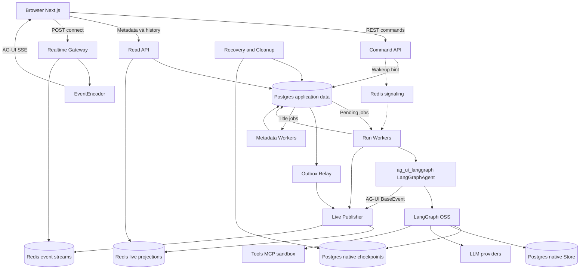

Ba khối Postgres là ranh giới ownership/schema logic, không yêu cầu ba cluster. Giai đoạn đầu có thể dùng một cluster với connection role và schema được cấu hình, kiểm thử riêng. Không giả định native package tự hỗ trợ một tên schema tuỳ ý; migration/search path phải được xác minh trên bản được pin.

Không có LangSmith control plane, deployment listener, Agent Server container hoặc yêu cầu tương thích API của sản phẩm đó. Graph definition và app image được triển khai qua CI/CD của dự án.

### 4.1. Component và hợp đồng

| Component | Input | Output | Có chạy LLM chính? |
|---|---|---|---|
| Command API | AG-UI run hoặc command + auth + idempotency | Durable job và SSE cho run, JSON cho metadata/stop | Không |
| Read API | Conversation được phép xem | Metadata và transcript page | Không |
| Realtime Gateway | POST run/connect + scope được phép | AG-UI snapshot/tail + heartbeat | Không |
| Run Worker | Run đã claim | Checkpoints, live events, terminal result | Có |
| Metadata Worker | Title/memory job | Metadata hoặc Store update | Có thể gọi model riêng |
| Outbox Relay | Committed domain event | Idempotent live update | Không |
| Recovery Controller | Expired heartbeat, incomplete finalization | Recovery decision/job | Không trực tiếp |
| Cleanup Worker | Retention/deletion job | Xoá dữ liệu có kiểm soát | Không |

### 4.2. Vòng đời tài nguyên

| Tài nguyên | Scope | Chính sách |
|---|---|---|
| Graph definition/topology | Process + definition version | Cache, không chứa mutable conversation state |
| Bound graph/checkpointer handle | Execution attempt | Gắn connection ownership của attempt, huỷ sau cleanup |
| LangGraphAgent wrapper | Run/attempt | Instance riêng hoặc clone template an toàn, không share mutable active_run |
| Execution state và callbacks | Attempt | Tuyệt đối không dùng chung giữa run |
| DB/HTTP pools | Process | Có giới hạn tổng theo replica |
| LLM client | Process hoặc credential scope | Không gắn lịch sử user vào client dùng chung |
| Memory namespace | Tenant + user | Bền vững qua conversation |
| MCP session | Theo credential/tool scope | TTL, tách khỏi graph state |
| Sandbox | Workspace/conversation theo policy | Giữ reference để attach lại, không giữ worker chỉ để giữ sandbox |

“Runtime mới mỗi lượt” không bắt buộc compile lại toàn bộ topology hay tạo lại mọi HTTP client. Không mutate checkpointer của một compiled graph đang phục vụ run khác; factory tạo bound handle đúng scope, đo compile/bind overhead trước khi tối ưu.

## 5. Native persistence: dùng gì và không tự viết gì

### 5.1. Tích hợp LangGraph

Các package dự kiến: `langgraph`, `langgraph-checkpoint-postgres`, `psycopg`, `psycopg-pool`, cộng model/tool integration hiện có. Pin phiên bản bằng lockfile khi triển khai.

```text
Conversation UUID
  └─ thread_id duy nhất, tạo phía server
      ├─ checkpoint state: messages, graph-owned fields, interrupts
      └─ checkpoint history do native saver quản lý

Memory namespace: (tenant_id, user_id, "memories")
  └─ key/value do native Store quản lý
```

Native Postgres saver và Store chịu trách nhiệm serialization, ghi/đọc checkpoint và item storage. Ứng dụng không viết SQL trực tiếp vào bảng nội bộ của chúng. Chạy `setup()`/migration trong deployment job có kiểm soát, không để mọi request tự chạy setup. [Memory](https://docs.langchain.com/oss/python/langgraph/add-memory), [Stores](https://docs.langchain.com/oss/python/langgraph/stores)

Pseudocode cấu hình, không phải đoạn có thể copy chạy ngay:

```python
from ag_ui_langgraph import LangGraphAgent

# Process scope: definition registry, HTTP clients, Store pool.
store = AsyncPostgresStore(memory_pool)

# Attempt scope: dedicated connection đã giữ thread ownership lock.
saver = AsyncPostgresSaver(owned_checkpoint_connection)
graph = graph_factory.bind(
    definition_version=run.definition_version,
    checkpointer=saver,
    store=store,
)
config = {
    "configurable": {"thread_id": conversation.thread_id},
    "metadata": {"app_run_id": str(run.id), "attempt_id": str(attempt.id)},
}

# run_input là RunAgentInput đã được backend validate/reconcile.
# Graph/checkpointer đã bind ownership và execution policy đúng version.
agent = LangGraphAgent(
    name="agent", graph=graph, config=config, emit_raw_events=False
)
async for event in agent.run(run_input):
    await live_publisher.append_agui_event(run, event)
```

`graph_factory.bind` và `live_publisher` là module của ứng dụng; `LangGraphAgent.run()` là nguồn phát live AG-UI events. Không có custom mapper native-event-to-AG-UI chạy song song. Thông tin tenant/user được truyền qua runtime context đã xác thực; không tin namespace hoặc `thread_id` do browser tuỳ ý gửi.

### 5.2. Chính sách checkpoint đề xuất

- Mục tiêu durability là sync cho graph có tool/approval và yêu cầu recovery rõ ràng. Phải kiểm tra cách đưa execution policy này qua LangGraphAgent/graph của version pin; không giả constructor hoặc `.run()` nhận `durability="sync"` nếu API không hỗ trợ. Đây là integration check chưa triển khai.
- Chỉ đổi sang `async` sau benchmark và chấp nhận cửa sổ mất checkpoint.
- Không dùng `exit` làm mặc định cho run dài có side effect.
- Không ghi một checkpoint cho mỗi token bằng cách tự sửa bảng native.
- Cleanup phải dùng API của saver/version được pin; không xoá checkpoint blob riêng lẻ theo tuổi nếu còn dependency.
- Snapshot runtime không chứa socket, connection pool, MCP object hoặc SDK client.

### 5.3. Context và transcript

MVP có thể đọc messages từ graph state khi lịch sử nhỏ. Thiết kế production đề xuất một **transcript projection** cho UI vì context của graph có thể trim/summarize, trong khi người dùng vẫn cần xem bản hội thoại đầy đủ và phân trang.

Projection không được dùng làm engine hydrate thứ hai: LangGraph luôn load checkpoint. Khi submit chỉ gửi message mới hoặc resume command, không gửi lại toàn bộ transcript từ browser vào graph.

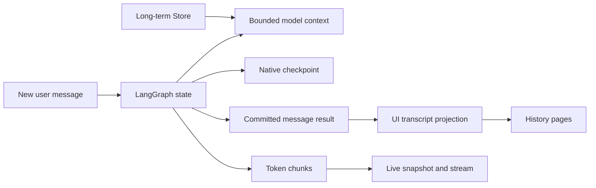

Transcript lưu public assistant/tool content được phép hiển thị, không dump toàn bộ internal graph state. Reasoning hiển thị theo khả năng/policy model, không coi raw chain of thought là dữ liệu bắt buộc lưu.

## 6. LLD: mô hình dữ liệu ứng dụng

Đây là schema contract để triển khai migration sau, không phải migration đã chạy. UUID dùng cho resource ID công khai/phân tán; timestamp dùng `timestamptz`; revision/fence dùng `bigint`; status dùng `text` với CHECK hoặc lookup. Mọi access path phải lọc tenant đúng scope.

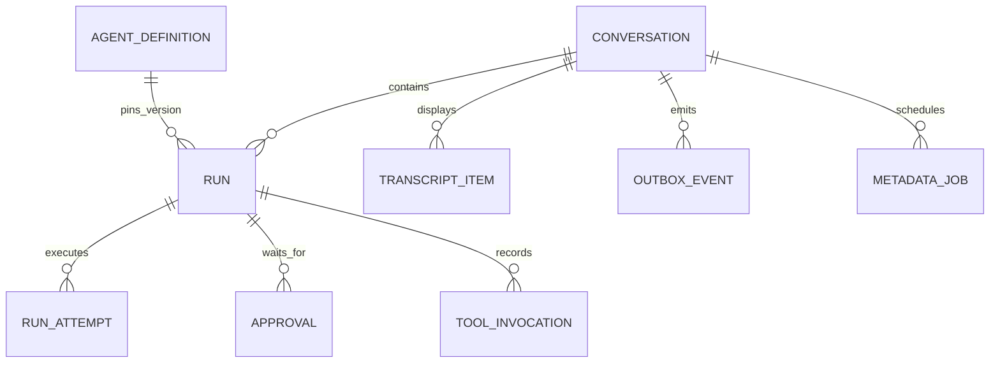

### 6.1. Bảng chính

| Bảng | Các trường quan trọng | Constraint/index cần có |
|---|---|---|
| `conversation` | `id`, `tenant_id`, `owner_id`, `thread_id`, `lock_key`, `execution_generation`, `title`, `title_source`, `title_revision`, `revision`, `created_at`, `updated_at`, `deleted_at` | PK id, UNIQUE thread_id, UNIQUE lock_key, index sidebar `(tenant_id, owner_id, updated_at DESC, id)` với điều kiện chưa xoá |
| `agent_definition` | `id`, `version`, `graph_key`, `state_schema_version`, `config`, `created_at` | PK `(id, version)`, config immutable sau publish |
| `run` | `id`, `conversation_id`, `created_by`, `definition_id/version`, `idempotency_key`, `request_hash`, `kind`, `input`, `status`, `fence`, `revision`, `cancel_requested_at`, `available_at`, `created_at`, `finished_at`, `result_checkpoint_id` | FK conversation/definition, UNIQUE `(conversation_id, created_by, idempotency_key)`, partial unique một run chưa terminal/conversation |
| `run_attempt` | `id`, `run_id`, `attempt_no`, `fence`, `worker_id`, `heartbeat_at`, `lease_expires_at`, `status`, `start_checkpoint_id`, `end_checkpoint_id`, `error_code` | FK run, UNIQUE `(run_id, attempt_no)`, index lease/status |
| `transcript_item` | `id`, `conversation_id`, `run_id`, `ordinal`, `role`, `content_blocks`, `status`, `revision`, `source_checkpoint_id`, `created_at` | FK conversation/run, UNIQUE `(conversation_id, ordinal)`, index `(run_id, id)` |
| `approval` | `id`, `run_id`, `interrupt_id`, `checkpoint_id`, `revision`, `decision`, `decided_by`, `decided_at` | FK run, UNIQUE `(run_id, interrupt_id)`, conditional consume một lần |
| `tool_invocation` | `id`, `run_id`, `logical_call_key`, `request_hash`, `status`, `external_operation_id`, `result_ref`, timestamps | FK run, UNIQUE `(run_id, logical_call_key)`, index recovery theo status |
| `metadata_job` | `id`, `conversation_id`, `kind`, `input_revision`, `status`, `available_at`, `attempts`, `result` | FK conversation, unique logical job key, partial index pending |
| `outbox_event` | `id`, `conversation_id`, `owner_id`, `entity_type/id`, `entity_revision`, `event_type`, `payload`, `created_at`, `published_at` | FK conversation, unique logical event key, partial index chưa publish |

`lock_key` là số duy nhất cấp từ identity/sequence cho advisory lock, không hash UUID bằng hàm hash không ổn định giữa process. FK cần index ở phía referencing, không giả định PostgreSQL tự tạo. Không tạo GIN toàn bộ JSONB nếu chưa có query thực tế.

`execution_generation` tăng đơn điệu **theo conversation** mỗi khi cấp attempt ownership mới; giá trị đó được copy vào `run.fence` và `run_attempt.fence`. Không reset fence về 1 khi sang run tiếp theo vì Redis gate có scope conversation. Revision của entity và generation của executor là hai bộ đếm khác nhau.

`transcript_item.run_id` có thể NULL cho nội dung nhập/import ngoài run; các field thật sự tuỳ chọn mới cho phép NULL. ID bảng native được giữ dưới dạng reference ứng dụng, không tạo FK xuyên vào schema nội bộ LangGraph.

### 6.2. Constraint và index tối thiểu minh hoạ

```sql
-- Fragment minh hoạ, bảng app.run được tạo bởi migration riêng.
CREATE UNIQUE INDEX run_one_open_per_conversation
ON app.run (conversation_id)
WHERE status IN (
    'queued', 'claimed', 'running', 'waiting_input',
    'cancel_requested', 'recovering'
);

CREATE INDEX run_ready_queue
ON app.run (available_at, created_at, id)
WHERE status = 'queued';

CREATE INDEX outbox_unpublished
ON app.outbox_event (created_at, id)
WHERE published_at IS NULL;
```

MVP reject lượt mới khi conversation còn run chưa terminal, kể cả đang chờ approval. Nếu sau này cho queue nhiều lượt/conversation, phải thay constraint và bổ sung thứ tự conversation; không chỉ xoá unique index.

Không cập nhật row transcript lớn mỗi token. Partial text nằm ở Redis; transcript cập nhật khi message kết thúc hoặc ở mốc durable được chọn. Tách heartbeat khỏi row input/result lớn để giảm write amplification.

## 7. REST command, idempotency và durable queue

### 7.1. API contract đề xuất

> Cập nhật 26/10/2026: [API contract cho chat AG-UI](./chat-agent-api-contract.md) là danh sách hiện hành, dựa trên source CopilotKit local. Public execution dùng run/connect/stop, thread list dùng GET, rename dùng `name`. `/threads/{threadId}` vẫn ánh xạ conversation nội bộ.
> Chốt: POST run/connect trả AG-UI SSE. Không dùng shared-user-feed profile hoặc JSON ACK để tạo run từ browser. Không dùng CopilotKit package; chỉ tham khảo cấu trúc API.

| API | Hành vi |
|---|---|
| `GET /info` | Agent registry và capabilities |
| `POST /agent/{agentId}/run` | AG-UI input, durable submit, trả SSE trong chính POST response |
| `POST /agent/{agentId}/connect` | Snapshot + watermark + tail trong cùng response, không tạo run mới |
| `POST /agent/{agentId}/stop/{threadId}` | Ghi cancel intent theo exact run scope |
| `POST /threads` | Custom create, owner mapping, server-generated threadId |
| `GET /threads` | Sidebar theo agent/user, cursor pagination |
| `GET /threads/{threadId}` | Custom metadata và active-run summary |
| `PATCH /threads/{threadId}` | Rename `name`/archive với expected revision |
| `GET /threads/{threadId}/messages` | Transcript pagination, không load mọi checkpoint |
| `DELETE /threads/{threadId}` | Tombstone, cancel, enqueue deletion, không xoá graph đang chạy ngay |
| `GET /health/live`, `GET /health/ready` | Deployment probes theo role |

API không nhận `owner_id` hoặc memory namespace từ client làm thẩm quyền. Auth dùng session cookie an toàn hoặc fetch streaming có bearer token; không đưa bearer token dài hạn vào query URL.

### 7.2. Transaction nhận run

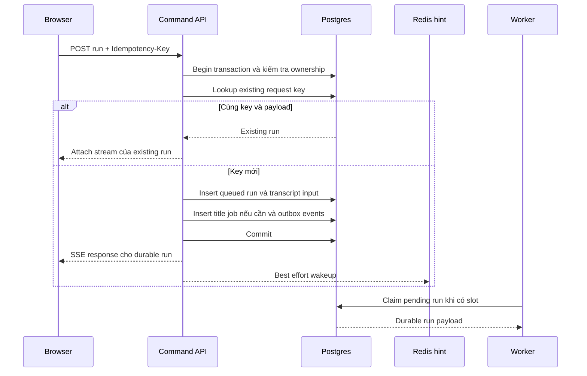

Idempotency key có scope conversation + caller; hash payload chuẩn hoá lưu cùng request. Cùng key nhưng payload khác trả `409 idempotency_conflict`. Request retry phải tra key cũ trước khi báo conversation busy. Không dùng key mới cho retry mạng của cùng một submit.

### 7.3. PostgreSQL là queue, Redis là hint

Worker định kỳ kiểm tra DB dù không nhận wakeup. Redis hint bị mất hoặc gửi trước khi worker nghe không làm mất run. Có thể dùng Pub/Sub hoặc list cho hint; không coi nội dung hint là nguồn truth.

Chọn queue Postgres ở giai đoạn đầu để transaction nhận run không cần dual-write sang một broker khác. Đây là lựa chọn giảm số cơ chế nhất quán phải vận hành, không phải khẳng định Postgres luôn nhanh hơn queue chuyên dụng. Nếu claim contention/vacuum/queue latency thành bottleneck đã đo, có thể chuyển dispatch sang broker qua transactional outbox, vẫn giữ run record và idempotency trong DB.

Claim bằng transaction ngắn, không giữ row lock suốt thời gian LLM trả lời:

```sql
BEGIN;
SELECT id
FROM app.run
WHERE status = 'queued' AND available_at <= clock_timestamp()
ORDER BY available_at, created_at, id
FOR UPDATE SKIP LOCKED
LIMIT 1;
-- Trong cùng transaction: kiểm tra slot/admission,
-- chuyển claimed, tăng fence, tạo run_attempt, COMMIT.
COMMIT;
```

Đây là pseudocode SQL, không phải đủ để copy làm queue production. Implementation phải kiểm tra affected rows, transaction isolation và concurrency test. Worker chỉ claim số job tương ứng slot còn trống, không prefetch vô hạn. Retry dùng `available_at`, exponential backoff + jitter và giới hạn theo loại lỗi.

## 8. Worker ownership: tránh hai writer và checkpoint bị ghi bởi worker cũ

### 8.1. Vì sao lease đơn thuần chưa đủ

Worker A có thể mất heartbeat nhưng vẫn đang chạy model/tool. Nếu chỉ đợi TTL rồi cấp run cho B, A có thể quay lại ghi checkpoint cùng `thread_id`. CAS ở bảng `run` hoặc fence trong Redis không bảo vệ bảng native saver.

Thiết kế nền tảng ban đầu chọn **session advisory lock theo conversation trên PostgreSQL**, giữ bởi chính connection dùng cho native checkpointer của attempt. Lease dùng để phát hiện vấn đề và quan sát, không tự cấp quyền thay writer khi lock cũ vẫn tồn tại.

[PostgreSQL advisory locks](https://www.postgresql.org/docs/current/explicit-locking.html#ADVISORY-LOCKS) có session scope. Native [AsyncPostgresSaver OSS](https://github.com/langchain-ai/langgraph/blob/main/libs/checkpoint-postgres/langgraph/checkpoint/postgres/aio.py) chấp nhận connection riêng hoặc pool; thiết kế chọn connection riêng. Source `main` là tham chiếu khả năng hiện tại, cần kiểm thử lại trên package version được pin.

### 8.2. Trình tự attempt

1. Worker claim run trong transaction ngắn và lấy `attempt_id`, tăng conversation generation để cấp `fence` mới.
2. Checkout một dedicated connection, dùng session pooling hoặc direct Postgres.
3. Gọi `pg_try_advisory_lock(conversation.lock_key)`. Không lấy được thì chưa chạy graph, đưa về lịch retry/recovery theo trạng thái.
4. Đọc lại run, xác minh attempt/fence/cancel intent; tạo saver gắn **chính connection đã lock**.
5. Register attempt/fence với live publisher trước khi chấp nhận delta.
6. Chạy graph; heartbeat bằng connection control riêng, không query đồng thời tuỳ ý trên connection saver.
7. Chờ toàn bộ native checkpoint writes kết thúc, finalize transcript/run/outbox.
8. Đóng stream/task con, unlock và trả connection; không trả connection còn lock về pool.

Trình tự claim trên áp dụng cho run đã queued hợp lệ. Recovery của run nghi còn executor cũ phải thử/acquire thread lock trước khi đổi durable ownership và tăng fence; không thu hồi owner cũ chỉ bằng cách sửa row khi lease hết hạn.

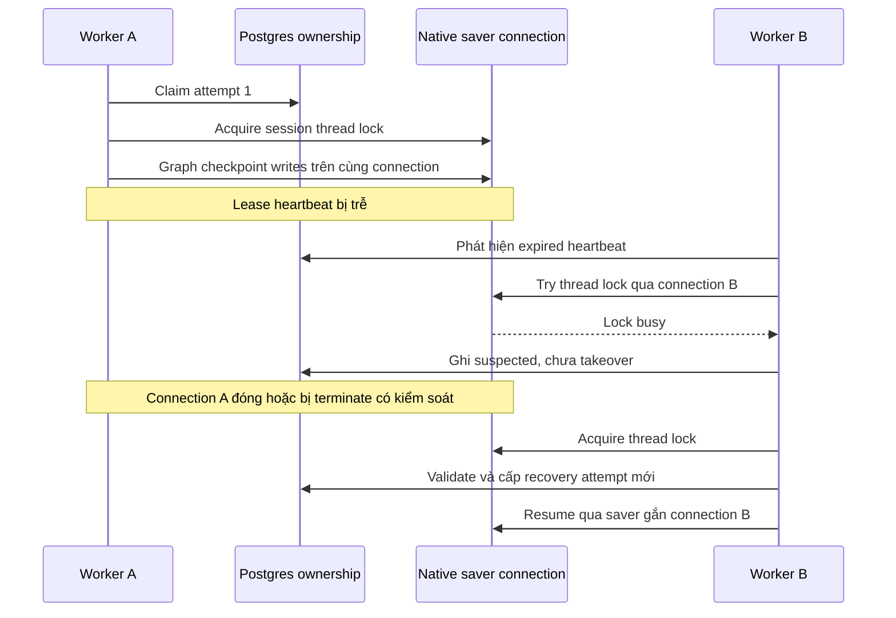

### 8.3. Quy tắc bắt buộc

- Saver của attempt không nhận pool có thể tự lấy connection khác. Không tự reconnect và tiếp tục attempt cũ sau khi mất owned connection.
- Khi connection mất, huỷ graph/provider tasks và chặn tiếp việc phát side effect; checkpoint write trên connection đã chết phải fail closed.
- Không unlock khi background checkpoint task còn có thể chạy. Nếu runtime teardown chưa chứng minh sạch, đóng connection/process thay vì tái sử dụng.
- Tất cả graph writers, kể cả admin update/fork/resume, phải tuân thủ thread ownership. Read-only state inspection không cần lock execution dài hạn.
- Session advisory lock không đi qua PgBouncer transaction pooling. Dành đường kết nối session/direct cho execution.
- Run status update dùng CAS `run_id + attempt_id/fence + expected status`; live publisher reject attempt cũ sau khi fence mới đã được register.
- Register fence phải xác thực durable attempt ownership từ DB; worker không được tự nâng fence theo con số do mình gửi. Khi Redis reset, gate phải được seed lại từ DB, không chấp nhận worker đầu tiên tới như owner mặc định.
- Advisory lock bảo vệ checkpoint writer, không rollback side effect ngoài Postgres. Tool vẫn cần idempotency.
- PostgreSQL failover/partition cần fault test với topology thực; không quảng cáo lock như bảo đảm hoạt động trên hai primary độc lập.

Mỗi active run giữ một checkpoint connection: đây là tradeoff chủ động để giữ native saver và đơn giản hoá ownership. Nếu quy mô không cho phép, cần thiết kế gated saver adapter kiểm tra fence trong cùng transaction của mỗi write và kiểm thử conformance; không chỉ bỏ lock rồi dùng lease TTL.

## 9. Run lifecycle, cancellation và approval

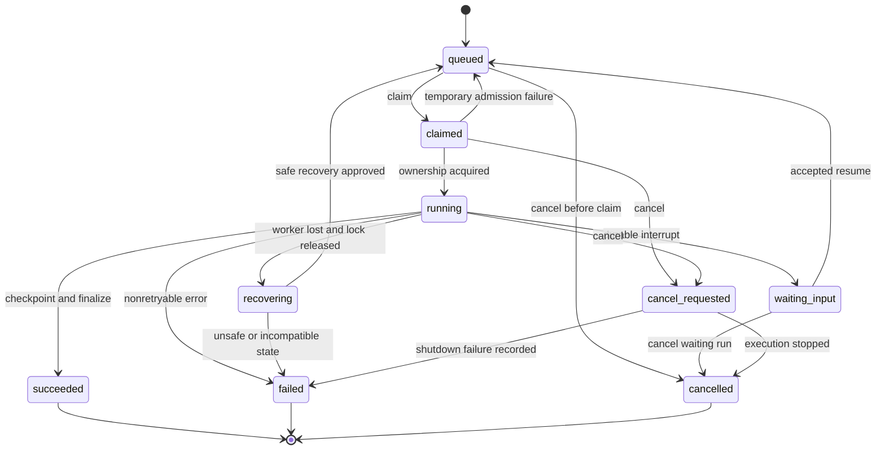

Một `run` là logical turn; nhiều `run_attempt` thể hiện retry hoặc continuation. `waiting_input` giữ logical run mở nhưng giải phóng worker slot/connection sau khi checkpoint đã durable. Resume hợp lệ chuyển **cùng run** về queued, tạo attempt mới; attempt counter không đồng nghĩa error retry counter.

### 9.1. Cancel

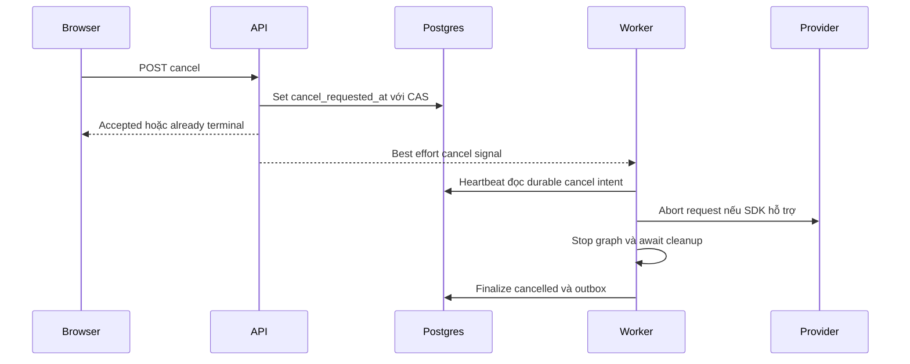

Không đợi Pub/Sub làm nguồn cancel duy nhất. Queued run có thể chuyển cancelled trong transaction mà không chạy graph. Với running run, API chỉ ghi intent; worker xác nhận đã dừng mới terminal. Race cancel/completion được giải bằng conditional transition: completion đã commit trước thì trả already terminal; cancel intent đã thắng thì không finalize thành succeeded.

Provider có thể vẫn tính phí hoặc tool không thể bị thu hồi; UI phản ánh trạng thái đang dừng cho tới khi có kết quả xử lý. Không gắn `cancel` vào callback đóng SSE.

`cancelled`/`failed` là trạng thái ứng dụng, không tự xoá pending task trong native graph state. Trước khi nhận lượt mới, coordinator phải xác định checkpoint là điểm bắt đầu hợp lệ: resume/reconcile phần dang dở hoặc tạo state transition/reset được định nghĩa và kiểm thử cho graph đó. Không mặc định mọi lỗi đều có thể bỏ qua bằng một user message mới.

### 9.2. Approval và resume

- Lưu interrupt ID, checkpoint reference, request revision và decision trong DB.
- Resume endpoint auth lại, kiểm tra conversation/run đang waiting, consume interrupt một lần bằng transaction.
- Graph adapter truyền `Command(resume=...)` theo API bản LangGraph được pin.
- Không coi resume là user message mới và không append lại prompt đầu.
- Code trước `interrupt()` có thể chạy lại khi resume; đặt side effect sau approval và dùng idempotency nếu cần. [Nguồn interrupts](https://docs.langchain.com/oss/python/langgraph/interrupts)

## 10. Streaming: snapshot + tail bên trong connect

### 10.1. Scope và storage

SSE gắn với thread/nhánh đang chọn. POST run gửi AG-UI input và nhận stream; POST connect attach lại thread sau reload mà không tạo prompt mới. Hai route cùng dùng shared streaming service của backend FastAPI. Không có CopilotKit Runtime/AgentRunner object trong execution path; chỉ tham khảo trách nhiệm run/connect/stop.

Redis keys được chia theo tenant + native thread để projection và event Stream có cùng Redis Cluster hash slot:

```text
rt:{tenant_uuid:thread_uuid}:epoch
rt:{tenant_uuid:thread_uuid}:events
rt:{tenant_uuid:thread_uuid}:view
rt:{tenant_uuid:thread_uuid}:fence
rt:{tenant_uuid:thread_uuid}:dedup:<logical_event_uuid>
```

Ownership vẫn kiểm tra bằng authenticated user ở DB; key thread/UUID không phải authorization. Tab chỉ giữ consumer cho chat đang xem; worker của chat nền vẫn chạy. Không cam kết push mọi update sidebar của mọi chat nền.

### 10.2. Publisher và watermark

Worker dùng publisher atomic có giới hạn payload: kiểm tra epoch/fence/revision/dedup, append event, apply event vào live projection, ghi watermark và retention metadata. Tất cả thay đổi live hoặc outbox metadata của thread đi qua cùng publisher.

Redis script atomic về interleaving, không tự rollback write đã chạy khi script lỗi; validate key types/precondition trước mutation, xử lý OOM và reconciliation. Batch delta có giới hạn byte/time; không ghi đầy đủ response lặp lại mỗi token.

| Trường | Ý nghĩa |
|---|---|
| Thread stream ID | Vị trí trong shared Stream của một thread |
| Epoch | Thế hệ Stream, thay khi continuity bị mất |
| Entity revision | Reject stale/duplicate message hoặc metadata |
| Fence | Thế hệ executor, không reset theo run |
| Checkpoint ID | Durable graph state, không dùng làm stream cursor |

Live Publisher nhận BaseEvent đã được LangGraphAgent.run() emit, lưu nguyên protocol payload trong envelope chứa các trường trên và apply vào live projection. Gateway restore BaseEvent từ shared store rồi EventEncoder encode thành SSE. Không có bước tự convert native graph events sang AG-UI tại gateway. Metadata ngoài graph dùng CustomEvent/model chính thức của ag_ui.core.

### 10.3. Connect lấy snapshot và nối tail

1. Xác thực owner và thread/nhánh đang chọn; không enqueue run.
2. Lấy public messages/state, partial response và watermark W nhất quán.
3. Dùng models ag_ui.core dựng AG-UI restore snapshot/prefix events, EventEncoder encode SSE; giữ active message ID/open-message bookkeeping. Không gọi LangGraphAgent.run() trong connect.
4. Đọc shared Stream sau W, chuyển thành AG-UI delta/lifecycle trong cùng response.
5. Consumer rời đi không ảnh hưởng ownership của detached worker.

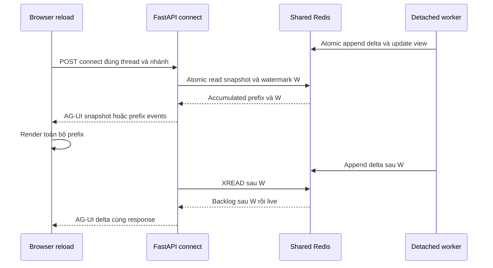

Không cần browser gọi public bootstrap trước connect. Snapshot hydration là operation nội bộ. Snapshot là tại W, không phải thời điểm đồng hồ render. Client không nhận lại hàng nghìn token cũ thành animation.

MESSAGES_SNAPSHOT/STATE_SNAPSHOT hoặc START + một CONTENT chứa prefix là phương án serialization cần integration test với reducer phiên bản pin. Không chứa active message hai lần ở snapshot và prefix events, không END active message trước tail.

### 10.4. Cold state, Redis reset và retention

- Cold thread terminal: hydrate durable transcript/state với barrier trước khi đọc DB, reconcile events sau barrier theo revision để không skip run mới/metadata mới.
- Active thread thiếu live view: yêu cầu worker republish full accumulated snapshot có fence/revision rồi đọc lại view. Nếu partial buffer đã mất, hiển thị recovery rõ ràng; không bịa text hoặc coi checkpoint có mọi token.
- Epoch đổi/retention gap: connect dựng lại snapshot; không gửi suffix đơn độc. Continuity guard kiểm tra từng batch hoặc pin reader có timeout, không chỉ XINFO một lần trước XREAD.
- TTL active snapshot được refresh trong khi run sống; terminal retention theo policy riêng. Stream MAXLEN và projection byte limit là hai giới hạn khác nhau.
- Không dùng consumer group để broadcast cho các tab vì group chia event giữa consumer. Reader chia sẻ cục bộ phải cùng tenant/thread scope.
- Redis unavailable: bounded worker buffer, degrade live rõ ràng; durable graph có thể hoàn tất trong Postgres. Không cam kết partial text sống qua mất toàn bộ Redis nếu chưa có durable partial journal.
- Hoàn thành message phát authoritative full result với revision cao hơn partial để hội tụ; delta cần đúng predecessor, full replacement có thể nhảy revision.

### 10.5. Title và stream lifecycle

Title/task update của chat đang xem phát CUSTOM thread.updated trong cùng stream khi còn subscriber. Chuyển chat hoặc mở lại lấy metadata mới từ GET thread/list và connect snapshot. Nếu title còn pending sau khi run stream đóng, UI refresh metadata có giới hạn; không cần một global SSE riêng.

Frontend detach stream cũ khi đổi chat/bắt đầu operation mới. Plain HttpAgent không tự biết endpoint connect/stop custom: viết adapter AG-UI mỏng, không cài CopilotKit. Một tab không consume song song run và connect cho cùng text.

## 11. Finalization và khoảng trống giữa native checkpoint với app DB

Native saver commit checkpoint không mặc nhiên cùng transaction với cập nhật app.run. Không bọc hai thao tác riêng rồi gọi đó là atomic.

Thiết kế finalization là idempotent, có recovery:

1. Graph kết thúc và xác nhận checkpoint cuối durable; xác định checkpoint/run/attempt tương ứng.
2. Đọc public result, upsert transcript theo stable message ID + revision.
3. Trong transaction ứng dụng: ghi transcript, terminal run status, result checkpoint reference và outbox.
4. Relay publish full completion và run status qua publisher.
5. Release execution ownership khi graph/task/checkpoint cleanup đã hoàn tất.

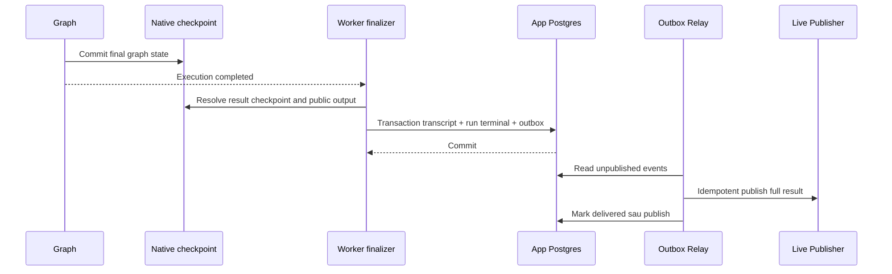

Nếu worker chết sau bước 1 trước bước 3, recovery đọc checkpoint và finalize lại, không gọi LLM lần nữa chỉ vì `run.status` chưa succeeded. Nếu relay chết sau publish trước mark, dedup key + entity revision chống append trùng. Các relay có thể xử lý out-of-order: metadata/full replacement mang revision; delta dùng strict predecessor check.

Metadata `app_run_id` phải tồn tại trong state/checkpoint metadata bằng cơ chế đã kiểm thử của bản LangGraph dùng. Không giả định field metadata bất kỳ luôn được lưu native; nếu cần, thêm graph-owned execution marker có schema để recovery phân biệt checkpoint của run trước.

## 12. Title và long-term memory jobs

### 12.1. Title

Tạo fallback từ prompt đầu trong transaction tạo conversation/run. Lưu `title_source=fallback`, `title_revision`. Title task dùng input cố định từ prompt đầu, budget riêng và không giữ worker slot của main run.

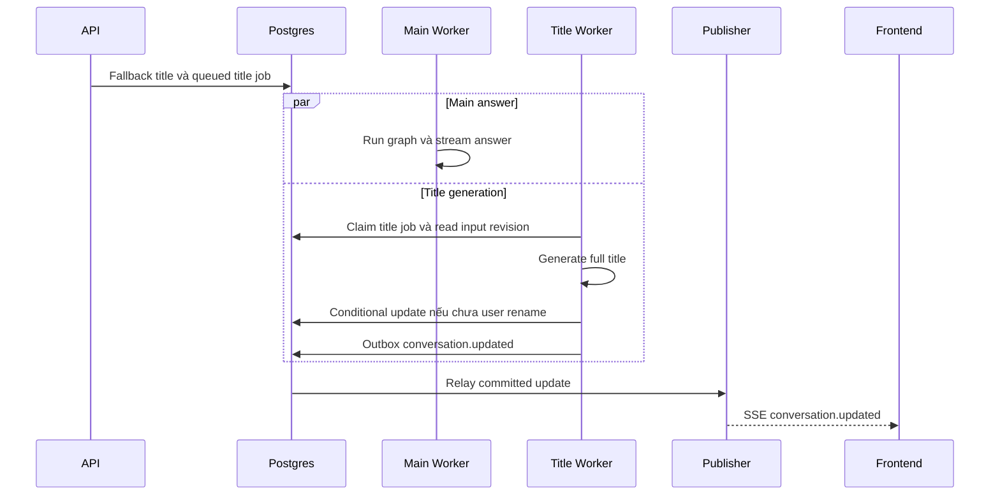

Update chỉ thành công nếu source vẫn fallback và generation/input revision đúng. User rename đặt `title_source=user` và tăng revision. Title lỗi/timeout giữ fallback; frontend không polling chờ “title hoàn thiện”. Task retry không tạo nhiều title event cùng revision.

### 12.2. Memory policy

- Store giữ item theo tenant/user namespace; graph đọc có giới hạn hoặc semantic retrieval nếu được cấu hình.
- Extraction chỉ từ nội dung đã committed và được phép ghi nhớ; không lấy partial response làm fact.
- Dùng deterministic memory key hoặc logical operation key để retry không nhân bản cùng fact.
- Nếu memory extraction chạy nền, memory mới có thể chưa có ở câu hỏi ngay tiếp theo; phải chấp nhận eventual consistency hoặc đặt extraction vào graph trước terminal khi có yêu cầu nghiêm ngặt.
- Store không thay thế ownership table, ACL hoặc transcript. Xoá conversation không mặc nhiên xoá mọi memory user; cần provenance/policy rõ ràng.

## 13. Recovery và tool side effects

### 13.1. Phân loại mất kết nối

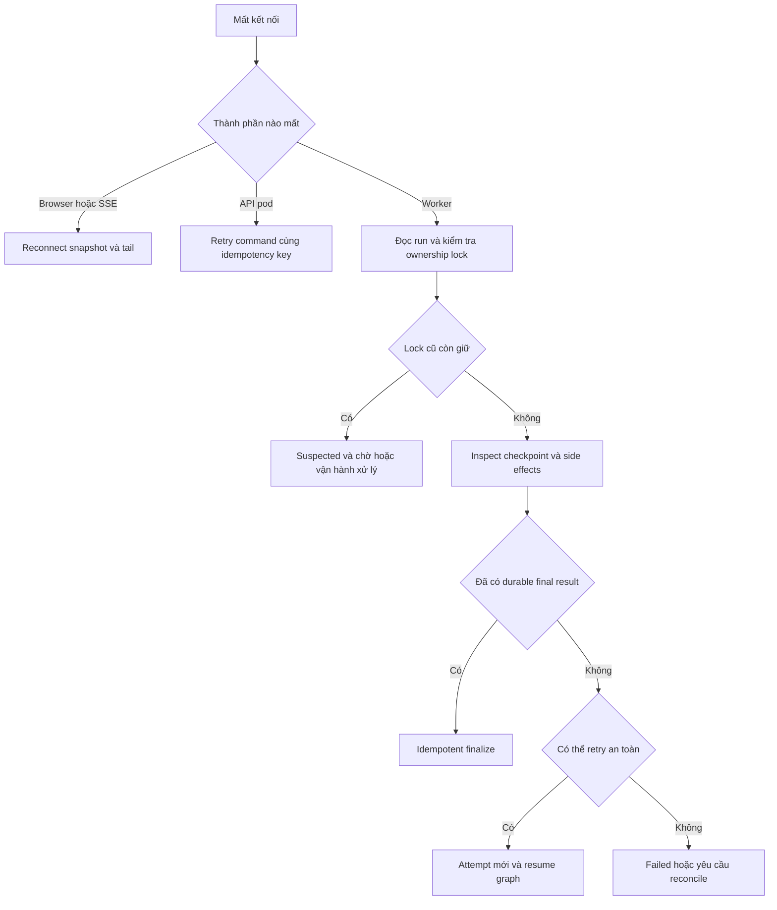

### 13.2. Quy tắc recovery

| Điểm worker chết | Hành động |
|---|---|
| Chưa input checkpoint | Submit lại input với cùng stable message ID sau kiểm tra marker |
| Đã input checkpoint, model đang sinh | Resume execution từ native state, không append lại user input |
| Có durable node result | Dùng checkpoint/pending writes, không tự gọi lại node đã durable |
| Tool side effect có external operation ID | Query/reconcile trạng thái ngoài trước khi retry |
| Side effect chưa biết đã xảy ra chưa | Mark ambiguous, không tự lặp thao tác không idempotent |
| Graph final đã durable, app chưa finalize | Chạy finalizer |
| Graph schema/image không tương thích | Dừng recovery, route tới worker version phù hợp hoặc migration đã kiểm thử |

Recovery của model call thường có nghĩa gọi lại node chưa hoàn tất; provider stream cũ không thể tự nối tiếp từ byte cuối. Khi attempt mới sinh lại message, gửi `message.replaced`/generation reset có fence mới; không append output mới vào prefix cũ như thể cùng một lần sinh.

MVP chỉ auto-retry lỗi đã phân loại an toàn. Lease hết hạn không đồng nghĩa được replay mọi node. Dùng retry budget riêng cho DB transient, model transient, metadata và tool; không vô hạn hoá retry ở nhiều tầng.

### 13.3. Tool invocation ledger

```text
planned → executing → succeeded
                    → failed
                    → ambiguous → reconciled
```

`logical_call_key` ổn định xuyên retry cho cùng hành động, không lấy `attempt_id` làm idempotency key ngoài hệ thống. Trước side effect ghi intent; gọi downstream với idempotency key nếu hỗ trợ; sau đó lưu external operation ID/result. Ledger riêng không đủ chống duplicate nếu downstream không hỗ trợ dedup và worker chết sau remote commit.

Native Store writes cũng là side effects nếu node bị replay: ưu tiên put theo deterministic key, merge có version; concurrent facts giữa nhiều conversation của cùng user cần policy conflict riêng.

## 14. Frontend và AG-UI adapter

Frontend không trực tiếp sở hữu LLM request. Hook chat quản lý thread/nhánh, optimistic message, POST run/connect SSE, cursor metadata nội bộ và event reducer. Không dùng JSON ACK + user feed.

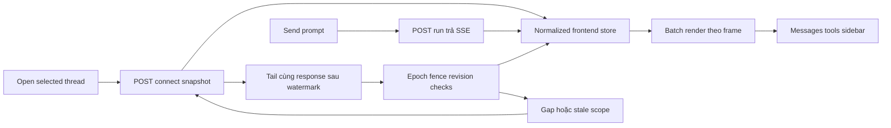

Giữ AG-UI làm execution contract, native graph state thuộc LangGraph còn live cursor thuộc streaming service custom. Không giả định `HttpAgent.runAgent()` hiện tại tự có detached run/resume semantics.

`LangGraphAgent` là lớp duy nhất chuyển native graph execution thành live AG-UI events. Worker consume `.run()` và lưu output; projection reducer đọc BaseEvent để tích luỹ view, EventEncoder encode SSE tại gateway. Adapter frontend chỉ attach/detach/connect/stop; không có custom StreamAdapter tự consume graph.astream/astream_events rồi emit text/tool/lifecycle lần nữa.

Frontend apply theo thứ tự: kiểm tra epoch → conversation scope → fence → entity revision → block offset. Gap thì resync, duplicate thì bỏ qua; timestamp chỉ để hiển thị. Optimistic message được reconcile bằng stable client/server message ID.

Sidebar title và answer dùng chung transport nhưng reducer khác entity. Reconnect không gọi POST tạo run lần nữa. Logout/account switch phải huỷ SSE và xoá store/cursor của user cũ.

## 15. Scale nhiều pod và capacity planning

### 15.1. Deployment production đề xuất

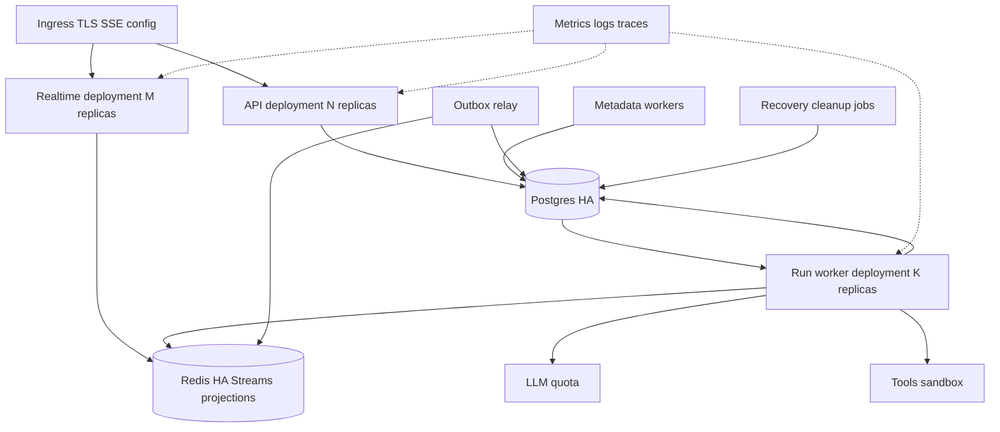

Các deployment dùng app image của dự án với entrypoint khác nhau, không dùng Agent Server base image. Dev có thể dùng Compose với API/realtime chung process, worker process riêng, Postgres và Redis.

### 15.2. Ba loại capacity

| Tier | Metric chính | Resource giới hạn |
|---|---|---|
| Command/read API | Request rate, p95 latency, pool wait | DB, CPU, serialization |
| Realtime | Active connections, bytes/sec, send backlog | Socket/FD, RAM, network, Redis readers |
| Run workers | Runnable backlog, oldest job age, active slots | LLM quota, checkpoint connections, RAM, tool capacity |

Tăng API pod không làm model chạy được nhiều hơn. Tăng worker pod không giải quyết client chậm. Với thiết kế ownership đã chọn, số checkpoint connection tăng gần tuyến tính theo active runs.

Capacity estimate của thiết kế:

```text
required_active_slots ≈ arrival_rate_runs_per_second × mean_run_seconds
worker_replicas ≈ ceil(required_active_slots / slots_per_worker / target_utilization)

pg_connections_budget ≥ API_pools + Store_pools + control_pools
                        + active_run_checkpoint_connections
                        + relay/recovery/operations_headroom

redis_memory_budget ≈ hot_snapshot_bytes + retained_event_bytes
                      + dedup_keys + replication_and_allocator_headroom
```

Ví dụ giả định, không phải benchmark: 2 run/giây, trung bình 30 giây cần khoảng 60 slot ở 100% utilization. Với 10 slot/worker và mục tiêu 70%, cần khoảng 9 worker trước khi kiểm tra provider quota và DB budget.

### 15.3. Autoscaling và backpressure

- Worker scale theo oldest runnable age/backlog và số slot đang dùng, có CPU/RAM guardrail. Không dùng CPU đơn lẻ cho workload chờ LLM I/O.
- Slot admission chịu giới hạn theo tenant/user/model provider và tool, không chỉ tổng process.
- Metadata dùng queue/slot budget riêng để title không chiếm hết capacity main answer.
- Khi quá tải, từ chối admission bằng `429/503` hoặc queue có giới hạn; không nhận vô hạn rồi để người dùng chờ không có deadline.
- Gateway có send queue giới hạn; client quá chậm nhận resync/disconnect, không kéo chậm execution.
- Một shared reader/tenant/thread trong gateway có thể phục vụ nhiều tab local; không mở một Redis blocking connection cho mọi browser mà không tính budget.
- Reconnect dùng exponential backoff/jitter để tránh thundering herd sau deploy.
- SSE heartbeat, ingress idle timeout và buffering/compression phải được cấu hình và đo thực tế.
- Run claim, ownership, resume, finalization và bootstrap cần tính nhất quán dùng Postgres primary. Chỉ đưa sidebar/history chấp nhận stale sang read replica; không dùng replica lag để quyết định checkpoint chưa tồn tại rồi replay input.

### 15.4. Drain và rollout

Worker nhận SIGTERM: stop claim → giữ heartbeat khi drain → chờ active runs trong termination budget → stop an toàn/finalize hoặc để recovery sau khi ownership thực sự mất. Không mark succeeded chỉ vì process sắp bị kill.

Pin `definition_version`, `graph_key`, `state_schema_version` và image-compatible worker pool cho run. Chưa migrate checkpoint khi đang có active writer. Deployment phải giữ worker version cũ đủ lâu cho run cũ hoặc có migration/recovery đã thử nghiệm.

Giữ ít nhất một worker ở giai đoạn đầu. Scale-to-zero chỉ triển khai khi có queue-driven activator độc lập đã chứng minh nhận job và đánh thức worker từ trạng thái zero.

## 16. Cấu hình khởi đầu để benchmark

Các giá trị sau là **đề xuất thử tải**, không phải default của LangGraph hoặc SLA đã cam kết:

| Cấu hình | Giá trị khởi đầu | Cần xác minh |
|---|---|---|
| `RUN_SLOTS_PER_WORKER` | 8 | RAM/run, CPU/tool, provider concurrency |
| `HEARTBEAT_INTERVAL` | 5 giây | DB write rate và failure detection |
| `LEASE_OBSERVATION_TIMEOUT` | 30 giây | Chỉ đánh dấu suspected, không tự phá ownership lock |
| `QUEUE_POLL_INTERVAL` | 1 giây + jitter | Wakeup failure latency và DB cost |
| `DELTA_BATCH_INTERVAL` | 30–50 ms | Time to first delta và Redis bandwidth |
| `SSE_HEARTBEAT_INTERVAL` | 15 giây | Nhỏ hơn ingress idle timeout |
| `TERMINAL_LIVE_RETENTION` | 30 phút | Reload window, RAM và privacy policy |
| `TITLE_TIMEOUT` | 15 giây | Fallback vẫn sử dụng được khi timeout |
| `LIVE_SEND_QUEUE_MAX_BYTES` | Theo benchmark | Bắt buộc hữu hạn, không hardcode số lớn tuỳ ý |

Stream retention tính theo cả thời gian/số event/bytes. Chọn MAXLEN và trimming policy từ token rate, concurrent runs và reconnect window; không dùng một TTL chung rồi giả định đủ cho mọi user.

## 17. Observability, security và cleanup

### 17.1. Metric cần thu

| Nhóm | Metric |
|---|---|
| User latency | submit→ack, queue wait, hydrate, first model token, first SSE delta, bootstrap→render |
| Worker | active slots, attempt duration, lock wait, heartbeat age, cancellation lag |
| Persistence | checkpoint write p50/p95, bytes/checkpoint, pool wait, finalization lag |
| Realtime | stream append latency, snapshot size, resync rate, retention gaps, send backlog |
| Reliability | duplicate requests, stale fence rejects, ambiguous tools, recovery success/failure |
| Metadata | title latency, fallback rate, rejected stale title update |

Log/trace mang `tenant_id`, `conversation_id`, `run_id`, `attempt_id`, fence và definition version; tránh đưa prompt/secret vào metric labels. Dùng OpenTelemetry/metrics stack của dự án, không bắt buộc LangSmith tracing.

### 17.2. Quyền truy cập và dữ liệu

- Authz kiểm tra ở command, bootstrap, history và SSE; UUID không phải cơ chế phân quyền.
- SSE chỉ đọc feed của principal được xác thực; revoke quyền phải đóng stream hoặc revalidate theo policy.
- Credentials để trong secret manager/environment injection, không nằm trong checkpoint, transcript hoặc Store.
- Runtime context gắn tenant/user từ backend; tools không tự lấy user_id do model sinh làm authority.
- Quota, payload limits và tool permissions được kiểm tra trước thực thi.

### 17.3. Retention và deletion

Conversation deletion: tombstone → ngăn run mới → cancel run đang mở → đợi ownership nhả → xoá transcript/run/approval/ledger theo policy → xoá thread bằng native saver API → xử lý memory provenance → xoá live keys và phát invalidation.

Không dùng FK cascade sang bảng native do package quản lý. Cleanup là durable job idempotent, ghi trạng thái từng bước để retry sau lỗi. Không xoá checkpoint của run đang waiting approval hoặc chưa reconcile. Backup/restore phải kiểm thử cả app data và native checkpoint/Store; restore Redis không được làm sống lại epoch/cursor đã mất continuity.

## 18. Ma trận lỗi và tiêu chí nghiệm thu

| Thử nghiệm | Kết quả phải đạt |
|---|---|
| Đóng browser giữa model response, mở lại | Hiện accumulated prefix ở snapshot và nối delta mới, không tạo run mới |
| Retry submit sau mất ACK | Một logical run và một user input |
| Hai API pod submit cùng conversation | Chỉ một run được nhận, request khác 409 hoặc cùng idempotent ACK |
| Kill SSE pod | Reconnect qua pod khác không mất text trong retention |
| Mất Redis wakeup | Worker polling vẫn nhận durable queued run |
| Kill worker giữa node | Recovery kiểm tra lock/checkpoint, không append lại input |
| Pause worker lâu hơn lease nhưng DB session còn sống | Worker mới không được ghi checkpoint cùng thread |
| Mất saver connection, attempt cũ còn model task | Attempt cũ không reconnect để ghi checkpoint, fence mới loại output cũ |
| Crash sau final checkpoint trước app finalization | Recovery finalize, không gọi lại LLM |
| Duplicate/out-of-order outbox delivery | Revision/dedup giữ title/message đúng |
| User rename khi title LLM đang chạy | Tên user thắng |
| Approval gửi hai lần | Một continuation, response còn lại idempotent/conflict rõ ràng |
| Tool remote commit rồi worker chết | Reconcile/idempotency, không tự lặp side effect mù |
| Trim stream giữa các batch đọc | Phát hiện continuity gap và resync |
| Redis reset giữa model response | Epoch mới, worker full snapshot hoặc trạng thái mất partial rõ ràng |
| Slow browser và token rate cao | Send buffer hữu hạn, worker không bị giữ bởi client |
| Rolling deploy với run dài | Drain/version routing, không load graph schema không tương thích |
| Trim model context rồi đọc history cũ | UI vẫn có transcript đầy đủ theo retention |

Cần thêm test wrapper RUN_ERROR/interrupt/finalization, replay không execute wrapper, không duplicate lifecycle và durability policy thực tế qua version LangGraphAgent đã pin. Các test này chưa chạy vì tài liệu là thiết kế. Production readiness cần integration/fault/load test, không chỉ unit test serializer/reducer.

## 19. Áp dụng vào repository hiện tại

### 19.1. Hiện trạng đã đọc

- [Graph hiện tại](/home/lamhung/code/agent_project/backend/src/agent_backend/agent_graph.py) dùng `InMemorySaver`, chưa có persistent native Postgres Store.
- [Endpoint hiện tại](/home/lamhung/code/agent_project/backend/src/agent_backend/main.py) stream trực tiếp từ `request_agent.run()` trong HTTP response.
- [AG-UI wrapper](/home/lamhung/code/agent_project/backend/src/agent_backend/agui.py) cache wrapper gốc và clone theo request.
- [Frontend hook](/home/lamhung/code/agent_project/frontend/src/hooks/use-agent-chat.ts) gọi `HttpAgent.runAgent()`; chưa là command + detached executor + snapshot/tail.
- [Dependency manifest](/home/lamhung/code/agent_project/backend/pyproject.toml) đã dùng LangGraph OSS; chưa khai báo native Postgres persistence packages trong danh sách đã đọc.

### 19.2. Cấu trúc module đề xuất

```text
backend/src/agent_backend/
  api/                 # threads, history, AG-UI run/connect/stop SSE
  domain/              # commands, run transitions, event schema
  persistence/         # application repositories, native saver/store setup
  runtime/             # graph registry, LangGraphAgent factory, execution policy
  workers/             # run loop, ownership, supervisor, finalizer
  realtime/            # atomic publisher, projection, cursor, retention
  metadata/            # title and memory jobs
  recovery/            # lease observation, checkpoint reconciliation
  tools/               # tool ledger and external idempotency
  observability/       # metrics and tracing
  entrypoints/         # api, run_worker, metadata_worker, relay, maintenance
```

Đây là hướng tổ chức khi triển khai, chưa tạo các thư mục này.

### 19.3. Roadmap có điều kiện hoàn thành

| Giai đoạn | Nội dung | Điều kiện chuyển tiếp |
|---|---|---|
| 1. Native durability | Postgres saver/Store, auth ownership, stable IDs, context policy | Restart process vẫn đọc đúng thread, không lẫn user |
| 2. Detached runs | Durable run queue, worker, idempotency, thread lock, cancel | Disconnect không dừng run, duplicate request không nhân run |
| 3. Realtime recovery | Redis thread projection/Stream, connect snapshot+tail, revision/fence | Reload prefix+tail đúng, trim/reset xử lý rõ ràng |
| 4. Product metadata | Title jobs, outbox, transcript pagination, approval | Rename race và resume duplicate đều đúng |
| 5. Recovery hardening | Attempt reconcile, tool ledger, finalization crash cases | Qua fault matrix trước bật auto-retry rộng |
| 6. Scale | Independent deployments, capacity budget, HPA, drain | Load test đạt SLO đã đo, không vượt quota/pool |

Không tuyên bố “đã dùng PostgresSaver nên hỗ trợ multi-pod đầy đủ” trước khi hoàn thành queue ownership, realtime và fault tests.

## 20. Quyết định đề xuất và những thứ chưa cần xây

| Hạng mục | Đề xuất trong tài liệu này |
|---|---|
| Agent engine | LangGraph OSS, native Postgres saver và Store |
| AG-UI emission | ag_ui_langgraph.LangGraphAgent.run(), EventEncoder encode SSE |
| CopilotKit | Chỉ tham khảo input/output API, không package/runtime/SDK |
| Execution platform | Backend/worker tự xây bằng application code |
| Durable queue | PostgreSQL run table, SKIP LOCKED, Redis wakeup không bắt buộc |
| Thread writer ownership | Session advisory lock + owned saver connection, lease cho quan sát |
| Run concurrency cùng conversation | MVP reject lượt mới khi run còn mở |
| Stream transport | AG-UI SSE qua POST run/connect, chat đang chọn |
| Reload semantics | POST connect chứa snapshot + watermark + tail, cold hydrate có barrier |
| Partial storage | Redis live projection + replay Stream, RPO công bố riêng |
| Transcript | Projection cho UI, không thay thế checkpoint engine |
| Title | Durable metadata job + conditional update + outbox |
| Recovery | Conservative theo checkpoint và side-effect safety |
| Control plane riêng | Chưa xây, dùng CI/CD và orchestrator hiện có |
| Cron/assistant marketplace/remote graph compatibility | Ngoài phạm vi MVP |
| Full token journal bền vững | Chỉ thêm nếu yêu cầu RPO partial buộc phải có |

Các thông số retention, SLO, PostgreSQL connection budget, Redis topology và policy cho tool không idempotent cần được chốt bằng workload thực. Đây là những tham số vận hành còn mở, không làm thay đổi ranh giới trách nhiệm của thiết kế.

## 21. Nguồn và tài liệu liên quan

Nguồn được truy cập ngày 23/10/2026. Các URL `.md` người dùng cung cấp tương ứng trang HTML dưới đây; dùng HTML để đọc và liên kết ổn định trong tài liệu này.

1. [Agent Server](https://docs.langchain.com/langsmith/agent-server) — ranh giới API/worker, persistence và lifecycle.
2. [Configure Agent Server for scale](https://docs.langchain.com/langsmith/agent-server-scale) — phân biệt request/run capacity và áp lực read/write.
3. [LangSmith data plane](https://docs.langchain.com/langsmith/data-plane) — backing services, signaling và control plane listener.
4. [Self-host standalone servers](https://docs.langchain.com/langsmith/deploy-standalone-server) — triển khai, drain và trách nhiệm vận hành.
5. [LangGraph checkpointers](https://docs.langchain.com/oss/python/langgraph/checkpointers) — native state persistence và durability.
6. [LangGraph memory](https://docs.langchain.com/oss/python/langgraph/add-memory) — persistent memory integration.
7. [LangGraph stores](https://docs.langchain.com/oss/python/langgraph/stores) — cross-thread memory storage.
8. [LangGraph interrupts](https://docs.langchain.com/oss/python/langgraph/interrupts) — pause/resume contract.
9. [Event streaming API](https://docs.langchain.com/langsmith/event-streaming) — tham chiếu bổ sung, không mặc định cùng semantics với data-plane Pub/Sub.
10. [AsyncPostgresSaver OSS source](https://github.com/langchain-ai/langgraph/blob/main/libs/checkpoint-postgres/langgraph/checkpoint/postgres/aio.py) — khả năng nhận dedicated connection, cần đối chiếu version pin khi triển khai.
11. [PostgreSQL advisory locks](https://www.postgresql.org/docs/current/explicit-locking.html#ADVISORY-LOCKS) — cơ sở ownership connection-level.
12. [Kiến trúc chat ban đầu](./agent-chat-architecture.md) và [so sánh các dự án](../architecture/chat-data-flow-comparison.md) — bối cảnh quyết định của dự án.
