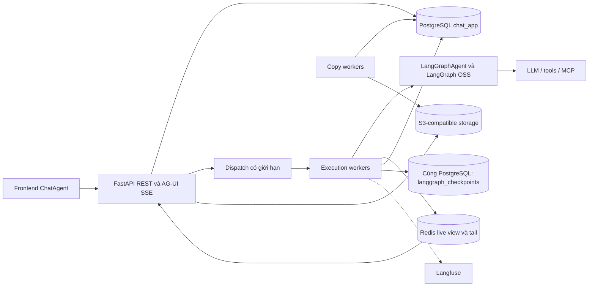

# Lưu trữ và mở rộng hệ thống chat theo database mới

Cập nhật và đọc lại nguồn web: **29/10/2026**, Asia/Ho_Chi_Minh.

Tài liệu này thay toàn bộ thiết kế cũ trong cùng file. Baseline là [database giai đoạn 1–4](database-decisions.md), [API](chat-agent-api-contract.md), [ChatAgent](chat-agent-client-decisions.md) và [quy ước ID](conversation-message-run-id-decisions.md). SQL chuẩn ở [database_decisions](../database_decisions/README.md); đây không phải schema/migration thứ hai.

**Phân biệt trạng thái:** các quyết định database/API đã duyệt được giữ nguyên. Các cách bố trí deployment, pool, admission, queue và thông số tải dưới đây là đề xuất áp dụng cho baseline, chưa triển khai hoặc benchmark. Không suy ra hệ thống đã production-ready từ tài liệu này.

## 1. Kết luận áp dụng

Database mới có thể làm nền cho chat nhiều user/workspace và nhiều conversation chạy đồng thời. Để tăng tải, trước hết tách capacity API, streaming và execution; giới hạn concurrency; dùng Redis cho dữ liệu live; giữ PostgreSQL cho dữ liệu bền vững. Không cần đưa bảng run/attempt hoặc token journal trở lại chỉ để có nhiều worker.

Các quyết định nền:

- Một assistant pending/running/requires_action tối đa mỗi conversation; conversation khác nhau chạy độc lập.
- SQL assistant message là danh tính bền vững của lượt, giữ nguyên qua pause/resume.
- ID ứng dụng do frontend/backend tạo dùng UUIDv7. runId chỉ phục vụ adapter/protocol AG-UI, không lưu current_run_id và không là khóa nghiệp vụ.
- PostgreSQL ghi content ở completed/failed/cancelled/requires_action, không ghi mỗi token.
- Checkpoint durable chỉ phục vụ intentional interrupt, không tự khôi phục worker chết giữa lượt.
- API input nghiệp vụ riêng; ChatAgent kế thừa HttpAgent để tái sử dụng HTTP/SSE và subscriber.
- Không dùng Agent Server, CopilotKit Runtime/SDK hoặc LangSmith Deployment. Langfuse theo dõi token/chi phí.
- Phần nhiều SSE khi chuyển conversation và hiển thị chéo UI đang tạm hoãn; tài liệu không chốt một hay nhiều stream cho mỗi tab.

## 2. Đã đọc gì từ tài liệu cũ và nguồn web

Đã mở lại **11 URL web riêng biệt trong bản cũ**, không chỉ giữ lại danh sách tham khảo. Bảng này tóm tắt quan sát nguồn; phần áp dụng từ mục 3 là suy luận/đề xuất cho dự án mình.

| Nguồn đã đọc | Quan sát có ích | Áp dụng có chọn lọc |
|---|---|---|
| [Agent Server](https://docs.langchain.com/langsmith/agent-server) | Có persistence, queue và worker execution | Tách vòng đời execution khỏi HTTP; không sao chép catalogue assistants/runs/crons |
| [Scale](https://docs.langchain.com/langsmith/agent-server-scale) | Request concurrency khác run concurrency; async, lọc/phân trang và giảm checkpoint thừa giúp kiểm soát tải | Scale API và execution theo metric riêng; đo workload của mình |
| [Data plane](https://docs.langchain.com/langsmith/data-plane) | PostgreSQL giữ resource/state, Redis phục vụ signaling/ephemeral metadata; có listener của nền tảng | Chia vai trò storage; không xây control plane/listener |
| [Standalone](https://docs.langchain.com/langsmith/deploy-standalone-server) | Tự host vẫn phải vận hành backing services, autoscaling và drain | Dùng deployment của dự án, có termination budget; không áp Helm/env của Agent Server vào FastAPI |
| [Checkpointers](https://docs.langchain.com/oss/python/langgraph/checkpointers) | Có durability modes, checkpoint và pending writes; exit vẫn có thể persist khi kết thúc/error/interrupt | Adapter chỉ export ở pause là logic riêng đã thử, không phải mặc định của exit |
| [Memory](https://docs.langchain.com/oss/python/langgraph/add-memory) | Phân biệt memory theo thread và memory qua nhiều session | History ứng dụng và checkpoint chờ là hai lớp khác nhau |
| [Stores](https://docs.langchain.com/oss/python/langgraph/stores) | Store phục vụ dữ liệu xuyên thread | Chưa có nhu cầu memory xuyên chat đã chốt, nên chưa tạo Store |
| [Interrupts](https://docs.langchain.com/oss/python/langgraph/interrupts) | Pause/resume cần checkpoint; node có thể chạy lại từ đầu | Chờ lâu không giữ worker; đặt side effect phù hợp quanh interrupt |
| [Event streaming API](https://docs.langchain.com/langsmith/event-streaming) | API Deployment có bounded replay và sequence/event identities | Học nguyên tắc continuity, không dùng wire/API đó thay AG-UI |
| [AsyncPostgresSaver source](https://github.com/langchain-ai/langgraph/blob/main/libs/checkpoint-postgres/langgraph/checkpoint/postgres/aio.py) | Có đường tích hợp connection/pool | Kiểm tra theo package pin; pause transaction cần cùng connection với message |
| [PostgreSQL advisory locks](https://www.postgresql.org/docs/current/explicit-locking.html#ADVISORY-LOCKS) | Session lock và transaction lock có vòng đời khác nhau | Không bắt mọi lượt LLM giữ một session lock/connection dài hạn như thiết kế cũ |

Hai lưu ý sau khi đọc lại:

- Trang data plane mô tả Pub/Sub không lưu events; trang event streaming mô tả bounded buffer/replay ở API/version khác. Không ghép chúng thành bảo đảm rằng Pub/Sub tự có replay. Thiết kế Redis của mình phải tự định nghĩa view/tail.
- Standalone nói về queue của sản phẩm Agent Server. Điều đó không bảo đảm HTTP submit, broker của mình hoặc external tool thực thi exactly-once. Hiện mình không xây dedup submit hay worker crash recovery.

## 3. Chuyển từ database cũ sang database đã chốt

| Thành phần trong thiết kế cũ | Baseline mới |
|---|---|
| app.run / run_attempt / generation fence trong DB | messages.status + assistant message ID; không có bảng execution riêng |
| Durable run queue PostgreSQL, SKIP LOCKED trên bảng run | Chưa chọn dispatch/queue đầy đủ; không giả messages là queue durable đã hoàn chỉnh |
| Idempotency-Key/hash/retry submit bắt buộc | Tạm bỏ khỏi input chạy chat, không tự retry mutation |
| Transcript projection riêng từ checkpoint | messages.content là transcript AG-UI canonical; không tạo bảng transcript khác |
| Branch table, native thread theo branch | parent_message_id; checkpoint thread theo assistant message |
| Approval/pending-action table | messages.metadata + requires_action + activity trong content |
| PostgresSaver ghi mọi bước; mặc định sync | Buffer trong RAM, export checkpoint/writes chỉ khi interrupt bằng adapter đã kiểm chứng |
| Native Store/memory mặc định | Chưa có trong phạm vi |
| Outbox/title job/revision/title_source bắt buộc | Chưa tạo bảng/cột này; title có thể làm sau với conditional update phù hợp |
| Journal commit trước mọi SSE token | Không có; partial response vẫn có cửa sổ mất khi worker/Redis chết |
| Attempt takeover, lease recovery, tool receipt ledger | Ngoài phạm vi hiện tại |
| Stop exact runId | Stop assistant message, không body; có thể tác động lần resume hiện tại |
| TTL/xóa thread tự động | Không tự hết hạn action chờ; chưa có hard purge/checkpoint cleanup |

Các bảng conversation_copy_jobs/conversation_copy_files vẫn tồn tại cho copy file/chat. client_request_id, lease và retry của **copy job đã chốt** không bị xóa bởi quyết định tạm bỏ dedup ở API chạy LLM. Không gộp hai loại tác vụ này thành một run queue mới.

## 4. Storage ownership và bảng thực tế

| Nhóm | Bảng/thành phần | Trách nhiệm |
|---|---|---|
| Identity | users, user_accounts, refresh_tokens, verifications | Tài khoản và auth |
| Workspace/tổ chức | organizations, workspaces, organization_members, organization_invitations | Scope cá nhân/tổ chức và membership |
| Quyền | permissions, organization_roles, role_permissions, member_role_assignments | RBAC động/tool permission |
| Chat | conversations, messages, conversation_folders | Metadata, cây message, pin/archive/folder |
| File | stored_files, message_files | Metadata object và liên kết message |
| Share | conversation_shares, share_snapshots, share_snapshot_messages, share_snapshot_files, share_snapshot_message_files | Snapshot version bất biến toàn cây |
| Copy | conversation_copy_jobs, conversation_copy_files | Copy độc lập, theo dõi byte copy |
| Checkpoint SDK | checkpoints, checkpoint_blobs, checkpoint_writes, checkpoint_migrations | Schema langgraph_checkpoints, SDK quản lý |
| Live | Redis view + bounded event tail + control signals | Nội dung đang sinh và connect |
| Binary | S3-compatible object storage | Byte file private |
| Observability | Langfuse + metrics/logs hạ tầng | Trace/token/cost, tải và lỗi |

Có 24 bảng ứng dụng trong chat_app và 4 bảng kỹ thuật sau setup SDK. Chưa có bảng agents, skills, tools, usage, runs/attempts hoặc native Store.

chat_app và langgraph_checkpoints cần nằm trong **cùng database PostgreSQL** để transaction pause ghi checkpoint + message nguyên tử như proof. Không tự tách chúng ra hai cluster để scale mà vẫn hứa transaction cũ; nếu tách sẽ cần thiết kế nhất quán khác.

## 5. Kiến trúc triển khai đề xuất



API và SSE có thể cùng deployment ban đầu. Worker có vòng đời độc lập subscriber. Khi tải tăng, tách API/read, gateway streaming, execution worker và copy worker theo bottleneck; không cần tách microservice/database chỉ vì sơ đồ có nhiều vai trò.

Tái sử dụng registry/topology/HTTP client an toàn theo process; clone LangGraphAgent và state mutable theo invocation. Không dùng cùng wrapper đang hoạt động cho hai conversation, không mutate saver của compiled graph đang được execution khác dùng.

### Dispatch còn phải triển khai

Có thể dùng task supervisor riêng hoặc broker theo hạ tầng dự án. Đây là điểm mở, không chốt Celery/Redis Streams/PostgreSQL queue trong tài liệu này.

- Queue payload nhỏ: assistant/conversation/workspace IDs và ngữ cảnh dispatch do server cấp; không nhét toàn bộ transcript/credentials.
- Commit message trước dispatch; nếu publish bị lỗi khi process còn sống thì xử lý có kiểm soát, không báo đã chạy thành công.
- Crash giữa commit và dispatch có thể để message pending. Hiện chấp nhận chưa tự recovery; không giả after-commit callback đã xóa cửa sổ này.
- Broker có thể redeliver; worker cần claim/kiểm tra quyền thực thi trước khi gọi model. Không bật auto-retry chạy LLM/tool chỉ vì broker hỗ trợ retry.
- Luồng start và resume phải thống nhất điểm claim; resume đã chuyển running trong transaction thì một task thấy running không đủ chứng minh nó là worker được chạy. Cơ chế ownership/dispatch cụ thể phải kiểm chứng trước khi bật nhiều execution worker.

Một active assistant trong database chỉ bảo vệ **số dòng active**, không tự ngăn hai task cùng thực thi một dòng. Không giải quyết bằng cách âm thầm thêm runId/attempt/fence vào schema. Nếu về sau cần takeover tự động thì phải bàn lại requirement.

## 6. Điểm ghi PostgreSQL và vòng đời execution

| Mốc | Ghi PostgreSQL | Dữ liệu live |
|---|---|---|
| Nhận câu hỏi | User message + file links + placeholder assistant trong transaction | Chuẩn bị view |
| Được phép chạy | Claim trạng thái, xác minh quyền/scope | Worker tích lũy content |
| Model đang sinh | Không UPDATE content mỗi token | RAM worker và Redis |
| Hoàn tất | content/attachments/file links, completed | Kết thúc stream sau commit |
| Lỗi bắt được | Giữ partial, failed | Phát lỗi/outcome phù hợp |
| Người dùng stop | Giữ partial, cancelled sau xử lý | Signal theo assistant message |
| Interrupt | Checkpoint/writes + partial content + metadata + requires_action cùng transaction | Trả thông tin chờ |
| Người dùng trả lời | Validate interrupts, lưu response/activity, claim running | Runtime mới resume cùng assistant |

User message có thể stage pending để gắn file nhưng phải completed trước commit theo deferred trigger. Terminal message và file links bất biến; mọi file phát sinh phải được gắn trước khi finalize. Không thêm heartbeat writes vào metadata của message lớn.

Stop không nhận runId. API không báo worker đã dừng chỉ vì gửi signal; không tạo SQL stopping/cancel_requested. Signal có thể dùng shared Redis routing/control nhưng ownership và race finalization vẫn phải kiểm thử.

## 7. Checkpoint chờ lâu mà không chiếm slot

Official exit persist ở các điểm graph thoát, không phải chỉ interrupt. Chế độ chỉ lưu khi pause của dự án được thực hiện bởi [adapter thử nghiệm](../experiments/langgraph-action-checkpoints/README.md), tham khảo [durability modes](https://docs.langchain.com/oss/python/langgraph/checkpointers#durability-modes).

1. Buffer state/writes trong RAM khi chạy.
2. Nếu actual interrupt, export boundary checkpoint, channel values/versions và các pending writes cần thiết.
3. Cùng connection/transaction, lưu checkpoint SDK và message requires_action/metadata/content/file links.
4. Commit xong mới công bố đang chờ; giải phóng graph coroutine, slot và connection. Không giữ worker chỉ để đợi người dùng.
5. Resume dựng runtime mới, đọc checkpoint đúng assistant, validate quyền/graph_version và ResumeEntry rồi tiếp tục.

Không có TTL tự hủy action đang chờ. Graph version cũ phải còn tương thích hoặc có kế hoạch nâng phiên bản được kiểm chứng trước deploy; chưa có migration checkpoint tự động.

Tài liệu [interrupts](https://docs.langchain.com/oss/python/langgraph/interrupts) nêu node có thể chạy lại trước vị trí pause. Việc bố trí tool/side effect phải tính đến điều đó; try/catch không ngăn tool bên ngoài đã thành công bị gọi lại.

State RAM là giới hạn capacity riêng: đo số byte context/checkpoint/pending writes mỗi active execution. Không phải cứ giảm checkpoint DB là có thể tăng slot vô hạn.

## 8. PostgreSQL: scale đọc, ghi và connection

### 8.1. Access paths đã có trong SQL

| Nhu cầu | Index/đường truy cập hiện có | Lưu ý |
|---|---|---|
| Sidebar | conversations_sidebar_idx: owner_user_id, workspace_id, updated_at DESC, id DESC, deleted_at IS NULL | Keyset theo cặp updated_at/id; chỉ lấy metadata cần thiết |
| Pin/folder | idx_conversations_pinned, idx_conversations_folder | Query phải phù hợp predicate deleted/archived của partial index |
| Nhánh con | messages_parent_idx: conversation_id, parent_message_id | Parent path cần recursive traversal, không sort thời gian thay topology |
| Trang message | messages_history_idx: conversation_id, created_at, id | Index thời gian không tự giải quyết phân trang ancestor path dài |
| Active assistant | messages_one_active_assistant_idx | Partial unique bao gồm requires_action sau phase 4 |
| File links | PK message_files + message_files_stored_file_idx | Batch load file manifest, tránh N+1 |
| Snapshot | Parent/history index của share_snapshot_messages | Tải theo snapshot version; public manifest theo allowlist |
| Copy pending | conversation_copy_jobs_pending_idx | Chỉ cho copy, không dùng cho execution LLM |

Tên và cột trên được đối chiếu SQL hiện tại, không là DDL đề xuất mới. Trước tối ưu đo EXPLAIN (ANALYZE, BUFFERS) trên dữ liệu thử tương đương tải, nhất là trigger topology, membership guard và snapshot toàn cây.

### 8.2. JSONB và write amplification

messages.content/attachments giữ cấu trúc AG-UI; stored_files.metadata là phần mở rộng cho mô tả file/RAG sau này. Không tạo GIN toàn bộ content/metadata khi chưa có truy vấn cần đến. [PostgreSQL JSONB](https://www.postgresql.org/docs/18/datatype-json.html)

Không index hoặc INCLUDE nguyên content lớn cho sidebar. Không UPDATE content/updated_at conversation theo từng delta. Chỉ touch sidebar ở mốc nghiệp vụ phù hợp, tránh churn index sắp xếp.

Cho phép lặp tool output trong content và attachments theo quyết định đã chốt; vì vậy phải đo dung lượng cả hai và đặt giới hạn output/file hợp lý, không giả mỗi message chỉ có một bản text.

MVCC/HOT không có nghĩa mọi UPDATE rẻ: thay cột được index và thiếu chỗ trên page có thể không dùng HOT. Theo dõi WAL, dead tuples, autovacuum, kích thước TOAST và index khi thử tải; chưa chốt fillfactor hoặc vacuum threshold cố định. [PostgreSQL HOT](https://www.postgresql.org/docs/18/storage-hot.html)

### 8.3. Connection budget

Đề xuất dự trù tổng connection tối đa theo process, không chỉ theo số pod:

```text
PG_budget >= tổng(max API pools của mọi process)
           + tổng(max worker application pools)
           + tổng(max pause/resume saver pools)
           + copy/background pools + deployment/operations headroom
```

Không giữ transaction/connection DB suốt thời gian chờ model hoặc chờ người dùng. Với adapter pause-only, connection cần ở mốc đọc/claim/export/finalize; không lấy quy tắc một checkpoint connection cho mỗi active LLM của thiết kế cũ làm mặc định. Profile code cụ thể trước khi chốt pool.

Pause export phải dùng cùng connection cho saver và application writes; không dùng hai pool độc lập rồi coi là một transaction. Setup/migration SDK chạy qua deployment job có kiểm soát, không ở mỗi request.

[AsyncPostgresSaver source](https://github.com/langchain-ai/langgraph/blob/main/libs/checkpoint-postgres/langgraph/checkpoint/postgres/aio.py) là tham chiếu API; bản main không thay kiểm thử package pin. [Session advisory lock](https://www.postgresql.org/docs/current/explicit-locking.html#ADVISORY-LOCKS) có scope connection; nếu sau này chọn giữ nó dài hạn thì phải tính lại pooling/connection budget, không tự thêm làm baseline.

### 8.4. Read replica và partitioning

Đề xuất chỉ đưa lịch sử/sidebar chấp nhận stale sang replica sau khi đo nhu cầu; hỗ trợ read-after-write. Membership/permission, start/resume/stop, idle guard snapshot/copy và checkpoint cần quyết định nhất quán trên primary, không suy từ replica lag.

Chưa partition hoặc shard messages ở giai đoạn này. PK/FK hiện tham chiếu message ID và conversation scope; partition theo tháng có thể buộc đổi PK/unique/FK vì unique của partitioned table phải chứa partition key. Chỉ làm khi có bottleneck/dữ liệu đo được và migration riêng. [PostgreSQL partitioning](https://www.postgresql.org/docs/18/ddl-partitioning.html)

UUIDv7 giúp tính cục bộ khi insert theo thời gian nhưng không tự tạo clustered heap, không thay index phù hợp hoặc bảo đảm thứ tự nhánh.

## 9. Redis: live state hữu hạn, không là database thứ hai

Đề xuất namespace minh họa, chưa là Redis schema đã triển khai:

```text
chat:{workspaceId:conversationId:assistantMessageId}:view
chat:{workspaceId:conversationId:assistantMessageId}:events
chat:{workspaceId:conversationId:assistantMessageId}:control
```

Các key liên quan cùng hash tag khi dùng Redis Cluster và cần atomic operation. Conversation/assistant IDs là scope nghiệp vụ; AG-UI runId có thể nằm trong payload event nhưng không là khóa execution ứng dụng. UUID/key không cấp quyền.

Worker batch các delta nhỏ theo byte/time, giữ projection + bounded tail và sequence nội bộ nhất quán. Tránh serialize lại toàn bộ snapshot lớn mỗi token. Với snapshot + tail, gateway đọc view tại watermark rồi chuyển events sau watermark; API connect không cần cursor public.

Pub/Sub đơn thuần không replay dữ liệu khi subscriber vắng. Redis Streams có thể phục vụ tail; XREAD và XREADGROUP có semantics khác nhau, nên không dùng chung consumer group chia việc để broadcast đầy đủ tới mọi reader. Đây là lựa chọn triển khai đề xuất, không phải tính năng tự có của AG-UI. [Pub/Sub](https://redis.io/docs/latest/develop/pubsub/), [XREAD](https://redis.io/docs/latest/commands/xread/), [XREADGROUP](https://redis.io/docs/latest/commands/xreadgroup/)

Tách budget cho view, event tail, control và broker nếu dùng. Redis DB number không cô lập RAM/eviction hoặc Pub/Sub namespace; nếu một workload có thể đẩy mất control/broker keys thì cần instance/policy phù hợp thay vì chỉ đổi prefix.

Giới hạn theo thời gian và bytes/event count; refresh live keys khi còn chạy, terminal keys có retention ngắn hơn sau khi đã lưu DB. Các giá trị phải đo, chưa chốt TTL cụ thể. Không TTL-xóa pending action durable vì live keys hết hạn.

Nếu mất live view khi đang chạy: có thể lấy lại buffer từ worker còn sống nếu implementation hỗ trợ; nếu không, báo trạng thái dữ liệu thiếu. Không dựng prefix từ checkpoint rồi hứa đó là mọi token user đã thấy. Redis không chỉ là cache luôn tái tạo đầy đủ: nó có thể đang giữ partial chưa có trong PostgreSQL.

## 10. File, snapshot và copy là tải riêng

Luồng file giữ nguyên:

```text
messages -> message_files -> stored_files -> private S3 object
```

- API cấp upload/download sau khi kiểm tra scope; byte đi qua object storage theo transport phù hợp, không đưa binary/base64 lớn vào message JSONB.
- Public share vẫn đọc qua gateway/signed URL ngắn hạn; object không đổi sang public. Không cache response private chỉ theo object ID mà thiếu scope.
- stored_files.metadata không chứa secret, presigned URL dài hạn, corpus chunks hoặc vectors. Processing/RAG pipeline chưa được thiết kế chỉ vì có metadata.
- Snapshot version toàn cây, kể cả nhánh cũ, bất biến sau seal. Đọc snapshot cũ không cần truy lại conversation nguồn để dựng lại nội dung, nhưng quyền/link revoke vẫn kiểm tra authoritative.
- Chỉ create/update snapshot khi conversation idle. Snapshot toàn cây là tác vụ nặng hơn history một nhánh; đặt giới hạn kích thước và đo transaction/trigger cost trước khi tăng tải.
- Chat tiếp từ share tạo ID mới và copy byte object mới theo policy. Không tối ưu bằng alias object hoặc tham chiếu quyền nguồn vì sẽ đổi quyết định sản phẩm.
- Tách concurrency copy khỏi LLM; stream/copy bằng S3 API, giới hạn tổng bytes/task và số request đồng thời, không tải cả file lớn vào RAM.
- S3 và PostgreSQL không chung transaction: job completed chỉ sau verify manifests/object copy. Các bảng copy job/file có sẵn phục vụ việc này; failed copy có thể để orphan cần cleanup sau, chưa có purge worker.

Dung lượng tăng theo số snapshot version và physical copies, không chỉ theo số messages gốc. Cache theo snapshot version bất biến giúp giảm read/serialization, nhưng không cache quyền truy cập vô hạn hoặc làm sống lại link đã revoke.

## 11. Capacity và autoscaling đề xuất

Áp dụng bài học tách request/run capacity của [tài liệu scale](https://docs.langchain.com/langsmith/agent-server-scale), nhưng không copy N_JOBS_PER_WORKER hoặc bảng RPS của Agent Server thành SLA của mình.

| Tier | Metric để đo | Giới hạn thực tế |
|---|---|---|
| REST/read | RPS, p95/p99, pool wait, bytes response | PostgreSQL, serialization, CPU |
| Streaming gateway | Active connections, bytes/s, send backlog, hydrate latency | FD/socket, RAM, network, Redis readers |
| Execution | Active slots, queue/admission wait, first token, duration | LLM quota, tool latency, RAM state |
| Pause persistence | Pause commit latency, checkpoint bytes/writes, pool wait | PostgreSQL I/O/serializer |
| Share/copy | Snapshot bytes/version, copy backlog/bytes/s, oldest job | PostgreSQL + S3 bandwidth |

Ước lượng của dự án, không phải benchmark:

```text
active_slots ≈ arrival_rate_execution × mean_active_seconds
worker_count ≈ ceil(active_slots / slots_per_worker / target_utilization)

redis_bytes ≈ tổng(hot views) + tổng(retained tails)
            + control/broker bytes + replication/allocator headroom

storage_growth ≈ messages(content + attachments + indexes)
               + share snapshot versions + copied object bytes
               + retained checkpoint blobs/writes + WAL/backups
```

Ví dụ giả định 2 invocation/giây × 30 giây đang chạy ≈ 60 active slots. Với 10 slot/worker và utilization 70% thì khoảng 9 worker; còn phải kiểm tra provider quotas/RAM/DB. Thời gian người dùng chờ trả lời action không chiếm active slot.

Scale execution theo slot utilization/admission wait và provider quota; CPU không đủ phản ánh workload chờ LLM. Tool CPU-bound/blocking cần executor riêng hoặc offload phù hợp để không chặn event loop.

Đặt admission/backpressure trước khi nhận quá nhiều execution: 429/503 hoặc queue hữu hạn. Queue đầy cần phản hồi rõ; không nhận vô hạn và giữ hàng nghìn message pending. Gateway có buffer hữu hạn để client chậm không giữ hết RAM hoặc chặn worker.

Không thêm heartbeat row vào messages để có metric. Metrics từ worker/broker/Redis hoặc hạ tầng; Langfuse phục vụ trace/token/cost, không thay metrics pool/queue/socket.

## 12. Deploy, backup và giới hạn durability

Deployment đề xuất: đầu tiên một PostgreSQL, shared Redis, S3-compatible storage, API và worker riêng. Mở rộng từng tier khi đo bottleneck. Không đặt scale-to-zero làm mặc định khi chưa có activator/dispatch được kiểm chứng; [standalone docs](https://docs.langchain.com/langsmith/deploy-standalone-server) cũng chỉ rõ trách nhiệm drain/scale của bên tự host.

Khi deploy/scale-down worker: ngừng nhận việc mới, đợi active executions trong termination budget và finalize khi có thể. Nếu bị kill cưỡng bức, áp dụng giới hạn worker crash đã chốt, không tuyên bố checkpoint-only-at-pause cứu phần đang sinh.

requires_action đã commit không giữ process; sau deploy vẫn có thể resume nếu graph/runtime tương thích. Không upgrade graph làm hỏng checkpoint đang chờ mà chưa có kiểm tra version.

Backup/restore cần cùng app schema + checkpoint schema và byte S3 được tham chiếu. Redis backup/HA là chính sách riêng, không thay backup PostgreSQL/S3. Định nghĩa RPO/RTO trước khi chọn replication/PITR; chưa có số SLA được chốt.

Không áp TTL/purge từ ví dụ Agent Server vào chat này: message không xóa riêng, snapshot/copy giữ tham chiếu file, action không tự hết hạn. Cleanup checkpoint/object/soft-deleted data phải có policy và kiểm tra dependencies riêng trước khi triển khai.

| Sự cố | Phạm vi hiện tại |
|---|---|
| Browser mất kết nối, worker và Redis còn sống | Worker tiếp tục; connect lấy snapshot mới nhất, không gọi lại LLM |
| Một API pod chết | Có thể connect qua pod khác sau khi shared storage/gateway đã tích hợp; chưa test end-to-end |
| LLM lỗi hoặc stop có handler | Lưu partial và trạng thái terminal |
| Worker chết giữa execution | Có thể mất RAM/partial và kẹt pending/running; chưa auto-recovery |
| Redis mất partial chưa có trong DB | Không hứa tái tạo đầy đủ token đã phát |
| Pause đã commit, process restart | Checkpoint/message đủ để intentional resume trong phạm vi đã thử |
| DB lỗi khi commit pause | Không công bố pause thành công; rollback checkpoint và message cùng transaction |
| Broker dispatch mất sau commit | Có thể kẹt pending; không có outbox/recovery ngầm |
| Tool bên ngoài thành công rồi worker chết | Chưa có receipt/reconcile; không tự retry mù |

## 13. Lộ trình áp dụng không đổi database baseline

| Bước | Công việc | Điều kiện nghiệm thu |
|---|---|---|
| 1. Đọc/ghi đúng schema | Auth/scope, message tree, file links và immutable terminal | Kiểm tra personal/org isolation, edit/regenerate, history |
| 2. Execution độc lập HTTP | Worker/dispatch hữu hạn và claim nhất quán | Disconnect không cancel; không hai worker chạy cùng assistant |
| 3. Pause durable | Tích hợp adapter saver và transaction chung | Restart process rồi resume đúng assistant; concurrent answers chỉ một claim |
| 4. Redis live/connect | View + tail nhất quán, bounded memory, connect không cursor | Snapshot + tail không thiếu prefix; không gọi model khi connect |
| 5. File/share/copy | Snapshot toàn cây, physical copy, pool riêng | Verify bytes/manifests; copy hoàn tất độc lập nguồn |
| 6. Scale theo đo đạc | Load test API/gateway/worker/PG/Redis/S3 | Đạt latency/capacity đã thống nhất, không vượt quota/pool |

Chưa yêu cầu giải quyết nhiều SSE/chuyển chat UI để hoàn thành bản thiết kế storage này. Không thêm crash recovery, submit dedup, Store/memory hoặc audit/tool ledger thành điều kiện ngầm.

## 14. Kiểm chứng và phần chưa làm

Đã có bằng chứng riêng về schema và checkpoint tại [database decisions](../database_decisions/README.md) và [checkpoint proof](../experiments/langgraph-action-checkpoints/README.md): 122 SQL assertions qua các giai đoạn, 27 kiểm tra sync và 30 kiểm tra async/AG-UI theo báo cáo đã lưu. Đây là kết quả trước đó, không phải tests được chạy lại trong lần sửa tài liệu này.

Đợt này: đọc tài liệu cũ, crawl lại các nguồn web, đối chiếu bảng/index/guards hiện tại, viết lại design và kiểm tra liên kết. Chưa sửa SQL/code, chưa apply database, chưa chạy benchmark hoặc triển khai hạ tầng.

Các kiểm thử cần khi triển khai: HTTP auth/status propagation; mapping public C1/native A1; claim start/resume đa worker; stream snapshot/tail; partial error/stop; pause transaction; large branch traversal; snapshot/copy throughput; pool exhaustion và deploy drain. Trạng thái readiness phải dựa kết quả đó, không dựa việc có nhiều bảng hoặc dùng PostgresSaver.

## 15. Nguồn và tài liệu liên quan

11 nguồn gốc đã được dẫn tại mục 2; ngày truy cập lại **29/10/2026**. Bổ sung nguồn PostgreSQL 18 về JSONB/HOT/partitioning và Redis về Pub/Sub/XREAD/XREADGROUP tại các mục áp dụng. Mỗi link hỗ trợ quan sát của nguồn; cấu trúc ứng dụng và roadmap trong tài liệu là đề xuất riêng, không phải implementation nội bộ của LangSmith.

- [Database mới đã chốt](database-decisions.md).
- [SQL và quyết định chi tiết](../database_decisions/README.md).
- [API contract](chat-agent-api-contract.md).
- [ChatAgent input và transport](chat-agent-client-decisions.md).
- [ID ứng dụng và checkpoint](conversation-message-run-id-decisions.md).
- [Kiến trúc chat](agent-chat-architecture.md).
- [Checkpoint proof](../experiments/langgraph-action-checkpoints/README.md).
