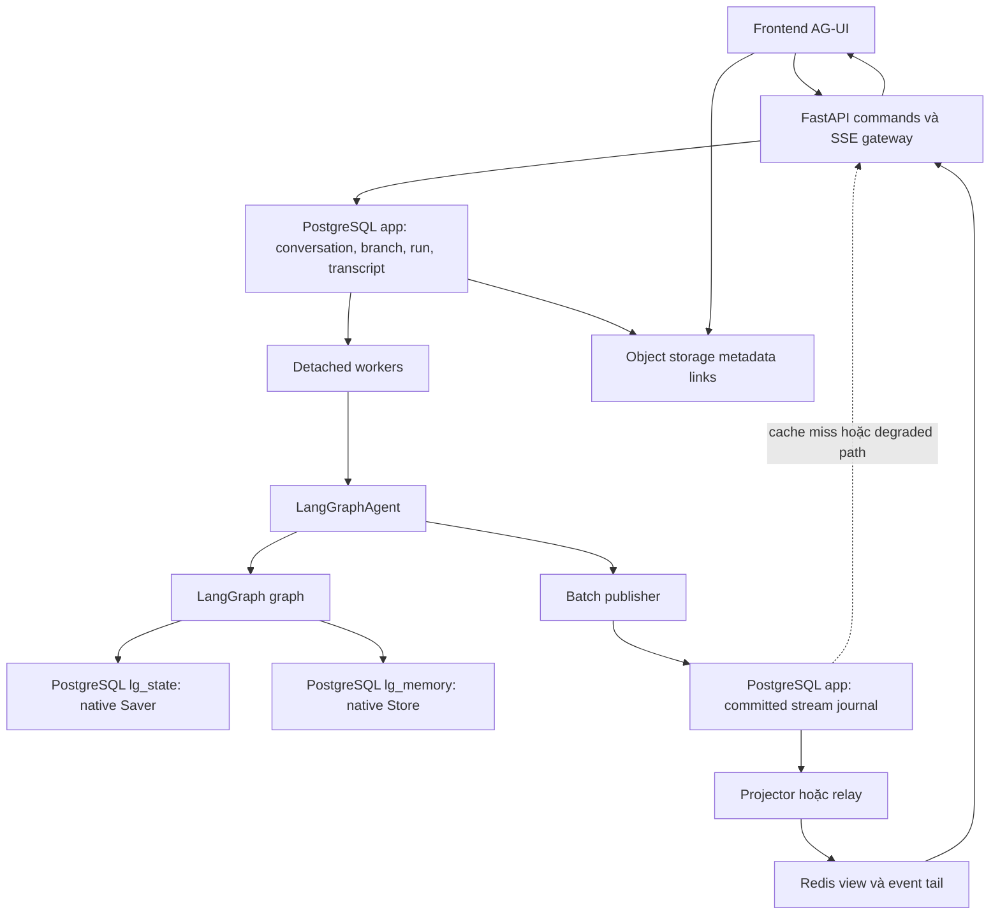
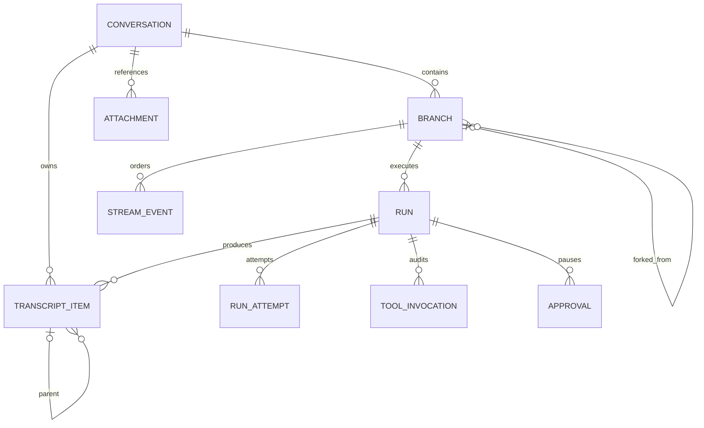
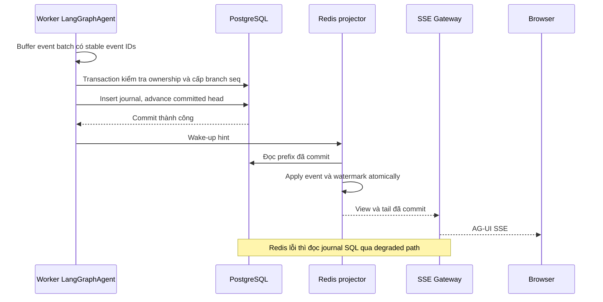

# Thiết kế lưu trữ lâu dài cho hệ thống chat agent production

Ngày: **27/10/2026**. Trạng thái: **đề xuất kiến trúc để triển khai**, chưa phải migration hoặc tính năng đã chạy. Tài liệu tổng hợp [nghiên cứu sáu dự án](../database_research/README.md), giữ backend custom, LangGraph OSS, native Saver/Store, `LangGraphAgent` emit AG-UI và SSE.

Tài liệu này điều chỉnh hai điểm trong [thiết kế nền tảng trước](./langgraph-oss-agent-platform-design.md): **journal response bền vững trở thành lựa chọn đề xuất mặc định cho production**, và **conversation có nhiều branch, mỗi branch có native thread riêng**. Trước đây journal là tùy chọn, metadata conversation ánh xạ trực tiếp một thread. Các thay đổi này là khuyến nghị mới, chưa được triển khai hoặc benchmark.

> **Schema review bổ sung:** [database-schema-review.md](./database-schema-review.md) cụ thể hóa catalogue: thêm branch_item cho history paging, run_invocation, typed provenance, credential/approval lifecycle và index theo truy vấn; dùng bản review khi chuyển nhóm bảng bên dưới thành DDL.

## 1. Quyết định lưu trữ được đề xuất

Sử dụng **một PostgreSQL cluster** cho dữ liệu nghiệp vụ, native checkpoint và native memory; **Redis** tăng tốc live view/replay; **object storage** giữ byte file. Tách schema/role/connection policy để có thể tách hạ tầng sau này. Không cần thêm MongoDB, Kafka hoặc vector database riêng ngay từ đầu chỉ vì các dự án tham khảo có chúng.

| Dữ liệu | Nguồn chính | Bản phục vụ đọc/tăng tốc | Có thể dựng lại không? |
|---|---|---|---|
| Owner, title, archive, branch mapping | PostgreSQL `app` | Cache sidebar nếu cần | Không bỏ nguồn chính |
| Run, attempt, queue, cancel, approval, tool receipt | PostgreSQL `app` | Redis wake-up hints | Không bỏ nguồn chính |
| Transcript người dùng xem | PostgreSQL `app` | Search index/client cache tùy chọn | Không dựa vào checkpoint để bảo đảm dựng lại toàn bộ |
| Response đã gửi qua SSE | PostgreSQL journal, rồi transcript/snapshot durable khi compact | Redis events + accumulated view | Redis có thể dựng lại từ SQL |
| State graph và interrupt/pending writes | Native Postgres Saver | Cache của runtime, nếu có | Không dựng từ UI transcript một cách mặc định |
| Memory xuyên conversation | Native Postgres Store | Search/vector index nếu có nhu cầu | Provenance và policy thuộc ứng dụng |
| Nội dung attachment/artifact | Object storage | CDN/download cache nếu cần | SQL metadata không thay byte file |

Checkpoint trả lời “agent tiếp tục tính toán từ state nào”. Transcript trả lời “người dùng đã trao đổi và được hiển thị gì”. Journal trả lời “response đang chạy đã được commit và phát tới đâu”. Ba vai trò có thể chứa nội dung tương tự, nhưng không thay thế nhau.

Native checkpointer lưu state theo super-step; Store lưu dữ liệu định nghĩa bởi ứng dụng xuyên thread. Không tự sửa schema checkpoint hoặc coi channel messages là kho transcript duy nhất. [LangGraph checkpointers](https://docs.langchain.com/oss/python/langgraph/checkpointers), [persistence](https://docs.langchain.com/oss/python/langgraph/persistence).

## 2. Các cam kết dữ liệu

1. `run accepted` chỉ được xác nhận sau transaction tạo input/placeholder/run/idempotency đã commit.
2. Gateway chỉ gửi **response event đã commit**. Những byte còn ở provider hoặc buffer worker chưa thuộc cam kết lưu trữ này.
3. Browser disconnect không hủy run. Stop ghi durable intent; worker xác nhận dừng sau cleanup.
4. Redis mất toàn bộ vẫn phục hồi phần response đã commit mà không gọi lại LLM chỉ để đọc lịch sử.
5. Worker chết không có nghĩa có thể nối tiếp đúng token tiếp theo của provider. Có thể cần thực thi lại node từ checkpoint, với attempt/generation mới và quy tắc thay thế response rõ ràng.
6. Compaction context, checkpoint retention hoặc đổi model không làm mất transcript đã lưu.
7. Một run chỉ có một attempt có quyền ghi. Lease hết hạn chưa đủ bằng chứng writer cũ đã mất quyền.
8. Không báo thành công cho người dùng trước khi final transcript và trạng thái ứng dụng đã durable.

Đây là cam kết thiết kế. Mức bền vững thực tế còn phụ thuộc commit/fsync, replication, failover và backup của PostgreSQL. Asynchronous replication có thể mất transaction đã commit trên primary khi promote standby chưa theo kịp; synchronous replication giảm cửa sổ này với đánh đổi độ trễ/availability. Không gọi kiến trúc này là RPO=0 trong mọi thảm họa. [PostgreSQL replication](https://www.postgresql.org/docs/current/warm-standby.html).

## 3. Bố trí vật lý

Các khối PostgreSQL có thể chung cluster/database. `lg_state` và `lg_memory` là tên schema triển khai dự kiến; phải xác minh `search_path`, migration và query qualification của package được pin. Không giả định constructor saver có tham số `schema`. Connection giữ ownership checkpoint có policy riêng với connection API/queue.

`app` dùng migration của dự án. Native tables do package Saver/Store tạo và nâng cấp bằng quy trình deployment được kiểm soát. Không chạy setup ở từng request, không thêm FK tới bảng nội bộ thư viện, không gắn query sidebar vào layout serialized blob của checkpoint.

## 4. Identity và mô hình nhánh

### 4.1. Các ID khác nhau

| ID | Scope và vai trò |
|---|---|
| `conversation_id` | Một chat trong sidebar, owner/title/sharing |
| `branch_id` | Một đường tiếp diễn với state độc lập trong conversation |
| `native_thread_id` | Thread LangGraph của branch; backend cấp và authorize mapping |
| `message_id` / `item_id` | Danh tính ổn định trên UI, không thay theo từng delta |
| `run_id` | Một logical turn của người dùng hoặc một lần regenerate |
| `attempt_id` + `generation` | Lần thực thi/continuation cụ thể và quyền ghi |
| `checkpoint_ref` | Native thread/namespace/checkpoint và version graph liên quan |
| `stream_epoch` + `seq` | Vị trí trong stream ứng dụng của branch, không phải checkpoint ID |

Giữ `agent_id` như cấu hình definition (`handy` mặc định), không dùng nó thay owner/thread/run. Backend resolve các reference có quyền; không tin thread/checkpoint/tenant tùy ý do browser gửi.

### 4.2. Branch và transcript tree

Conversation giữ default branch; lựa chọn đang xem thuộc user/tab. Có thể lưu `conversation_view` theo user để khôi phục lần mở sau, nhưng tab đang mở phải giữ branch của chính nó. Một tab đổi branch không tự bẻ context của run đang chạy ở tab khác.

Transcript dùng parent liên kết trong cùng conversation; không xóa sibling khi edit/regenerate. Branch giữ `parent_branch_id`, `fork_item_id`, `head_item_id`, `native_thread_id`, `fork_checkpoint_ref`, `graph_version` và trạng thái provisioning/ready/error. Các turn mới chỉ append vào phần riêng của branch; prefix cũ được tham chiếu, không cần sao chép toàn bộ body transcript.

Đây là domain ER rút gọn. FK/unique/check cụ thể sẽ được viết trong migration; cạnh parent cần thêm kiểm tra không cycle và cùng conversation. Không suy ra các invariant này chỉ từ một FK trỏ ID.

### 4.3. Fork state là thao tác cần kiểm chứng

Fork chỉ từ boundary đủ thông tin: user edit dùng state trước câu hỏi gốc; regenerate dùng state trước assistant response, giữ đúng user input. Message có thể nằm trong node có nhiều tool/subgraph step; vì vậy phải lưu mapping boundary transcript → checkpoint, không chỉ tìm checkpoint theo timestamp.

Quy trình: reserve branch `provisioning` → pin source checkpoint/version → tạo native target thread bằng API được adapter hỗ trợ và kiểm thử → xác minh state/pending tasks/tool messages → chuyển branch ready → enqueue run. Chỉ cho phép fork tại boundary hỗ trợ; không tự replay side effect để tái dựng state. UI hiện thao tác fork thất bại rõ ràng nếu chưa có boundary hợp lệ.

Không assume có API copy một checkpoint tùy ý sang thread mới. Base checkpointer có phương thức khai báo nhưng adapter có thể chưa implement; `copy_thread` toàn bộ thread cũng không đồng nghĩa copy tới một checkpoint quá khứ. Nếu phiên bản triển khai chưa hỗ trợ fork an toàn, giữ source checkpoint được pin và chặn tính năng đó cho tới khi có adapter/contract test. Không fallback âm thầm bằng copy text.

Trong giai đoạn đầu giữ **một logical run chưa terminal trên mỗi conversation**, dù có nhiều branch. Đây là policy hạn chế concurrency có chủ đích; chỉ mở một run/branch sau khi state, tools, artifact và ownership đã thật sự tách biệt.

## 5. Nhóm bảng ứng dụng

Tên bảng dưới đây là thiết kế logic, không phải DDL đã chạy. Đây là nhóm bảng phục vụ chat/execution; mô hình đầy đủ cần bổ sung identity, organization membership/team, quyền theo tài nguyên/action, credential binding, source ACL/provenance, chia sẻ kết quả và audit theo [32 tình huống sản phẩm và phân quyền](./chat-use-cases-and-organization-access.md). Không coi một `owner_id` hoặc role tổ chức là đủ để authorize toàn bộ dữ liệu và tool.

| Nhóm/bảng | Dữ liệu phải quản lý | Access path/constraint chính |
|---|---|---|
| `conversation` | Tenant/org, created_by, custodian, visibility, title/source/revision, activity, archive/tombstone | Sidebar theo org và phạm vi actor được phép; creator/custodian không thay thế resource grants hoặc source ACL |
| `branch` | Parent/fork/head, native mapping, graph version, generation | Unique native thread; composite owner/conversation references; fork validity |
| `conversation_view` | User, conversation, last viewed branch/message | Unique user/conversation; quyền xem được kiểm tra khi đọc lại |
| `run` | Branch, input, kind, definition version, idempotency hash, status, cancel intent, checkpoint refs | Unique idempotency scoped conversation+actor; partial unique một run mở/conversation |
| `run_attempt` | Attempt number, generation, worker, lease/heartbeat, start/end refs, error | Unique run/attempt_no; CAS ownership, recovery access path |
| `transcript_item` | Parent, originating branch/run, type/role, structured content, status, revision, checkpoint boundary | History keyset; composite same-conversation parent FK; unfinished assistant lookup |
| `stream_head` | Branch, epoch, committed_seq, compacted_through_seq | Một row/stream, serialize append transaction ngắn |
| `stream_event` | Branch, epoch, seq, event_id, attempt/generation, protocol version, AG-UI payload | PK `(branch_id,epoch,seq)`; unique stable event_id scoped stream |
| `stream_snapshot` | Durable accumulated view, through_seq, reducer version | Một hoặc vài snapshot được giữ/stream; watermark cùng transaction với view |
| `approval` | Interrupt/checkpoint reference, request revision, decision, decided_via | Unique logical interrupt; conditional consume; actor audit |
| `tool_invocation` | Logical call key, request hash, external operation ID, status/result/receipt | Unique logical operation; ambiguous/unknown recovery lookup |
| `metadata_job` | Title/memory extraction work, input revision, lease token, retry budget | Pending ready index; conditional completion chống stale worker |
| `outbox_event` | Entity revision, payload, claim/lease, published marker | Pending work claim; unique logical event key |
| `attachment` + item links | Object key, owner, MIME/size/hash, upload/scan/delete status | Lookup owner/conversation/item; object lifecycle retry |
| `memory_provenance` | Native Store namespace/key và source item/version | Delete/export/repair; không copy cả memory value làm nguồn thứ hai |
| `checkpoint_pin` | Branch/run/approval và reference cần giữ | Ngăn cleanup phá branch/resume đang được hỗ trợ |

`agent_definition` có thể là version registry trong code + manifest immutable trước khi cần bảng authoring. Cần persist version reference của run, không cần xây UI nhiều agent ngay.

### Quy tắc vật lý PostgreSQL

- Dùng UUID cho external/distributed IDs, `BIGINT` cho bộ đếm; `TIMESTAMPTZ` cho thời gian; tiền dùng numeric hoặc đơn vị nguyên có định nghĩa rõ.
- Metadata truy vấn thường xuyên có cột riêng. Structured blocks, tool args/result metadata và optional attributes dùng JSONB. Không nhét cả conversation vào một blob.
- Giữ tenant/conversation trong composite key/reference khi cần DB ngăn liên kết chéo scope. App authorization vẫn bắt buộc; RLS có thể bổ sung sau khi đã kiểm tra pooling/native connections.
- CHECK trạng thái, terminal timestamp, positive sequence và payload size; FK có chính sách xóa rõ. Index phía referencing theo access path thật.
- Một ordinal tạo item không đủ để tail các cập nhật item cũ. Dùng event seq để đồng bộ thay đổi; item revision phục vụ stale rejection, creation order chỉ phục vụ history paging.
- Tách heartbeat/lease nóng khỏi row chứa content lớn. Index lease đồng nghĩa heartbeat có index churn; fillfactor không tự khiến indexed update thành HOT. Đo active attempts trước khi tối ưu bảng lease.
- Không update sidebar activity theo từng token; cập nhật ở accept, metadata change và terminal. Không thêm GIN toàn JSONB nếu chưa có query.
- Không partition mọi bảng ngay từ đầu. Đo journal size, delete/vacuum và access path; nếu partition journal theo thời gian, thiết kế lại unique/key/routing vì partition key ảnh hưởng uniqueness.

## 6. Đường ghi streaming: durable trước, cache sau

### 6.1. Batch AG-UI event

Worker consume `LangGraphAgent.run(validated_input)`. Publisher nhận BaseEvent cùng envelope: event_id, branch/run/attempt, generation, protocol/reducer version. EventEncoder chỉ chạy ở gateway. Không dựng mapper native `astream_events` thứ hai.

Native state/context có thể chứa thông tin không thuộc public transcript. Cấu hình wrapper tắt raw events và có policy chọn public payload; không chuyển thẳng mọi field graph lên UI hoặc journal public. Native checkpoint vẫn lưu state thực thi theo policy của graph. Đo riêng kích thước các event snapshot chứa nhiều history, tránh journal lặp nguyên transcript mỗi lần có delta.

Điểm khởi đầu để đo: gộp text delta tối đa khoảng **50 ms hoặc 16 KiB**, flush sớm khi có lifecycle/tool/approval/cancel. Đây là cấu hình dự kiến, không phải số liệu benchmark hay SLA. Chỉ coalesce delta liên tiếp cùng message/block đúng thứ tự; không ghép qua boundary tool hoặc lifecycle. Giới hạn queue RAM và backpressure khi storage chậm.

Mỗi batch mở transaction ngắn: lock ownership row thích hợp và `stream_head`, kiểm tra attempt/generation/cancel state, cấp dải seq, INSERT events, advance head, commit. Không giữ transaction khi chờ LLM. Retry cùng batch dùng stable event IDs và request hash; payload khác cùng ID là conflict, không bỏ qua âm thầm.

Nếu kết quả COMMIT không rõ vì mất connection, retry lookup stable IDs/hash để trả lại seq đã commit trước khi cấp dải mới. Không cấp dải rồi `ON CONFLICT DO NOTHING` làm head tiến qua các seq không có row. Dedupe toàn batch hoặc suffix chưa commit phải có semantics được test, không giả định một retry luôn tạo transaction mới.

Các writer thống nhất thứ tự khóa: ownership/run/attempt cần thiết trước, rồi `stream_head`. Finalizer và metadata appender tuân cùng thứ tự nếu cần cả hai nhóm; compactor không giữ head rồi chờ ownership. Thiết kế query phải kiểm tra deadlock/retry dưới tải, không giữ các khóa này trong thao tác mạng.

**Không dùng BIGSERIAL toàn bảng như cursor commit.** Hai transaction có thể cấp ID theo thứ tự khác thứ tự commit. Row-lock theo stream và counter cập nhật cùng transaction tạo committed prefix cho stream đó; rollback không đẩy head. Redis projector/rebuild chỉ apply liên tiếp, thiếu seq thì dừng và sửa gap. Advisory lock runtime không thay thế kiểm tra thứ tự ở tầng event append.

Stream gồm cả title/control event cần thứ tự với text; chúng đi qua appender dùng cùng khóa stream. API title không sửa `stream_head` bằng đường không có generation/authorization policy. Metadata không thuộc executor cần authority riêng, không giả làm worker đang chạy.

### 6.2. Redis chỉ chứa dữ liệu đã commit

Redis keys vẫn scope theo tenant/native thread hoặc branch và dùng cùng Cluster hash tag. Lua kiểm tra stream epoch, projection watermark, event identity và entity revision; apply prefix theo seq, append tail và cập nhật view trong một thao tác có validate trước mutation. Relay cũ không được reset epoch/generation hay ghi đè view mới.

Hint bị mất không làm mất event: projector đọc `committed_seq` để bắt kịp. Projector nhiều instance cần lease/CAS hoặc cùng idempotent contiguous-apply script; fencing process checkpoint không mặc nhiên bảo vệ projector. Redis script không rollback mutation đã thực hiện khi script lỗi, nên vẫn cần reconciliation.

PostgreSQL append là điểm kiểm tra quyền execution. Relay có thể phát event của attempt cũ **đã commit hợp lệ** trước attempt mới; không drop chúng chỉ vì fence hiện tại đã tăng. Sau đó reducer apply event recovery/replacement theo đúng thứ tự journal.

Nếu PostgreSQL không commit được: giữ bounded buffer, retry có giới hạn rồi dừng/pause run theo policy. Không âm thầm phát trực tiếp token chưa lưu hoặc chuyển Redis-only mà vẫn hứa durability như cũ. Nếu Redis lỗi: dùng SQL catch-up/live polling có rate limit và giảm concurrency khi cần; không rerun LLM để phục hồi view.

## 7. Connect: một snapshot và phần sau snapshot

1. Authenticate tenant/user và resolve conversation/branch/native mapping.
2. Lấy view cùng watermark `W` bằng snapshot nhất quán: Redis atomic read hoặc durable snapshot SQL cộng replay journal tới head chụp được.
3. Gửi snapshot AG-UI kèm stream identity/epoch/W trong SSE response của connect.
4. Đọc events `seq > W` theo prefix liên tiếp; catch up xong chờ/poll tail. Snapshot read và tail read không cần cùng transaction nếu journal giữ mọi event sau W và reader kiểm tra continuity.
5. Cursor quá cũ/epoch khác/gap: gửi reset có full snapshot mới rồi tiếp tục; không tự append delta vào text không biết phiên bản.
6. Không gọi `LangGraphAgent.run()` trong connect. Restore dùng official AG-UI models và reducer đã test, giữ message/tool IDs ổn định.

Reader snapshot/tail phải cùng nguồn continuity. Redis view ở W nhưng tail Redis đã trim sau W thì lấy SQL prefix hoặc reset; không bỏ qua đoạn thiếu. Nếu đọc replica SQL, cần bảo đảm replica đã qua commit fence/head tương ứng; giai đoạn đầu dùng primary cho active-run connect để tránh replica lag.

Snapshot đầy đủ gồm response text, structured blocks/tool status, run status, approval và metadata revision cần UI. Không nhầm bản context rút gọn trong checkpoint với bản transcript để render. Frontend thay snapshot rồi apply suffix, không phát lại toàn bộ prefix như animation token.

## 8. Finalization và lỗi giữa hai hệ persistence

Native checkpoint và app transcript thường **không cùng transaction**, dù chung PostgreSQL cluster. Thiết kế recovery phải chấp nhận hai phía lệch tạm thời.

1. Wrapper hoàn tất; coordinator đợi các tác vụ native saver kết thúc, xác minh graph terminal hoặc waiting-input thật, ghi checkpoint ref và graph version. Graph state hoặc durable invocation metadata phải mang logical run identity/input reference; finalizer kiểm tra kết quả thuộc run hiện tại, không nhận nhầm head hoàn tất của turn trước khi attempt mới chưa kịp chạy.
2. Finalizer dùng stable IDs và CAS generation, ghi/upsert final transcript, tool summary, checkpoint boundary mapping và run status trong transaction app.
3. Cùng transaction khóa `stream_head`, INSERT terminal `stream_event`, advance committed head và ghi outbox/metadata job cần tạo. Outbox chỉ phục vụ wake-up/distribution, không cấp lại vị trí terminal sau commit; nếu không, event của run mới có thể vượt terminal run cũ. Terminal của wrapper được buffer/gate tới đây; không forward `RUN_FINISHED` thành “app success” trước app commit. Wrapper phát lỗi phải được phân loại, không coi hết generator là thành công. Waiting-input có state/event riêng, không bị chuyển thành run succeeded.
4. Projector apply committed terminal; gateway emit lifecycle và close theo contract. `EventEncoder` vẫn chỉ encode payload.

| Crash point | Hướng xử lý |
|---|---|
| Journal đã commit, Redis chưa apply | Projector bắt kịp từ seq; không gọi model |
| Graph checkpoint xong, app finalize chưa xong | Recovery finalizer kiểm tra native completion và reconcile, không chạy thêm LLM |
| App terminal commit, SSE chưa gửi | Connect trả final snapshot/terminal từ durable state |
| Worker chết khi model node đang chạy | Giữ attempt cũ interrupted, checkpoint restore theo policy; attempt mới có generation mới |
| Tool đã side effect, chưa ghi receipt | Trạng thái unknown, lookup external operation/idempotency hoặc yêu cầu xử lý; không tự retry mù |

Response của attempt khởi động lại có thể khác prefix cũ. Lưu version/status của output cũ và phát replacement/reset rõ ràng trước version mới; không nối hai lần sinh thành một câu. Không dùng native checkpoint để hứa tiếp tục chính provider connection đã chết.

## 9. Queue, ownership và tác vụ phụ

Giữ queue trong PostgreSQL, claim bằng transaction ngắn `FOR UPDATE SKIP LOCKED`. `run` là logical turn; continuation sau approval là attempt mới của cùng run. Idempotency key gắn actor/conversation và normalized payload hash; trùng key khác payload bị từ chối.

Theo thiết kế nền tảng trước, connection native saver phải giữ ownership lock và fail closed khi mất connection. Không cho worker tự reconnect rồi tiếp tục ghi với quyền cũ. Lease/heartbeat dùng phát hiện liveness; recovery chỉ cấp generation mới khi ownership thực sự được thu hồi. Session advisory lock không tương thích transaction pooling; ngân sách connection giới hạn concurrency phải được tính trước production. Chưa coi failover/partition là đã kiểm chứng an toàn chỉ nhờ có lock.

Title/memory job có claim token, retry budget và input watermark. Title ban đầu fallback; LLM title update có điều kiện revision/source, manual rename thắng. Memory writes qua native Store với key idempotent/provenance; chỉ trích từ input/output đủ điều kiện, không tự học mọi text tool đưa vào.

Outbox claim theo pending state/lease, publish at-least-once, consumer dedup theo logical event ID. Không đọc “id lớn hơn cursor” để tìm transaction mới commit. `published_at` chỉ có nghĩa đã relay đúng đích theo policy; retry khi crash giữa publish/ack là bình thường.

## 10. Retention, compaction và chi phí

### Điểm khởi đầu đề xuất, cần điều chỉnh theo sản phẩm và tải

| Dữ liệu | Chính sách khởi đầu |
|---|---|
| Conversation/transcript | Giữ tới khi user/org xóa hoặc hết retention đã cấu hình |
| Active/paused stream journal | Giữ toàn bộ phần chưa được durable snapshot/finalization bao phủ; không TTL cứng làm đứt run sống |
| Journal run terminal | Giữ khoảng 7 ngày để reconnect/debug; compact chỉ sau khi đã verify snapshot/transcript và consumer fences |
| Redis view/tail | Giữ khi active; TTL khởi đầu 24 giờ sau terminal, chỉ là cache |
| Native checkpoints | Giữ head, active/approval/fork pins và dependency cần thiết; old debug history có cửa sổ riêng sau khi adapter cleanup được kiểm chứng |
| Native memory | Theo policy user/org, có provenance và thao tác xóa/export |
| Attempt/tool/audit metadata | Khởi đầu 30–90 ngày theo nhu cầu vận hành; payload nhạy cảm có thể ngắn hơn |
| Attachment | Theo reference/upload/delete lifecycle; dọn orphan bằng job có grace period |

Các mốc 7 ngày/24 giờ/30–90 ngày là đề xuất vận hành, không phải quyết định retention pháp lý hoặc cam kết người dùng đã chấp thuận.

Compactor dựng `stream_snapshot(view, through_seq, reducer_version)` rồi commit trước khi xóa event prefix. `stream_head.compacted_through_seq` không được vượt snapshot durable. Connect cũ nhận snapshot reset nếu prefix đã compact. Giữ tối thiểu dữ liệu terminal/recovery cần thiết; không xóa raw log rồi mới kiểm tra liệu transcript có đầy đủ hay không.

Định kỳ tạo snapshot theo cả khoảng thời gian và byte journal để giới hạn chi phí rebuild; giá trị cần đo. Bắt buộc snapshot/finalize ở terminal và điểm pause được hỗ trợ. Snapshotter không update accumulated JSON lớn mỗi token, không giữ transaction khi replay dài: chụp input frontier, dựng view, rồi publish bằng CAS watermark/reducer version. Nếu prefix cần đọc đã compact thì retry từ snapshot mới, không ghi view thiếu dữ liệu.

Snapshot winner phải tăng đơn điệu theo `(epoch, through_seq)`; builder cũ chạy chậm không được đè snapshot mới. GC chỉ dựa vào snapshot winner đã commit và không xóa quá watermark của nó. Epoch khác phải theo reset protocol, không so số seq giữa hai epoch như cùng một timeline.

Checkpoint cleanup phải qua API thực sự được adapter/version hỗ trợ và contract test có subgraph/pending writes/interrupt/fork. Base API tồn tại không chứng minh adapter implement. Delta-channel state có thể phụ thuộc ancestor writes/snapshot; không DELETE bảng native theo tuổi hoặc giữ mỗi row head một cách ngây thơ. Transcript pin giữ metadata thôi chưa đủ nếu cleanup không thực thi pin policy. [LangGraph checkpoint storage và pruning](https://docs.langchain.com/oss/python/langgraph/checkpointers).

Journal cần append delta theo batch, không snapshot toàn response ở mỗi token. Ví dụ sizing để đo: 1.000 run đồng thời × 20 batch/giây = khoảng 20.000 batch/giây, chưa tính số row/event, WAL, replication và index. Đây **không phải** tuyên bố PostgreSQL cấu hình bất kỳ xử lý được mức đó. Đo và tăng batch interval, group commit nhiều stream có giới hạn, giảm write amplification hoặc đánh giá log broker chuyên dụng khi chạm giới hạn. Không thêm Kafka trước khi có bằng chứng cần.

## 11. Backup, xóa và nâng version

- PostgreSQL có WAL/PITR, standby và lịch restore drill. Cần thử khôi phục đồng thời app metadata, native Saver/Store và mapping phiên bản; có backup file chưa chứng minh restore được agent.
- Redis mất dữ liệu phải rebuild được từ journal/snapshot. AOF/replication giúp availability nhưng không dùng Redis như bản sao duy nhất của text đã gửi trong lựa chọn này. [Redis persistence](https://redis.io/docs/latest/operate/oss_and_stack/management/persistence/).
- Object storage có lifecycle/versioning phù hợp. Giữ object key riêng với signed URL; URL hết hạn không làm mất reference. Kiểm tra quyền trước cấp download/upload token.
- Xóa conversation là tombstone ngay để chặn read/run mới; job dừng active run, xử lý Store provenance, native thread/checkpoints, stream cache/journal, search và file references. Multi-store cleanup có status/retry/audit, không giả định CASCADE SQL xóa được native/object storage.
- Backup có retention riêng. Thông báo rõ thời gian dữ liệu đã xóa rời backup; kiểm thử quy trình không làm sống lại tombstoned data khi restore.
- Persist graph definition version, state schema version, AG-UI payload version và reducer version. Replay dùng reducer phù hợp; chạy lại state cũ cần migration/compatibility policy, không load code mới bất kỳ vào checkpoint cũ.
- Database migration dùng expand/contract, kiểm tra index build/lock timeout, giữ tương thích writer cũ/mới khi rolling deploy. Không sửa native blobs bằng migration ứng dụng.

## 12. Điều kiện trước khi gọi thiết kế là production-ready

1. **Native integration:** pinned `LangGraphAgent` truyền execution/durability policy đúng cách; waiting-input/error/terminal không bị hiểu sai; async saver connection ownership được kiểm chứng.
2. **Reload:** đóng browser giữa text, tool args, tool result và approval; mở qua API pod khác; snapshot không thiếu hoặc nhân prefix.
3. **Storage failure:** Redis flush/restart, projector chết, gateway chết, PostgreSQL timeout; response đã gửi vẫn dựng lại được theo cam kết.
4. **Execution failure:** kill worker trước/sau checkpoint và trước/sau app finalization; stale worker không ghi được; recovery không tự lặp external side effect.
5. **Branch:** edit đầu/cuối, regenerate, fork từ checkpoint hỗ trợ, reload đúng branch, cleanup không làm mất checkpoint pin và không trộn context.
6. **Lifecycle:** manual rename thắng title job cũ; user deletion và attachment cleanup retry được; backup restore giữ đúng owner/memory/checkpoint mapping.
7. **Load:** đo commit p95/p99, time-to-first-persisted-event, batch size, WAL, projector lag, reconnect rebuild cost, connection budget, vacuum và journal retention.
8. **Acceptance:** có chỉ tiêu RPO/RTO/latency/concurrency được đo trên hạ tầng dự kiến. Chưa có các số đó thì tài liệu chỉ là thiết kế, không phải chứng nhận capacity.

Không cần chạy tất cả kiểm thử này cho thay đổi tài liệu. Đây là checklist nghiệm thu implementation trước production, chưa được chạy trong lần nghiên cứu này.

## 13. Đối chiếu với sáu dự án

| Nguồn | Pattern học được | Phần không sao chép nguyên |
|---|---|---|
| [Codex](../database_research/codex.md) | Metadata/transcript projection tách execution; watermark commit cùng read model | Filesystem và active snapshot RAM không đáp ứng arbitrary API pod |
| [TrueForge](../database_research/trueforge.md) | Parent turn, snapshot context/capability và transcript/context khác nhau | Stream TTL và seq replay chưa đủ accumulated snapshot contract |
| [Onyx](../database_research/onyx.md) | Message tree, tool IDs/order, shared replay, transaction ngắn | Shared cache không tự thành durable execution |
| [Open WebUI](../database_research/open-webui.md) | Overlay response dở với lịch sử SQL, index theo query | Dual write whole history blob gây chi phí và khóa cần tránh ở schema mới |
| [LibreChat](../database_research/librechat.md) | Generation identity, sync-before-live, pending gap events, persistence-before-final, title revision | Không coi mọi multi-store snapshot là một transaction atomic hoặc mọi crash đều resume token |
| [NextChat](../database_research/nextchat.md) | Stable message IDs, hydration/local cache | Local storage và backup merge không thay canonical server data/replay |

## 14. Phạm vi thay đổi và bước triển khai

Đề xuất này không thay transport hoặc thêm CopilotKit/Agent Server. `POST run` vẫn trả SSE, `POST connect` vẫn snapshot+tail trong một response, explicit stop vẫn riêng. Branch cần field/contract thống nhất trước khi triển khai API; không âm thầm thay ý nghĩa `threadId` đang public.

Thứ tự triển khai: chốt ID/branch/checkpoint-boundary và invariants → migration app + native version pin → durable admission/ownership → journal/publisher/projector → transcript finalization/reconciliation → reconnect/branch → retention/backup/load tests. Viết DDL từ thiết kế sau khi resolve adapter fork/prune/durability integration; không phát hành một file SQL được gọi là production-ready khi các boundary đó còn chưa kiểm chứng.

Tài liệu [native storage findings](./langgraph-native-storage-findings.md) có số đo lịch sử và dẫn tới `chat-schema.sql`, nhưng file SQL đó không có trong checkout lúc nghiên cứu này. Lần này không tái lập các thí nghiệm cũ hoặc xác nhận các claim đã chạy migration; mọi đề xuất ở đây được đánh dấu theo đúng phạm vi kiểm chứng.
