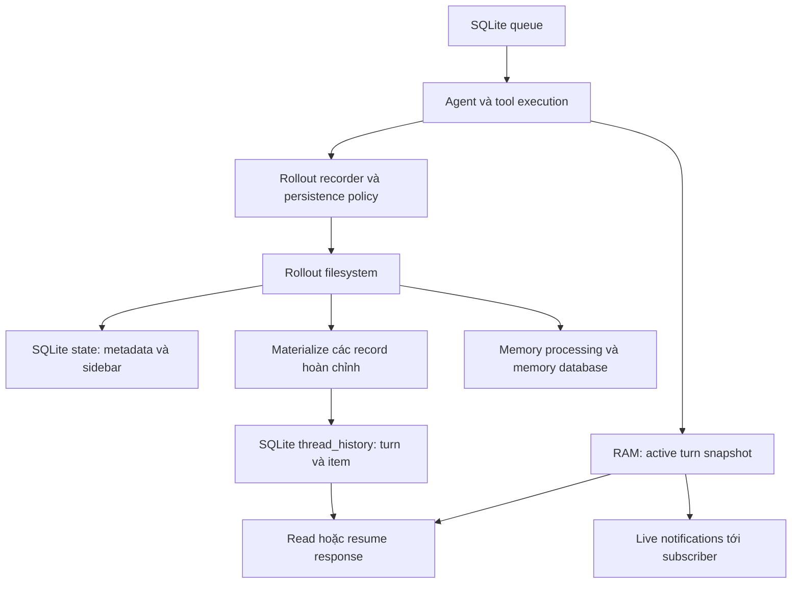
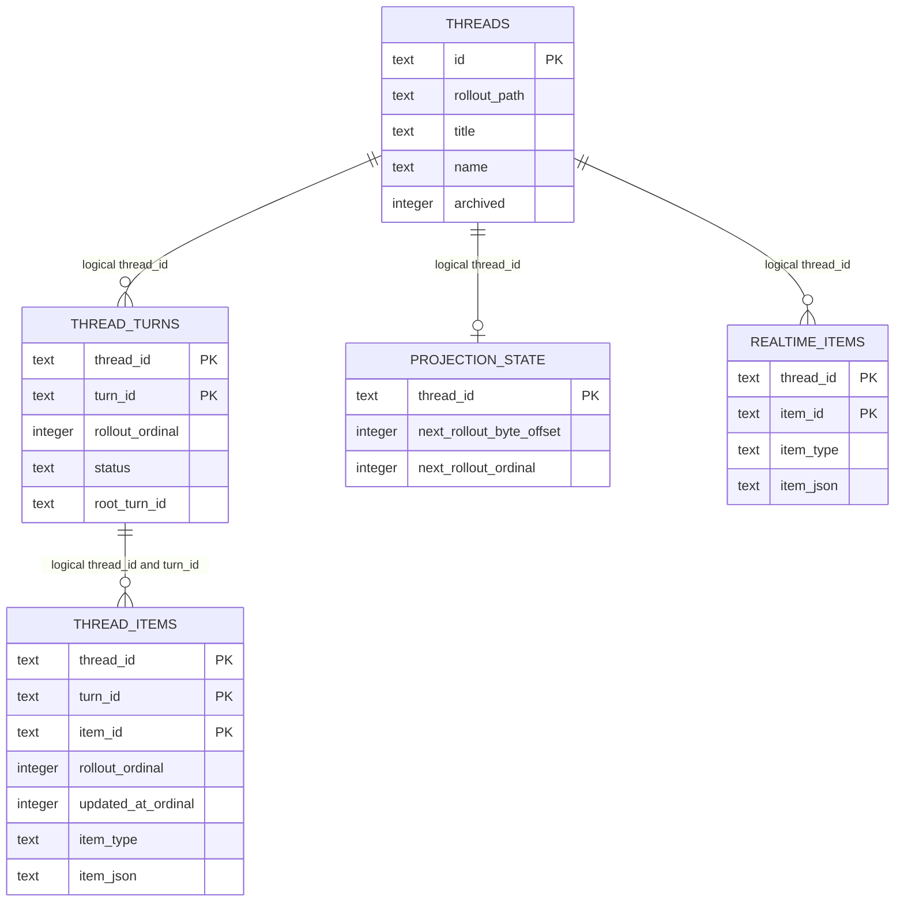

# Codex: nghiên cứu lưu trữ hội thoại và database

Ngày khảo sát: 27/10/2026. Repository: `/home/lamhung/code/codex`. Commit: `970111f6cb62cc02fe36a82ea7d71b37a2889c97`.

Phạm vi là mã nguồn Codex Rust trong checkout này, tập trung local thread store và app-server. Đây **không phải** schema dịch vụ ChatGPT hay hạ tầng Codex cloud. Kết luận lấy từ migration và đường đọc/ghi; chưa chạy ứng dụng hoặc thử phục hồi lỗi thực tế.

## 1. Kết luận kiến trúc

Codex dùng **rollout trên filesystem làm lịch sử thực thi bền vững**, SQLite làm metadata, lịch sử đã dựng thành bảng, queue, memory, goal và log. Nó không dùng một bảng `messages` duy nhất để chứa mọi thứ.

Crate `state` mô tả rõ việc lấy metadata từ rollout JSONL và phản chiếu vào SQLite. Lịch sử paginated còn có projection theo từng item/turn, được cập nhật tới một byte offset và ordinal xác định. [Mô tả state](/home/lamhung/code/codex/codex-rs/state/src/lib.rs:1), [materialization](/home/lamhung/code/codex/codex-rs/thread-store/src/local/thread_history_materialization.rs:29).

Điểm cần phân biệt cho bài toán reload: **lịch sử đã lưu** khác **text đang sinh dở**. Delta text không được ghi từng token vào rollout. Khi tiến trình còn sống, app-server ghép snapshot active turn trong RAM vào response resume. Vì vậy, khả năng mở lại browser khi server còn chạy không đồng nghĩa với phục hồi đủ partial text sau khi server chết. [Chính sách persistence](/home/lamhung/code/codex/codex-rs/rollout/src/policy.rs:125), [resume đang chạy](/home/lamhung/code/codex/codex-rs/app-server/src/request_processors/thread_lifecycle.rs:721).

## 2. Các kho dữ liệu và quyền sở hữu

Checkout hiện tại định nghĩa **7 RuntimeDbSpec**, trong đó memory có bản thường và bản v2. Không nên ghi thành “luôn có đúng sáu database”. Việc một tính năng mở database nào còn phụ thuộc cấu hình và đường chạy. [Tên và registry database](/home/lamhung/code/codex/codex-rs/state/src/sqlite.rs:44).

| Kho | Dữ liệu chính | Vai trò |
|---|---|---|
| Rollout filesystem | Session metadata, response/tool items, turn context, compaction, lifecycle, các record được policy cho phép | Lịch sử thực thi dùng để resume và dựng projection |
| `state_5.sqlite` | `threads`, projects, sections, attachments, agent batch jobs, read receipts | Tra cứu, sidebar, tổ chức workspace và một số trạng thái ứng dụng |
| `thread_history_1.sqlite` | `thread_turns`, `thread_items`, `thread_history_projection_state`, `thread_realtime_items` | Read model cho lịch sử paginated |
| `queue_1.sqlite` | `queued_items`, `queued_thread_revisions` | Các user submission đang chờ theo thread |
| `memories_1.sqlite` | `stage1_outputs`, `jobs`, `consolidation_progress` | Kết quả trích memory, điều phối xử lý memory |
| `memories_v2_1.sqlite` | Biến thể memory database được chọn theo version | Cách ly vòng đời thử nghiệm memory |
| `goals_1.sqlite` | `thread_goals`, continuation deferrals | Objective và ngân sách dài hạn của thread |
| `logs_2.sqlite` | Log có timestamp, thread/process context | Quan sát vận hành |
| RAM app-server | Active turn, item đang cập nhật, connection subscriptions | Snapshot đang chạy và chuyển tiếp notification |

Không phải mọi dữ liệu trong SQLite đều có thể bỏ đi rồi dựng lại nguyên trạng từ rollout. Ví dụ queue và tổ chức workspace mang ý nghĩa ứng dụng riêng. Ngay cả database history cũng được cấu hình recovery mode `Unavailable`, trong khi các database khác chọn `BackupAndRebuild`; **khả năng materialize lại không phải lời hứa tự phục hồi mọi lỗi**. [Recovery mode](/home/lamhung/code/codex/codex-rs/state/src/sqlite.rs:81).

Các mũi tên thể hiện quan hệ dữ liệu, không mô tả một transaction xuyên file, SQLite và RAM.

## 3. Schema hội thoại và lịch sử

### 3.1. `threads`: metadata của một cuộc hội thoại

Migration đầu tạo `threads` với `id TEXT PRIMARY KEY`, `rollout_path`, `created_at`, `updated_at`, `source`, `model_provider`, `cwd`, `title`, sandbox/approval settings, token count và archive flags. Các migration sau bổ sung tên do người dùng đặt, preview, model, reasoning effort, timestamps mili giây, memory/history mode, project, section và creator identity. [Bảng gốc](/home/lamhung/code/codex/codex-rs/state/migrations/0001_threads.sql:1), [name](/home/lamhung/code/codex/codex-rs/state/migrations/0041_threads_name.sql:1), [creator](/home/lamhung/code/codex/codex-rs/state/migrations/0056_threads_creator_identity.sql:1).

Chức năng query thể hiện qua các index theo thời gian, archive, cwd, project và section. Sidebar không cần tải transcript để sắp xếp thread. Các index mới dùng `created_at_ms`/`updated_at_ms` và recency; không nên lấy bộ index ban đầu làm toàn bộ schema hiện hành. [Millisecond indexes](/home/lamhung/code/codex/codex-rs/state/migrations/0025_thread_timestamps_millis.sql:111), [project recency](/home/lamhung/code/codex/codex-rs/state/migrations/0052_projects_recency.sql:1), [archive sort](/home/lamhung/code/codex/codex-rs/state/migrations/0058_threads_archive_sort_indexes.sql:1).

### 3.2. History dùng turn và item

| Bảng | Khóa | Trường đáng chú ý | Mục đích |
|---|---|---|---|
| `thread_turns` | PK `(thread_id, turn_id)` | `rollout_ordinal`, status, error JSON, start/end/duration, first user/final agent IDs | Một lượt thực thi có vòng đời |
| `thread_items` | PK `(thread_id, turn_id, item_id)` | `rollout_ordinal`, `item_json`, `item_type`, `updated_at_ordinal`, lifecycle timestamps | Message, tool và các item hiển thị được mô hình hóa bằng payload có type |
| `thread_history_projection_state` | PK `thread_id` | `next_rollout_byte_offset`, `next_rollout_ordinal` | Mốc tiếp tục materialization |
| `thread_realtime_items` | PK `(thread_id, item_id)` | ordinal, timestamp, item type, JSON | Item thuộc luồng realtime được lưu trong rollout |

Nguồn: [history migration gốc](/home/lamhung/code/codex/codex-rs/state/thread_history_migrations/0001_thread_history.sql:1), [item type](/home/lamhung/code/codex/codex-rs/state/thread_history_migrations/0002_thread_items_item_type.sql:1), [update ordinal](/home/lamhung/code/codex/codex-rs/state/thread_history_migrations/0004_thread_items_updated_at_ordinal.sql:1), [realtime](/home/lamhung/code/codex/codex-rs/state/thread_history_migrations/0005_thread_realtime_items.sql:1).

Đây là quan hệ **logic**, không phải tất cả đều có FK vật lý. `threads` và history nằm ở các SQLite file khác nhau. Trong migration history đã đọc, liên hệ giữa turn/item không có FK khai báo.

Index tiêu biểu:

- Unique `(thread_id, rollout_ordinal)` cho paging turn và item.
- `(thread_id, turn_id, rollout_ordinal)` cho item trong một turn.
- Partial index chỉ cho `item_type = 'userMessage'`.
- Index `(thread_id, updated_at_ordinal)` để đọc thay đổi của item cũ được cập nhật sau đó.
- Partial index `rollout_end_ordinal IS NOT NULL` cho turn đã có biên kết thúc.

Hai ordinal giải hai câu hỏi khác nhau: item xuất hiện ở đâu và item được cập nhật gần nhất ở đâu. Migration cố ý giữ index update **non-unique** để writer cũ còn ghi được giá trị mặc định 0. [Migration giải thích tương thích writer](/home/lamhung/code/codex/codex-rs/state/thread_history_migrations/0004_thread_items_updated_at_ordinal.sql:1), [turn end index](/home/lamhung/code/codex/codex-rs/state/thread_history_migrations/0006_thread_turn_ends.sql:1).

### 3.3. Tool và payload

Policy lưu các `ResponseItem` như function call/output, custom tool call/output, shell call, web search và message. Paginated history ưu tiên `ItemCompleted` với TurnItem. Đây là cách dùng **typed item JSON trong lịch sử**, không phải schema quan hệ cố định một bảng cho từng tool. Persisted command output và MCP result còn có giới hạn cắt ngắn; không được coi rollout là bản sao không mất mát của mọi byte tool output. [Response item policy](/home/lamhung/code/codex/codex-rs/rollout/src/policy.rs:16), [paginated item policy](/home/lamhung/code/codex/codex-rs/rollout/src/policy.rs:231).

## 4. Đường ghi và độ nhất quán của projection

1. Recorder lọc record bằng persistence policy, xếp vào writer và ghi rollout với ordinal.
2. Materializer đọc từ byte offset đã lưu tới kích thước file chụp ở đầu lượt đọc.
3. Chỉ xử lý prefix có record kết thúc bằng newline; dòng cuối đang ghi dở để lượt sau.
4. Chia batch tối đa theo nguồn khoảng 1 MiB hoặc 256 projection steps; record đơn lớn không bị chẻ.
5. Transaction `BEGIN IMMEDIATE` kiểm tra offset mong đợi, apply các thay đổi, rồi cập nhật cả offset và ordinal.
6. Commit xong mới coi batch đã materialize.

Vì dữ liệu bảng và watermark được commit cùng transaction, SQLite không đánh dấu đã đi qua đoạn rollout chưa được phản chiếu. Producer đọc file trước, consumer chỉ mở transaction khi có batch để giảm thời gian giữ writer. [Đọc theo prefix](/home/lamhung/code/codex/codex-rs/thread-store/src/local/thread_history_materialization.rs:106), [pipeline](/home/lamhung/code/codex/codex-rs/thread-store/src/local/thread_history_materialization_pipeline.rs:79), [apply và checkpoint](/home/lamhung/code/codex/codex-rs/thread-store/src/local/thread_history.rs:104).

Recorder có flush và cơ chế thử ghi pending item; tuy nhiên không nên đồng nhất `.flush()` với cam kết `fsync` mỗi token. SQLite mở với synchronous `Normal`, busy timeout 5 giây; filesystem thường dùng WAL, NFS chọn DELETE journal. Đây là quyết định cho local storage, không phải distributed transaction. [Writer pending và flush](/home/lamhung/code/codex/codex-rs/rollout/src/recorder.rs:1828), [SQLite options](/home/lamhung/code/codex/codex-rs/state/src/sqlite.rs:420).

## 5. Reload, stream đang dở và replay

| Tình huống | Dữ liệu có thể dùng | Giới hạn |
|---|---|---|
| Mở lại thread đã hoàn tất | Rollout và history projection | Chỉ những record được policy lưu |
| Client reconnect khi app-server còn giữ turn | Durable history + active-turn snapshot trong RAM, rồi notification đang chạy | Phụ thuộc lifetime tiến trình và subscription |
| App-server chết giữa lúc sinh text | Prefix durable đã lưu | Delta text chưa thành durable item không được bảo đảm tồn tại |
| History projection chưa theo kịp | Tiếp tục từ offset/ordinal, đọc thêm rollout | Không tạo lại token không từng được lưu |

Policy phân loại `AgentMessageContentDelta`, reasoning delta, command output delta và nhiều progress events là transient. `ItemStarted` cũng không được lưu theo cùng đường đó. Đây là bằng chứng trực tiếp rằng schema history không đóng vai trò token event log. [Danh sách transient](/home/lamhung/code/codex/codex-rs/rollout/src/policy.rs:156).

App-server lưu `ThreadHistoryBuilder` trong `ThreadState`, xử lý event vào bộ dựng này và tạo active snapshot. Resume có thể hợp nhất snapshot với lịch sử đã đọc. [ThreadState](/home/lamhung/code/codex/codex-rs/app-server/src/thread_state.rs:117), [handle_event](/home/lamhung/code/codex/codex-rs/app-server/src/thread_state.rs:211), [merge khi resume](/home/lamhung/code/codex/codex-rs/app-server/src/request_processors/thread_lifecycle.rs:743).

**Không nhầm tên:** `thread_realtime_items` không phải bảng lưu partial text của câu trả lời chat thông thường. Nó nhận `RolloutItem::RealtimeItem`, policy chỉ persist loại này trong paginated mode; timeline đọc chúng như nhánh realtime riêng. [Policy realtime](/home/lamhung/code/codex/codex-rs/rollout/src/policy.rs:37), [insert realtime projection](/home/lamhung/code/codex/codex-rs/thread-store/src/local/thread_history.rs:162), [timeline](/home/lamhung/code/codex/codex-rs/thread-store/src/local/thread_history/realtime.rs:27).

## 6. Rẽ nhánh và quan hệ giữa thread

Codex có fork theo biên lịch sử. Paginated fork giữ quan hệ lineage và `HistoryPosition` gồm thread nguồn, ordinal kết thúc exclusive và byte offset. Boundary hỗ trợ latest, through turn và before turn. Trước khi tính biên, nó persist và materialize lịch sử liên quan; through-turn từ chối turn còn `inProgress`. [Chuẩn bị fork](/home/lamhung/code/codex/codex-rs/thread-store/src/local/paginated_fork.rs:15), [xác định boundary](/home/lamhung/code/codex/codex-rs/thread-store/src/local/paginated_fork.rs:90), [khởi tạo rollout metadata](/home/lamhung/code/codex/codex-rs/thread-store/src/local/create_thread.rs:34).

Điều này gần với **thread mới tham chiếu prefix của thread nguồn**, không phải một bảng message có `parent_message_id` cho mọi câu. Khi đọc phải giải lineage thành các đoạn lịch sử có biên. Không thể suy ra có đầy đủ UX sửa câu hỏi/chọn sibling như ChatGPT chỉ từ schema này.

`thread_turns.root_turn_id` là causal root của turn theo protocol. Nó **không tự chứng minh** cây message edit/regenerate. `thread_spawn_edges` lại là quan hệ spawn agent/thread; không nên gộp spawn, attached parent và fork thành một loại branch. [Causal root](/home/lamhung/code/codex/codex-rs/protocol/src/protocol.rs:2296), [spawn edges](/home/lamhung/code/codex/codex-rs/state/migrations/0021_thread_spawn_edges.sql:1), [attached parent](/home/lamhung/code/codex/codex-rs/state/migrations/0062_threads_attached_parent.sql:1).

## 7. Queue, memory, goal và tổ chức workspace

### Queue user submission

`queued_items` lưu `id`, `thread_id`, `payload_json`, `queue_order`, timestamps. Unique `(thread_id, queue_order)` đảm bảo vị trí không trùng trong thread. `queued_thread_revisions` có revision và unique thread; trigger insert/update/delete queue tăng revision để client nhận biết thay đổi. Đây là queue input cục bộ, không phải bằng chứng có durable distributed run scheduler. [Queue schema](/home/lamhung/code/codex/codex-rs/state/queue_migrations/0001_queued_items.sql:1), [revision triggers](/home/lamhung/code/codex/codex-rs/state/queue_migrations/0002_queued_thread_revisions.sql:1).

### Memory pipeline

`stage1_outputs` giữ một output theo `thread_id`: source watermark, raw memory, summary, slug, generated time, usage và chọn vào phase 2. `jobs` có PK `(kind, job_key)`, worker, ownership token, lease, retry deadline/count, input watermark và last-success watermark. Code claim bằng điều kiện lease/status; hoàn tất cập nhật với điều kiện ownership token. Token được dùng thực tế, không chỉ nằm trong schema. [Memory schema](/home/lamhung/code/codex/codex-rs/state/memory_migrations/0001_memories.sql:1), [claim job](/home/lamhung/code/codex/codex-rs/state/src/runtime/memories.rs:695), [conditional completion](/home/lamhung/code/codex/codex-rs/state/src/runtime/memories.rs:876).

Đây là kết quả/pipeline memory riêng của Codex. Không có nghĩa ta nên thay LangGraph Store bằng bảng raw_memory tương tự.

### Goal và ngân sách

`thread_goals` có một goal hiện tại theo thread, objective, status, token budget, tokens used, time used và timestamps. Status có CHECK gồm active, paused, blocked, usage_limited, budget_limited, complete. `thread_goal_continuation_deferrals` có FK cascade trong cùng goal database. Goal dài hạn khác với status của một run. [Goal schema](/home/lamhung/code/codex/codex-rs/state/goals_migrations/0001_thread_goals.sql:1).

### Workspace, attachments và batch jobs

- Projects/project roots và sections phục vụ tổ chức sidebar. [Projects](/home/lamhung/code/codex/codex-rs/state/migrations/0049_projects.sql:1).
- `thread_attachments` có unique `(thread_id, attachment_type, identity_key)` và payload JSON/text; được đổi tên từ artifacts. [Bảng ban đầu](/home/lamhung/code/codex/codex-rs/state/migrations/0051_thread_artifacts.sql:1), [rename](/home/lamhung/code/codex/codex-rs/state/migrations/0055_thread_attachments.sql:1).
- `agent_jobs`/`agent_job_items` phục vụ batch như input CSV, per-row status và result; item có FK cascade sang job. Không phải mô hình run chat tổng quát. [Batch job schema](/home/lamhung/code/codex/codex-rs/state/migrations/0014_agent_jobs.sql:1).

## 8. Scale và điều có thể học cho hệ thống của mình

**Quan sát từ code:** quyền ghi rollout được điều phối bằng lock-file theo thread trong cùng Codex home. SQLite điều phối writer theo file; nhiều database giúp phân tách workload. Không thấy tenant-scoped key trên các bảng history chính đã khảo sát. [Cross-process writer lock](/home/lamhung/code/codex/codex-rs/rollout/src/writer_lock.rs:1).

**Suy luận kiến trúc:** thiết kế này phù hợp local agent/app-server có filesystem chung và một tiến trình sở hữu active turn. Nó không cung cấp sẵn snapshot đang stream cho backend pod bất kỳ. Copy SQLite/lock-file lên volume chung không tự tạo ra distributed ownership, subscriber routing hoặc stream retention an toàn.

| Bài học nên áp dụng | Cách diễn giải cho thiết kế đã chốt |
|---|---|
| Tách metadata khỏi transcript và graph state | Application tables riêng; native LangGraph Saver/Store vẫn có ownership riêng |
| Turn có vòng đời, item có type và stable ID | Tách logical run khỏi message/tool projection; không chỉ lưu chuỗi text |
| Projection và watermark commit cùng nhau | Nếu dùng durable event log ở PostgreSQL, cập nhật read model và cursor nhất quán |
| Phân biệt create order và update order | Replay phải bắt được item bị sửa sau snapshot, hoặc dùng event revision riêng |
| Memory job có lease và ownership token | Metadata/title job cần conditional write và retry policy phù hợp |
| Fork có boundary rõ và lineage | Thiết kế branch phải ánh xạ cả checkpoint/context, không chỉ sao chép message UI |
| Partial text cần policy lưu riêng | Muốn reload ở pod khác hoặc phục hồi sau crash phải thiết kế shared projection/event retention rõ ràng |

Không đề xuất lấy Codex filesystem làm nơi lưu transcript production của dự án hiện tại. Ta đã chọn backend custom, LangGraph OSS, `LangGraphAgent` emit AG-UI và SSE. Nghiên cứu này cung cấp cách chia dữ liệu và consistency; không thay đổi các quyết định đó.

## 9. Giới hạn khảo sát

- Chưa benchmark SQLite, NFS, replay latency hoặc độ trễ projection.
- Chưa chạy thử kill server giữa stream; giới hạn partial dựa trên policy và RAM snapshot trong code.
- Chưa đánh giá toàn bộ remote ThreadStore, cloud backend hoặc mọi feature flag.
- Không suy luận schema server của sản phẩm thương mại từ local repository.
- Các link trỏ vào checkout hiện tại; cần đối chiếu lại khi commit nguồn thay đổi.
