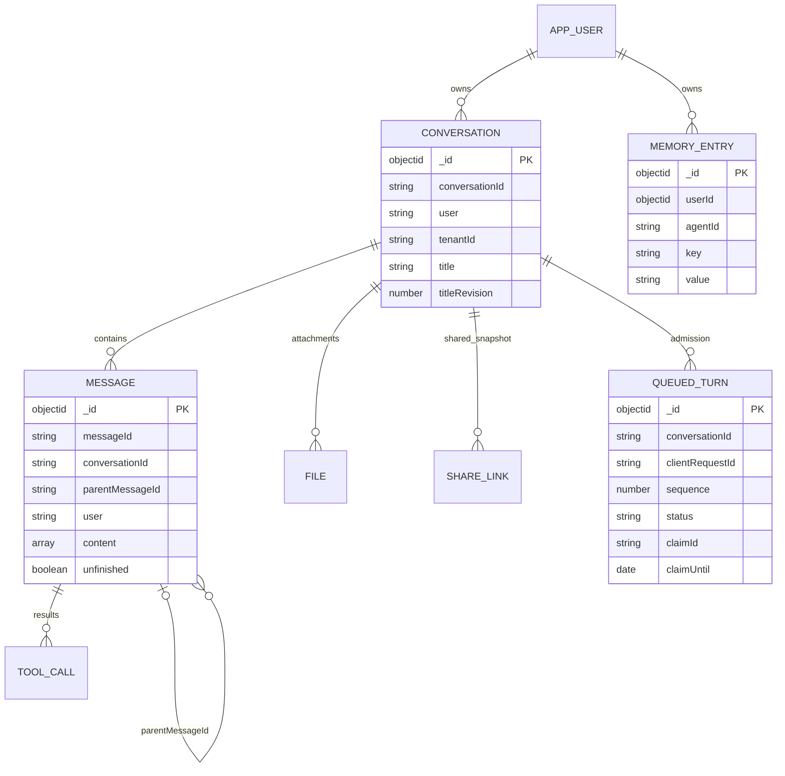
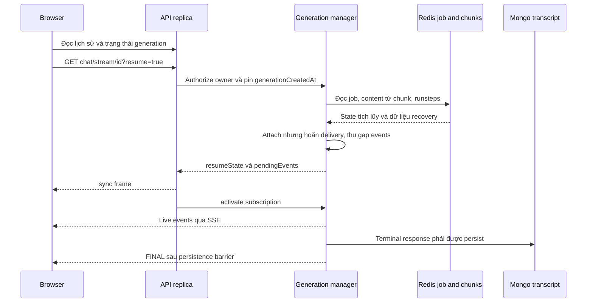

# LibreChat — nghiên cứu database, generation và khôi phục stream

Ngày khảo sát: **27/10/2026**. Repository: `/home/lamhung/code/LibreChat`; commit `8d3da9bbb220a0a96be9330a2e1cbd385fb786d5`.

Phạm vi: chat/agent, MongoDB schema và đường persistence/reload đang có trong checkout. Chưa chạy database, migration, benchmark hoặc thử kill pod. Đây không phải mô tả mọi bản LibreChat đã phát hành; snapshot này có subsystem generation protocol v2 và recovery khá lớn.

## 1. Kết luận kiến trúc

LibreChat dùng **MongoDB/Mongoose cho metadata và transcript**, Redis cho generation job cùng chunk/replay khi bật Redis streams, và native MongoDBSaver cho checkpoint LangGraph phục vụ resume. Ba lớp có trách nhiệm khác nhau; không có một collection message tự giải quyết mọi yêu cầu.

Điểm gần bài toán của mình nhất là đường agent SSE: server cung cấp `resumeState` chứa nội dung đã tích lũy và thông tin run, thu các sự kiện trong khoảng chuyển tiếp, rồi kích hoạt live subscription. Tuy nhiên, đây là phối hợp nhiều cơ chế và nhiều kho; không nên mô tả thành một transaction snapshot + watermark xuyên MongoDB, Redis và graph.

Nguồn: [stream service factory](/home/lamhung/code/LibreChat/packages/api/src/stream/createStreamServices.ts:67), [subscribeWithResume](/home/lamhung/code/LibreChat/packages/api/src/stream/GenerationJobManager.ts:6193), [checkpoint adapter](/home/lamhung/code/LibreChat/packages/api/src/agents/checkpointer.ts:142).

## 2. Các lớp lưu trữ

| Kho | Dữ liệu | Vai trò |
|---|---|---|
| MongoDB qua Mongoose | Conversation, Message, ToolCall, File, MemoryEntry, ShareLink, agent/config, queued turn | Dữ liệu ứng dụng và transcript bền vững |
| MongoDB native saver | Checkpoint, pending writes, owner/storage namespace, TTL | State graph có thể resume, đặc biệt HITL |
| Redis job store | Hash metadata generation, stream chunk, JSON run steps, queue steer, receipts và epoch | Shared state của run đang chạy/paused và retention ngắn hạn |
| Redis transport | Pub/sub có sequence và bộ đệm replay giới hạn | Fan-out sự kiện giữa replica và subscriber |
| RAM process | Graph/runtime, AbortController, local content/graph cache, early event buffer | Fast path và thực thi còn sống |
| MeiliSearch khi cấu hình | Index conversation/message | Search projection; không phải canonical transcript |
| File backend | Byte file, theo source/storageKey/path | Tách metadata file khỏi object bytes |

Stream services chọn Redis theo `USE_REDIS_STREAMS`, mặc định đi theo cấu hình Redis; factory có fallback in-memory nếu không có client/subscriber phù hợp. Vì vậy **không thể mặc định mọi deployment đều có shared recovery**. In-memory mặc định giữ job hoàn tất 5 phút, tối đa 1.000 job và stale timeout 20 phút.

Nguồn: [factory và fallback](/home/lamhung/code/LibreChat/packages/api/src/stream/createStreamServices.ts:80), [Mongo model/Meili wiring](/home/lamhung/code/LibreChat/packages/data-schemas/src/models/convo.ts:7), [message model](/home/lamhung/code/LibreChat/packages/data-schemas/src/models/message.ts:7), [file metadata](/home/lamhung/code/LibreChat/packages/data-schemas/src/schema/file.ts:25).

## 3. Collections và identity

Các tên dưới đây là tên model/schema nghiệp vụ. Mongoose còn có `_id` riêng; `conversationId`/`messageId` là identity ứng dụng, không thay thế tự động `_id`.

| Model/schema | Trường chính | Khóa và ý nghĩa |
|---|---|---|
| Conversation | conversationId, user, tenantId, title, messages ObjectId[], agent/model preset, archive/pinned/project, last response/read state | Unique `(conversationId,user,tenantId)` |
| Message | messageId, conversationId, user, tenantId, parentMessageId, text/content, tokenCount, unfinished/error, files/attachments | Unique `(messageId,user,tenantId)`; cây message liên kết bằng string ID |
| ToolCall | conversationId, messageId, toolId, user, result, attachments, blockIndex/partIndex | Index lookup theo message hoặc conversation + owner + tenant; không thấy unique call ID trong schema này |
| MemoryEntry | userId ObjectId, agentId optional, key, value, tokenCount, updated_at | Index `(userId,agentId,key)` **không unique** trong schema đã đọc |
| File | file_id, user, conversationId/messageId, source/path/storageKey, bytes/type, provenance | Metadata và lifecycle object; không phải nội dung byte file |
| ShareLink | shareId, conversationId, user, targetMessageId, messages refs, fileSnapshots, expiredAt | Snapshot/chia sẻ và retention; ref không phải FK SQL |
| AgentQueuedTurn | owner/tenant/conversation/lane, clientRequestId/fingerprint, sequence, status, claim/admission/reconciliation fields | Durable admission queue có indexes uniqueness/partial riêng |

Nguồn: [Conversation](/home/lamhung/code/LibreChat/packages/data-schemas/src/schema/convo.ts:20), [Message](/home/lamhung/code/LibreChat/packages/data-schemas/src/schema/message.ts:5), [ToolCall](/home/lamhung/code/LibreChat/packages/data-schemas/src/schema/toolCall.ts:19), [MemoryEntry](/home/lamhung/code/LibreChat/packages/data-schemas/src/schema/memory.ts:11), [ShareLink](/home/lamhung/code/LibreChat/packages/data-schemas/src/schema/share.ts:44), [queued turn](/home/lamhung/code/LibreChat/packages/data-schemas/src/schema/queuedTurn.ts:65).

Message content là mảng structured blocks kiểu Mixed, cùng text và metadata. Tool output có thể hiện diện trong content để render/context; ToolCall là kho kết quả/attachment truy vấn riêng. Vì vậy không nên giả định mọi tool execution chỉ nằm trong một collection có schema event cố định.

Conversation còn có subagentThread lineage, continuation lease và committed event-actor state. Message có server-only subagentTask, transcript/activity/trigger projections. Các trường này là mô hình agent mở rộng, không phải yêu cầu bắt buộc cho MVP chat một agent.

### ER logic rút gọn

Tất cả cạnh dưới là quan hệ logic hoặc Mongoose ref. MongoDB không thực thi foreign key/cascade như PostgreSQL.



## 4. Ownership, tenant và constraint

Conversation/Message unique key có owner và tenant. Không được coi ID chat là đủ authorization. Query còn phải bound authenticated owner; stream route đọc job và kiểm tra `job.metadata.userId` với `req.user.id`, sau đó kiểm tra tenant mismatch. Job thiếu owner bị từ chối.

Mongoose model áp dụng tenant isolation plugin. Tenant context đi qua AsyncLocalStorage; có explicit system context để thực hiện tác vụ xuyên tenant. Plugin có policy cho tenantless/strict mode và thêm predicate/stamp khi đọc/ghi. Đây là enforcement ứng dụng/ODM, **không phải MongoDB row-level security**; native driver, bulk writer hay collection khác phải giữ đúng boundary tương ứng.

Nguồn: [stream authorization](/home/lamhung/code/LibreChat/api/server/routes/agents/index.js:222), [tenant context](/home/lamhung/code/LibreChat/packages/data-schemas/src/config/tenantContext.ts:1), [tenant plugin](/home/lamhung/code/LibreChat/packages/data-schemas/src/models/plugins/tenantIsolation.ts:35), [model applies plugin](/home/lamhung/code/LibreChat/packages/data-schemas/src/models/convo.ts:10).

Schema `required`, enum và validator là Mongoose validation, không nên mô tả thành PostgreSQL CHECK hay server-side Mongo validator. Unique index mới là cơ chế database chống trùng sau khi index đã được tạo thành công. `ref: 'Message'` không bảo đảm target tồn tại hoặc parent cùng conversation; invariant cây vẫn cần ứng dụng.

## 5. Index theo access pattern

| Access pattern | Index trong source |
|---|---|
| Sidebar recency mặc định | Conversation `(user,updatedAt DESC,_id DESC)` |
| Sidebar theo project/pinned/archive/endpoint | Các compound index riêng, có keyset tie-break `_id` |
| Đọc lịch sử có sort ổn định | Message `(conversationId,user,createdAt,_id)` |
| Insights theo agent/model/user | Tenant + temporary + createdAt và các facet liên quan |
| Temporary conversation/message | TTL index `expiredAt`, `expireAfterSeconds:0` |
| Tool result lookup | `(messageId,user,tenantId)` và `(conversationId,user,tenantId)` |
| Queue chống retry trùng | Unique `(tenantId,user,conversationId,clientRequestId)` |
| Queue thứ tự | Partial unique sequence trong conversation |
| Queue claim/admission | Partial unique lane đang claimed/admission, index claimUntil và reconciliation |

Nguồn: [conversation indexes](/home/lamhung/code/LibreChat/packages/data-schemas/src/schema/convo.ts:438), [message indexes](/home/lamhung/code/LibreChat/packages/data-schemas/src/schema/message.ts:336), [queue indexes](/home/lamhung/code/LibreChat/packages/data-schemas/src/schema/queuedTurn.ts:124).

Chú thích message index giải thích không đặt tenant giữa prefix vì deployment không có tenant predicate sẽ mất khả năng sort theo index. Đây là ví dụ thiết kế index theo query thật, không chỉ đặt mọi cột isolation vào đầu mọi index.

Schema/index có migration riêng để đổi tenant indexes; connection còn cho cấu hình `MONGO_AUTO_INDEX` và `MONGO_AUTO_CREATE`. Đọc `.index()` trong source chưa chứng minh index đã hiện diện trên deployment. Khảo sát này không chạy index migration hoặc kiểm tra catalog đang vận hành. Nguồn: [tenant index migration exports](/home/lamhung/code/LibreChat/packages/data-schemas/src/migrations/index.ts:1), [Mongo connection options](/home/lamhung/code/LibreChat/api/db/connect.js:14).

TTL MongoDB là cleanup theo thời gian, không thay thế authorization/expired check tức thời và không cascade các collection khác. File `expiredAt` trong schema có index thường, không nên gán cùng TTL semantics với Message chỉ vì cùng tên cột. [File indexes](/home/lamhung/code/LibreChat/packages/data-schemas/src/schema/file.ts:253).

## 6. Message tree, regenerate và fork

`parentMessageId` tạo cây conversation; nhiều sibling giữ các phương án trả lời/câu hỏi. Lựa chọn nhánh ở client có sibling index; khi restore active generation, `useResumeOnLoad` còn tìm branch target và khôi phục sibling indexes.

Fork có các lựa chọn direct path/include branches/target level. Code tải owner-scoped source, clone lineage và tạo map ID mới để remap parent. Một số metadata runtime subagent được tháo khỏi bản sao; file scope và provenance có quy tắc riêng. Đây là **copy transcript có kiểm soát**, không chứng minh fork một conversation có thể dùng nguyên state graph của source mà không ánh xạ checkpoint.

Nguồn: [fork algorithm](/home/lamhung/code/LibreChat/api/server/utils/import/fork.js:26), [fork modes](/home/lamhung/code/LibreChat/api/server/utils/import/fork.js:87), [restore branch on reload](/home/lamhung/code/LibreChat/client/src/hooks/SSE/useResumeOnLoad.ts:94).

## 7. Generation storage và streaming

### 7.1. Job khác conversation

RedisJobStore ghi chú `streamId === conversationId`. Nhiều turn nối tiếp có thể tái sử dụng stream ID, nên **generation còn có identity `createdAt`**, protocol version, epoch và guarded writes. Route có query `generationCreatedAt`, validate số an toàn và pin subscription vào đúng generation đã authorize. Chỉ lọc conversation ID sẽ không đủ chặn callback/run cũ tác động run mới.

Serializable job có status `running`, `complete`, `error`, `aborted`, `requires_action`; owner/tenant, responseMessageId, userMessage, checkpointNamespace, durable frontier, pending action, terminal persistence và các recovery receipts. `requires_action` là trạng thái nonterminal, không cleanup như complete.

Nguồn: [job contract](/home/lamhung/code/LibreChat/packages/api/src/stream/interfaces/IJobStore.ts:107), [route generation validation](/home/lamhung/code/LibreChat/api/server/routes/agents/index.js:192), [job keys](/home/lamhung/code/LibreChat/packages/api/src/stream/implementations/RedisJobStore.ts:1739).

### 7.2. Redis layout

```text
stream:{streamId}:job          -> Hash metadata generation
stream:{streamId}:chunks       -> Redis Stream chứa event JSON
stream:{streamId}:runsteps      -> JSON string
stream:{streamId}:seq           -> transport sequence counter
stream:{streamId}:steers        -> FIFO list
stream:{streamId}:generation-epoch -> generation fence
```

Các key dùng `{streamId}` hash tag để Lua thao tác cùng Redis Cluster slot. Đây là stream chunk log thật qua XADD, khác bộ đệm string của Open WebUI hay compressed cache chunk của Onyx.

Defaults: running job/chunks 1.200 giây; completed job 300 giây; chunks/runsteps sau complete mặc định xóa ngay; requires-action backstop 24 giờ, có thể mở rộng theo approval deadline. Running chunk append refresh retention, paused retention không được vô tình rút về running window. Cấu hình Redis persistence/replication quyết định mức mất dữ liệu; từ “durable” trong code ở đây không có nghĩa giữ mọi token vĩnh viễn.

Nguồn: [TTL và layout](/home/lamhung/code/LibreChat/packages/api/src/stream/implementations/RedisJobStore.ts:1826), [Lua append](/home/lamhung/code/LibreChat/packages/api/src/stream/implementations/RedisJobStore.ts:871).

### 7.3. Transcript cuối và publication barrier

Đường agent request ghi response MongoDB **trước khi phát FINAL**, yêu cầu save trả về durable row. Nó còn sửa reference trên conversation khi message đã được cứu bằng bare save; điều này tránh follow-up dùng parent chưa được lưu. Đây là nhiều thao tác phối hợp; không phải một transaction MongoDB + Redis.

Nguồn: [terminal persistence trước FINAL](/home/lamhung/code/LibreChat/api/server/controllers/agents/request.js:3079), [conversation write](/home/lamhung/code/LibreChat/packages/data-schemas/src/methods/conversation.ts:2405), [message persistence](/home/lamhung/code/LibreChat/packages/data-schemas/src/methods/message.ts:1137).

## 8. Reload: snapshot, gap events rồi live

Luồng đang khảo sát là **agent/resumable path**. Hook frontend bật resume với endpoint không phải Assistants; không gán guarantee này cho mọi provider/legacy route.



Source `getContentParts` ưu tiên host content/graph cache trên cùng process; khác replica reconstruct bằng cùng content aggregator từ Redis chunks. Run steps được đọc riêng và merge với buffer đang có. `subscribeWithResume` hoãn live delivery tới khi route ghi sync frame và gọi activate, đồng thời recheck pause/steer/terminal trong cửa sổ snapshot→attach.

Nguồn: [getContentParts](/home/lamhung/code/LibreChat/packages/api/src/stream/implementations/RedisJobStore.ts:4354), [resume state](/home/lamhung/code/LibreChat/packages/api/src/stream/GenerationJobManager.ts:8856), [attach và race reconciliation](/home/lamhung/code/LibreChat/packages/api/src/stream/GenerationJobManager.ts:6520), [sync rồi activate](/home/lamhung/code/LibreChat/api/server/routes/agents/index.js:357), [frontend exclusions](/home/lamhung/code/LibreChat/client/src/hooks/SSE/useResumeOnLoad.ts:40).

### Tính nguyên tử có phạm vi

- Transport có script cấp sequence và publish trong một round trip, reorder buffer, và subscription marker xác định frontier sau SUBSCRIBE.
- Đường replayable transport có Lua đọc sequence frontier + retained replay list nguyên tử. SUBSCRIBE phải ACK trước; live buffer loại phần giao nhau bằng frontier.
- Đây **không đồng nghĩa** content snapshot, runsteps, pending action và mọi chunk đều được chụp trong một transaction duy nhất. Manager phối hợp local capture, deferred delivery và re-read/reconciliation.
- Source nói rõ cross-replica chunk log có thể trễ live emission tới một coalescing window. Same-replica read flush pending append của process đó; replica khác không thể flush buffer RAM của producer bằng thao tác này.
- Recovery nhạy cảm kiểm tra `reconstructedEventCount` với `durableEventCount`; gap có thể làm fail closed, thay vì giả vờ đủ dữ liệu.

Nguồn: [atomic replay scripts](/home/lamhung/code/LibreChat/packages/api/src/stream/internal/replay.ts:14), [subscription frontier](/home/lamhung/code/LibreChat/packages/api/src/stream/implementations/RedisEventTransport.ts:1366), [chunk snapshot và coalescing caveat](/home/lamhung/code/LibreChat/packages/api/src/stream/implementations/RedisJobStore.ts:5319), [durable gap validation](/home/lamhung/code/LibreChat/packages/api/src/stream/GenerationJobManager.ts:8918).

Đánh giá: đây là tham khảo gần nhất cho trải nghiệm “mở lại thấy câu trả lời hiện tại rồi nhận tiếp”. Muốn áp dụng vào SSE AG-UI của mình nên lấy invariant sync-before-live, generation identity, gap detection và persistence-before-final; không sao chép lời hứa atomic rộng hơn implementation.

## 9. Checkpoint và phục hồi execution

LibreChat dùng `MongoDBSaver` qua owner-aware wrapper. Generation có namespace opaque gắn authenticated owner; wrapper ánh xạ private configurable key sang namespace lưu trữ vì LangGraph tự quản lý root/subgraph `checkpoint_ns`. Có owner index, namespace index và TTL; mặc định checkpoint 24 giờ. Không dùng conversation ID đơn lẻ làm ranh giới bảo mật checkpoint.

Mục đích được source nêu rõ là HITL: graph pause tại tool approval, sau đó dựng **Run mới** từ durable checkpoint, có thể trên replica khác. Lazy saver giữ checkpoint có interrupt hoặc real state/delta anchor; clean exit/bookkeeping-only không được giữ như checkpoint resume thông thường, và terminal cleanup dọn checkpoint theo generation. Event-actor invocation có chính sách candidate head riêng.

Nguồn: [namespace adapter và saver policy](/home/lamhung/code/LibreChat/packages/api/src/agents/checkpointer.ts:39), [HITL scope](/home/lamhung/code/LibreChat/packages/api/src/agents/checkpointer.ts:142), [lazy policy](/home/lamhung/code/LibreChat/packages/api/src/agents/checkpointer.ts:200), [owner namespace](/home/lamhung/code/LibreChat/packages/api/src/stream/checkpoints.ts:3), [indexes](/home/lamhung/code/LibreChat/packages/api/src/agents/checkpointer.ts:887).

| Tình huống | Điều source hỗ trợ / giới hạn |
|---|---|
| Browser rời đi, producer còn sống | Detach subscriber; generation có thể tiếp tục, reload lấy snapshot rồi live |
| API replica khác nhận attach | Redis job/chunks cho reconstruct và transport fan-out, nếu deployment có Redis |
| HITL pause rồi process restart | Có đường dựng Run mới từ Mongo checkpoint còn hạn; phải giữ graph/config/owner đúng |
| Producer chết giữa LLM token | Chunk còn lưu có thể khôi phục phần hiển thị; **không có bằng chứng tiếp tục đúng token tiếp theo của cùng provider stream** |
| Terminal publish hỏng nhưng state đã lưu | Route cho reconnect; job terminal còn retention để phát lại authoritative final |
| Redis tắt hoặc fallback RAM | Mất shared job/replay giữa process; không có guarantee tương đương Redis deployment |
| Redis/key/checkpoint hết hạn | Không còn nguồn recovery tương ứng; transcript Mongo cuối vẫn là kho lịch sử riêng |

Có stale-job reaping, host-action settlement, generation handoff và detached event-actor recovery. Các đường này không được gộp thành “mọi chat LLM crash đều tự chạy tiếp”. Chưa thực nghiệm failover hoặc audit toàn bộ tool side effect nên không tuyên bố exactly-once execution.

Nguồn: [terminal reconnect behavior](/home/lamhung/code/LibreChat/api/server/routes/agents/index.js:344), [generation manager](/home/lamhung/code/LibreChat/packages/api/src/stream/GenerationJobManager.ts:894), [stale checkpoint/recovery lifecycle](/home/lamhung/code/LibreChat/packages/api/src/stream/GenerationJobManager.ts:9164).

## 10. Durable queue, title, memory và deletion

**Queued turn:** không chỉ là array trong RAM. Schema có status reserving/queued/claimed/admitted/cancelled/dead, claimId/claimUntil, admission fence, reconciliation claim và terminalReceipt. Partial unique indexes bảo vệ lane và capacity, unique request ID chống retry trùng. Có runtime `queuedTurns` và database methods claim/admission; đây là queue điều phối admission cho agent, không tự bảo đảm mọi external tool chạy đúng một lần.

Nguồn: [queue schema](/home/lamhung/code/LibreChat/packages/data-schemas/src/schema/queuedTurn.ts:65), [runtime queue](/home/lamhung/code/LibreChat/packages/api/src/agents/queuedTurns.ts:1), [database methods](/home/lamhung/code/LibreChat/packages/data-schemas/src/methods/queuedTurn.ts:193).

**Title:** Conversation có `titleSetByUser`, `titleRevision`. Writer manual đánh dấu user-set và tăng revision; đường automatic update có predicate không ghi đè title đã user-set. Resume state còn có title event. Đây là pattern phù hợp chống title job đến muộn ghi đè rename.

Nguồn: [conditional title update](/home/lamhung/code/LibreChat/packages/data-schemas/src/methods/conversation.ts:2459), [revision/CAS](/home/lamhung/code/LibreChat/packages/data-schemas/src/methods/conversation.ts:2614), [resume title event](/home/lamhung/code/LibreChat/packages/api/src/stream/GenerationJobManager.ts:8976).

**Memory:** là key/value string theo user, optional agent partition; không phải toàn bộ transcript và không phải native LangGraph Store. Index schema không unique nên chưa thể kết luận database bảo đảm một value cho mỗi key nếu không đọc update policy. Không nên copy schema mà bỏ ownership/provenance của dự án mình.

**Share và file:** share giữ message refs và immutable file metadata snapshot, tham chiếu object gốc chứ không tự copy byte. Clone/fork có policy file riêng; xóa file và retention phải tính tới share references.

**Deletion:** Mongoose ref không tự cascade. `deleteConvos` xử lý message cleanup, subagent/queue/receipt và deferred cleanup trong code; có thể có bước thành công rồi bước sau lỗi. TTL temporary record cũng không tự dọn toàn bộ object/checkpoint/vector. Cần coi xóa nhiều kho là lifecycle có retry/audit.

Nguồn: [memory schema](/home/lamhung/code/LibreChat/packages/data-schemas/src/schema/memory.ts:11), [share file snapshot](/home/lamhung/code/LibreChat/packages/data-schemas/src/schema/share.ts:20), [conversation deletion](/home/lamhung/code/LibreChat/packages/data-schemas/src/methods/conversation.ts:4013).

## 11. Tầng agent: LangGraph, `@librechat/agents` và app

Bổ sung **27/10/2026**. Đọc từ tarball npm `@librechat/agents@4.1.1` (package ship cả `src/`), vì `node_modules` không có trong checkout và package không nằm trong `packages/` của repo. Tải về thư mục riêng, đọc, rồi xóa.

### 11.1. Ba tầng, không phải một

```
@langchain/langgraph 1.4.8          engine: graph execution, checkpoint, interrupt
    └─ @librechat/agents 4.1.1      framework riêng của họ (npm package tách rời)
         └─ LibreChat app           queue, admission, approval, subagent, persistence
```

Số lần import trong `packages/api/src` + `api/server`:

| Nguồn | Số import |
|---|---|
| `@librechat/agents` | **306** |
| `@langchain/langgraph-checkpoint` | 7 |
| `@langchain/langgraph-checkpoint-mongodb` | 4 |
| `@langchain/langgraph` | 4 |

**Cả 4 import `@langchain/langgraph` trực tiếp đều nằm trong file `.spec.ts`** (`errors.spec.ts`, `actor.integration.spec.ts`, `modes.integration.spec.ts`, `edits.spec.ts`). Code production của LibreChat không import graph API của LangGraph ở đâu cả. API dựng graph (`StateGraph`, `Annotation.Root`, `MessagesAnnotation`, `.compile()`) chỉ xuất hiện ở **2 file production**: `agents/checkpointer.ts` và `agents/discovery.ts`, cả hai thuộc tầng hạ tầng.

`@librechat/agents` có 38 dependency, **17 gói `@langchain/*`**, và ghim `@langchain/langgraph` đúng `1.4.8`.

### 11.2. Bên dưới là `StateGraph` thật, topology kinh điển

`src/graphs/createGraph.ts` là factory 32 dòng chọn `StandardGraph` hoặc `MultiAgentGraph`. `src/graphs/Graph.ts` — **6.302 dòng** — import `START, END, StateGraph, Annotation` từ `@langchain/langgraph` và `ToolNode` từ `@langchain/langgraph/prebuilt`, rồi dựng:

```ts
const workflow = new StateGraph(StateAnnotation)
  .addNode(agentNode, (state, config) => ...)
  .addNode(toolNode, callTools)
  .addNode(summarizeNode, ...)
  .addEdge(START, agentNode)
  .addConditionalEdges(agentNode, routeMessage)
  .addEdge(summarizeNode, agentNode)
  .addEdge(toolNode, agentContext.toolEnd ? END : agentNode);
return workflow.compile({ name: STANDARD_GRAPH_RUN_NAME });
```

State cũng là LangGraph chuẩn: `Annotation.Root` với `messagesStateReducer` (tương đương `add_messages` bên Python), cộng bốn channel riêng — `summarizationRequest`, `manualSummary`, `runStepState`, `handoffState`.

**Topology chỉ chiếm khoảng 30 dòng cuối file.** 6.272 dòng còn lại là context overflow recovery, provider fallback, hook registry, handoff, stream limit, breaker epoch, file checkpointer theo run — tức phần sản phẩm, không phải phần agent. `summarizeNode` là đối ứng runtime của `compactionSemanticIndex`/`contextMeta`/`summary` trong schema.

### 11.3. Checkpointer cấp riêng cho mỗi Run

Checkpointer tiêm vào lúc compile qua `compileOptions?.checkpointer`. Comment ở `Graph.ts:985-987` nói rõ mục đích: *"Graph instance, so the next Run gets its own checkpointer / the checkpointer was nulled before the caller could reach it."*

Trùng với §8.2 của [thiết kế nền tảng](../chat_development/langgraph-oss-agent-platform-design.md): saver bind theo attempt, gắn chính connection giữ ownership lock, không trả connection còn lock về pool. Hai dự án đến cùng kết luận từ hai phía.

### 11.4. Chỗ duy nhất họ bỏ qua cả hai tầng

Framework riêng đủ cho đường chạy agent, **nhưng không đủ cho resume/ownership/xóa**. Ở đó LibreChat làm việc trực tiếp với giao thức checkpoint của LangGraph:

```ts
import { MongoDBSaver } from '@langchain/langgraph-checkpoint-mongodb';
import { INTERRUPT, ERROR, emptyCheckpoint, WRITES_IDX_MAP }
  from '@langchain/langgraph-checkpoint';
```

trong `checkpointer.ts`, `checkpoints/actor.ts`, `checkpoints/storage.ts`, `checkpoints/saver.ts`. `WRITES_IDX_MAP` chính là bảng idx âm trong `checkpoint_writes` mà [phép đo native](../chat_development/langgraph-native-storage-findings.md) §1.2 tìm thấy trên Postgres (`__interrupt__` = −3, `__resume__` = −4). Cộng với `lc_owner` **chèn vào chính document do thư viện quản lý**, vì thư viện gốc không hỗ trợ xóa checkpoint theo chủ sở hữu.

**Cảnh báo cho dự án:** nguyên tắc "không tự ghi vào bảng native, xóa thread bằng native saver API" ở §17.3 thiết kế nền tảng chưa được kiểm chứng. LibreChat là bằng chứng rằng với adapter Mongo, API đó **không đủ**, và một sản phẩm có framework riêng vẫn phải vi phạm nguyên tắc ấy. Mục 6 của tài liệu native storage đã xếp cleanup checkpoint vào phần chưa test; nên nâng mức rủi ro.

### 11.5. Chưa kiểm chứng

Đọc `src/` của package, chưa chạy nó. Chưa đối chiếu `dist/` với `src/`. Chưa xác minh `MultiAgentGraph` có cùng cách dựng hay không.

## 12. Lưu lịch sử chat: đọc lại chi tiết

Bổ sung **27/10/2026**, đọc lại đường ghi/đọc thật thay vì chỉ schema.

### 12.1. Canonical là rows, đọc bằng cursor

Lịch sử nằm ở collection `messages`, mỗi message một document, cây bằng `parentMessageId` dạng string. Route `GET /api/messages?conversationId=…&cursor=…&pageSize=…` ([`api/server/routes/messages.js:151`](/home/lamhung/code/LibreChat/api/server/routes/messages.js)) gọi:

```ts
db.getMessagesByCursor(
  { conversationId, user },
  { sortField, sortOrder, limit: pageSize, cursor, select: CLIENT_MESSAGE_SELECT },
)
```

`pageSize` mặc định **25**, lấy `limit + 1` rồi `pop()` để sinh `nextCursor`. Projection `CLIENT_MESSAGE_SELECT` — comment trong route nói rõ *"Client-facing reads never expose server-private fields such as `contextMeta`"*.

**Sửa nhận định cũ:** LibreChat **có** phân trang keyset cho lịch sử chat, không phải luôn load cả hội thoại. `getMessages()` (không cursor, sort `createdAt: 1`, **không limit mặc định**) vẫn tồn tại và vẫn load hết, nhưng nó dùng cho đường lấy một `messageId` cụ thể và cho `saveConvo`.

### 12.2. Cursor thiếu tiebreak

[`getMessagesByCursor`](/home/lamhung/code/LibreChat/packages/data-schemas/src/methods/message.ts:4237):

```ts
queryFilter[sortField] = sortOrder === 1 ? { $gt: cursor } : { $lt: cursor };
```

Cursor là **một trường duy nhất**, không có `_id` phá hòa. Index đọc lịch sử là `(conversationId, user, createdAt, _id)` — **có** `_id`, nhưng query không dùng tới. Hai message cùng `createdAt` ở biên trang sẽ bị bỏ sót hoặc lặp.

`sortField` còn nhận `'endpoint'` và `'updatedAt'`. Keyset trên `endpoint` — trường không duy nhất, không đơn điệu — va chạm nặng hơn nhiều.

Đây cùng lớp lỗi với defect tìm thấy khi tự rà soát schema của dự án (index audit sort `occurred_at DESC` không có `id DESC`). Nghĩa là nó không phải lỗi hiếm; nên đặt thành quy tắc: **mọi keyset phải có tiebreak duy nhất trong khóa index *và* trong predicate cursor.**

### 12.3. `conversation.messages` — mảng ghi nhiều, đọc gần như không

Conversation có `messages: [ObjectId→Message]`, song song với `message.conversationId`. Hai đường ghi:

| Đường | Chi phí |
|---|---|
| [`saveConvo`](/home/lamhung/code/LibreChat/packages/data-schemas/src/methods/conversation.ts:2481) khi `appendMessageIds == null`: `update.messages = await getMessages({ conversationId, user }, '_id')` | **Truy vấn lại toàn bộ `_id` rồi ghi đè cả mảng — O(n) đọc + O(n) ghi mỗi lần lưu conversation** |
| [`appendConvoMessageReference`](/home/lamhung/code/LibreChat/packages/data-schemas/src/methods/conversation.ts:2958): `$addToSet: { messages: ObjectId }` | Tăng dần |

Đường đọc trong production code: tìm được **đúng một chỗ** — [`packages/chat/src/core/resumable/messages.ts:94`](/home/lamhung/code/LibreChat/packages/chat/src/core/resumable/messages.ts), dùng làm fallback khi `messageIds` rỗng.

Tức một conversation 10.000 message thì mỗi lần đổi title/metadata qua đường `saveConvo` mặc định sẽ đọc 10.000 `_id` và ghi lại mảng 10.000 phần tử, cho một field hầu như không ai đọc. Đây là biến thể của "dual write whole history" mà [README](./README.md) đã ghi nhận ở Open WebUI — ở đây là mảng ID chứ không phải nội dung, nhưng khuếch đại ghi vẫn là O(n).

### 12.4. Lịch sử không chỉ nằm ở `messages`

| Phần | Nơi lưu |
|---|---|
| Message thường | `messages` |
| Kết quả tool | `toolcalls`, neo vào `content` của message bằng `blockIndex`/`partIndex` |
| Transcript subagent | `subagentcontents` — commit hai pha, mảnh `fragment ≥ 0` rồi bản ghi `fragment = -1` làm điểm nhìn thấy; `messagesJson` lưu **dạng chuỗi** để né giới hạn độ sâu |
| Response đang sinh | Redis chunks, **không** ở `messages`; ghi Mongo trước khi phát FINAL (§7.3) |
| Bản chia sẻ | `sharedlinks` + `fileSnapshots` metadata bất biến |
| Tìm kiếm | MeiliSearch mirror — projection, không phải canonical |

Dựng lại một lượt đầy đủ cần đọc ít nhất `messages` + `toolcalls`, và với subagent thì thêm `subagentcontents`.

### 12.5. Nhánh dựng ở client

`parentMessageId` cho cây; chọn nhánh là sibling index **phía client**, và `useResumeOnLoad` khôi phục sibling indexes khi reload (§6). Server phân trang hội thoại theo thứ tự thời gian tuyến tính, không theo vị trí trên một nhánh.

Hệ quả: không có truy vấn "nhánh B, 30 item trước vị trí X". Đó vẫn là khác biệt thật so với mô hình `branch_item(branch_id, ordinal)` của dự án — nhưng khác biệt nằm ở **đơn vị phân trang** (thời gian tuyến tính vs vị trí trên nhánh), không phải ở chỗ "có phân trang hay không".

## 13. Bài học cho hệ thống của mình

Các mục sau là đề xuất sau khảo sát, chưa phải DDL đã chốt:

1. Tách conversation, transcript, generation/run, stream projection và native checkpoint; mỗi lớp có ID, retention và authorization riêng.
2. Run phải có identity riêng ngoài conversation ID. Epoch/generation guard ngăn callback hoặc stop cũ tác động lượt mới.
3. Connect gửi snapshot trước live; phải kiểm tra cả text, tool, pending approval, title và terminal event trong cửa sổ chuyển tiếp.
4. Lưu durable transcript trước FINAL; nếu persistence hỏng, đừng báo hoàn tất thành công rồi để follow-up tham chiếu parent chưa có.
5. Native saver vẫn cần owner binding, namespace, cleanup và policy giữ checkpoint. Dùng thư viện không loại bỏ trách nhiệm ứng dụng.
6. Queue admission, retry và side-effect receipts khác token replay. Đừng dùng shared Redis như bằng chứng exactly-once tool hoặc arbitrary token continuation.
7. Tách constraint database khỏi validation ODM; khi chuyển pattern sang PostgreSQL, quyết định rõ FK, unique, CHECK và indexes theo query.
8. Học title revision/manual-wins, branch-aware restore và cleanup nhiều kho có retry.

Các lựa chọn hiện tại giữ nguyên: FastAPI custom, LangGraph OSS native Saver/Store, `LangGraphAgent` emit AG-UI, SSE run/connect; không dùng CopilotKit. LibreChat cung cấp pattern để tham khảo, không thay thế kiến trúc hoặc kéo toàn bộ subsystem của họ vào MVP.

## 14. Giới hạn kiểm chứng

Đã đọc schema/model, tenant plugin, fork, writer terminal, job/cache implementations, stream route/manager, frontend resume và checkpoint adapter. Chưa chạy Mongo indexes/migrations hoặc test suite, chưa đo replay cost trên conversation dài, chưa thử Redis failover/TTL/kill-pod, chưa audit mọi legacy/Assistants/provider path. Sơ đồ là mô hình rút gọn, không liệt kê mọi collection agent/admin/schedule/skill/telemetry.
