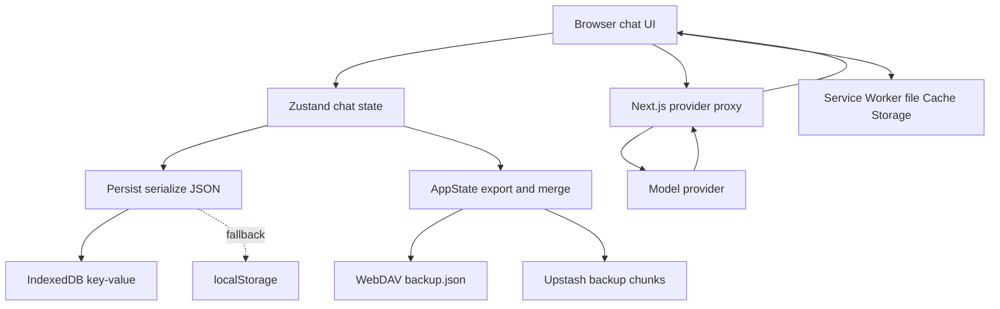
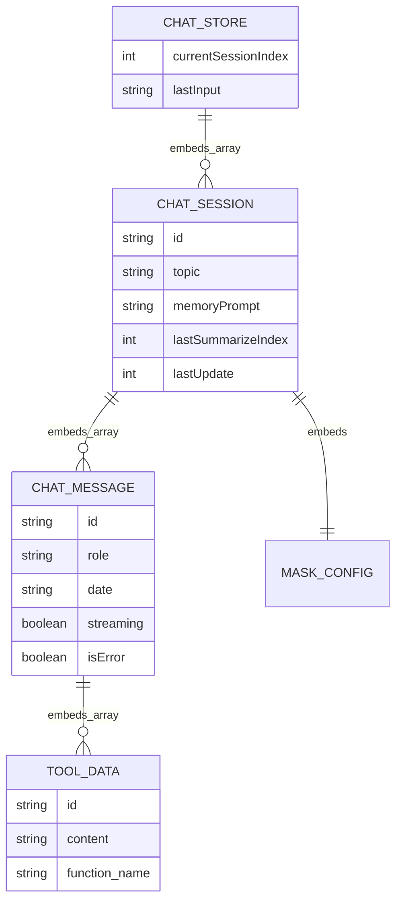

# NextChat — nghiên cứu thiết kế lưu trữ hội thoại

Ngày khảo sát: **27/10/2026**. Repository: `/home/lamhung/code/NextChat`, commit `1d3dc331512929a4b1d3e82354e72acce33b5c7a`; working tree sạch khi khảo sát.

Phạm vi: source NextChat tại checkout này, tập trung web chat và các cơ chế lưu/sync đi kèm. Chưa chạy ứng dụng, chưa kiểm thử đóng browser hoặc ghi đồng thời. Không suy luận hạ tầng dịch vụ thương mại từ repository này.

## 1. Kết luận chính

NextChat là một ví dụ **browser sở hữu dữ liệu chat**. Zustand giữ state trong RAM; middleware persist serialize state vào IndexedDB, có fallback localStorage. Cloud sync tùy chọn đưa một bản AppState lên WebDAV hoặc Upstash. Các API backend được khảo sát chủ yếu proxy request đến model hoặc sync service; chưa thấy database transcript server với conversation/message rows trong đường chat này.

Vì vậy không nên đưa NextChat vào cùng nhóm PostgreSQL/MongoDB chat backend. Điểm đáng học là mô hình state frontend, migration local và backup/sync; nó không cung cấp sẵn durable worker, shared partial response hay SSE reconnect theo cursor.

Nguồn: [persist factory](/home/lamhung/code/NextChat/app/utils/store.ts:29), [IndexedDB adapter](/home/lamhung/code/NextChat/app/utils/indexedDB-storage.ts:7), [chat store](/home/lamhung/code/NextChat/app/store/chat.ts:226), [model API](/home/lamhung/code/NextChat/app/api/openai.ts:31), [sync store](/home/lamhung/code/NextChat/app/store/sync.ts:103).

## 2. Các lớp lưu trữ

| Lớp | Nội dung | Vòng đời |
|---|---|---|
| RAM của tab | Zustand state, response text đang xử lý, AbortController | Mất khi reload/đóng tab |
| IndexedDB qua `idb-keyval` | Một JSON string cho mỗi persistent store | Giữ qua reload cùng browser/origin nếu storage còn |
| localStorage | Fallback đọc/ghi khi IndexedDB thiếu giá trị hoặc lỗi; một số dữ liệu local khác | Cùng browser/origin |
| Cache Storage + Service Worker | File/image blob dưới URL `/api/cache/...` | Kho local riêng với JSON chat |
| WebDAV tùy chọn | `chatgpt-next-web/backup.json` chứa AppState | Backup/sync từ client |
| Upstash tùy chọn | AppState chia thành các key chunk và key đếm chunk | Backup/sync từ client, không phải token stream buffer |
| Next.js API | Proxy model/provider và proxy sync | Không thấy transcript database trong đường code đã khảo sát |

`createPersistStore()` ép `persistOptions.storage = createJSONStorage(() => indexedDBStorage)`. Đây không phải chỉ một import adapter chưa dùng. Adapter `getItem()` đọc IndexedDB trước rồi localStorage; `setItem()` đợi `_hasHydrated=true`, sau đó ghi IndexedDB, lỗi thì ghi localStorage. Source không thực hiện một transaction di chuyển/xóa bản localStorage khi đọc fallback.

Nguồn: [factory và hydration](/home/lamhung/code/NextChat/app/utils/store.ts:38), [adapter](/home/lamhung/code/NextChat/app/utils/indexedDB-storage.ts:7), [Service Worker](/home/lamhung/code/NextChat/public/serviceWorker.js:22).

Các đường sync chỉ chạy khi được gọi; không biểu diễn một transaction xuyên local và remote.

## 3. Schema thực tế: object và key, không phải bảng SQL

### 3.1. Persistent store keys

`StoreKey` định nghĩa các key như `chat-next-web-store`, `app-config`, `access-control`, `mask-store`, `prompt-store`, `chat-next-web-plugin`, `sync`, `sd-list`, `mcp-store`. Những store dùng factory chung sẽ lưu state JSON theo key tương ứng. Chat store đang khai báo version **3.3**.

Nguồn: [StoreKey](/home/lamhung/code/NextChat/app/constant.ts:90), [chat persistence version](/home/lamhung/code/NextChat/app/store/chat.ts:868).

### 3.2. ChatSession và ChatMessage

| Object | Field | Ý nghĩa |
|---|---|---|
| Chat store | `sessions`, `currentSessionIndex`, `lastInput` | Toàn bộ danh sách chat và index chat đang chọn |
| `ChatSession` | `id`, `topic` | Nano ID và tiêu đề |
| `ChatSession` | `messages: ChatMessage[]` | Transcript là mảng có thứ tự |
| `ChatSession` | `memoryPrompt`, `lastSummarizeIndex`, `clearContextIndex` | Summary context và biên lịch sử dùng inference |
| `ChatSession` | `mask`, `stat`, `lastUpdate` | Cấu hình/persona, thống kê, activity |
| `ChatMessage` | `id`, `role`, `content`, `date` | Danh tính, nội dung text/multimodal, thời gian dạng chuỗi locale |
| `ChatMessage` | `streaming`, `isError`, `model` | Trạng thái frontend |
| `ChatMessage` | `tools`, `audio_url`, `isMcpResponse` | Tool data và dữ liệu bổ sung |
| `ChatMessageTool` | `id`, `function.name/arguments`, `content`, `isError` | Call/result gắn trong message |

Nguồn: [types và defaults](/home/lamhung/code/NextChat/app/store/chat.ts:44), [khởi tạo session](/home/lamhung/code/NextChat/app/store/chat.ts:104).

Sơ đồ là **object containment**, không có FK/PK SQL. Nano ID được ứng dụng tạo, không phải unique constraint kiểm tra bởi server. Không có secondary index theo owner, parent hoặc run trong schema object này; thao tác tìm/xóa/sort làm trên array/map trong client.

`currentSessionIndex` là vị trí trong mảng session, không phải khóa conversation ổn định. Khi reorder/delete, code điều chỉnh index. `date` dạng locale còn được sync parser dùng để sort, nên không tương đương một timestamp chuẩn có timezone do server cấp.

## 4. Luồng ghi message, stream và reload

1. Client lấy history cùng memory để xây payload model.
2. Tạo user message và assistant placeholder `streaming=true`, append vào session.
3. Gửi request model với `stream=true` qua client API.
4. `onUpdate()` đặt assistant content thành accumulated text, gọi `updateTargetSession()` để set sessions.
5. Middleware persist nhận state thay đổi và serialize toàn store xuống storage.
6. `onFinish()` đặt `streaming=false`, cập nhật thời gian, thống kê, title/summary nếu cần và bỏ controller.

Nguồn: [onUserInput](/home/lamhung/code/NextChat/app/store/chat.ts:407), [onUpdate/onFinish](/home/lamhung/code/NextChat/app/store/chat.ts:464), [updateTargetSession](/home/lamhung/code/NextChat/app/store/chat.ts:808).

Trong helper stream, delta từ provider còn được tích lũy vào `remainText`, rồi `requestAnimationFrame` chuyển dần sang `responseText` và gọi onUpdate. Vì vậy **byte đã tới network chưa chắc đã vào state đã persist**. Storage write là async; handler không await một durable acknowledgment trước khi hiển thị. Không được hứa mọi token trước lúc browser tắt đều đã xuống IndexedDB.

Nguồn: [stream animation](/home/lamhung/code/NextChat/app/utils/chat.ts:410), [SSE parsing](/home/lamhung/code/NextChat/app/utils/chat.ts:545).

### Reload giải quyết được gì

| Tình huống | Hành vi xác nhận hoặc giới hạn |
|---|---|
| Reload sau khi answer hoàn tất và local write thành công | Hydrate lại state từ IndexedDB/fallback |
| Reload giữa stream | Có thể thấy partial đã persist local; không có attach lại execution cũ trong đường đã đọc |
| Đóng browser | Request/controller và response buffer local mất; không có detached worker contract được tìm thấy |
| Mở trên thiết bị khác | Cần backup/sync đã chạy thành công; không tự có cùng local storage |
| Proxy pod chết | Connection có thể lỗi; không thấy shared event tail hoặc durable run state để resume |
| Xóa local data | Transcript local mất nếu không còn backup phù hợp |

`ChatControllerPool` là object RAM giữ AbortController, không được serialize. UI khi đổi/mount session kiểm tra message lỗi hoặc cũ hơn `REQUEST_TIMEOUT_MS`, reset streaming và báo empty response khi rỗng. Đây là cleanup stale flag, **không phải khởi động lại stream**; flag mới bị hydrate chưa chắc được reset ngay nếu chưa hết timeout.

`openWhenHidden=true` của SSE helper chỉ giữ request khi trang bị ẩn theo library behavior; không có nghĩa sống qua reload hoặc đóng browser. Các đoạn đã đọc không có custom connect endpoint với snapshot/watermark/tail hay durable run ID để resume.

Nguồn: [controller pool](/home/lamhung/code/NextChat/app/client/controller.ts:1), [stale message cleanup](/home/lamhung/code/NextChat/app/components/chat.tsx:1144), [SSE helper](/home/lamhung/code/NextChat/app/utils/chat.ts:545).

## 5. Branching, resend và delete

`forkSession()` tạo session mới, sao chép mảng message và cấp message ID mới, sao chép mask/model config. Không ghi parent session/fork point trong `ChatSession`; session mới khởi tạo memory/stat theo defaults. Spread message là shallow copy, không phải bảo đảm clone mọi nested object. Đây là copy chat, không phải persistent branch tree.

Resend trong UI tìm cặp user/assistant liên quan, xóa cặp cũ rồi gọi `onUserInput()` để gửi lại. Không giữ sibling answer trong một cây lựa chọn như ChatGPT. `ChatMessage` không có `parent_message_id`, `branch_id` hoặc checkpoint mapping trong type đã khảo sát.

Nguồn: [forkSession](/home/lamhung/code/NextChat/app/store/chat.ts:243), [resend](/home/lamhung/code/NextChat/app/components/chat.tsx:1218), [message type](/home/lamhung/code/NextChat/app/store/chat.ts:57).

Delete session/message là sửa mảng local; clear-all xóa IndexedDB và localStorage. Sync không có tombstone trong merger chat đã đọc, nên delete local không được hiểu là một delete có version được phát tới mọi replica.

Nguồn: [delete session](/home/lamhung/code/NextChat/app/store/chat.ts:337), [delete message](/home/lamhung/code/NextChat/app/components/chat.tsx:1206), [clear all](/home/lamhung/code/NextChat/app/store/chat.ts:817), [sync merger](/home/lamhung/code/NextChat/app/utils/sync.ts:68).

## 6. Backup/sync và conflict semantics

`AppState` export gồm chat, access, config, mask và prompt theo `LocalStateGetters`; không mặc định toàn bộ mọi StoreKey, Service Worker file cache hoặc controller. Import đọc JSON, merge vào local state, set lại rồi reload.

Sync đọc remote AppState, merge vào local, rồi ghi full AppState trở lại. Chat merger:

- Nhận session remote chưa có local; bỏ qua session remote rỗng.
- Session cùng ID thì chỉ append message có ID chưa tồn tại.
- Message cùng ID **không được cập nhật theo revision**. Remote có answer đầy đủ hơn nhưng cùng ID local partial có thể bị bỏ qua.
- Sort message theo `new Date(date)` và session theo `lastUpdate`.
- Config/access dùng chiến lược `lastUpdateTime` riêng; không nên gán semantics đó cho chat message.

Nguồn: [AppState export/import selectors](/home/lamhung/code/NextChat/app/utils/sync.ts:36), [chat merge](/home/lamhung/code/NextChat/app/utils/sync.ts:68), [sync orchestration](/home/lamhung/code/NextChat/app/store/sync.ts:103).

| Provider | Layout | Giới hạn suy ra từ code |
|---|---|---|
| WebDAV | Một file `chatgpt-next-web/backup.json` | PUT full document; không thấy If-Match/version CAS trong client này |
| Upstash | `{storeKey}-chunk-N`, `{storeKey}-chunk-count` | Ghi lần lượt chunk rồi count; không có generation manifest hoặc transaction cho toàn backup |

Upstash chia chunk để giới hạn kích thước request, **không phải event seq hay token replay**. Hai sync writer đồng thời có thể tranh cùng key/file; không có bằng chứng merge server-side hoặc atomic snapshot nhiều key. Các nguy cơ này là đánh giá từ giao thức ghi, chưa kiểm thử race.

Nguồn: [WebDAV client](/home/lamhung/code/NextChat/app/utils/cloud/webdav.ts:7), [Upstash client](/home/lamhung/code/NextChat/app/utils/cloud/upstash.ts:8), [Upstash proxy](/home/lamhung/code/NextChat/app/api/upstash/[action]/[...key]/route.ts:3).

## 7. Memory, title, file và ownership

**Memory:** `memoryPrompt` là summary trong session, kèm `lastSummarizeIndex`. Client tạo model request summarize khi đủ threshold và sendMemory bật; kết quả lại lưu trong session. Đây là context compression theo chat, không phải native persistent agent state hay memory xuyên chat có namespace/ACL như LangGraph Store.

**Title:** `topic` mặc định; sau message mới, `summarizeSession()` có thể gọi thêm LLM non-stream để sinh topic khi ngưỡng đếm ước lượng đạt 50 hoặc refresh cưỡng bức. Callback cập nhật cùng session store. Không có metadata job bền vững độc lập khi browser đã đóng. Điều kiện topic mặc định được kiểm tra lúc gửi request; callback không thể hiện version CAS bảo vệ rename xảy ra trong lúc chờ.

Nguồn: [title generation](/home/lamhung/code/NextChat/app/store/chat.ts:663), [memory summarize](/home/lamhung/code/NextChat/app/store/chat.ts:730).

**File:** `/api/cache/upload` trong web path được Service Worker intercept, ghi blob vào Cache Storage và trả URL cùng origin. GET `/api/cache/...` đọc cache. Do đó URL nhìn giống API backend không chứng minh file nằm trên backend. Backup JSON chứa URL không tự sao chép byte file cache sang thiết bị khác.

Nguồn: [upload helper](/home/lamhung/code/NextChat/app/utils/chat.ts:144), [Service Worker upload/get](/home/lamhung/code/NextChat/public/serviceWorker.js:22).

**Ownership:** không có user/tenant FK trên ChatSession. Dữ liệu local được phân cách bởi browser profile/origin. API auth kiểm tra access code hoặc provider API key để cho phép gọi model; đây không phải ownership database của từng conversation. Cloud sync dùng credential/key do client cấu hình.

Nguồn: [session type](/home/lamhung/code/NextChat/app/store/chat.ts:84), [API auth](/home/lamhung/code/NextChat/app/api/auth.ts:28), [sync config](/home/lamhung/code/NextChat/app/store/sync.ts:25).

## 8. Migration và scale

Chat store có migrate theo version: chuyển layout cũ, cấp nano ID và thêm/chỉnh cấu hình model/mask. Đây là migration JSON client-side khi hydrate, không phải SQL migration có DDL/foreign key.

Mỗi lần set sessions có thể serialize cả chat store, kể cả nhiều session khác. Đây là chi phí khác với append một message row; IndexedDB adapter không triển khai store riêng từng message hoặc index history pagination. Chưa benchmark tác động khi transcript lớn, quota browser hoặc nhiều tab ghi cùng origin.

Các proxy backend có thể scale theo request mà không phải share transcript database trong thiết kế local này. Nhưng điều đó đạt được vì data/control nằm ở browser, không phải vì đã giải quyết server-side conversation consistency. Để đáp ứng reload ở pod bất kỳ, title background và execution tồn tại lâu hơn browser, cần kiến trúc khác.

Nguồn: [JSON persistence](/home/lamhung/code/NextChat/app/utils/store.ts:38), [chat migration](/home/lamhung/code/NextChat/app/store/chat.ts:868), [provider proxy](/home/lamhung/code/NextChat/app/api/openai.ts:31).

## 9. Bài học cho hệ thống của mình

Đây là đề xuất áp dụng, không phải mô tả NextChat:

1. Có thể học state shape rõ ràng, stable message ID, placeholder, hydration và migration client cache.
2. Client cache nên là read model/offline convenience; PostgreSQL vẫn quản lý canonical conversation, owner, branch và run.
3. Không dùng backup union theo ID để reconcile partial/final answer: cần revision/watermark, cập nhật cùng message ID và delete semantics.
4. Không đồng nhất “partial lưu local” với “reload rồi nối stream đang chạy”. Giữ SSE connect snapshot + watermark + tail đã thống nhất.
5. Title và memory extraction cần job/policy backend khi phải sống qua browser disconnect. Native LangGraph Saver/Store vẫn giữ vai trò đã chọn.
6. Attachment cần kho byte và access policy riêng; backup metadata không đủ chuyển file.
7. Không lấy fork bằng copy transcript thay cho fork native checkpoint và kiểm soát tool side effect.

Quyết định hiện tại không đổi: backend custom, không dùng CopilotKit; `LangGraphAgent` emit AG-UI; application database quản lý hội thoại/ownership/run, native LangGraph quản lý checkpoint và Store.

## 10. Giới hạn khảo sát

Đã đọc store types, persistence adapter, stream callbacks, cloud merger/provider, API proxy/auth, file Service Worker, resend/fork và migration JSON. Chưa khảo sát toàn bộ provider, Tauri native storage/network hoặc dịch vụ ngoài repository. Không có benchmark, kiểm thử concurrency IndexedDB, sync writer race hay browser shutdown. Các giới hạn reload dựa trên đường code này, không khẳng định behavior của mọi bản fork/deployment NextChat.
