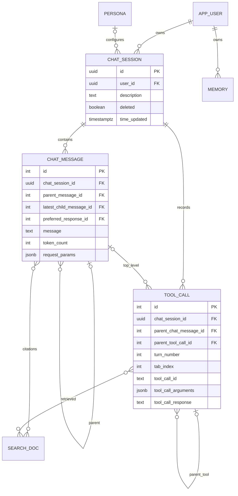
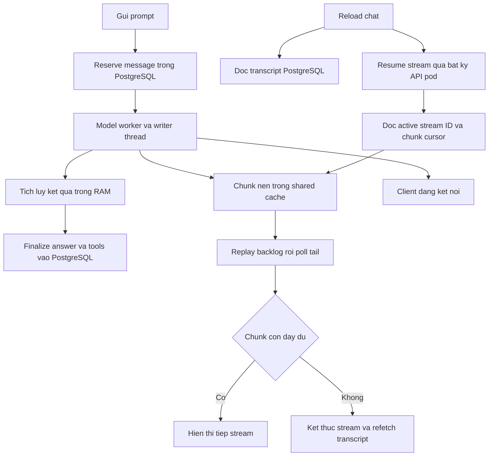

# Onyx — nghiên cứu database cho hệ thống chat agent

## 1. Phạm vi và snapshot

- Ngày đọc: **27/10/2026**.
- Repository: `/home/lamhung/code/onyx`.
- Commit: `03d0a7fcde658e6c27ce613b4b3cc7cf3da14b0b`; working tree sạch tại thời điểm khảo sát.
- Phương pháp: đọc ORM, migration, truy vấn và nơi ghi kết quả. Không kết nối database đang chạy, không chạy migration.
- Trọng tâm: chat thường và Build/Craft. Không liệt kê toàn bộ schema quản trị, connector hay enterprise.

**Kết luận chính:** Onyx tách dữ liệu hội thoại bền vững trong PostgreSQL khỏi bộ đệm phát lại stream trong shared cache. Message chat là một cây. Build/Craft dùng bộ bảng khác và lưu các packet đã tích lũy. Không nên gộp hai đường xử lý này thành một mô hình duy nhất.

## 2. Các lớp lưu trữ

| Lớp | Công nghệ và dữ liệu | Vai trò |
|---|---|---|
| Quan hệ bền vững | PostgreSQL, SQLAlchemy ORM | User, quyền, persona, session, message, tool, memory, file metadata |
| Migration | Alembic | Nâng schema; có luồng migration tenant |
| Cache chia sẻ | `CacheBackend`: Redis hoặc PostgreSQL | Processing fence, stop, stream chunk có TTL và state ngắn hạn |
| File | FileStore: S3 mặc định; GCS, Azure, PostgreSQL tùy cấu hình | Nội dung file tách khỏi message; PostgreSQL backend dùng Large Objects |
| Search index | OpenSearch | Chỉ mục tài liệu, chunk và tìm kiếm; không phải bản ghi gốc của transcript chat |

Nguồn: [ORM](/home/lamhung/code/onyx/backend/onyx/db/models.py:3298), [cache factory](/home/lamhung/code/onyx/backend/onyx/cache/factory.py:44), [FileStore selection](/home/lamhung/code/onyx/backend/onyx/file_store/file_store.py:904), [OpenSearch implementation](/home/lamhung/code/onyx/backend/onyx/document_index/opensearch/opensearch_document_index.py:1), [migration standards](/home/lamhung/code/onyx/backend/AGENTS.md:94).

### Tenant và ownership là hai lớp khác nhau

`get_session_with_tenant()` chọn engine theo tenant, rồi dùng `schema_translate_map={None: tenant_id}`. Vì vậy `chat_session` không cần mang `tenant_id` trên từng row trong mô hình này. Routing có thể chọn shard theo tenant; catalog database giữ mapping dùng chung. Không nên suy ra schema-per-tenant tự nó cung cấp row-level security.

Trong schema tenant, `ChatSession.user_id` xác định owner; `shared_status` điều khiển chia sẻ. `get_chat_session_by_id()` lọc owner hoặc session vô chủ; đường shared chỉ nhận session public chưa bị xóa. `user_id=None` có ý nghĩa đặc biệt trong helper nội bộ, nên authorization phải được bảo đảm tại caller. Không được đưa nguyên quy ước này thành endpoint công khai.

Nguồn: [tenant routing](/home/lamhung/code/onyx/backend/onyx/db/engine/sql_engine.py:518), [ownership lookup](/home/lamhung/code/onyx/backend/onyx/db/chat.py:60).

## 3. Schema chat thường

### Bảng chính

| Bảng | Khóa và liên kết | Dữ liệu đáng chú ý |
|---|---|---|
| `chat_session` | UUID PK; FK user, persona, user_project | `description` là tên chat; timestamps; deleted; sharing; model/prompt overrides; incognito policy |
| `chat_message` | Integer PK; FK session; self-FK parent/latest child/preferred response | Text, reasoning, token count, loại message, request params, files, citations, error, duration |
| `tool_call` | Integer PK; FK session; FK message hoặc parent tool | Provider tool-call ID, arguments JSONB, response text, thứ tự song song/tuần tự |
| `search_doc` | Integer PK; association với message/tool | Snapshot metadata kết quả retrieval để dựng lại giao diện citations |
| `chat_feedback` và feedback liên quan | Liên kết message | Phản hồi về câu trả lời và tài liệu |
| `memory` | Integer PK; FK user | Memory text và optional conversation/message provenance |

Nguồn: [session](/home/lamhung/code/onyx/backend/onyx/db/models.py:3298), [message](/home/lamhung/code/onyx/backend/onyx/db/models.py:3401), [tool call](/home/lamhung/code/onyx/backend/onyx/db/models.py:3543), [search doc](/home/lamhung/code/onyx/backend/onyx/db/models.py:3630), [memory](/home/lamhung/code/onyx/backend/onyx/db/models.py:547).

### ER rút gọn

Các quan hệ dưới đây biểu diễn liên kết nghiệp vụ. Không biểu diễn đầy đủ nullability và mọi cascade.



### Khóa, index và constraint đáng học

1. Sidebar có index `(user_id, onyxbot_flow, time_updated DESC)`. Nó bám đúng điều kiện lọc và sort của danh sách chat.
2. Message có index `chat_session_id` phục vụ đọc lịch sử, retention và xóa theo session. Không nên mặc định FK PostgreSQL tự tạo index.
3. `parent_message_id`, `latest_child_message_id`, `preferred_response_id` đều là FK về `chat_message`. FK kiểm tra tồn tại row; schema này **không tự chứng minh** parent nằm cùng session hoặc cây không có chu trình. Cần logic ứng dụng.
4. `tool_call.tool_id` cố ý không là FK: xóa định nghĩa tool không xóa lịch sử thực thi. `tool_call_id` giữ ID provider để ghép call/result đúng khi dựng lại context.
5. Tool nested dùng `parent_tool_call_id`. Cùng parent và `turn_number` là nhóm song song; `tab_index` định thứ tự hiển thị. Khác `turn_number` là tuần tự.
6. Các enum tại các model này dùng `native_enum=False`. Không đồng nghĩa mọi giá trị enum đều có CHECK ở database; phải xem DDL/Alembic thực tế trước khi áp dụng thiết kế tương tự.

Nguồn: [session indexes](/home/lamhung/code/onyx/backend/onyx/db/models.py:3300), [message indexes and pointers](/home/lamhung/code/onyx/backend/onyx/db/models.py:3411), [tool model](/home/lamhung/code/onyx/backend/onyx/db/models.py:3543).

## 4. Nhánh, regenerate và lịch sử đưa cho LLM

Onyx không lưu chat chỉ bằng một mảng message phẳng:

- Root là message rỗng. Root cho phép sửa câu hỏi đầu tiên mà vẫn giữ một parent chung.
- `parent_message_id` giữ cấu trúc cây và các phương án cũ.
- `latest_child_message_id` chọn đường đi hiện tại qua cây.
- Với multi-model, user message có `preferred_response_id` chọn assistant response để tiếp tục. Helper cập nhật cả latest-child để mainline khớp lựa chọn.
- `create_chat_history_chain()` tải các message của session rồi lần theo latest-child từ root. Có thể dừng tại một message cụ thể.
- Summary có `last_summarized_message_id`; không chỉ lưu một summary chung không biết thuộc nhánh nào.

Đây là mô hình **message tree với con trỏ chọn nhánh**, không có bảng `branch` độc lập trong các model chat vừa khảo sát. Con trỏ nằm trên dữ liệu dùng chung của session; không nên mặc định mỗi thiết bị có lựa chọn nhánh riêng.

Nguồn: [root creation](/home/lamhung/code/onyx/backend/onyx/db/chat.py:676), [reserve alternate messages](/home/lamhung/code/onyx/backend/onyx/db/chat.py:746), [preferred response validation](/home/lamhung/code/onyx/backend/onyx/db/chat.py:788), [history traversal](/home/lamhung/code/onyx/backend/onyx/db/chat.py:1219), [summary lookup](/home/lamhung/code/onyx/backend/onyx/db/chat.py:1282).

**Đánh giá cho dự án mình:** lưu parent và con trỏ nhánh giải quyết transcript UI. State LangGraph vẫn cần fork/checkpoint tương ứng; không thể chỉ đổi con trỏ UI rồi dùng nguyên state của nhánh cũ.

## 5. Ghi kết quả và replay khi reload

### Hai dạng dữ liệu riêng

**Transcript bền vững:** chat tạo/reserve message row trước khi trả lời. Khi model hoàn tất, lỗi hoặc người dùng Stop, completion handler ghi kết quả tương ứng. Handler mở một DB session ngắn, đọc lại assistant row hiện tại rồi gọi `save_chat_turn()`, tránh giữ transaction xuyên suốt thời gian sinh token. Tool calls, citations và answer được lưu để dựng lại lịch sử.

**Stream tạm:** `StreamBufferWriter` ghi chính các dòng outbound NDJSON vào shared cache. Dữ liệu được nén zlib, chia chunk có số thứ tự. Đây không phải bảng token PostgreSQL và cũng không phải Redis Streams/XADD. Bộ đệm flush khi pending đạt khoảng 32 KiB hoặc writer có idle tick.

Nguồn: [reserve placeholder](/home/lamhung/code/onyx/backend/onyx/db/chat.py:710), [outcome persistence](/home/lamhung/code/onyx/backend/onyx/chat/process_message.py:1224), [final DB session](/home/lamhung/code/onyx/backend/onyx/chat/process_message.py:2024), [save chat transaction](/home/lamhung/code/onyx/backend/onyx/chat/save_chat.py:169), [buffer implementation](/home/lamhung/code/onyx/backend/onyx/chat/stream_buffer.py:1).

### Khóa cache và retention

```text
chatstream_{session_id}_{stream_id}:{chunk_number} -> compressed bytes
chatstream_{session_id}_{stream_id}:meta           -> chunk_count, done, truncated
chatprocessing_fence_{session_id}                 -> active stream_id
```

Tenant isolation do cache backend đảm nhiệm. Defaults trong snapshot: active chunk TTL **3.600 giây**, completed TTL **600 giây**, giới hạn tổng compressed bytes **16 MiB**. Processing fence TTL **30 phút** và writer refresh khi chạy. Các giá trị này là cấu hình, không phải guarantee giữ stream vô hạn.

Nguồn: [cache key functions](/home/lamhung/code/onyx/backend/onyx/chat/stream_buffer.py:49), [TTL config](/home/lamhung/code/onyx/backend/onyx/configs/chat_configs.py:62), [processing state](/home/lamhung/code/onyx/backend/onyx/chat/chat_processing_checker.py:8), [writer refresh](/home/lamhung/code/onyx/backend/onyx/chat/process_message.py:1490).

### Luồng đọc lại



`GET /chat-session/{session_id}/resume-stream?cursor=0` kiểm tra quyền bằng DB session ngắn, rồi phát lại chunk và poll phần mới. Cursor là **chỉ số chunk**, không phải message ID hay sequence của từng token. Mỗi lần đọc tối đa 32 chunk để giới hạn bộ nhớ. Reader chỉ tin `done` khi đã drain hết backlog. Nếu thiếu chunk, meta hỏng, buffer hết hạn hoặc bị truncate, reader kết thúc để frontend refetch session.

Writer có thread riêng, tiếp tục drain sau khi reader trình duyệt rời đi. Writer đánh dấu buffer done trước khi bỏ processing fence, tránh reader kết thúc sớm mất đoạn cuối. Cơ chế này cho phép API pod khác phục vụ resume nếu shared cache còn nguyên.

Nguồn: [resume endpoint](/home/lamhung/code/onyx/backend/onyx/server/query_and_chat/chat_backend.py:1296), [fan-out and detached writer](/home/lamhung/code/onyx/backend/onyx/chat/process_message.py:1477), [finalization order](/home/lamhung/code/onyx/backend/onyx/chat/process_message.py:1583).

### Giới hạn cần hiểu đúng

- Đây là **replay backlog + live tail**. Không phải contract bắt buộc “một snapshot text mới nhất + đúng một watermark rồi tail”. Muốn giao diện như yêu cầu của mình cần reducer và quy tắc ghép với lịch sử.
- Cache lỗi thì run được phép tiếp tục nhưng trở thành không resumable. `truncated` báo downgrade rõ ràng.
- Browser đóng khác với pod chết: model/writer vẫn nằm trong process. Cache shared không tự biến execution thành durable worker queue hoặc tiếp tục model từ token cũ sau pod crash.
- Final persistence và stream buffer là hai nơi ghi khác nhau. Không có transaction nguyên tử PostgreSQL + Redis cho toàn bộ token stream trong đường code này.
- Nếu dùng cache PostgreSQL Lite, vẫn là dữ liệu tạm có TTL trong `cache_store`; không vì nằm trong PostgreSQL mà trở thành checkpoint hội thoại dài hạn.

Nguồn: [buffer downgrade and gap handling](/home/lamhung/code/onyx/backend/onyx/chat/stream_buffer.py:68), [PostgreSQL cache](/home/lamhung/code/onyx/backend/onyx/cache/postgres_backend.py:156).

## 6. Build/Craft là mô hình khác

| Bảng | Thiết kế |
|---|---|
| `build_session` | UUID, owner, tên, trạng thái, origin, model/provider, `opencode_session_id` tham chiếu runtime |
| `build_message` | UUID, session FK cascade, `turn_index`, loại, packet JSONB trong `message_metadata`, created time |
| `sandbox` | Một sandbox/user bằng unique user_id; provisioning attempt number ngăn attempt cũ ghi đè trạng thái mới |
| `artifact` | Unique `(session_id, path)`; cập nhật version và giữ tombstone khi file bị xóa |
| `snapshot` | Metadata snapshot output và storage path; không phải LangGraph checkpoint |
| `action_approval` | Pending khi decision NULL; decision, decided_at, decided_via; gated target FK SET NULL |
| `action_receipt` | Audit action pending/confirmed/failed/unknown; unique operation key khi khác NULL để coalesce |

Nguồn: [build session](/home/lamhung/code/onyx/backend/onyx/db/models.py:6653), [sandbox](/home/lamhung/code/onyx/backend/onyx/db/models.py:6743), [artifact](/home/lamhung/code/onyx/backend/onyx/db/models.py:6800), [receipt](/home/lamhung/code/onyx/backend/onyx/db/models.py:6863), [build message and approval](/home/lamhung/code/onyx/backend/onyx/db/models.py:6965).

`build_message` có index `(session_id, turn_index, created_at)`. Message/thought chunks được tích lũy trong RAM, flush khi chuyển loại event và khi stream kết thúc. Tool-start không ghi; phần lớn tool chỉ ghi lúc completed; plan update được upsert để giữ bản mới nhất. Vì vậy bảng này là transcript packet được chọn lọc, **không phải event log đầy đủ mọi delta**.

Nguồn: [flush pending chunks](/home/lamhung/code/onyx/backend/onyx/server/features/build/session/streaming.py:424), [event persistence policy](/home/lamhung/code/onyx/backend/onyx/server/features/build/session/streaming.py:654).

## 7. Memory, file, retrieval và deletion

- `memory` thuộc user; provenance conversation/message là cột optional nhưng không có FK tại model này. Đó là memory riêng của Onyx, không phải LangGraph Store.
- `file_record` giữ file ID, bucket/object key, type, metadata, size và timestamps. `file_content` cung cấp PostgreSQL Large Object backend khi cấu hình chọn PostgreSQL.
- `SearchDoc` lưu snapshot metadata của kết quả retrieval cho việc xem lại citations. Comment model nói rõ không lưu toàn bộ nội dung Document/Chunk; cần retrieval lại để lấy content đưa vào inference.
- `chat_session.deleted` hỗ trợ tombstone khi cấu hình không hard-delete. Đường xóa có helper dọn message/file và orphan search docs; không thể chỉ dựa vào cascade cho mọi loại dữ liệu.
- User deletion có FK cascade tới session/memory. Message có ORM delete-orphan; `tool_call` có DB cascade trên session/message/parent tool. Phải phân biệt cascade ORM với `ON DELETE` của database.
- Incognito policy được pin trên session. Không phải session nào cũng lưu nội dung; mode không giữ content dùng ephemeral state và tránh summary durable.

Nguồn: [memory model](/home/lamhung/code/onyx/backend/onyx/db/models.py:547), [file metadata](/home/lamhung/code/onyx/backend/onyx/db/models.py:5008), [SearchDoc caveat](/home/lamhung/code/onyx/backend/onyx/db/models.py:3631), [deletion helpers](/home/lamhung/code/onyx/backend/onyx/db/chat.py:223), [delete session](/home/lamhung/code/onyx/backend/onyx/db/chat.py:414), [incognito finalization](/home/lamhung/code/onyx/backend/onyx/chat/process_message.py:2035).

## 8. Cảnh báo về migration response mới

Snapshot có hai migration:

- [`chat_response_item`](/home/lamhung/code/onyx/backend/alembic/versions/7a03b6e90c12_add_chat_response_items.py:17): string PK; FK assistant message; `step_index >= 0`; unique `(chat_message_id, step_index)`; partial unique một answer/message; generation status và message/rendering JSONB.
- [`chat_response_checkpoint`](/home/lamhung/code/onyx/backend/alembic/versions/6b4e821c0a93_add_chat_response_checkpoints.py:17): PK/FK chat message; `ownership_version`; state JSONB.

**Mức xác nhận:** đọc được DDL migration. Tìm kiếm `chat_response_item` và `chat_response_checkpoint` trong `backend/onyx` không tìm thấy model hoặc runtime caller tại snapshot này. Vì vậy chưa thể khẳng định các bảng đang được production path dùng, hoặc đã cung cấp durable execution recovery. Không dùng tên migration làm bằng chứng tính năng đã hoàn chỉnh. Cũng chưa chạy Alembic để xác nhận database triển khai thực tế đã có các bảng này.

## 9. Bài học cho database của mình

| Có thể học | Áp dụng cùng thiết kế đã chốt |
|---|---|
| Session metadata tách transcript, tool và file | Application schema quản lý owner, title, sharing, transcript; native LangGraph tables giữ state/checkpoints |
| Cây message và con trỏ lựa chọn rõ ràng | Bổ sung identity nhánh và mapping tới native graph thread/checkpoint; kiểm tra cùng conversation |
| Tool-call IDs, thứ tự và kết quả được lưu | Giữ canonical tool IDs để render AG-UI và tái tạo model context |
| Cache transient khác transcript durable | Redis projection/event tail phải có retention, gap detection và đường restore từ PostgreSQL |
| Query index theo sidebar/history thực tế | Index theo tenant/owner/activity và conversation/branch/history; không sao chép tên index máy móc |
| DB session ngắn trong stream | Gateway SSE không giữ transaction hoặc connection PostgreSQL suốt stream |
| Receipt/approval là entity riêng | Giữ audit cùng policy, idempotency và trạng thái ambiguous khi external tool có side effect |

**Chưa thể lấy nguyên từ Onyx:** durable queue/run-attempt, fencing bảo vệ native LangGraph saver, atomic snapshot-watermark-tail và recovery sau worker crash. Các phần này vẫn phải thiết kế cho backend custom của mình. `LangGraphAgent` chỉ emit AG-UI; nó không tự thay thế application metadata, authorization, queue hay replay storage.

## 10. Giới hạn khảo sát

Tài liệu mô tả source tại commit nêu trên. Chưa đo query plan, contention, throughput, cache eviction hoặc retention trên dữ liệu production. ER chỉ là phần liên quan chat agent; không bao quát hàng trăm bảng nghiệp vụ của Onyx. Các nhận xét áp dụng cho dự án mình là đánh giá thiết kế, không phải cam kết chức năng của Onyx.
