# Open WebUI — toàn bộ database schema theo tài liệu chính thức

Ngày ghi: 2026-10-27. Nguồn: <https://docs.openwebui.com/reference/database-schema/>, lấy nguyên văn từ markdown gốc `open-webui/docs@main:docs/reference/database-schema.md`.

**Cảnh báo của chính trang nguồn:** đây là *community contribution*, không được team Open WebUI hỗ trợ chính thức, và nội dung phản ánh schema **tới phiên bản v0.12.0**. Vì vậy tài liệu này là bản dịch/hệ thống hóa trang đó, không phải kết quả đọc source hay dump database thật.

Bản khảo sát source tại checkout cục bộ (commit `33c1978d5bad52a31df75ea55143025dfad18d16`) nằm ở [open-webui.md](./open-webui.md). Khi hai tài liệu lệch nhau, ưu tiên bản đọc source cho chi tiết ORM/migration, còn tài liệu này cho **độ phủ toàn bộ bảng**.

---

## 1. Vị trí và cách truy cập database

Mặc định Open WebUI dùng SQLite làm xương sống cho user management, chat history, file storage và các chức năng lõi. File nằm tại `root` → `data` → `webui.db`:

```txt
📁 Root (/)
├── 📁 data
│   ├── 📁 cache
│   ├── 📁 uploads
│   ├── 📁 vector_db
│   └── 📄 webui.db
├── 📄 dev.sh
├── 📁 open_webui
├── 📄 requirements.txt
├── 📄 start.sh
└── 📄 start_windows.bat
```

Copy database từ container ra máy local:

```bash
docker cp open-webui:/app/backend/data/webui.db ./webui.db
```

Hoặc vào thẳng container:

```bash
docker exec -it open-webui /bin/sh
```

---

## 2. Danh sách toàn bộ bảng (47 bảng)

Đánh số theo trang nguồn.

| **No.** | **Bảng** | **Mô tả** |
| --- | --- | --- |
| 01 | `access_grant` | Lưu access control đã chuẩn hóa cho mọi resource |
| 02 | `auth` | Credential đăng nhập và thông tin xác thực |
| 03 | `calendar` | Lịch thuộc sở hữu user, có access control |
| 04 | `calendar_event` | Sự kiện lịch, hỗ trợ lặp theo RRULE |
| 05 | `calendar_event_attendee` | RSVP của người tham dự sự kiện được chia sẻ |
| 06 | `channel` | Channel chat và cấu hình |
| 07 | `channel_file` | Liên kết file với channel và message |
| 08 | `channel_member` | Thành viên và quyền trong channel |
| 09 | `chat` | Phiên chat và metadata |
| 10 | `chat_file` | Liên kết file với chat và message |
| 11 | `chatidtag` | **Legacy.** Mapping chat/tag trước khi có bảng `tag`; dữ liệu đã migrate sang `chat` |
| 12 | `config` | Cấu hình toàn hệ thống |
| 13 | `document` | **Legacy.** Bảng documents trước khi có Knowledge; dữ liệu đã migrate sang `knowledge` |
| 14 | `feedback` | Feedback và rating của user |
| 15 | `file` | File upload và metadata |
| 16 | `folder` | Tổ chức file/nội dung theo cây thư mục |
| 17 | `function` | Custom function và cấu hình |
| 18 | `group` | Group user và permission |
| 19 | `group_member` | Thành viên group |
| 20 | `knowledge` | Knowledge base |
| 21 | `knowledge_file` | Liên kết file với knowledge base |
| 22 | `memory` | Memory/ngữ cảnh lâu dài |
| 23 | `message` | Message của channel |
| 24 | `message_reaction` | Reaction (emoji) trên message |
| 25 | `migrate_history` | Theo dõi version schema và bản ghi migration |
| 26 | `model` | Cấu hình model AI |
| 27 | `note` | Note do user tạo |
| 28 | `oauth_session` | Session OAuth đang hoạt động |
| 29 | `prompt` | Template prompt |
| 30 | `prompt_history` | Version history/snapshot của prompt |
| 31 | `shared_chat` | Snapshot chat được chia sẻ qua link |
| 32 | `skill` | Bộ chỉ dẫn markdown tái sử dụng (Skills) |
| 33 | `tag` | Tag/nhãn phân loại nội dung |
| 34 | `tool` | Cấu hình tool và tích hợp |
| 35 | `user` | Hồ sơ và tài khoản user |
| 36 | `automation` | Automation theo lịch do user định nghĩa |
| 37 | `automation_run` | Lịch sử thực thi automation |
| 38 | `pinned_note` | Ghim note theo từng user (mỗi dòng = 1 user ghim 1 note) |
| 39 | `chat_message` | Store message đã normalize cho hội thoại chat |
| 40 | `api_key` | API key theo user, thay cột `user.api_key` cũ |
| 41 | `knowledge_directory` | Thư mục lồng nhau tổ chức file trong knowledge base |
| 42 | `channel_webhook` | Incoming webhook theo channel, post không cần đăng nhập |
| 43 | `model_history` | Version đã lưu của cấu hình workspace model |
| 44 | `tool_history` | Version đã lưu của source code và metadata tool |
| 45 | `function_history` | Version đã lưu của source code và metadata function |
| 46 | `skill_history` | Version đã lưu của skill, gồm file đi kèm |
| 47 | `app` | [Apps](https://docs.openwebui.com/features/channels/apps) đã cài và credential đã mã hóa |

**Hai bảng bị loại khỏi danh sách** vì không thuộc chức năng lõi: bảng Alembic version và Migrate History. (Lưu ý: trang nguồn tự mâu thuẫn ở đây — nó nói loại `migrate_history` nhưng vẫn liệt kê bảng này ở dòng 25.)

**Về bảng legacy `document`:** là bảng từ trước tính năng Knowledge. Dữ liệu đã được migrate vào `knowledge` (migration `6a39f3d8e55c`) và không còn gì ghi vào nó, nhưng **không migration nào drop bảng này**, nên database cũ vẫn có thể còn nó (rỗng). Code hiện tại không có model tương ứng.

---

## 3. Quyền, xác thực và người dùng

### 3.1. `access_grant`

| **Cột** | **Kiểu** | **Ràng buộc** | **Mô tả** |
| --- | --- | --- | --- |
| `id` | Integer | PRIMARY KEY, AUTOINCREMENT | Định danh |
| `resource_type` | Text | NOT NULL | Loại resource (`model`, `knowledge`, `tool`, …) |
| `resource_id` | Text | NOT NULL | ID của resource cụ thể |
| `principal_type` | Text | NOT NULL | Loại người được cấp: `user`, `group` hoặc `anyone` |
| `principal_id` | Text | NOT NULL | ID user/group (hoặc `*` cho public) |
| `permission` | Text | NOT NULL | Mức quyền: `read` hoặc `write` |
| `created_at` | BigInteger | nullable | Thời điểm tạo grant |

Cần biết:

- UNIQUE trên (`resource_type`, `resource_id`, `principal_type`, `principal_id`, `permission`) để chặn grant trùng.
- Index trên (`resource_type`, `resource_id`) và (`principal_type`, `principal_id`).
- Thay thế cột JSON `access_control` trước đây nhúng trong từng bảng resource.
- `principal_type = user` + `principal_id = *` nghĩa là public: **mọi user đã đăng nhập**, không tới được khách chưa đăng nhập.
- `principal_type = anyone` (thêm ở v0.11.0) là grant không cần đăng nhập, phục vụ open share link. Nó chỉ tồn tại ở đúng tổ hợp `anyone` / `*` / `read`; tổ hợp khác bị từ chối, và chỉ được chấp nhận cho `resource_type = shared_chat`. Mọi resource khác strip nó đi.
- Hỗ trợ cấp quyền cả ở mức group lẫn mức user.
- Grant ở mức group áp dụng cho cả thành viên của subgroup. Xóa group thì xóa luôn grant của nó.

### 3.2. `api_key`

Thêm ở v0.6.41 (migration `b10670c03dd5`), migration này đồng thời drop cột `api_key` khỏi bảng `user` sau khi copy mọi key hiện có sang đây.

| **Cột** | **Kiểu** | **Ràng buộc** | **Mô tả** |
| --- | --- | --- | --- |
| `id` | Text | PRIMARY KEY, UNIQUE | Định danh |
| `user_id` | Text | FOREIGN KEY(`user.id`) CASCADE | Chủ sở hữu key |
| `key` | Text | UNIQUE, NOT NULL | Chính API key |
| `data` | JSON | nullable | Payload mở rộng |
| `expires_at` | BigInteger | nullable | Thời điểm hết hạn |
| `last_used_at` | BigInteger | nullable | Lần dùng gần nhất |
| `created_at` | BigInteger | NOT NULL | Thời điểm tạo |
| `updated_at` | BigInteger | NOT NULL | Cập nhật lần cuối |

Cần biết:

- Xóa user cascade xóa key của họ.
- Sinh key sẽ xóa các dòng hiện có của tài khoản trước, nên **mỗi tài khoản nhiều nhất một key**. Dòng mang id cố định `key_{user_id}`.
- Sinh/lấy/xóa key đều qua `/api/v1/auths/api_key`. Cả ba bị từ chối nếu config `auth.enable_api_keys` tắt; user thường còn cần permission `features.api_keys`.
- `data`, `expires_at`, `last_used_at` **có trong schema nhưng không code path nào ghi**. Tra cứu key chỉ join trên `key` và không xét `expires_at`.

### 3.3. `auth`

| **Cột** | **Kiểu** | **Ràng buộc** | **Mô tả** |
| --- | --- | --- | --- |
| `id` | String | PRIMARY KEY | Định danh |
| `email` | String | - | Email |
| `password` | Text | - | Password đã hash |
| `active` | Boolean | - | Trạng thái tài khoản |
| `mfa` | JSON | nullable | Trạng thái 2FA: secret authenticator đã mã hóa, recovery code đã hash, bước đăng nhập đang chờ, bộ đếm số lần thử |
| `session_stamp` | Text | nullable | Dấu mang theo mọi session token; thay nó là đăng xuất khỏi mọi thiết bị |

Cần biết:

- PK dạng UUID. Quan hệ **1-1 với `user`** (dùng chung id).
- `mfa` và `session_stamp` do migration `a7d3e9f2b641` thêm. Dòng có từ trước bắt đầu với cả hai rỗng, và session cấp trước khi nâng cấp vẫn hợp lệ cho tới lần đăng xuất-toàn-bộ đầu tiên.
- Migration `0bd252b206fb` (v0.12.1) thêm một dòng cho mọi user chưa có, với `password` rỗng không bao giờ khớp. Trước v0.12.1, SCIM là con đường duy nhất tạo tài khoản mà không có dòng `auth`. Migration này chỉ đổi dữ liệu, và downgrade của nó giữ nguyên các dòng đã thêm.

### 3.4. `user`

| **Cột** | **Kiểu** | **Ràng buộc** | **Mô tả** |
| --- | --- | --- | --- |
| `id` | String | PRIMARY KEY | Định danh |
| `username` | String(50) | nullable | Handle |
| `name` | String | NOT NULL | Tên |
| `email` | String | - | Email |
| `role` | String | default `'pending'` | Vai trò |
| `profile_image_url` | Text | - | Ảnh đại diện |
| `profile_banner_image_url` | Text | nullable | Ảnh banner |
| `bio` | Text | nullable | Tiểu sử |
| `gender` | Text | nullable | Giới tính |
| `date_of_birth` | Date | nullable | Ngày sinh |
| `timezone` | String | nullable | Tên timezone IANA |
| `presence_state` | String | nullable | Trạng thái hiện diện |
| `status_emoji` | String | nullable | Emoji kèm status |
| `status_message` | Text | nullable | Text status |
| `status_expires_at` | BigInteger | nullable | Hạn của status |
| `last_active_at` | BigInteger | - | Hoạt động gần nhất |
| `updated_at` | BigInteger | - | Cập nhật lần cuối |
| `created_at` | BigInteger | - | Thời điểm tạo |
| `settings` | JSON | nullable | Tùy chọn người dùng |
| `info` | JSON | nullable | Thông tin bổ sung |
| `variables` | JSON | nullable | User variables thay vào system prompt |
| `oauth` | JSON | nullable | Subject của IdP, key theo provider |
| `scim` | JSON | nullable | Dữ liệu provisioning SCIM |

Cần biết:

- PK dạng UUID. 1-1 với `auth` (chung id); 1-n với `oauth_session` (qua `user_id`), mỗi lần đăng nhập một dòng.
- `email` unique **không phân biệt hoa thường**, cưỡng chế bằng partial unique index `uq_user_email_lower` trên `lower(email)` với điều kiện `email` không null (migration `f0bd01a18a3d`). Nâng cấp lên database đã có hai tài khoản chỉ khác hoa thường sẽ **dừng lại và nêu tên chúng** thay vì tự chọn.
- Cột `email` **không có** ràng buộc `UNIQUE` thường trong database. Model SQLAlchemy khai báo `unique=True`, nhưng schema chỉ được dựng từ migration và không migration nào tạo constraint đó — index ở trên là toàn bộ sự cưỡng chế.
- `variables` thêm ở v0.11.0 (migration `b0018471bbbe`): map phẳng string→string, thay vào system prompt lúc request. Bị loại khỏi response API user, đọc qua endpoint riêng.
- `oauth` thay cột text `oauth_sub` ở v0.6.41 (migration `b10670c03dd5`), nên một tài khoản giữ được subject của nhiều IdP cùng lúc, dạng `{"<provider>": {"sub": "<subject>"}}`. Database còn cũ hơn v0.6.41 khi nâng cấp trên bản build v0.9.6+ bị ghi giá trị này dạng text thay vì object, khóa tài khoản không đăng nhập được; migration `6d09d1bf1f23` viết lại các dòng đó lúc startup và không đụng dòng khác.
- Cột `api_key` bị xóa ở v0.6.41 (cùng migration `b10670c03dd5`); key chuyển sang bảng `api_key`, migration copy từng key trước khi drop cột.
- `profile_banner_image_url`, `timezone`, `presence_state`, `status_emoji`, `status_message`, `status_expires_at` đều thêm ở v0.6.41 (`b10670c03dd5`).
- `timezone` giữ tên zone IANA (ví dụ `Europe/Vienna`), ghi bởi `POST /api/v1/auths/update/timezone`. Expansion lặp của calendar, lập lịch automation và thống kê sử dụng theo user đều đọc nó. Giá trị trống/không nhận dạng được thì fallback về zone của server cho calendar và automation, và về UTC cho thống kê.
- `status_*` ghi qua `POST /api/v1/users/user/status/update`, bị từ chối nếu config `users.enable_status` tắt; được trả về cùng response đăng nhập và trong danh sách thành viên channel.
- `presence_state` được trả về trong danh sách thành viên channel và payload socket session, nhưng **không code path nào ghi nó**.

Cấu trúc kỳ vọng của `scim`:

```python
{
    "<provider>": {
        "external_id": string,  # externalId từ identity provider
    },
    # Có thể lưu nhiều provider cùng lúc
    # Ví dụ:
    # "microsoft": { "external_id": "abc-123" },
    # "okta": { "external_id": "def-456" }
}
```

Lý do có cột này: liên kết tài khoản SCIM theo `externalId` thay vì chỉ dựa vào email; hỗ trợ nhiều provider cùng lúc; và khi tra theo `externalId` mà không thấy entry `scim` thì fallback đối chiếu với subject trong `oauth` của cùng provider, để nối được tài khoản SCIM-provisioned với tài khoản OAuth.

### 3.5. `group`

| **Cột** | **Kiểu** | **Ràng buộc** | **Mô tả** |
| --- | --- | --- | --- |
| `id` | Text | PRIMARY KEY, UNIQUE | Định danh (UUID) |
| `parent_group_id` | Text | FOREIGN KEY(`group.id`), nullable, indexed | Group cha cho nested group; `NULL` là group cấp cao nhất |
| `user_id` | Text | - | Người tạo/sở hữu group |
| `name` | Text | - | Tên group |
| `description` | Text | - | Mô tả |
| `data` | JSON | nullable | Dữ liệu bổ sung |
| `meta` | JSON | nullable | Metadata |
| `permissions` | JSON | nullable | Cấu hình permission |
| `created_at` | BigInteger | - | Thời điểm tạo |
| `updated_at` | BigInteger | - | Cập nhật lần cuối |

Cột `user_ids` cũ đã được migrate sang bảng `group_member`.

Cần biết:

- `parent_group_id` thêm ở migration `b8e4f0a3c752`. Thành viên một group **kế thừa permission và access grant của mọi group phía trên**.
- Xóa một group sẽ đẩy subgroup của nó lên group cha, đồng thời xóa membership và access grant của nó.
- `data.config.default_models` giữ danh sách model ID mặc định của group; `data.config.share` giữ thiết lập "ai được share vào group này".

### 3.6. `group_member`

| **Cột** | **Kiểu** | **Ràng buộc** | **Mô tả** |
| --- | --- | --- | --- |
| `id` | Text | PRIMARY KEY, UNIQUE | Định danh (UUID) |
| `group_id` | Text | FOREIGN KEY(`group.id`), NOT NULL | Group |
| `user_id` | Text | FOREIGN KEY(`user.id`), NOT NULL, indexed | User |
| `created_at` | BigInteger | nullable | Thời điểm tạo |
| `updated_at` | BigInteger | nullable | Cập nhật lần cuối |

Cần biết:

- UNIQUE (`group_id`, `user_id`) chặn membership trùng, đồng thời phục vụ truy vấn xuất phát từ group.
- Index (`user_id`, `group_id`) cho truy vấn "user này thuộc group nào" (migration `1ce6ade7d93b`). Unique constraint dẫn đầu bằng `group_id` nên không trả lời được câu hỏi đó; thiếu index này thì **mọi** kiểm tra permission/access phải quét toàn bảng membership, chi phí tăng theo tổng số membership của cả instance chứ không theo số membership của riêng user.
- FK CASCADE delete tới cả `group` và `user`.

### 3.7. `oauth_session`

| **Cột** | **Kiểu** | **Ràng buộc** | **Mô tả** |
| --- | --- | --- | --- |
| `id` | Text | PRIMARY KEY, UNIQUE | Định danh session |
| `user_id` | Text | FOREIGN KEY(`user.id`) CASCADE, NOT NULL | User |
| `provider` | Text | NOT NULL | Provider OAuth (ví dụ `google`) |
| `token` | Text | NOT NULL | Token set đã mã hóa |
| `expires_at` | BigInteger | NOT NULL | Hạn token |
| `created_at` | BigInteger | NOT NULL | Thời điểm tạo |
| `updated_at` | BigInteger | NOT NULL | Cập nhật lần cuối |

Cần biết:

- Quan hệ với `user` là **1-n**: mỗi lần đăng nhập insert một dòng, nên một user + một provider có thể có nhiều dòng. `OAUTH_MAX_SESSIONS_PER_USER` (mặc định 10) giới hạn số dòng mỗi user mỗi provider; lúc đăng nhập, các dòng cũ vượt hạn mức bị xóa.
- Index trên `user_id`, trên `expires_at` và trên (`user_id`, `provider`) — `idx_oauth_session_user_id`, `idx_oauth_session_expires_at`, `idx_oauth_session_user_provider`, tất cả từ migration `38d63c18f30f`.
- Xóa user cascade xóa session.
- `token` chứa token set của provider (access token, ID token, refresh token) dạng JSON, **mã hóa at rest bằng Fernet** trước khi ghi và giải mã khi đọc. Key lấy từ `OAUTH_SESSION_TOKEN_ENCRYPTION_KEY`, fallback về `WEBUI_SECRET_KEY`. Key chưa đủ 44 ký tự sẽ được hash SHA-256 rồi base64 cho đúng độ dài Fernet yêu cầu.

---

## 4. Chat

### 4.1. `chat`

| **Cột** | **Kiểu** | **Ràng buộc** | **Mô tả** |
| --- | --- | --- | --- |
| `id` | String | PRIMARY KEY | Định danh (UUID) |
| `user_id` | String | - | Chủ sở hữu chat |
| `title` | Text | - | Tiêu đề |
| `chat` | JSON | - | Nội dung và history của chat |
| `created_at` | BigInteger | - | Thời điểm tạo |
| `updated_at` | BigInteger | - | Cập nhật lần cuối |
| `share_id` | Text | UNIQUE, nullable | Định danh chia sẻ |
| `archived` | Boolean | default `False` | Trạng thái lưu trữ |
| `pinned` | Boolean | default `False`, nullable | Trạng thái ghim |
| `meta` | JSON | server_default `"{}"` | Metadata, gồm tags |
| `folder_id` | Text | nullable | Folder chứa chat |
| `tasks` | JSON | nullable | Danh sách task/todo cấp chat cho agentic workflow |
| `summary` | Text | nullable | Tóm tắt chat (tùy chọn) |
| `last_read_at` | BigInteger | nullable | Mốc đã đọc, phục vụ chỉ báo chưa đọc |
| `current_message_id` | Text | nullable | Message hiện tại (leaf của nhánh đang hoạt động) |
| `variables` | JSON | nullable | Giá trị user điền cho chat variables của model |

Cần biết:

- `tasks` và `summary` phục vụ UX lập kế hoạch/trạng thái có cấu trúc trong phiên chat.
- `last_read_at` được logic unread của sidebar dùng (so với `updated_at`).
- `share_id` trỏ tới token `shared_chat.id` khi chat đang có link chia sẻ.
- `current_message_id` thêm ở v0.11.0 (migration `9a1b2c3d4e5f`). Nó ghi message hiện tại — **leaf của nhánh đang hoạt động** mà reply mới sẽ nối tiếp — và được backfill từ history sẵn có khi chạy migration. Việc nén context và tính context-usage đọc nó để làm việc trên đúng nhánh đang dùng thay vì toàn bộ cây message.
- `variables` thêm ở v0.11.0 (migration `c49178636c78`): map phẳng theo tên biến, giữ giá trị user điền cho chat variables mà system prompt của model khai báo. Được copy theo khi **chủ sở hữu** fork/clone chat; bản copy do người khác tạo bắt đầu với map rỗng. Chat tạm thời chỉ giữ giá trị trong request, không lưu gì.
- Migration `242a2047eae0` thêm cột **`old_chat`** (Text) backup blob JSON `chat` gốc dạng text. Đây là lưới an toàn của migration, không thuộc model đang dùng và không được đọc lúc runtime.

### 4.2. `chat_message`

Đây là **store per-message đã normalize** cho hội thoại chat: mỗi message một dòng, tách khỏi blob JSON history trong `chat.chat`, và khác với bảng `message` của channel (bảng kia giữ message channel/thread, không phải lượt chat với model).

| **Cột** | **Kiểu** | **Ràng buộc** | **Mô tả** |
| --- | --- | --- | --- |
| `id` | Text | PRIMARY KEY | Định danh (UUID) |
| `chat_id` | Text | FOREIGN KEY(`chat.id`) CASCADE, NOT NULL | Chat cha |
| `user_id` | Text | indexed | Tác giả message |
| `role` | Text | NOT NULL | Vai trò: `user`, `assistant`, `system` |
| `parent_id` | Text | nullable | Message cha (cho hội thoại phân nhánh) |
| `content` | JSON | nullable | Nội dung (string hoặc danh sách content block) |
| `output` | JSON | nullable | Payload output được sinh ra |
| `model_id` | Text | nullable, indexed | Model tạo ra message |
| `files` | JSON | nullable | File đính kèm |
| `sources` | JSON | nullable | Nguồn truy xuất/trích dẫn |
| `embeds` | JSON | nullable | Artifact nhúng |
| `meta` | JSON | nullable | Metadata; đánh dấu message nội bộ của sub-agent và timer (thêm ở v0.11.0) |
| `done` | Boolean | default `True` | Đã sinh xong hay chưa |
| `status_history` | JSON | nullable | Cập nhật trạng thái stream trong lúc sinh |
| `error` | JSON | nullable | Payload lỗi khi sinh thất bại |
| `usage` | JSON | nullable | Thống kê token/usage |
| `context_summary` | Text | nullable | Tóm tắt context của message (thêm ở v0.10.0) |
| `created_at` | BigInteger | indexed | Thời điểm tạo |
| `updated_at` | BigInteger | - | Cập nhật lần cuối |

Cần biết:

- Xóa chat cascade xóa message (`chat_id` FK `ON DELETE CASCADE`).
- Composite index phục vụ các pattern truy cập chính: (`chat_id`, `parent_id`), (`model_id`, `created_at`), (`user_id`, `created_at`).
- `context_summary` thêm ở v0.10.0 (migration `4c5ce3d2f27f`).
- `meta` thêm ở v0.11.0 (migration `856c5b02fb54`). Nó mang metadata per-message và là thứ đánh dấu các message Open WebUI chèn thay mặt user — ví dụ kết quả sub-agent hay timer đã kích hoạt — để giao diện render khác với message do user gõ.
- **Chat search đọc tập store khác nhau tùy backend.** Trên PostgreSQL, nó match `chat_message.content` *cùng với* map `history.messages` và mảng phẳng `messages` cũ bên trong blob `chat.chat`. Trên SQLite, nó chỉ match hai vị trí JSON đó.

### 4.3. `shared_chat`

| **Cột** | **Kiểu** | **Ràng buộc** | **Mô tả** |
| --- | --- | --- | --- |
| `id` | Text | PRIMARY KEY | Share token (UUID) dùng trong URL `/s/{id}` |
| `chat_id` | Text | FOREIGN KEY(`chat.id`) CASCADE, NOT NULL | Chat gốc |
| `user_id` | Text | NOT NULL | Người tạo share |
| `title` | Text | nullable | Tiêu đề chat tại thời điểm share |
| `chat` | JSON | nullable | Snapshot nội dung chat tại thời điểm share |
| `created_at` | BigInteger | nullable | Thời điểm tạo share |
| `updated_at` | BigInteger | nullable | Lần re-snapshot gần nhất |

Cần biết:

- Thay cho cách cũ là lưu snapshot chat chia sẻ thành dòng "ma" trong bảng `chat` với `user_id = shared-{chat_id}`.
- Mỗi dòng là snapshot bất biến của chat gốc tại thời điểm share (hoặc lần re-share gần nhất). Snapshot được cập nhật khi user bấm "Update and Copy Link".
- Xóa chat gốc cascade xóa snapshot.
- Access control cho shared chat nằm ở `access_grant` với `resource_type = 'shared_chat'`.

### 4.4. `chat_file`

| **Cột** | **Kiểu** | **Ràng buộc** | **Mô tả** |
| --- | --- | --- | --- |
| `id` | Text | PRIMARY KEY | Định danh (UUID) |
| `user_id` | Text | NOT NULL | User liên quan tới file |
| `chat_id` | Text | FOREIGN KEY(`chat.id`), NOT NULL | Chat |
| `file_id` | Text | FOREIGN KEY(`file.id`), NOT NULL | File |
| `message_id` | Text | nullable | Message liên quan |
| `created_at` | BigInteger | NOT NULL | Thời điểm tạo |
| `updated_at` | BigInteger | NOT NULL | Cập nhật lần cuối |

Cần biết:

- UNIQUE (`chat_id`, `file_id`) chặn trùng.
- FK có CASCADE delete.
- Index trên `chat_id`, `file_id`, `message_id`, `user_id`.

**Vì sao bảng này được thêm:**

- **Hiệu năng truy vấn:** trước đó file nhúng trong object message. Bảng này cho phép tra cứu có index trực tiếp để tìm mọi file trong một chat mà không phải duyệt từng message.
- **Nhất quán dữ liệu:** là single source of truth cho liên kết file. Trong triển khai nhiều node, mọi node truy vấn bảng này thay vì dựa vào dữ liệu nhúng có thể không đồng bộ.
- **Chống trùng:** unique constraint ở mức database đáng tin hơn kiểm tra ở tầng ứng dụng.

### 4.5. `folder`

| **Cột** | **Kiểu** | **Ràng buộc** | **Mô tả** |
| --- | --- | --- | --- |
| `id` | Text | PK (composite) | Định danh (UUID) |
| `parent_id` | Text | nullable | Folder cha |
| `user_id` | Text | PK (composite) | Chủ sở hữu |
| `name` | Text | - | Tên folder |
| `items` | JSON | nullable | Nội dung folder |
| `data` | JSON | nullable | Dữ liệu bổ sung |
| `meta` | JSON | nullable | Metadata |
| `is_expanded` | Boolean | default `False` | Trạng thái mở rộng trên UI |
| `created_at` | BigInteger | - | Thời điểm tạo |
| `updated_at` | BigInteger | - | Cập nhật lần cuối |

Cần biết: PK là composite (`id`, `user_id`); folder lồng nhau qua `parent_id`; folder gốc có `parent_id` null; tên folder phải duy nhất trong cùng một folder cha.

### 4.6. `tag`

| **Cột** | **Kiểu** | **Ràng buộc** | **Mô tả** |
| --- | --- | --- | --- |
| `id` | String | PK (composite) | Định danh tag đã chuẩn hóa |
| `name` | String | - | Tên hiển thị |
| `user_id` | String | PK (composite) | Chủ sở hữu tag |
| `meta` | JSON | nullable | Metadata |

PK là composite (`id`, `user_id`).

### 4.7. `chatidtag` (legacy)

| **Cột** | **Kiểu** | **Ràng buộc** | **Mô tả** |
| --- | --- | --- | --- |
| `id` | String | PRIMARY KEY | Định danh |
| `tag_name` | String | nullable | Tên tag |
| `chat_id` | String | nullable | Chat |
| `user_id` | String | nullable | User |
| `timestamp` | BigInteger | nullable | Thời điểm tạo |

Bảng **legacy** từ trước khi tag chat chuyển vào bản ghi chat. Migration `1af9b942657b` đọc các dòng ra và ghi vào bảng `chat`: mỗi tag vào `chat.meta.tags`, riêng tag `pinned` chuyển thành `chat.pinned`. Không còn gì ghi vào nó. Migration đó **để nguyên các dòng** và không migration nào drop bảng, nên database cũ vẫn có thể còn dữ liệu cũ ở đây. Code hiện tại không có model. Tag chat giờ nằm ở bảng `tag`.

### 4.8. `feedback`

| **Cột** | **Kiểu** | **Ràng buộc** | **Mô tả** |
| --- | --- | --- | --- |
| `id` | Text | PRIMARY KEY | Định danh (UUID) |
| `user_id` | Text | - | Người gửi feedback |
| `version` | BigInteger | default `0` | Số version của feedback |
| `type` | Text | - | Loại feedback |
| `data` | JSON | nullable | Dữ liệu feedback gồm rating |
| `meta` | JSON | nullable | Metadata (arena, chat_id, …) |
| `snapshot` | JSON | nullable | Snapshot chat liên quan |
| `created_at` | BigInteger | - | Thời điểm tạo |
| `updated_at` | BigInteger | - | Cập nhật lần cuối |

### 4.9. `memory`

| **Cột** | **Kiểu** | **Ràng buộc** | **Mô tả** |
| --- | --- | --- | --- |
| `id` | String | PRIMARY KEY | Định danh (UUID) |
| `user_id` | String | indexed | Chủ sở hữu memory |
| `type` | String | default `context`, indexed | Loại: `user` hoặc `context` (thêm ở v0.10.0) |
| `path` | Text | nullable | Path tùy chọn để tổ chức memory theo cây (thêm ở v0.10.0) |
| `content` | Text | - | Nội dung memory |
| `meta` | JSON | nullable | Metadata tùy chọn (thêm ở v0.10.0) |
| `created_at` | BigInteger | - | Thời điểm tạo |
| `updated_at` | BigInteger | - | Cập nhật lần cuối |

Cần biết:

- `type` phân biệt memory `user` (sự kiện do user tự khai, tự quản) với `context` (học từ hội thoại); có index cho tra cứu theo loại. Thêm ở migration `7b3f2a9c1d4e` (có một migration sửa index đi kèm sau đó).
- `path` và `meta` (thêm ở migration v0.10.0 sau đó) phục vụ bộ builtin memory tool mở rộng, cho phép model tổ chức memory theo path và gắn metadata có cấu trúc.
- Covering index trên (`id`, `user_id`) thêm ở v0.11.0 (migration `55f1302ac17c`) để tăng tốc tra cứu memory theo user.

---

## 5. Channel, message và app

### 5.1. `channel`

| **Cột** | **Kiểu** | **Ràng buộc** | **Mô tả** |
| --- | --- | --- | --- |
| `id` | Text | PRIMARY KEY | Định danh (UUID) |
| `user_id` | Text | - | Người tạo/sở hữu channel |
| `type` | Text | nullable | Loại channel |
| `name` | Text | - | Tên channel |
| `description` | Text | nullable | Mô tả |
| `is_private` | Boolean | nullable | Cờ riêng tư cho channel loại `group` |
| `data` | JSON | nullable | Lưu trữ linh hoạt |
| `meta` | JSON | nullable | Metadata |
| `created_at` | BigInteger | - | Thời điểm tạo (nanosecond) |
| `updated_at` | BigInteger | - | Cập nhật lần cuối (nanosecond) |
| `updated_by` | Text | nullable | Người sửa gần nhất |
| `archived_at` | BigInteger | nullable | Thời điểm lưu trữ (nanosecond) |
| `archived_by` | Text | nullable | Người lưu trữ |
| `deleted_at` | BigInteger | nullable | Thời điểm xóa (nanosecond) |
| `deleted_by` | Text | nullable | Người xóa |

Cần biết:

- PK dạng UUID; tên channel không phân biệt hoa thường (lưu chữ thường).
- `type` thêm ở migration `3781e22d8b01`. `is_private`, `updated_by`, `archived_at`, `archived_by`, `deleted_at`, `deleted_by` thêm ở `90ef40d4714e`.
- Truy vấn liệt kê channel và thành viên chỉ trả dòng có cả `archived_at` và `deleted_at` null, nên schema được định hình cho archive và soft delete.
- Nhưng **không code path nào ghi** `archived_at`, `archived_by`, `deleted_at`, `deleted_by`, `updated_by`. Xóa channel là xóa hẳn dòng, nên channel đã xóa không để lại gì cho filter `deleted_at` loại trừ. Ai truy vấn trực tiếp bảng này sẽ thấy năm cột đó null ở mọi dòng.
- Cột `access_control` mà bảng này được tạo cùng đã bị drop ở migration `f1e2d3c4b5a6`. Quyền truy cập channel quản lý qua `access_grant` với `resource_type = 'channel'`.

### 5.2. `channel_member`

| **Cột** | **Kiểu** | **Ràng buộc** | **Mô tả** |
| --- | --- | --- | --- |
| `id` | Text | PRIMARY KEY, UNIQUE | Định danh membership |
| `channel_id` | Text | NOT NULL | Channel |
| `user_id` | Text | nullable | User |
| `app_id` | Text | nullable | App, cho membership kiểu app |
| `role` | Text | nullable | Vai trò trong channel |
| `status` | Text | nullable | Trạng thái: `joined` hoặc `left` |
| `is_active` | Boolean | NOT NULL, server_default `true` | Membership còn hiệu lực |
| `is_channel_muted` | Boolean | NOT NULL, server_default `false` | Cờ mute theo thành viên |
| `is_channel_pinned` | Boolean | NOT NULL, server_default `false` | Cờ ghim theo thành viên |
| `data` | JSON | nullable | Payload mở rộng |
| `meta` | JSON | nullable | Metadata |
| `invited_at` | BigInteger | nullable | Thời điểm mời (nanosecond) |
| `invited_by` | Text | nullable | Người thêm thành viên này |
| `joined_at` | BigInteger | NOT NULL | Thời điểm tham gia (nanosecond) |
| `left_at` | BigInteger | nullable | Thời điểm rời (nanosecond) |
| `last_read_at` | BigInteger | nullable | Mốc đã đọc, điều khiển trạng thái chưa đọc |
| `created_at` | BigInteger | - | Thời điểm tạo membership |
| `updated_at` | BigInteger | nullable | Cập nhật lần cuối (nanosecond) |

Cần biết:

- `role`, `invited_at`, `invited_by` thêm ở migration `90ef40d4714e`. `status`, `is_active`, `is_channel_muted`, `is_channel_pinned`, `data`, `meta`, `joined_at`, `left_at`, `last_read_at`, `updated_at` thêm ở `2f1211949ecc`.
- `status` ghi `joined` khi tạo membership. Rời channel ghi `left`, đặt `is_active` false và đóng dấu `left_at`. **Dòng vẫn còn.**
- `is_active` mới là cờ mà danh sách channel và danh sách thành viên lọc theo, nên membership đã rời biến khỏi kết quả nhưng vẫn nằm trong bảng. Nó cũng được ghi bởi `POST /api/v1/channels/{id}/members/active`.
- `last_read_at` được đóng dấu khi tạo membership và cập nhật qua kết nối socket khi user đọc channel.
- `role` chỉ được đọc ở đúng một chỗ, để kiểm tra thành viên có phải `manager` không. **Không gì ghi giá trị `manager`**: membership của user để `role` null, membership của app ghi `member`, nên phép kiểm tra đó không bao giờ khớp. Các hành động chỉ-manager, như xem và tạo channel webhook, rơi xuống hai nhánh còn lại của phép kiểm tra: `user_id` của chính channel, hoặc admin của instance.
- `is_channel_muted` là thiết lập **Mentions only** của thành viên, ghi bởi `POST /api/v1/channels/{id}/members/mute`. Mute một channel thường mà thành viên chưa từng mở sẽ tạo dòng membership cho họ. Khi cờ này bật, webhook thông báo channel chỉ tới thành viên với message có mention họ. `is_channel_pinned` có setter trên model, `Channels.pin_channel`, nhưng **không ai gọi**.
- `joined_at` là NOT NULL trong database (migration `2f1211949ecc`) trong khi model SQLAlchemy bỏ cờ này. **Ràng buộc database mới là cái có hiệu lực.**
- Gỡ app khỏi channel, hoặc gỡ cài app, sẽ đặt `is_active` false và đóng dấu `left_at`; `status` vẫn là `joined`. Thêm app lại sẽ kích hoạt lại chính dòng đó.
- Migration `c92da83b017f` làm `user_id` nullable và thêm `app_id`. Một CHECK constraint bắt buộc **đúng một trong hai** có giá trị ở mọi dòng, và (`channel_id`, `app_id`) là unique.
- Xóa tài khoản user **để lại** dòng `channel_member` của họ. Danh sách thành viên, bộ đếm thành viên của channel, và truy vấn tìm direct message hiện có cho một nhóm người đều bỏ qua dòng có `user_id` không còn khớp tài khoản nào, nên dòng sót lại không bị tính là thành viên và không đẩy direct message thành cuộc hội thoại thứ hai.

### 5.3. `channel_webhook`

Incoming webhook post message vào một channel mà không cần user đăng nhập. Thêm bởi migration `90ef40d4714e`.

| **Cột** | **Kiểu** | **Ràng buộc** | **Mô tả** |
| --- | --- | --- | --- |
| `id` | Text | PRIMARY KEY, UNIQUE | Định danh (UUID) |
| `channel_id` | Text | FOREIGN KEY(`channel.id`) CASCADE, NOT NULL | Channel mà webhook post vào |
| `user_id` | Text | NOT NULL | Người tạo webhook |
| `name` | Text | NOT NULL | Tên hiển thị trên message của nó |
| `profile_image_url` | Text | nullable | Avatar trên message của nó |
| `token` | Text | NOT NULL | Secret để ủy quyền post |
| `last_used_at` | BigInteger | nullable | Thời điểm post gần nhất |
| `created_at` | BigInteger | NOT NULL | Thời điểm tạo |
| `updated_at` | BigInteger | NOT NULL | Cập nhật lần cuối |

Cần biết:

- Xóa channel cascade xóa webhook của nó.
- `token` là token URL-safe mang 32 byte entropy, sinh bằng `secrets.token_urlsafe(32)`, **lưu plaintext** và mang trong path của request. `POST /api/v1/channels/webhooks/{webhook_id}/{token}` **không cần xác thực** và chỉ đối chiếu cặp `id` + `token` với bảng này, nên ai giữ cặp đó đều post được vào channel.
- `last_used_at` được đóng dấu mỗi lần post được chấp nhận.
- Liệt kê và tạo webhook đòi hỏi caller là admin instance hoặc chính người tạo channel. Xem ghi chú về `role` ở `channel_member` để hiểu vì sao nhánh "manager theo membership" của phép kiểm tra đó không bao giờ khớp.
- `id` và `name` của webhook được copy vào `meta.webhook` của message đã post; đó là thứ giao diện render thay cho tài khoản tác giả.

### 5.4. `channel_file`

| **Cột** | **Kiểu** | **Ràng buộc** | **Mô tả** |
| --- | --- | --- | --- |
| `id` | Text | PRIMARY KEY | Định danh (UUID) |
| `user_id` | Text | NOT NULL | Chủ sở hữu quan hệ |
| `channel_id` | Text | FOREIGN KEY(`channel.id`) CASCADE, NOT NULL | Channel |
| `file_id` | Text | FOREIGN KEY(`file.id`) CASCADE, NOT NULL | File |
| `message_id` | Text | FOREIGN KEY(`message.id`) CASCADE, nullable | Message liên quan |
| `created_at` | BigInteger | NOT NULL | Thời điểm tạo |
| `updated_at` | BigInteger | NOT NULL | Cập nhật lần cuối |

Cần biết:

- UNIQUE (`channel_id`, `file_id`) chặn trùng.
- **Cả ba** FK đều cascade on delete, kể cả `message_id`, nên xóa message mà file được đính kèm cũng xóa dòng ở đây, không chỉ xóa channel hay file.
- Index trên `channel_id`, `file_id`, `user_id`.

### 5.5. `message`

| **Cột** | **Kiểu** | **Ràng buộc** | **Mô tả** |
| --- | --- | --- | --- |
| `id` | Text | PRIMARY KEY | Định danh (UUID) |
| `user_id` | Text | - | Tác giả message |
| `app_id` | Text | nullable | App đã post message |
| `channel_id` | Text | nullable | Channel liên quan |
| `reply_to_id` | Text | nullable | Message mà reply này trích dẫn |
| `parent_id` | Text | nullable | Gốc thread cho reply dạng thread |
| `is_pinned` | Boolean | NOT NULL, server_default `false` | Message có được ghim trong channel không |
| `pinned_at` | BigInteger | nullable | Thời điểm ghim (nanosecond) |
| `pinned_by` | Text | nullable | Người ghim |
| `content` | Text | - | Nội dung |
| `data` | JSON | nullable | Dữ liệu bổ sung |
| `meta` | JSON | nullable | Metadata |
| `created_at` | BigInteger | - | Thời điểm tạo (nanosecond) |
| `updated_at` | BigInteger | - | Cập nhật lần cuối (nanosecond) |

Cần biết:

- `parent_id` thêm ở migration `3781e22d8b01`, `reply_to_id` ở `a5c220713937`. `is_pinned`, `pinned_at`, `pinned_by` thêm ở `2f1211949ecc`.
- **`parent_id` và `reply_to_id` làm hai việc khác nhau.** `parent_id` là gốc thread: danh sách message của channel chọn các dòng có `parent_id` null, còn đọc một thread là chọn các dòng có `parent_id` bằng message gốc. `reply_to_id` trỏ tới đúng một message mà reply trích dẫn; message được trích dẫn sẽ được fetch và gắn kèm khi phục vụ message. Nó không ảnh hưởng tới việc message xuất hiện ở danh sách nào.
- `is_pinned`, `pinned_at`, `pinned_by` được ghi cùng nhau bởi `POST /api/v1/channels/{id}/messages/{message_id}/pin`. Bỏ ghim xóa `pinned_at` và `pinned_by` về null. `GET /api/v1/channels/{id}/messages/pinned` đọc chúng.
- `app_id` thêm ở migration `c92da83b017f`. Message do app post mang `app_id` của nó và `user_id` null, và giữ button/card trong `data` dưới khóa `app` (`actions` và `embeds`).
- `meta` mang danh tính webhook cho message post qua channel webhook, dưới khóa `webhook` — đó là thứ cho phép render tên và ảnh của webhook. Reply của model mang ID và tên model ở đó, cộng `done` khi reply hoàn tất. Cả hai message mà một automation post đều mang `automation_id` của nó. **Open WebUI tự ghi `meta`; `meta` gửi kèm request post/edit message bị bỏ qua.**

### 5.6. `message_reaction`

| **Cột** | **Kiểu** | **Ràng buộc** | **Mô tả** |
| --- | --- | --- | --- |
| `id` | Text | PRIMARY KEY, UNIQUE | Định danh (UUID) |
| `user_id` | Text | NOT NULL | Người react |
| `message_id` | Text | NOT NULL | Message liên quan |
| `name` | Text | NOT NULL | Tên reaction/emoji |
| `created_at` | BigInteger | nullable | Thời điểm react |

`user_id`, `message_id`, `name` là NOT NULL trong database (migration `3781e22d8b01`) trong khi model SQLAlchemy khai báo không có cờ này. Ràng buộc database mới là cái có hiệu lực.

### 5.7. `app`

Thêm ở v0.12.1 (migration `c92da83b017f`) cho tính năng Apps.

| **Cột** | **Kiểu** | **Ràng buộc** | **Mô tả** |
| --- | --- | --- | --- |
| `id` | Text | PRIMARY KEY | Định danh (UUID), là `app_id` gửi cho app |
| `slug` | Text | UNIQUE, NOT NULL | Handle của app chọn lúc cài |
| `name` | Text | NOT NULL | Tên hiển thị |
| `user_id` | Text | nullable | Admin đã cài app |
| `is_active` | Boolean | NOT NULL, server_default `false` | App có đang bật không |
| `data` | JSON | NOT NULL | URL app, manifest, scope được cấp, settings, installation ID và credential kết nối đã mã hóa |
| `api_key` | Text | nullable | API key của app, đã mã hóa |
| `created_at` | BigInteger | NOT NULL | Thời điểm tạo (nanosecond) |
| `updated_at` | BigInteger | NOT NULL | Cập nhật lần cuối (nanosecond) |

Cần biết:

- `api_key` và credential kết nối trong `data` được mã hóa bằng key dẫn xuất từ `WEBUI_SECRET_KEY`.
- Gỡ cài app **giữ lại dòng và `slug`**: nó xóa `api_key`, credential kết nối và installation ID, đặt `is_active` false, và vô hiệu hóa membership channel của app.
- Ai được dùng app lưu ở `access_grant` với `resource_type = 'app'`.
- Downgrade qua `c92da83b017f` bị từ chối khi còn dòng nào trong `message` có `app_id`.

---

## 6. Calendar và Automation

### 6.1. `calendar`

| **Cột** | **Kiểu** | **Ràng buộc** | **Mô tả** |
| --- | --- | --- | --- |
| `id` | Text | PRIMARY KEY | Định danh (UUID) |
| `user_id` | Text | NOT NULL | Chủ sở hữu lịch |
| `name` | Text | NOT NULL | Tên hiển thị |
| `color` | Text | nullable | Màu hiển thị (hex, ví dụ `#3b82f6`) |
| `is_default` | Boolean | NOT NULL, default `False` | Có phải lịch mặc định của user |
| `data` | JSON | nullable | Payload mở rộng |
| `meta` | JSON | nullable | Metadata |
| `created_at` | BigInteger | NOT NULL | Thời điểm tạo |
| `updated_at` | BigInteger | NOT NULL | Cập nhật lần cuối |

Cần biết:

- Index trên `user_id` để liệt kê lịch theo user.
- Lịch "Personal" mặc định được tự tạo ở lần truy cập đầu.
- Lịch "Scheduled Tasks" là **ảo**: không lưu trong bảng này. API tổng hợp nó lúc trả response (với ID cố định `__scheduled_tasks__`) cho user có quyền Automations. Các lần chạy tương lai theo RRULE của automation và bản ghi thực thi quá khứ được render thành sự kiện ảo trên lịch này.
- Access control qua `access_grant` với `resource_type = 'calendar'`, cho phép chia sẻ lịch giữa user và group.
- User chỉ xóa được lịch không phải mặc định. Xóa lịch cascade tới mọi sự kiện, người tham dự và access grant của nó.

### 6.2. `calendar_event`

| **Cột** | **Kiểu** | **Ràng buộc** | **Mô tả** |
| --- | --- | --- | --- |
| `id` | Text | PRIMARY KEY | Định danh (UUID) |
| `calendar_id` | Text | NOT NULL | Lịch cha |
| `user_id` | Text | NOT NULL | Người tạo sự kiện |
| `title` | Text | NOT NULL | Tiêu đề |
| `description` | Text | nullable | Mô tả |
| `start_at` | BigInteger | NOT NULL | Thời điểm bắt đầu (epoch nanosecond) |
| `end_at` | BigInteger | nullable | Thời điểm kết thúc (epoch nanosecond) |
| `all_day` | Boolean | NOT NULL, default `False` | Sự kiện cả ngày |
| `rrule` | Text | nullable | RRULE iCalendar cho lặp |
| `color` | Text | nullable | Màu riêng của sự kiện |
| `location` | Text | nullable | Địa điểm |
| `data` | JSON | nullable | Payload mở rộng |
| `meta` | JSON | nullable | Metadata (ví dụ `automation_id`) |
| `is_cancelled` | Boolean | NOT NULL, default `False` | Cờ hủy mềm |
| `created_at` | BigInteger | NOT NULL | Thời điểm tạo |
| `updated_at` | BigInteger | NOT NULL | Cập nhật lần cuối |

Cần biết:

- Composite index (`calendar_id`, `start_at`) cho truy vấn khoảng thời gian trong một lịch.
- Composite index (`user_id`, `start_at`) cho truy vấn khoảng thời gian theo user.
- Sự kiện lặp lưu chuỗi `rrule` và được khai triển thành từng instance **lúc truy vấn** (Python phía server dùng `dateutil`). Khai triển chạy theo timezone của user, nên mỗi instance giữ nguyên giờ đồng hồ địa phương của `start_at` đã lưu, kể cả khi vượt qua mốc đổi giờ. Tài khoản không có timezone dùng được thì fallback về timezone của server.
- Sự kiện đã hủy (`is_cancelled = True`) bị loại khỏi truy vấn khoảng thời gian nhưng vẫn giữ trong database.

### 6.3. `calendar_event_attendee`

| **Cột** | **Kiểu** | **Ràng buộc** | **Mô tả** |
| --- | --- | --- | --- |
| `id` | Text | PRIMARY KEY | Định danh (UUID) |
| `event_id` | Text | NOT NULL | Sự kiện |
| `user_id` | Text | NOT NULL | User được mời |
| `status` | Text | NOT NULL, default `'pending'` | RSVP: `pending`, `accepted`, `declined`, `tentative` |
| `meta` | JSON | nullable | Metadata |
| `created_at` | BigInteger | NOT NULL | Thời điểm tạo |
| `updated_at` | BigInteger | NOT NULL | Cập nhật lần cuối |

Cần biết: UNIQUE (`event_id`, `user_id`) chặn trùng; index (`user_id`, `status`) để tra các sự kiện user được mời; danh sách attendee bị **thay toàn bộ** khi cập nhật sự kiện với danh sách mới; xóa sự kiện cascade xóa attendee.

### 6.4. `automation`

| **Cột** | **Kiểu** | **Ràng buộc** | **Mô tả** |
| --- | --- | --- | --- |
| `id` | Text | PRIMARY KEY | Định danh (UUID) |
| `user_id` | Text | NOT NULL | Chủ sở hữu |
| `folder_id` | Text | nullable | Folder mà chat của các lần chạy được tạo vào |
| `name` | Text | NOT NULL | Tên hiển thị |
| `data` | JSON | NOT NULL | Payload (`prompt`, `model_id`, `rrule`, cấu hình terminal tùy chọn) |
| `meta` | JSON | nullable | Metadata |
| `is_active` | Boolean | NOT NULL, default `True` | Đang bật/tạm dừng |
| `last_run_at` | BigInteger | nullable | Lần chạy gần nhất |
| `next_run_at` | BigInteger | nullable | Lần chạy kế tiếp theo lịch |
| `created_at` | BigInteger | NOT NULL | Thời điểm tạo |
| `updated_at` | BigInteger | NOT NULL | Cập nhật lần cuối |

Cần biết:

- `next_run_at` có index để poll các lần chạy tới hạn.
- `data.rrule` định nghĩa lặp và điều khiển tính toán của scheduler.
- `folder_id` thêm ở v0.11.0 (migration `959eaac8f909`) cùng index (`user_id`, `folder_id`). **Nó không phải foreign key:** xóa folder sẽ xóa giá trị cột trên các automation của chủ sở hữu đó thay vì xóa automation, và một lần chạy mà folder đã biến mất trong lúc đó sẽ xóa cột và đặt chat ra ngoài mọi folder.

### 6.5. `automation_run`

| **Cột** | **Kiểu** | **Ràng buộc** | **Mô tả** |
| --- | --- | --- | --- |
| `id` | Text | PRIMARY KEY | Định danh (UUID) |
| `automation_id` | Text | NOT NULL | Automation |
| `chat_id` | Text | nullable | Chat được tạo bởi lần chạy này (nếu có) |
| `status` | Text | NOT NULL | Trạng thái: `success` / `error` |
| `error` | Text | nullable | Chi tiết lỗi khi `status = error` |
| `created_at` | BigInteger | NOT NULL | Thời điểm ghi nhận thực thi |

Index theo `automation_id` cho truy vấn lịch sử chạy. Dòng bị xóa khi automation bị xóa.

---

## 7. File và Knowledge

### 7.1. `file`

| **Cột** | **Kiểu** | **Ràng buộc** | **Mô tả** |
| --- | --- | --- | --- |
| `id` | String | PRIMARY KEY | Định danh |
| `user_id` | String | - | Chủ sở hữu file |
| `hash` | Text | nullable | Hash/checksum |
| `filename` | Text | - | Tên file |
| `path` | Text | nullable | Đường dẫn trên filesystem |
| `data` | JSON | nullable | Dữ liệu liên quan tới file |
| `meta` | JSON | nullable | Metadata file |
| `created_at` | BigInteger | - | Thời điểm tạo |
| `updated_at` | BigInteger | - | Cập nhật lần cuối |

Cấu trúc kỳ vọng của `meta`:

```python
{
    "name": string,          # Tên hiển thị (tùy chọn)
    "content_type": string,  # MIME type
    "size": integer,         # Kích thước byte
    # Cho phép metadata bổ sung qua ConfigDict(extra="allow")
}
```

Trên PostgreSQL, partial index `file_pending_knowledge_idx` (migration `b8f2c6d91a04`) phủ các file có `data.status` là `pending` hoặc `processing`, khóa theo knowledge base id trong `meta.data.knowledge_id`. Mở một knowledge base dùng index này để tìm file đang xử lý bằng một lần tra ngắn. **Trên SQLite migration này không có tác dụng.** Nếu PostgreSQL không tạo được index, migration ghi warning và vẫn được đánh dấu đã áp dụng, nên startup tiếp tục mà không có index.

### 7.2. `knowledge`

| **Cột** | **Kiểu** | **Ràng buộc** | **Mô tả** |
| --- | --- | --- | --- |
| `id` | Text | PRIMARY KEY, UNIQUE | Định danh (UUID) |
| `user_id` | Text | - | Chủ sở hữu knowledge base |
| `name` | Text | - | Tên |
| `description` | Text | - | Mô tả |
| `data` | JSON | nullable | Nội dung |
| `meta` | JSON | nullable | Metadata |
| `created_at` | BigInteger | - | Thời điểm tạo |
| `updated_at` | BigInteger | - | Cập nhật lần cuối |

### 7.3. `knowledge_directory`

Thư mục lồng nhau tổ chức file bên trong một knowledge base. Thêm bởi migration `3c9b0ca343fd`, migration này cũng thêm `directory_id` vào `knowledge_file`.

| **Cột** | **Kiểu** | **Ràng buộc** | **Mô tả** |
| --- | --- | --- | --- |
| `id` | Text | PRIMARY KEY | Định danh (UUID) |
| `knowledge_id` | Text | FOREIGN KEY(`knowledge.id`) CASCADE, NOT NULL | Knowledge base cha |
| `parent_id` | Text | FOREIGN KEY(`knowledge_directory.id`) CASCADE, nullable | Thư mục cha |
| `name` | Text | NOT NULL | Tên thư mục |
| `user_id` | Text | NOT NULL | Người tạo thư mục |
| `created_at` | BigInteger | NOT NULL | Thời điểm tạo |
| `updated_at` | BigInteger | NOT NULL | Cập nhật lần cuối |

Cần biết:

- Lồng nhau qua `parent_id` tự tham chiếu; thư mục gốc có `parent_id` null.
- UNIQUE (`knowledge_id`, `parent_id`, `name`) — `uq_knowledge_directory_knowledge_parent_name` — nên tên thư mục duy nhất trong cùng cấp của một knowledge base.
- Index trên `knowledge_id` và `parent_id` (`ix_knowledge_directory_knowledge_id`, `ix_knowledge_directory_parent_id`).
- Xóa knowledge base cascade tới thư mục. Xóa thư mục cascade tới thư mục lồng bên trong.

### 7.4. `knowledge_file`

| **Cột** | **Kiểu** | **Ràng buộc** | **Mô tả** |
| --- | --- | --- | --- |
| `id` | Text | PRIMARY KEY | Định danh (UUID) |
| `user_id` | Text | NOT NULL | Chủ sở hữu quan hệ |
| `knowledge_id` | Text | FOREIGN KEY(`knowledge.id`), NOT NULL | Knowledge base |
| `file_id` | Text | FOREIGN KEY(`file.id`), NOT NULL | File |
| `directory_id` | Text | FOREIGN KEY(`knowledge_directory.id`) SET NULL, nullable, indexed | Thư mục chứa file |
| `created_at` | BigInteger | NOT NULL | Thời điểm tạo |
| `updated_at` | BigInteger | NOT NULL | Cập nhật lần cuối |

Cần biết:

- UNIQUE (`knowledge_id`, `file_id`) chặn trùng.
- FK có CASCADE delete; index trên `knowledge_id`, `file_id`, `user_id`.
- `directory_id` thêm ở migration `3c9b0ca343fd` cùng index `ix_knowledge_file_directory_id`. Đây là **FK duy nhất ở đây không cascade**: xóa thư mục đặt `directory_id` về null trên các file của nó thay vì xóa chúng, và `directory_id` null nghĩa là file nằm ở gốc knowledge base.

Quyền truy cập resource (model, knowledge base, tool, prompt, note, file, channel) được quản lý qua bảng `access_grant` chứ không phải JSON nhúng. Mỗi grant nêu resource, principal (user hoặc group) và mức quyền (read/write).

---

## 8. Workspace: model, tool, function, prompt, skill, note

Năm loại tài nguyên workspace đều theo cùng một mô hình: một bảng "live" giữ bản đang dùng với cột `version_id`, và một bảng `*_history` giữ các snapshot đã lưu.

### 8.1. `model`

| **Cột** | **Kiểu** | **Ràng buộc** | **Mô tả** |
| --- | --- | --- | --- |
| `id` | Text | PRIMARY KEY | Định danh model |
| `user_id` | Text | - | Chủ sở hữu |
| `base_model_id` | Text | nullable | Model cha |
| `name` | Text | - | Tên hiển thị |
| `params` | JSON | - | Tham số model |
| `meta` | JSON | - | Metadata |
| `version_id` | Text | nullable | Version production (`model_history.id`) |
| `is_active` | Boolean | default `True` | Trạng thái hoạt động |
| `created_at` | BigInteger | - | Thời điểm tạo |
| `updated_at` | BigInteger | - | Cập nhật lần cuối |

### 8.2. `model_history`

| **Cột** | **Kiểu** | **Ràng buộc** | **Mô tả** |
| --- | --- | --- | --- |
| `id` | Text | PRIMARY KEY | Định danh (UUID) |
| `model_id` | Text | NOT NULL, INDEX | Model của version |
| `parent_id` | Text | nullable | Version mà version này được lưu chồng lên |
| `snapshot` | JSON | NOT NULL | Lưu name, base model, params và meta |
| `user_id` | Text | NOT NULL | Người lưu version |
| `commit_message` | Text | nullable | Mô tả nhập khi lưu |
| `created_at` | BigInteger | NOT NULL | Thời điểm tạo |

Snapshot giữ `name`, `base_model_id`, `params`, `meta`. Cờ ẩn, công tắc bật và access grant **ở lại model live**. Migration `e7b9d4a023bc` tạo bảng này và cấp cho mọi model hiện có một version khởi đầu.

### 8.3. `tool`

| **Cột** | **Kiểu** | **Ràng buộc** | **Mô tả** |
| --- | --- | --- | --- |
| `id` | String | PRIMARY KEY | Định danh |
| `user_id` | String | - | Chủ sở hữu |
| `name` | Text | - | Tên tool |
| `content` | Text | - | Nội dung/code |
| `specs` | JSON | - | Đặc tả tool |
| `meta` | JSON | - | Metadata |
| `valves` | JSON | - | Thiết lập điều khiển |
| `version_id` | Text | nullable | Version production (`tool_history.id`) |
| `created_at` | BigInteger | - | Thời điểm tạo |
| `updated_at` | BigInteger | - | Cập nhật lần cuối |

### 8.4. `tool_history`

| **Cột** | **Kiểu** | **Ràng buộc** | **Mô tả** |
| --- | --- | --- | --- |
| `id` | Text | PRIMARY KEY | Định danh (UUID) |
| `tool_id` | Text | NOT NULL, INDEX | Tool của version |
| `parent_id` | Text | nullable | Version được lưu chồng lên |
| `snapshot` | JSON | NOT NULL | Lưu name, source code và metadata |
| `user_id` | Text | NOT NULL | Người lưu version |
| `commit_message` | Text | nullable | Mô tả nhập khi lưu |
| `created_at` | BigInteger | NOT NULL | Thời điểm tạo |

Snapshot giữ name, source code, và description + translations từ `meta`. **Valves và access grant ở lại dòng `tool`.** Migration `f8c0e5b134cd` tạo bảng này và cấp cho mọi tool hiện có một version khởi đầu.

### 8.5. `function`

| **Cột** | **Kiểu** | **Ràng buộc** | **Mô tả** |
| --- | --- | --- | --- |
| `id` | String | PRIMARY KEY | Định danh |
| `user_id` | String | - | Chủ sở hữu |
| `name` | Text | - | Tên function |
| `type` | Text | - | Loại function |
| `content` | Text | - | Nội dung/code |
| `meta` | JSON | - | Metadata |
| `valves` | JSON | - | Thiết lập điều khiển |
| `is_active` | Boolean | - | Trạng thái hoạt động |
| `is_global` | Boolean | - | Cờ khả dụng toàn cục |
| `version_id` | Text | nullable | Version production (`function_history.id`) |
| `created_at` | BigInteger | - | Thời điểm tạo |
| `updated_at` | BigInteger | - | Cập nhật lần cuối |

`type` là một trong `pipe`, `filter`, `action`, `event` (loại `event` thêm ở v0.10.0). Loại được **tự phát hiện từ tên class cấp cao nhất** trong source của function.

### 8.6. `function_history`

| **Cột** | **Kiểu** | **Ràng buộc** | **Mô tả** |
| --- | --- | --- | --- |
| `id` | Text | PRIMARY KEY | Định danh (UUID) |
| `function_id` | Text | NOT NULL, INDEX | Function của version |
| `parent_id` | Text | nullable | Version được lưu chồng lên |
| `snapshot` | JSON | NOT NULL | Lưu name, source code và metadata |
| `user_id` | Text | NOT NULL | Người lưu version |
| `commit_message` | Text | nullable | Mô tả nhập khi lưu |
| `created_at` | BigInteger | NOT NULL | Thời điểm tạo |

Snapshot giữ name, source code, và description + translations từ `meta`. **Valves, công tắc active/global và loại đã phát hiện ở lại dòng `function`.** Migration `f8c0e5b134cd` tạo bảng này cùng `tool_history` và cấp cho mọi function hiện có một version khởi đầu.

### 8.7. `prompt`

| **Cột** | **Kiểu** | **Ràng buộc** | **Mô tả** |
| --- | --- | --- | --- |
| `id` | Text | PRIMARY KEY | Định danh (UUID) |
| `command` | String | UNIQUE, INDEX | Định danh lệnh |
| `user_id` | String | NOT NULL | Chủ sở hữu |
| `name` | Text | NOT NULL | Tên hiển thị |
| `content` | Text | NOT NULL | Nội dung/template |
| `data` | JSON | nullable | Dữ liệu bổ sung |
| `meta` | JSON | nullable | Metadata |
| `is_active` | Boolean | default `True` | Trạng thái hoạt động |
| `version_id` | Text | nullable | Định danh version hiện tại |
| `tags` | JSON | nullable | Tag liên quan |
| `created_at` | BigInteger | NOT NULL | Thời điểm tạo |
| `updated_at` | BigInteger | NOT NULL | Cập nhật lần cuối |

### 8.8. `prompt_history`

| **Cột** | **Kiểu** | **Ràng buộc** | **Mô tả** |
| --- | --- | --- | --- |
| `id` | Text | PRIMARY KEY | Định danh (UUID) |
| `prompt_id` | Text | FOREIGN KEY(`prompt.id`), INDEX | Prompt |
| `parent_id` | Text | nullable | Version cha |
| `snapshot` | JSON | NOT NULL | Snapshot prompt tại version |
| `user_id` | Text | NOT NULL | Người tạo version |
| `commit_message` | Text | nullable | Commit message |
| `created_at` | BigInteger | NOT NULL | Thời điểm tạo |

### 8.9. `skill`

| **Cột** | **Kiểu** | **Ràng buộc** | **Mô tả** |
| --- | --- | --- | --- |
| `id` | Text | PRIMARY KEY | Định danh (UUID) |
| `user_id` | Text | NOT NULL | Người tạo/sở hữu |
| `name` | Text | NOT NULL | Tên hiển thị |
| `description` | Text | nullable | Mô tả ngắn (dùng trong manifest) |
| `content` | Text | NOT NULL | Toàn bộ chỉ dẫn skill (Markdown) |
| `data` | JSON | nullable | File của skill: `SKILL.md` và file đi kèm |
| `version_id` | Text | nullable | Version production (`skill_history.id`) |
| `meta` | JSON | nullable | Metadata |
| `is_active` | Boolean | default `True` | Trạng thái hoạt động |
| `created_at` | BigInteger | NOT NULL | Thời điểm tạo |
| `updated_at` | BigInteger | NOT NULL | Cập nhật lần cuối |

Cần biết: PK dạng UUID; access control qua `access_grant` (`resource_type = skill`); `description` được chèn vào system prompt như một phần manifest, còn `content` chỉ được nạp khi cần qua builtin tool `view_skill`; `data` và `version_id` thêm ở migration `d6a8c3f912ab`, migration này cũng seed một version `skill_history` cho mỗi skill hiện có.

### 8.10. `skill_history`

| **Cột** | **Kiểu** | **Ràng buộc** | **Mô tả** |
| --- | --- | --- | --- |
| `id` | Text | PRIMARY KEY | Định danh (UUID) |
| `skill_id` | Text | NOT NULL, INDEX | Skill của version |
| `parent_id` | Text | nullable | Version được lưu chồng lên |
| `snapshot` | JSON | NOT NULL | Lưu nội dung skill và file của nó |
| `user_id` | Text | NOT NULL | Người lưu version |
| `commit_message` | Text | nullable | Mô tả nhập khi lưu |
| `created_at` | BigInteger | NOT NULL | Thời điểm tạo |

### 8.11. `note`

| **Cột** | **Kiểu** | **Ràng buộc** | **Mô tả** |
| --- | --- | --- | --- |
| `id` | Text | PRIMARY KEY | Định danh |
| `user_id` | Text | nullable | Chủ sở hữu |
| `title` | Text | nullable | Tiêu đề |
| `data` | JSON | nullable | Nội dung và dữ liệu |
| `meta` | JSON | nullable | Metadata |
| `created_at` | BigInteger | nullable | Thời điểm tạo |
| `updated_at` | BigInteger | nullable | Cập nhật lần cuối |

Thân note nằm trong `data` dưới `content.md` và là markdown. Dòng chứa object hoặc array ở đó — điều model có thể tạo ra khi truyền dữ liệu có cấu trúc vào note tool — sẽ được phục vụ với nội dung render thành code block `json`, và dòng đó được viết lại cho đúng dạng ở lần lưu note kế tiếp.

**Trạng thái ghim không còn lưu ở bảng này.** Cột legacy `is_pinned` bị xóa ở migration `4de81c2a3af1` và thay bằng bảng `pinned_note` theo user. Các pin có sẵn được backfill về chủ sở hữu note; API vẫn phơi ra `is_pinned` dưới dạng join theo từng request với các dòng của user đang gọi.

### 8.12. `pinned_note`

Ghim note theo từng user. Mỗi dòng ghi nhận một user đã ghim một note cho sidebar của chính họ. Ghim là riêng tư và không ảnh hưởng tới user khác có quyền với cùng note.

| **Cột** | **Kiểu** | **Ràng buộc** | **Mô tả** |
| --- | --- | --- | --- |
| `id` | Text | PRIMARY KEY | Định danh (UUID) |
| `user_id` | Text | NOT NULL | Người ghim |
| `note_id` | Text | NOT NULL, FOREIGN KEY(`note.id`) ON DELETE CASCADE | Note được ghim |
| `created_at` | BigInteger | NOT NULL | Thời điểm ghim (dùng để sắp xếp) |

UNIQUE (`user_id`, `note_id`) chặn ghim trùng cùng cặp user/note. Danh sách ghim sắp theo `created_at DESC` theo user, nên note ghim gần nhất lên đầu. Xóa note cascade qua bảng này; bật/tắt ghim **không** làm đổi `note.updated_at`.

---

## 9. Hệ thống

### 9.1. `config`

Từ v0.10.0, bảng config là **per-key**: mỗi thiết lập một dòng, khóa theo đường dẫn dot-notation, thay cho blob JSON một dòng trước đây.

| **Cột** | **Kiểu** | **Ràng buộc** | **Mô tả** |
| --- | --- | --- | --- |
| `key` | Text | PRIMARY KEY | Khóa config dot notation (ví dụ `audio.stt.engine`) |
| `value` | JSON | NOT NULL | Giá trị của khóa |
| `updated_at` | BigInteger | nullable | Cập nhật lần cuối (epoch) |

Cần biết:

- Được tái cấu trúc ở migration `3ff2c63645b8`. Schema cũ một dòng (`id` INTEGER PK, `data` JSON, `version` INTEGER, `created_at`/`updated_at` DATETIME) được migrate bằng cách bung blob JSON thành mỗi khóa một dòng.
- Bảng trước migration được giữ lại dưới tên **`config_old`** (đổi tên, không drop) để có thể đảo ngược; không dùng lúc runtime.
- Đọc/ghi theo từng khóa, tránh viết lại toàn bộ blob cấu hình mỗi lần thay đổi.

### 9.2. `migrate_history` và bảng Alembic version

Theo dõi version schema và bản ghi migration. Trang nguồn xếp cả hai vào nhóm "không thuộc chức năng lõi".

---

## 10. Sơ đồ quan hệ thực thể (ERD)

Giữ nguyên Mermaid từ trang nguồn.

```mermaid
erDiagram
    %% User and Authentication
    user ||--o{ auth : "has"
    user ||--o{ chat : "owns"
    user ||--o{ shared_chat : "shares"
    user ||--o{ calendar : "owns"
    user ||--o{ calendar_event : "creates"
    user ||--o{ channel : "owns"
    user ||--o{ message : "creates"
    user ||--o{ folder : "owns"
    user ||--o{ file : "owns"
    user ||--o{ feedback : "provides"
    user ||--o{ function : "manages"
    user ||--o{ group : "manages"
    user ||--o{ knowledge : "manages"
    user ||--o{ memory : "owns"
    user ||--o{ model : "manages"
    user ||--o{ prompt : "creates"
    user ||--o{ prompt_history : "creates"
    prompt ||--o{ prompt_history : "has"
    user ||--o{ tag : "creates"
    user ||--o{ skill : "manages"
    skill ||--o{ skill_history : "has"
    user ||--o{ tool : "manages"
    model ||--o{ model_history : "has"
    tool ||--o{ tool_history : "has"
    function ||--o{ function_history : "has"
    user ||--o{ note : "owns"
    user ||--o{ pinned_note : "pins"
    note ||--o{ pinned_note : "pinned_by"
    user ||--o{ oauth_session : "has"
    user ||--o{ api_key : "holds"

    %% Content Relationships
    message ||--o{ message_reaction : "has"
    chat ||--o{ tag : "tagged_with"
    chat ||--o{ chat_message : "contains"
    chat ||--o{ shared_chat : "shared_via"
    chat }|--|| folder : "organized_in"
    calendar ||--o{ calendar_event : "contains"
    calendar_event ||--o{ calendar_event_attendee : "has"
    channel ||--o{ message : "contains"
    channel ||--o{ channel_member : "has"
    channel ||--o{ channel_webhook : "has"
    user ||--o{ channel_member : "joins"
    message ||--o{ message : "replies"
    knowledge ||--o{ knowledge_directory : "contains"
    knowledge_directory ||--o{ knowledge_directory : "nests"
    knowledge_directory ||--o{ knowledge_file : "holds"

    user {
        string id PK
        string username
        string name
        string email
        string role
        text profile_image_url
        text profile_banner_image_url
        text bio
        text gender
        date date_of_birth
        string timezone
        string presence_state
        string status_emoji
        text status_message
        bigint status_expires_at
        bigint last_active_at
        json settings
        json info
        json variables
        json oauth
        json scim
    }

    auth {
        string id PK
        string email
        text password
        boolean active
    }

    chat {
        string id PK
        string user_id FK
        string title
        json chat
        text share_id
        boolean archived
        boolean pinned
        json meta
        text folder_id FK
    }

    shared_chat {
        text id PK
        text chat_id FK
        text user_id FK
        text title
        json chat
        bigint created_at
        bigint updated_at
    }

    chat_message {
        text id PK
        text chat_id FK
        text user_id FK
        text role
        text parent_id FK
        json content
        json output
        text model_id
        json files
        json sources
        boolean done
        json usage
        text context_summary
    }

    calendar {
        text id PK
        text user_id FK
        text name
        text color
        boolean is_default
        json data
        json meta
    }

    calendar_event {
        text id PK
        text calendar_id FK
        text user_id FK
        text title
        text description
        bigint start_at
        bigint end_at
        boolean all_day
        text rrule
        text color
        text location
        json data
        json meta
        boolean is_cancelled
    }

    calendar_event_attendee {
        text id PK
        text event_id FK
        text user_id FK
        text status
        json meta
    }

    channel {
        text id PK
        text user_id FK
        text type
        text name
        text description
        boolean is_private
        json data
        json meta
        text updated_by
        bigint archived_at
        text archived_by
        bigint deleted_at
        text deleted_by
    }

    channel_member {
        text id PK
        text channel_id FK
        text user_id FK
        text role
        text status
        boolean is_active
        boolean is_channel_muted
        boolean is_channel_pinned
        json data
        json meta
        bigint invited_at
        text invited_by
        bigint joined_at
        bigint left_at
        bigint last_read_at
    }

    channel_webhook {
        text id PK
        text channel_id FK
        text user_id FK
        text name
        text profile_image_url
        text token
        bigint last_used_at
    }

    message {
        text id PK
        text user_id FK
        text channel_id FK
        text reply_to_id FK
        text parent_id FK
        boolean is_pinned
        bigint pinned_at
        text pinned_by
        text content
        json data
        json meta
    }

    message_reaction {
        text id PK
        text user_id FK
        text message_id FK
        text name
    }

    feedback {
        text id PK
        text user_id FK
        bigint version
        text type
        json data
        json meta
        json snapshot
    }

    file {
        string id PK
        string user_id FK
        text hash
        text filename
        text path
        json data
        json meta
    }

    folder {
        text id PK "composite"
        text user_id PK "composite"
        text parent_id FK
        text name
        json items
        json data
        json meta
        boolean is_expanded
    }

    function {
        string id PK
        string user_id FK
        text name
        text content
        json meta
        json valves
        boolean is_active
        boolean is_global
        text version_id
    }

    function_history {
        text id PK
        text function_id FK
        text parent_id FK
        json snapshot
        text user_id FK
        text commit_message
    }

    group {
        text id PK
        text user_id FK
        text name
        text description
        json data
        json meta
        json permissions
    }

    knowledge {
        text id PK
        text user_id FK
        text name
        text description
        json data
        json meta
    }

    knowledge_directory {
        text id PK
        text knowledge_id FK
        text parent_id FK
        text name
        text user_id FK
        bigint created_at
        bigint updated_at
    }

    knowledge_file {
        text id PK
        text knowledge_id FK
        text file_id FK
        text directory_id FK
        text user_id FK
        bigint created_at
        bigint updated_at
    }

    memory {
        string id PK
        string user_id FK
        string type
        text path
        text content
        json meta
    }

    model {
        text id PK
        text user_id FK
        text base_model_id FK
        text name
        json params
        json meta
        text version_id
        boolean is_active
    }

    model_history {
        text id PK
        text model_id FK
        text parent_id FK
        json snapshot
        text user_id FK
        text commit_message
    }

    note {
        text id PK
        text user_id FK
        text title
        json data
        json meta
    }

    pinned_note {
        text id PK
        text user_id FK
        text note_id FK
        bigint created_at
    }

    oauth_session {
        text id PK
        text user_id FK
        text provider
        text token
        bigint expires_at
    }

    api_key {
        text id PK
        text user_id FK
        text key
        json data
        bigint expires_at
        bigint last_used_at
    }

    prompt {
        text id PK
        string command
        string user_id FK
        text name
        text content
        json data
        json meta
        boolean is_active
        text version_id
        json tags
    }

    prompt_history {
        text id PK
        text prompt_id FK
        text parent_id FK
        json snapshot
        text user_id FK
        text commit_message
    }

    tag {
        string id PK "composite"
        string user_id PK "composite"
        string name
        json meta
    }

    skill {
        text id PK
        text user_id FK
        text name
        text description
        text content
        json data
        json meta
        boolean is_active
        text version_id
    }

    skill_history {
        text id PK
        text skill_id FK
        text parent_id FK
        json snapshot
        text user_id FK
        text commit_message
    }

    tool {
        string id PK
        string user_id FK
        text name
        text content
        json specs
        json meta
        json valves
        text version_id
    }

    tool_history {
        text id PK
        text tool_id FK
        text parent_id FK
        json snapshot
        text user_id FK
        text commit_message
    }
```



Lưu ý khi đọc ERD: sơ đồ của trang nguồn vẽ cả quan hệ **logic** do ứng dụng quản lý lẫn FK thật. Ví dụ `chat_message.parent_id` được vẽ là FK nhưng mô tả cột ghi `nullable` không kèm FK; `automation.folder_id` cũng không phải FK. Không suy ra ràng buộc database từ cạnh trong sơ đồ này.

---

## 11. Mã hóa database và biến môi trường

### 11.1. SQLCipher — đã gỡ ở v0.9.0

SQLCipher **không còn được hỗ trợ từ v0.9.0**. Lớp async database thêm ở bản đó không có driver SQLCipher, nên Open WebUI **từ chối khởi động** khi `DATABASE_TYPE=sqlite+sqlcipher` hoặc khi URL dạng `sqlite+sqlcipher://` được đặt.

Để mã hóa at rest: đặt thư mục data trên filesystem đã mã hóa (LUKS trên Linux, BitLocker trên Windows, FileVault trên macOS), hoặc dùng PostgreSQL với storage đã mã hóa.

### 11.2. Nâng cấp database SQLCipher có sẵn

Giải mã sang file SQLite thường bằng CLI `sqlcipher` **trước khi** khởi động v0.9.0 trở lên:

```sql
-- chạy trong: sqlcipher webui.db
PRAGMA key = 'your-secure-password';
ATTACH DATABASE 'webui-plain.db' AS plaintext KEY '';
SELECT sqlcipher_export('plaintext');
DETACH DATABASE plaintext;
```

Thay `webui.db` bằng `webui-plain.db`, rồi đặt `DATABASE_TYPE=sqlite` (hoặc bỏ hẳn) và xóa `DATABASE_PASSWORD`.

### 11.3. Biến môi trường liên quan tới database

| Biến | Mặc định | Mô tả |
| --- | --- | --- |
| `DATABASE_ENABLE_SQLITE_WAL` | `False` | Bật Write-Ahead Logging cho hiệu năng tốt hơn |
| `DATABASE_SQLITE_PRAGMA_SYNCHRONOUS` | `NORMAL` | Chế độ sync của SQLite (an toàn khi có WAL, tránh fsync mỗi transaction) |
| `DATABASE_SQLITE_PRAGMA_BUSY_TIMEOUT` | `5000` | Thời gian chờ write-lock, mili-giây |
| `DATABASE_SQLITE_PRAGMA_CACHE_SIZE` | `-65536` | Kích thước page cache (số âm = KiB; ≈ 64 MB) |
| `DATABASE_SQLITE_PRAGMA_TEMP_STORE` | `MEMORY` | Nơi lưu temp table (`MEMORY` giữ trong RAM) |
| `DATABASE_SQLITE_PRAGMA_MMAP_SIZE` | `268435456` | Kích thước memory-mapped I/O, byte (≈ 256 MB) |
| `DATABASE_SQLITE_PRAGMA_JOURNAL_SIZE_LIMIT` | `67108864` | Kích thước WAL tối đa sau checkpoint (≈ 64 MB) |
| `DATABASE_POOL_SIZE` | `None` | Kích thước connection pool |
| `DATABASE_POOL_TIMEOUT` | `30` | Timeout lấy connection từ pool, giây |
| `DATABASE_POOL_RECYCLE` | `3600` | Thời gian recycle connection, giây |

---

## 12. Mốc phiên bản được trang nguồn nhắc tới

| Phiên bản | Thay đổi schema |
| --- | --- |
| v0.6.41 | Migration `b10670c03dd5`: tách bảng `api_key`, drop `user.api_key`, thay `oauth_sub` bằng JSON `oauth`, thêm `profile_banner_image_url`, `timezone`, `presence_state`, `status_*` |
| v0.9.0 | Gỡ SQLCipher; thêm lớp async database |
| v0.10.0 | `config` chuyển sang per-key (`3ff2c63645b8`); `function.type` thêm `event`; `memory` thêm `type`/`path`/`meta`; `chat_message.context_summary` (`4c5ce3d2f27f`) |
| v0.11.0 | `chat.current_message_id` (`9a1b2c3d4e5f`), `chat.variables` (`c49178636c78`), `user.variables` (`b0018471bbbe`), `chat_message.meta` (`856c5b02fb54`), covering index memory (`55f1302ac17c`), `automation.folder_id` (`959eaac8f909`), principal `anyone` trong `access_grant` |
| v0.12.0 | Mốc mà trang nguồn tuyên bố đã phản ánh |
| v0.12.1 | Bảng `app` và `message.app_id`, `channel_member.app_id` (`c92da83b017f`); migration `0bd252b206fb` thêm dòng `auth` cho user thiếu |

---

## 13. Giới hạn của tài liệu này

- Nội dung lấy từ trang docs, **không phải từ đọc source hay dump database**. Trang đó tự khai là community contribution không được hỗ trợ chính thức.
- Trang nguồn tự mâu thuẫn ở chỗ nói loại `migrate_history` khỏi danh sách nhưng vẫn liệt kê nó ở dòng 25.
- Trang mô tả database như SQLite, nhưng Open WebUI cũng chạy PostgreSQL; một số index (`file_pending_knowledge_idx`, `uq_user_email_lower`) và hành vi chat search chỉ tồn tại/khác nhau trên PostgreSQL. Không coi cột "Constraints" là DDL thật cho cả hai backend.
- Nhiều cột được ghi rõ là **có trong schema nhưng không code path nào ghi** (`api_key.data/expires_at/last_used_at`, `channel.archived_*`/`deleted_*`/`updated_by`, `user.presence_state`, `channel_member.is_channel_pinned`, `channel_member.role = manager`). Khi thiết kế schema của mình, đừng sao chép những cột này như thể chúng đang hoạt động.
- Đối chiếu với bản đọc source ([open-webui.md](./open-webui.md)) trước khi kết luận về hành vi runtime, đặc biệt ở chỗ `chat.chat` JSON và `chat_message` vẫn được **dual write**, và ở phần response đang stream (Redis/RAM) mà trang docs này không đề cập.
