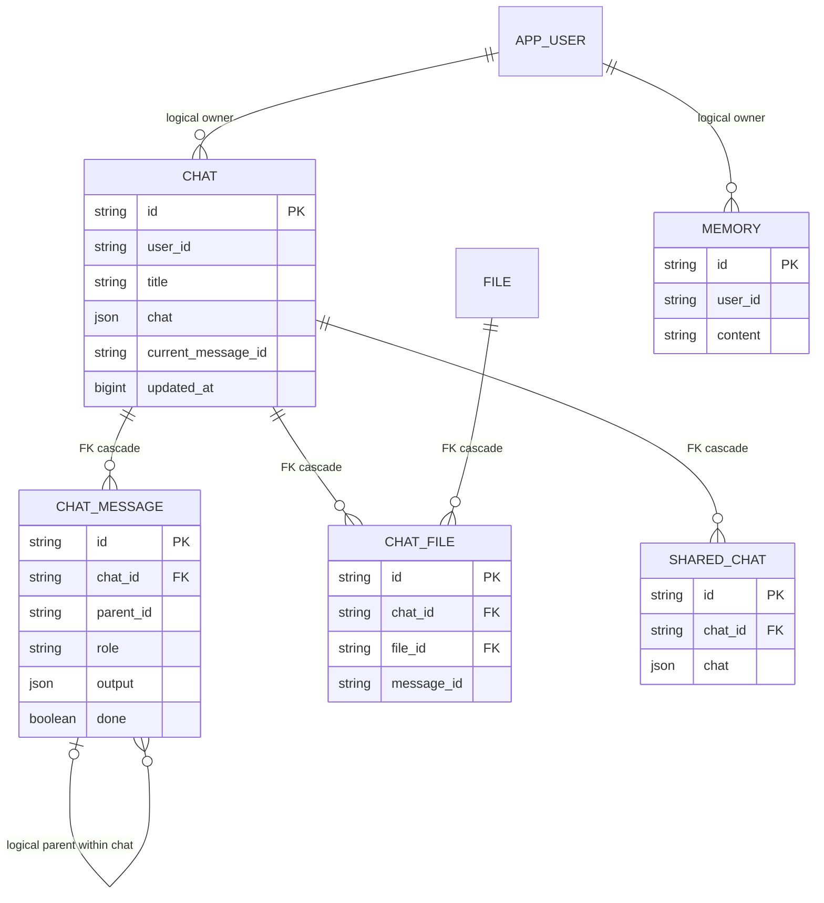
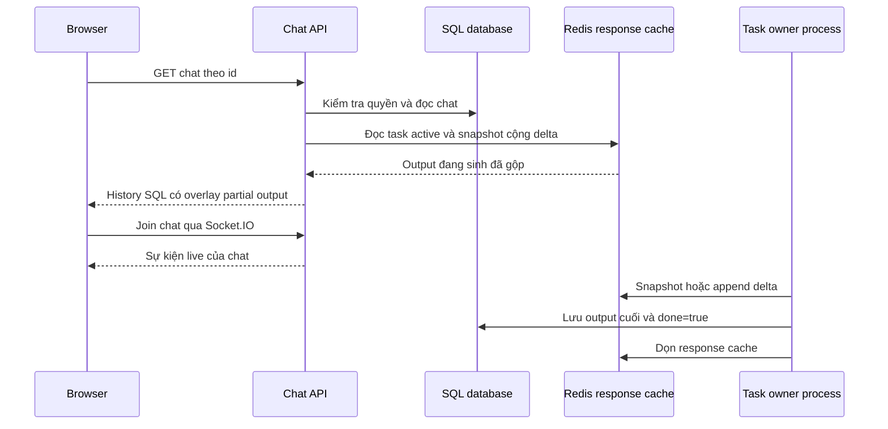

# Open WebUI — nghiên cứu thiết kế database

Ngày khảo sát: 2026-10-27. Nguồn: `/home/lamhung/code/open-webui`, commit `33c1978d5bad52a31df75ea55143025dfad18d16`.

Phạm vi: database phục vụ chat, nhánh, memory, chia sẻ, attachment và response đang stream. Đây là khảo sát source tại snapshot này, không phải kết quả benchmark hoặc kiểm tra database đang triển khai. Các liên kết trỏ tới checkout cục bộ; số dòng có thể đổi khi cập nhật source.

## 1. Kiến trúc lưu trữ

Open WebUI dùng SQLAlchemy và Alembic; mặc định SQLite tại `webui.db`, có đường kết nối PostgreSQL. Runtime database dùng async session; sync engine phục vụ startup/migration/config. PostgreSQL async dùng psycopg, SQLite async dùng aiosqlite. Xem [cấu hình mặc định](/home/lamhung/code/open-webui/backend/open_webui/env.py:271), [database engine](/home/lamhung/code/open-webui/backend/open_webui/internal/db.py:1).

| Lớp | Dữ liệu | Vai trò |
|---|---|---|
| SQL | `chat`, `chat_message` | Metadata và transcript bền vững; hiện duy trì cả JSON history và message row |
| SQL | `memory`, `file`, `chat_file`, `shared_chat`, `access_grant` | Memory, attachment, snapshot chia sẻ và quyền |
| Redis, nếu cấu hình | Response snapshot + delta, task registry/TTL, lệnh stop | Chia sẻ response đang sinh giữa các instance |
| RAM của process | `asyncio.Task`, fallback response dictionary | Nơi thực thi thật; Redis không chứa coroutine có thể khôi phục |
| Vector backend | Collection memory theo user | Tra cứu memory bằng embedding, tách khỏi nội dung SQL |

**Điểm đáng học:** không ghi mọi token vào SQL. Trong đường streaming được khảo sát, middleware giữ output dở trong response cache, rồi ghi output cuối vào transcript. Tuy vậy, thao tác ghi transcript vẫn cập nhật cả blob `chat.chat` lẫn `chat_message`; đây chưa phải kiến trúc chỉ còn message row.

Nguồn: [task và response cache](/home/lamhung/code/open-webui/backend/open_webui/tasks.py:16), [finalize output](/home/lamhung/code/open-webui/backend/open_webui/utils/middleware.py:6310), [dual write](/home/lamhung/code/open-webui/backend/open_webui/models/chats.py:1338).

## 2. Bảng và dữ liệu chính

### 2.1. `chat`: metadata và history tương thích

| Nhóm | Cột tiêu biểu | Ý nghĩa |
|---|---|---|
| Identity/ownership | `id`, `user_id` | ID chat dạng string, owner user |
| Sidebar | `title`, `archived`, `pinned`, `folder_id`, `updated_at` | Danh sách chat và tổ chức |
| History | `chat JSON`, `current_message_id` | JSON chứa `history.messages`, `history.currentId`; con trỏ message đang chọn |
| Metadata | `meta`, `variables`, `tasks`, `summary` | Thuộc tính mở rộng và dữ liệu tác vụ |
| Read/scheduling | `last_read_at`, `timer_at` | Đọc/chưa đọc và lịch timer |
| Sharing | `share_id` | Token liên quan chia sẻ; còn có bảng `shared_chat` riêng |

`created_at`, `updated_at`, `last_read_at` dùng số epoch; `timer_at` có chú thích nanosecond. Không nên suy ra toàn bộ timestamp cùng đơn vị. Các JSON ở đây là SQLAlchemy `JSON`, không được mô tả thành PostgreSQL `JSONB`. Helper `JSONField` ở tầng database lại là TEXT có codec, là một kiểu khác.

Nguồn: [Chat model](/home/lamhung/code/open-webui/backend/open_webui/models/chats.py:131), [JSONField](/home/lamhung/code/open-webui/backend/open_webui/internal/db.py:1).

### 2.2. `chat_message`: transcript từng message

| Cột | Kiểu/constraint trong ORM | Vai trò |
|---|---|---|
| `id` | Text PK | Khóa lưu dạng `chat_id-message_id`, không chỉ ID message trên wire |
| `chat_id` | Text NOT NULL, FK `chat.id`, CASCADE | Thuộc chat |
| `user_id` | Text, index | Người gắn với message; có thể khác owner khi chat được tiếp tục bởi người khác |
| `role`, `parent_id` | Role NOT NULL; parent nullable, không FK tự tham chiếu | Cây message |
| `content`, `output` | JSON | Text/block và structured output, gồm thông tin tool trong output |
| `model_id` | Text, index | Model của assistant |
| `files`, `sources`, `embeds`, `meta` | JSON | Attachment, nguồn và metadata |
| `done`, `status_history`, `error` | Boolean/JSON | Hoàn tất, tiến trình, lỗi |
| `usage`, `context_summary` | JSON/Text | Token/timing và mốc nén context |
| `created_at`, `updated_at` | BigInteger | Thời gian |

`parent_id` giữ ID message theo history, trong khi PK SQL là composite string. Vì vậy không thể vẽ nó thành FK trực tiếp tới `chat_message.id`. Tương tự, `current_message_id` là con trỏ logic, không có FK trong model. Role và done không có tập CHECK chặt trong model này; validation ứng dụng và constraint database cần được phân biệt.

Nguồn: [ChatMessage](/home/lamhung/code/open-webui/backend/open_webui/models/chat_messages.py:167), [tạo composite ID](/home/lamhung/code/open-webui/backend/open_webui/models/chat_messages.py:308).

### 2.3. Các bảng liên quan

| Bảng | Thiết kế đáng chú ý |
|---|---|
| `chat_file` | PK string; FK `chat_id` và `file_id` đều CASCADE; UNIQUE `(chat_id,file_id)`; `message_id` chỉ là liên kết logic nullable |
| `file` | Owner, filename, path, hash, data/meta JSON; row là thông tin file, không đồng nghĩa byte file nằm trong SQL |
| `shared_chat` | PK là share token; FK chat CASCADE; lưu bản sao title + chat JSON tại thời điểm share, có thao tác re-snapshot |
| `memory` | PK string, user, type, path, content Text, meta JSON, timestamps; memory dài hạn theo user |
| `access_grant` | Quyền đa hình `(resource_type,resource_id)` và `(principal_type,principal_id)`; UNIQUE toàn bộ resource/principal/permission |
| `folder`, `tag`, `feedback` | Tổ chức, nhãn và phản hồi; không phải checkpoint thực thi graph |

Nguồn: [ChatFile](/home/lamhung/code/open-webui/backend/open_webui/models/chats.py:219), [File](/home/lamhung/code/open-webui/backend/open_webui/models/files.py:18), [SharedChat](/home/lamhung/code/open-webui/backend/open_webui/models/shared_chats.py:26), [Memory](/home/lamhung/code/open-webui/backend/open_webui/models/memories.py:15), [AccessGrant](/home/lamhung/code/open-webui/backend/open_webui/models/access_grants.py:25).

### 2.4. Sơ đồ quan hệ

Các cạnh ghi `logical` là quan hệ do ứng dụng quản lý, không khẳng định có FK SQL.

## 3. Index và tính nhất quán

| Access pattern | Index/biện pháp có trong source |
|---|---|
| Sidebar owner + trạng thái | `(user_id,pinned)`, `(user_id,archived)` và các index owner/folder/update/read |
| Tìm con của message | `(chat_id,parent_id)` |
| Tìm assistant chưa xong | `(chat_id,role,done)`; dùng trong logic đọc/chưa đọc |
| Usage theo model/user và thời gian | `(model_id,created_at)`, `(user_id,created_at)` |
| Timer pending | Partial index `(user_id,timer_at)` với `timer_at IS NOT NULL`, có khai báo cả SQLite và PostgreSQL |
| Chống liên kết attachment trùng | UNIQUE `(chat_id,file_id)` |

Nguồn: [chat indexes](/home/lamhung/code/open-webui/backend/open_webui/models/chats.py:157), [message indexes](/home/lamhung/code/open-webui/backend/open_webui/models/chat_messages.py:211), [unfinished probe](/home/lamhung/code/open-webui/backend/open_webui/models/chats.py:107).

Ghi history dùng `_chat_transaction`: SQLite `BEGIN IMMEDIATE`, PostgreSQL đọc Chat với `FOR UPDATE`, rồi cập nhật blob và row trong cùng transaction. Điều này tuần tự hóa thay đổi cùng chat, tránh mất cập nhật khi nhiều writer sửa history. Đổi lại, chat có nhiều thao tác sẽ tranh cùng row lock; trên SQLite phạm vi khóa ghi rộng hơn PostgreSQL. Đây là đánh giá từ cơ chế khóa, chưa đo throughput.

`edit_message_output` cũng giữ khóa khi sửa tool state. Insert turn tạo user message và assistant placeholder `done=False`, kiểm tra parent/ID, rồi dual write. Xem [transaction](/home/lamhung/code/open-webui/backend/open_webui/models/chats.py:399), [insert turn](/home/lamhung/code/open-webui/backend/open_webui/models/chats.py:1254).

## 4. Nhánh, regenerate và fork

Cây history dùng `parentId`, `childrenIds`; `currentId` chọn lá đang xem. SQL lưu `parent_id`, chat lưu `current_message_id`. Nhiều assistant cùng parent cho phép có nhiều response; user message chỉnh sửa có thể tạo sibling. Frontend có logic giữ nhánh người đang xem khi nhận nhánh mới từ người khác.

Fork sang chat khác đi ngược từ message được chọn tới root, phát hiện cycle, deep-copy đúng đường tổ tiên, dựng lại children/currentId và tạo chat mới. Route từ chối fork khi response còn chạy. Đây là sao chép transcript nhánh; không phải native LangGraph checkpoint fork và không chứng minh tool side effect được rollback.

Nguồn: [history reducer](/home/lamhung/code/open-webui/backend/open_webui/models/chats.py:1085), [frontend giữ lựa chọn nhánh](/home/lamhung/code/open-webui/src/lib/components/chat/Chat.svelte:1376), [fork algorithm](/home/lamhung/code/open-webui/backend/open_webui/utils/chat_fork.py:4), [fork API](/home/lamhung/code/open-webui/backend/open_webui/routers/chats.py:1829).

## 5. SQL migration: thêm message row nhưng vẫn giữ blob

Migration `8452d01d26d7` tạo `chat_message` và backfill history JSON. Batch insert tối đa 5.000 message, dùng savepoint; khi batch lỗi thì thử từng row để cô lập row lỗi. Các migration tiếp theo thêm context summary, meta và index.

Runtime `get_messages_map_by_chat_id` ưu tiên bảng message. Nếu không có row, nó đọc history cũ rồi backfill; nếu thiếu parent thì ghép phần thiếu từ JSON và backfill. Các writer vẫn ghi cả hai dạng. Vì thế nhận định chính xác là **chuẩn hóa thêm một lớp truy vấn và duy trì tương thích**, không phải đã loại bỏ blob.

Nguồn: [migration](/home/lamhung/code/open-webui/backend/open_webui/migrations/versions/8452d01d26d7_add_chat_message_table.py:24), [read fallback và self-heal](/home/lamhung/code/open-webui/backend/open_webui/models/chats.py:1147).

## 6. Response đang stream và reload

### 6.1. Dạng dữ liệu cache

Redis key `${REDIS_KEY_PREFIX}:tasks:response_streams:${task_id}` là **string**, không phải Redis Stream/XADD. Nội dung là một dòng snapshot JSON `{chat_id,message_id,output}`, tiếp theo là các dòng delta JSON. Lua chỉ APPEND nếu độ dài hiện tại bằng độ dài writer chờ đợi; append có refresh TTL. Khi delta làm buffer vượt khoảng hai lần snapshot hoặc gặp dạng output không phù hợp, middleware ghi snapshot mới.

Không Redis thì dùng dictionary trong process. Mặc định response TTL là 3.600 giây, task TTL 300 giây; heartbeat task chạy theo task TTL. Lookup response còn phụ thuộc task đang active trong registry, nên TTL response không phải lời hứa có thể xem lại partial trong đủ một giờ.

Nguồn: [save/append/load](/home/lamhung/code/open-webui/backend/open_webui/tasks.py:204), [task liveness](/home/lamhung/code/open-webui/backend/open_webui/tasks.py:73), [TTL config](/home/lamhung/code/open-webui/backend/open_webui/env.py:386), [snapshot compaction](/home/lamhung/code/open-webui/backend/open_webui/utils/middleware.py:4540).

### 6.2. Luồng tải lại

Sơ đồ trên thể hiện trách nhiệm tổng quát, không quy định mọi lần reload luôn GET trước join. Frontend còn có đường **join rồi refresh chat**, chụp baseline để tránh refresh đè một số cập nhật local khi đang sinh.

API chat đọc SQL và gọi `overlay_response_streams` để thay content/output của message đang chạy, đặt `done=False`. Frontend join phòng chat và nhận `chat:completion`/response event. Đây là giải pháp snapshot từ cache + sự kiện live. Không thấy contract cursor/watermark nguyên tử nối snapshot với tail trong các đường này; không nên gọi nó là bảo đảm không mất/trùng event theo seq như thiết kế SSE của mình.

Nguồn: [overlay](/home/lamhung/code/open-webui/backend/open_webui/routers/chats.py:73), [chat GET](/home/lamhung/code/open-webui/backend/open_webui/routers/chats.py:1430), [join/refresh/baseline](/home/lamhung/code/open-webui/src/lib/components/chat/Chat.svelte:1423), [finalize và cancel](/home/lamhung/code/open-webui/backend/open_webui/utils/middleware.py:6310).

### 6.3. Giới hạn khi nhiều pod

- Redis giúp instance khác đọc partial output; Socket.IO có Redis manager để phân phối live event khi được cấu hình.
- Thực thi vẫn là `asyncio.create_task` trong RAM của pod sở hữu. Task registry và heartbeat không biến nó thành durable queue.
- Stop gửi Redis pub/sub command, process đang giữ task nhận rồi cancel. Pub/sub không phải durable cancel intent có ACK thực thi.
- Pod chết khác browser reload: coroutine mất, có thể còn output cache trong một khoảng thời gian; không có bằng chứng từ các đường đã đọc về tự dựng lại coroutine từ checkpoint.
- Redis mất/TTL hết có thể mất phần partial chưa finalize. SQL không được cập nhật mọi token trong đường stream này.

Nguồn: [create task](/home/lamhung/code/open-webui/backend/open_webui/tasks.py:162), [distributed stop listener](/home/lamhung/code/open-webui/backend/open_webui/tasks.py:32), [socket Redis manager](/home/lamhung/code/open-webui/backend/open_webui/socket/main.py:117).

## 7. Memory, quyền và xóa dữ liệu

Memory content ở SQL; vector index dùng collection `user-memory-{user.id}`. API tạo SQL memory rồi cập nhật vector. Hai hệ lưu trữ không nằm trong một SQL transaction; source có helper upsert hoặc reindex để xử lý phần vector. Cần phân biệt memory dài hạn theo user với `context_summary` của message và state thực thi đang chạy.

Nguồn: [memory model](/home/lamhung/code/open-webui/backend/open_webui/models/memories.py:15), [memory vector write](/home/lamhung/code/open-webui/backend/open_webui/routers/memories.py:151).

Owner là `chat.user_id`, nhưng quyền đọc/ghi còn qua shared chat/folder/access grants; không thể chỉ nhìn message.user_id để quyết định quyền chat. `access_grant` dùng resource/principal đa hình nên constraint unique chống trùng grant, không bảo đảm FK tới mọi loại resource.

Xóa chat có code xóa `ChatMessage` tường minh, tháo liên kết automation, xóa Chat rồi xử lý shared chat. Archive là cờ riêng. FK CASCADE trong schema không có nghĩa toàn bộ cleanup file/vector/task được thực hiện nguyên tử trong một transaction. Xem [access check và ownership](/home/lamhung/code/open-webui/backend/open_webui/models/chats.py:1929), [delete](/home/lamhung/code/open-webui/backend/open_webui/models/chats.py:2744).

## 8. Áp dụng cho hệ thống đang thiết kế

Các mục dưới là đề xuất, không mô tả code Open WebUI:

1. Học cách tách SQL transcript khỏi cache partial; giữ `message_id` ổn định giữa placeholder, cache và output cuối.
2. Có parent message và con trỏ nhánh đang chọn ngay từ đầu. Với LangGraph, phải bổ sung mapping nhánh sang checkpoint/thread thực thi; cây UI chưa đủ.
3. Học các index theo truy vấn thật: owner/sidebar, parent lookup, assistant chưa hoàn tất và usage theo thời gian.
4. Tránh dual write toàn bộ blob history cho mỗi lần cập nhật transcript trong schema mới, trừ khi có lý do tương thích rõ ràng. Đây là đánh đổi về ghi/khóa, không phải kết luận benchmark.
5. Giữ thiết kế đã thống nhất: custom backend, `LangGraphAgent` emit AG-UI; PostgresSaver/Store lo state/memory native; database ứng dụng lo owner, conversation, branch, run và transcript.
6. Dùng SSE connect snapshot + watermark + tail của mình. Không cần đổi sang Socket.IO để học cơ chế overlay partial.
7. Durable queue, fencing, cancel intent và recovery phải có thiết kế riêng; không sao chép `asyncio.Task` + Redis registry rồi coi là phục hồi worker.

## 9. Giới hạn khảo sát

Đã đọc ORM, migration thêm message, writer/reader transcript, response cache, reload frontend, fork và memory API. Chưa chạy migration, EXPLAIN, benchmark, kill-pod hoặc thử race reload. Không khẳng định mọi provider/plugin đi qua cùng một nhánh middleware. Tài liệu này không liệt kê toàn bộ bảng quản trị/RAG của sản phẩm.
