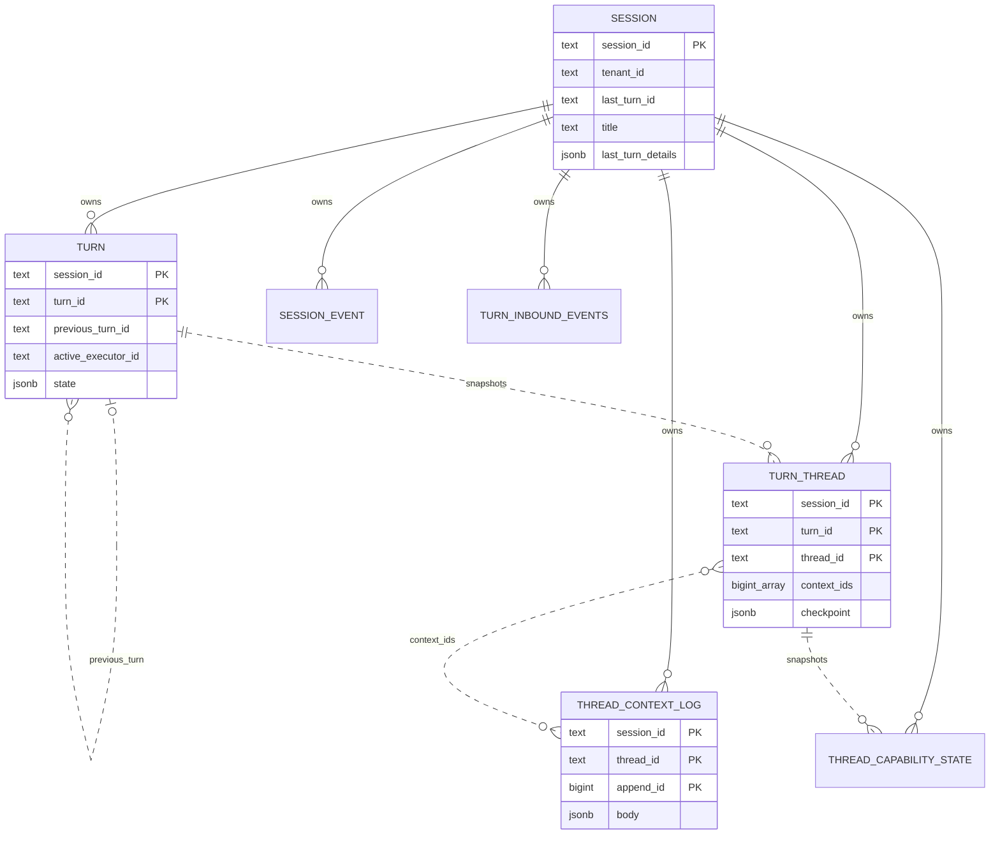
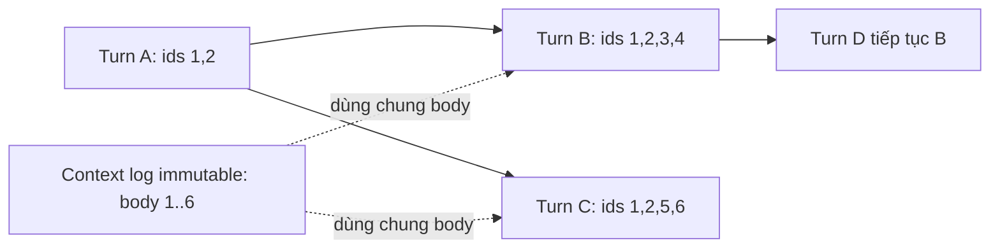
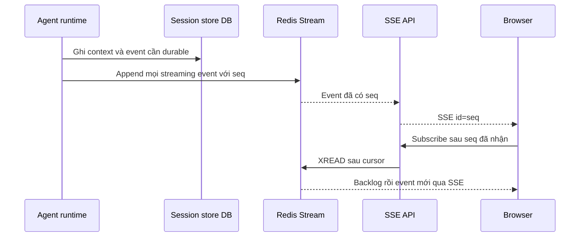

# TrueForge — nghiên cứu thiết kế database

Ngày khảo sát: 27/10/2026. Source: `/home/lamhung/code/trueforge`, commit `f5427d9116f1ade2c7ec2dc0172e66894a406204`.

Phạm vi: schema ứng dụng và đường ghi/đọc phục vụ agent chat. Đây là nghiên cứu source tại commit trên; chưa chạy database, benchmark hoặc kiểm thử khôi phục sự cố. Quan hệ logic trong sơ đồ không đồng nghĩa có foreign key.

## 1. Kết luận chính

TrueForge tách **session**, **turn**, **trạng thái từng agent thread**, **context nội bộ** và **event cho client**. Streaming token dùng kho tạm Redis; nội dung đã hoàn thiện và state dùng database. Một turn có thể kế thừa từ turn cũ để rẽ nhánh mà không sao chép lại toàn bộ body message.

Điểm cần tránh hiểu sai: migration khởi tạo PostgreSQL dùng composite key chứa `tenant_id`, nhưng migration tiếp theo đã đổi thiết kế. Schema hiện tại dùng `session_id` toàn cục; bảng con tham chiếu session bằng cascade FK. Không thể kết luận “TrueForge không có FK” hoặc “mọi PK bắt đầu bằng tenant_id” từ migration đầu tiên. [Migration đổi khóa](/home/lamhung/code/trueforge/packages/trueforge/src/db/postgres/migrations/20260803_000002_session_scoped_keys.ts:3).

## 2. Các lớp lưu trữ

| Lớp | Dữ liệu | Vai trò |
|---|---|---|
| PostgreSQL + Kysely | Session, turn, context, capability, event, cấu hình | Persistence cho deployment hosted |
| SQLite + better-sqlite3 + Kysely | Cùng contract persistence, layout khác một số chỗ | Persistence standalone |
| Redis Streams | Event đang phát, bao gồm model delta, có TTL | Replay và nối tiếp stream giữa các request/pod |
| RAM tiến trình | ActiveTurnRegistry, AbortController, đối tượng runtime, sequence counter của producer | Thực thi đang sống; không phải persistence sau crash |

Các adapter được lắp riêng trong [main.ts — SQLite](/home/lamhung/code/trueforge/packages/trueforge/src/main.ts:439) và [PostgreSQL](/home/lamhung/code/trueforge/packages/trueforge/src/main.ts:582). `ISessionStore` chỉ quản lý persistence, chủ ý không chứa SSE hoặc streaming transport. [Contract](/home/lamhung/code/trueforge/packages/trueforge-core/src/agent-session/store/ISessionStore.ts:264).

PostgreSQL dùng schema cấu hình qua `search_path`, pooled connection, statement timeout và idle-in-transaction timeout. Không có một connection giữ suốt một turn trong đoạn wiring này. [Client](/home/lamhung/code/trueforge/packages/trueforge/src/db/postgres/client.ts:38).

## 3. Từ vựng và schema chat hiện tại

- **Session**: một cuộc hội thoại trong sản phẩm.
- **Turn**: một lần nhập input và thực thi agent, có state riêng.
- **Thread**: luồng context của root agent hoặc sub-agent bên trong session. Không đồng nhất với một cuộc hội thoại ở sidebar.
- **Context log**: message agent dùng để gọi model, gồm nội dung và tool context.
- **Session event**: sự kiện được lưu để dựng lịch sử hiển thị cho client; không phải mọi delta đã stream.

Schema runtime được mô tả trong [types.ts](/home/lamhung/code/trueforge/packages/trueforge/src/db/postgres/types.ts:59). Dưới đây là khóa sau các migration, không phải khóa trong bản DDL đầu tiên:

| Bảng | Primary key hiện tại | Các cột quan trọng |
|---|---|---|
| `session` | `session_id` | `tenant_id`, `created_by_subject`, `agent_id`/`agent_spec`, `title`, `shared`, `last_turn_id`, `last_turn_details`, `metadata`, `metrics`, `custom`, timestamps |
| `turn` | `(session_id, turn_id)` | `first_turn_id`, `previous_turn_id`, `ancestor_ids text[]`, `active_executor_id`, `input jsonb`, `state jsonb`, `checkpoint jsonb`, `custom` |
| `turn_thread` | `(session_id, turn_id, thread_id)` | `context_ids bigint[]`, `agent_info`, `checkpoint`, `current_context_usage` |
| `thread_context_log` | `(session_id, thread_id, append_id)` | `append_id bigint identity`, `turn_id` ghi nguồn, `body jsonb`, `created_at` |
| `session_event` | `(session_id, turn_id, event_id)` | `event_id` monotonic ULID, `event jsonb`, `created_at` |
| `thread_capability_state` | `(session_id, turn_id, thread_id, key)` | `state jsonb`, `updated_at` |
| `turn_inbound_events` | `(session_id, turn_id, event_id)` | `payload jsonb`, `consumed boolean`, `created_at` |

[DDL nền](/home/lamhung/code/trueforge/packages/trueforge/src/db/postgres/migrations/20260728_000001_session_store.ts:20), [đổi khóa và FK](/home/lamhung/code/trueforge/packages/trueforge/src/db/postgres/migrations/20260803_000002_session_scoped_keys.ts:3), [inbox](/home/lamhung/code/trueforge/packages/trueforge/src/db/postgres/migrations/20260924_000001_turn_inbound_events.ts:7).

Đường liền từ session biểu diễn FK thật. Các liên kết giữa turn, turn_thread, context và parent turn là quan hệ logic; migration đổi khóa chỉ thêm FK `session_id`, không thêm toàn bộ composite FK cho mỗi liên kết.

### Isolation theo tenant và quyền sở hữu

`tenant_id` nằm ở session; nhiều query bảng con chỉ nhận `session_id`. API trước tiên tải session theo tenant và kiểm tra quyền, sau đó mới truy cập turn/stream. Vì vậy không được bê query nội bộ ra thành endpoint công khai mà bỏ bước xác minh session. [Subscribe authorization](/home/lamhung/code/trueforge/packages/trueforge/src/apis/turns.ts:903).

`created_by_subject` là JSON có danh tính người tạo, không phải FK sang bảng user nội bộ của session-store. `shared` mở đọc trong tenant theo model sản phẩm. Không suy ra các cột này tự thực thi authorization ở database.

## 4. Cây turn và snapshot context

Turn mới chỉ ra `previous_turn_id`; đây có thể là turn cuối để tiếp tục hoặc một turn cũ để rẽ nhánh. Store sao chép danh sách `context_ids` và capability state từ parent; body context cũ vẫn dùng chung trong log. `ancestor_ids` là cửa sổ ancestor đã lưu, không nhất thiết toàn bộ lịch sử; reader có thể đi tiếp qua cửa sổ ancestor cũ. [createTurn](/home/lamhung/code/trueforge/packages/trueforge/src/db/postgres/session-store/queries/turns.ts:425), [đọc ancestor chain](/home/lamhung/code/trueforge/packages/trueforge/src/db/postgres/session-store/queries/events.ts:174).

Đây là sơ đồ minh họa, không phải dữ liệu thật. `append_id` chỉ là danh tính log row; **thứ tự context do mảng `context_ids` quyết định**. Reader dùng `unnest WITH ORDINALITY`; không được sort log theo sequence toàn database để suy ra lịch sử hội thoại. [DDL và quy tắc order](/home/lamhung/code/trueforge/packages/trueforge/src/db/postgres/migrations/20260728_000001_session_store.ts:177).

Khi compaction thay context, store thay mảng tham chiếu; log cũ giữ nguyên vì turn ancestor vẫn tham chiếu. `thread_capability_state` cũng là snapshot **theo turn**, thay vì một map latest-wins chung toàn session. Nếu chỉ giữ state mới nhất, fork từ quá khứ sẽ đọc nhầm state hiện tại. [Overwrite](/home/lamhung/code/trueforge/packages/trueforge/src/db/postgres/session-store/queries/threads.ts:309), [capability snapshot](/home/lamhung/code/trueforge/packages/trueforge/src/db/postgres/types.ts:338).

Không có bảng `message` đơn giản một row cho mỗi bubble trong schema này. Không có bảng `tool_invocation` riêng trong bộ session-store: tool response và model/context được ghi vào event/context theo contract. Không có bảng long-term memory tổng quát tương đương LangGraph Store trong danh sách app tables đã khảo sát; capability snapshot không tự trở thành memory xuyên conversation. [Danh sách bảng runtime](/home/lamhung/code/trueforge/packages/trueforge/src/db/postgres/types.ts:609).

## 5. Transaction và chống ghi sau khi turn kết thúc

`createTurn()` chạy transaction READ COMMITTED:

1. `SELECT session ... FOR UPDATE` khóa tip của session.
2. Cập nhật `last_turn_id`, summary, activity, metrics và title nếu chưa có.
3. Đọc parent và các snapshot của parent; parent chưa terminal bị từ chối.
4. Insert turn, context mới, snapshot thread và carry-forward capability state.
5. Commit toàn bộ; lỗi làm rollback cả tip bump.

Hai statement khóa rồi cập nhật được chọn có chủ ý; source ghi nhận rủi ro stale tip khi gộp vào một statement CTE. Parent không tồn tại được xử lý khá lỏng: không inheritance. Đây là semantics cần cân nhắc nếu API của mình muốn từ chối mọi parent không hợp lệ. [Transaction](/home/lamhung/code/trueforge/packages/trueforge/src/db/postgres/session-store/queries/turns.ts:431).

Ghi context khi đang chạy dùng fence đọc `turn.state->>'status' = 'running'` với `FOR SHARE`, sau đó INSERT log + UPDATE mảng context trong một statement CTE. Khi terminal state đã commit, predicate không còn khớp, ghi trả zero rows và được phân loại thành lỗi. [Fence](/home/lamhung/code/trueforge/packages/trueforge/src/db/postgres/session-store/queries/turns.ts:187), [append atomic](/home/lamhung/code/trueforge/packages/trueforge/src/db/postgres/session-store/queries/threads.ts:289).

Giới hạn: fence theo trạng thái không đồng nghĩa với distributed execution lease hoặc generation fencing chống hai worker cùng chạy một turn. Redis producer cũng giả định một writer. `active_executor_id` ghi nhận replica sở hữu runtime; không nên chỉ nhìn cột đó để suy ra một hệ thống queue/recovery đầy đủ.

## 6. Streaming, reload và durability

`TurnHandle` chỉ lưu event bền vững có chọn lọc. `MODEL_MESSAGE` và `MODEL_MESSAGE_DELTA` được cho đi trực tiếp; nội dung model bền vững đi qua `AGENT_CONTEXT_APPEND.output`. Tool response được append vào event log. Context message nội bộ đi vào context log. [Switch ghi event](/home/lamhung/code/trueforge/packages/trueforge-core/src/agent-session/TurnHandle.ts:408).

Sơ đồ chỉ biểu diễn nhánh event cần durable; delta text không có bước ghi DB đầu tiên. Drain ghi resumable stream trước khi gửi client, và HTTP response không sở hữu vòng đời execution. [drainTurnEvents](/home/lamhung/code/trueforge/packages/trueforge/src/apis/turns.ts:380).

Redis key scoped theo tenant/session/turn. Producer có counter RAM từ 1, dùng Redis stream ID dạng `seq-1`, `XADD` cùng TTL trong transaction Redis. Subscriber dùng `XREAD` sau seq; mỗi lần đọc tối đa 100 item, poll nghỉ 1 giây khi chưa có event. Redis data có TTL; producer counter không được recover từ Redis khi process chết. [Redis implementation](/home/lamhung/code/trueforge/packages/trueforge/src/runtime/event-subscription/redis.ts:26).

TTL được arm ở `turn.created`, rút xuống drain window ở `turn.done`; event giữa turn không tự gia hạn TTL. Subscribe trả HTTP 412 nếu key mất hoặc quá gần hết hạn. [TTL policy](/home/lamhung/code/trueforge/packages/trueforge/src/apis/turns.ts:361), [admission](/home/lamhung/code/trueforge/packages/trueforge/src/apis/turns.ts:931).

| Tình huống | Khả năng từ cơ chế đã đọc |
|---|---|
| Browser disconnect, runtime còn chạy, Redis còn key | Đọc lại event từ seq và nối tiếp |
| Browser reload không còn partial text local | Có thể replay từ đầu stream; không thấy atomic accumulated snapshot+watermark được cung cấp bởi Redis subscription này |
| Redis hết TTL/mất key | Không còn delta replay; phải dùng lịch sử durable cho phần đã ghi |
| Pod runtime chết giữa câu | RAM execution mất; không có bằng chứng token generation tự tiếp tục đúng vị trí chỉ nhờ Redis |
| Pod API khác nhận subscribe | Đọc cùng Redis được; không cần có agent runtime trong pod subscriber |
| Standalone không Redis | Registry dùng stream RAM chung process; restart mất stream |

Vì vậy “replay stream” khác “snapshot toàn bộ câu đang dở + tail”. Để thực hiện contract mình đã chốt, cần thêm accumulated projection và watermark nhất quán; không nên gọi nguyên endpoint subscribe này là đã có đủ contract đó. [Registry fallback](/home/lamhung/code/trueforge/packages/trueforge/src/runtime/event-subscription/index.ts:43).

## 7. Index, constraint và chi phí ghi

| Cơ chế | Access path / ý nghĩa |
|---|---|
| `session_list_idx(tenant_id, created_at, session_id)` | Lọc khoảng thời gian tạo |
| `session_list_updated_at_idx(tenant_id, updated_at, session_id)` | Sidebar theo cập nhật, cursor ổn định có tie-break |
| `GIN(metadata jsonb_path_ops)` | Lọc `metadata @> ...` |
| Partial unique `(tenant_id, external_id)` khi external ID khác NULL | Chống trùng integration key |
| `turn_list_idx(session_id, created_at, turn_id)` | Liệt kê turn trong session |
| PK session_event theo session/turn/event | Đọc event theo turn và ULID |
| Partial index inbox `WHERE consumed = false` | Poll inbound event chưa xử lý |
| CHECK XOR `agent_id` với `agent_spec` | Session dùng registry agent hoặc inline spec |
| FK bảng con → session, `ON DELETE CASCADE` | Xóa dữ liệu con khi hard delete session |

[Index sidebar](/home/lamhung/code/trueforge/packages/trueforge/src/db/postgres/migrations/20260814_000001_session_list_updated_at_idx.ts:3), [GIN](/home/lamhung/code/trueforge/packages/trueforge/src/db/postgres/migrations/20260904_000003_session_metadata_gin.ts:4), [XOR](/home/lamhung/code/trueforge/packages/trueforge/src/db/postgres/migrations/20260810_000001_agent.ts:29).

Session list dùng keyset cursor `(updated_at, session_id)`; timestamp cursor giữ microsecond qua SQL string thay vì cắt xuống millisecond của JS Date. [Query](/home/lamhung/code/trueforge/packages/trueforge/src/db/postgres/session-store/queries/sessions.ts:260).

Migration nền tách cột theo độ nóng: JSON lớn ít thay đổi ở cột riêng, `checkpoint` do store quản lý, `custom` do caller quản lý. `turn_thread` fillfactor 70; session/turn/capability 85; log insert-only dùng mặc định 100. Mảng context vẫn bị rewrite khi nối thêm; source chấp nhận chi phí này và ghi rõ đó là tradeoff. [Write heat](/home/lamhung/code/trueforge/packages/trueforge/src/db/postgres/migrations/20260728_000001_session_store.ts:3).

Lưu ý: comment “HOT-friendly” không bảo đảm mọi UPDATE là HOT. Schema về sau thêm index `updated_at` trên session; mỗi lần tip bump cập nhật `updated_at` sẽ tác động index. Cần đánh giá layout sau tất cả migration, không chỉ comment trong DDL ban đầu.

`last_turn_details` là summary JSONB nhỏ trên session, giúp hiển thị sidebar mà không join toàn bộ turn; migration có backfill từ `last_turn_id`. Đây là denormalization có chủ đích. [Migration summary](/home/lamhung/code/trueforge/packages/trueforge/src/db/postgres/migrations/20261018_000001_session_last_turn_details.ts:3).

## 8. SQLite khác PostgreSQL thế nào

SQLite vẫn cùng domain contract nhưng không sao chép layout PostgreSQL nguyên xi:

- Bảng `STRICT`; JSON dùng BLOB SQLite JSONB, timestamps ISO-8601 TEXT.
- PostgreSQL có `context_ids bigint[]`; SQLite dùng `turn_thread_context(session_id, turn_id, thread_id, pos, append_id)`.
- Thứ tự context SQLite là `pos`; có index lookup theo session/thread/append ID.
- SQLite `thread_context_log.append_id` là integer primary key autoincrement toàn bảng; PostgreSQL dùng identity và composite PK.
- Driver ánh xạ transaction `read write` thành `BEGIN IMMEDIATE` để giữ write lock sớm.

[SQLite DDL](/home/lamhung/code/trueforge/packages/trueforge/src/db/sqlite/migrations/20260730_000002_session_store.ts:3), [bảng context order](/home/lamhung/code/trueforge/packages/trueforge/src/db/sqlite/migrations/20260730_000002_session_store.ts:66), [driver transaction](/home/lamhung/code/trueforge/packages/trueforge/src/db/sqlite/client.ts:19).

Đây là bài học về port persistence: giữ semantics chung ở interface và contract test, nhưng cho phép data structure phù hợp từng database. Không lấy file SQLite làm shared database cho nhiều backend pod.

## 9. Cấu hình và dữ liệu hỗ trợ ngoài chat

Runtime schema còn có `agent`, `model_provider`, `web_search_provider`, `skill`, `mcp_server`, `oauth_token`, `oauth_pending_authorization`, `sandbox_provider`, `sandbox_environment`, version/secret của environment, `schedule` và `schedule_run`. Nhiều cấu hình dùng identity cột riêng + manifest JSONB thay toàn document. Agent có ID bất biến và uniqueness tên trong tenant. Schedule run ghi lịch sử lần kích hoạt; không đồng nhất với durable queue thực thi mọi chat turn. [Các table types](/home/lamhung/code/trueforge/packages/trueforge/src/db/postgres/types.ts:382), [registry đầy đủ](/home/lamhung/code/trueforge/packages/trueforge/src/db/postgres/types.ts:609).

Xóa session là hard delete scoped tenant rồi để cascade dọn bảng con; không có tombstone trong query xóa này. Chính sách retention/audit của hệ thống mình có thể khác. [deleteSession](/home/lamhung/code/trueforge/packages/trueforge/src/db/postgres/session-store/queries/sessions.ts:146).

Title ban đầu được lấy từ user input, không phải một LLM title job trong đường create-turn đã đọc. Store dùng `COALESCE(title, ...)` để không ghi đè title đã có. [Title derivation](/home/lamhung/code/trueforge/packages/trueforge/src/apis/turns.ts:466), [conditional write](/home/lamhung/code/trueforge/packages/trueforge/src/db/postgres/session-store/queries/turns.ts:455).

## 10. Điều nên học cho hệ thống của mình

Đây là đề xuất sau khảo sát, chưa phải schema đã chốt:

1. Tách conversation metadata, run/turn, transcript, live stream và native LangGraph checkpoint. Không biến một bảng JSONB thành tất cả các vai trò.
2. Thiết kế nhánh cùng snapshot state ngay từ đầu. Cần xác định parent/fork point và state tại thời điểm fork; chỉ copy bubble text là thiếu.
3. Giữ transcript cho UI tách context dùng model. Compaction context không được làm mất lịch sử người dùng.
4. Dùng index theo query thật: sidebar keyset, external ID unique, inbox pending partial index, metadata GIN nếu có containment query.
5. Mỗi run cần ownership/generation rõ ràng. Không coi “status running” hoặc “executor_id” là đủ thay thế fencing của worker.
6. Shared Redis hỗ trợ subscriber nhiều pod, nhưng cần projection+watermark để đáp ứng snapshot đang dở rồi tail. Phải chỉ rõ mất Redis sẽ mất gì.
7. Bảo vệ tenant/owner trước query nội bộ chỉ có session ID. Tách cấu hình agent khỏi ownership conversation.
8. Giữ interface persistence chung; kiểm tra semantics trên mỗi adapter. Không ép PostgreSQL và SQLite dùng cùng cấu trúc vật lý.

Với quyết định hiện tại, mình vẫn dùng FastAPI custom, LangGraph OSS và `LangGraphAgent` emit AG-UI. Các pattern TrueForge là tài liệu tham khảo; không thay thế native Saver/Store hoặc thêm CopilotKit vào hệ thống.
